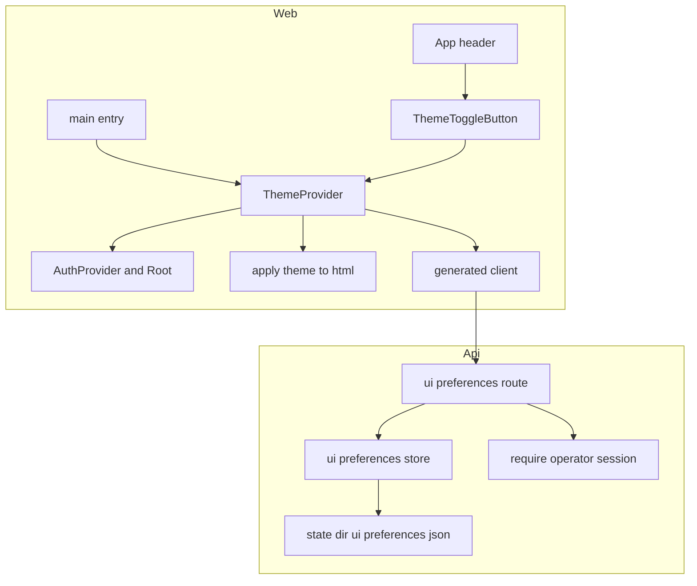
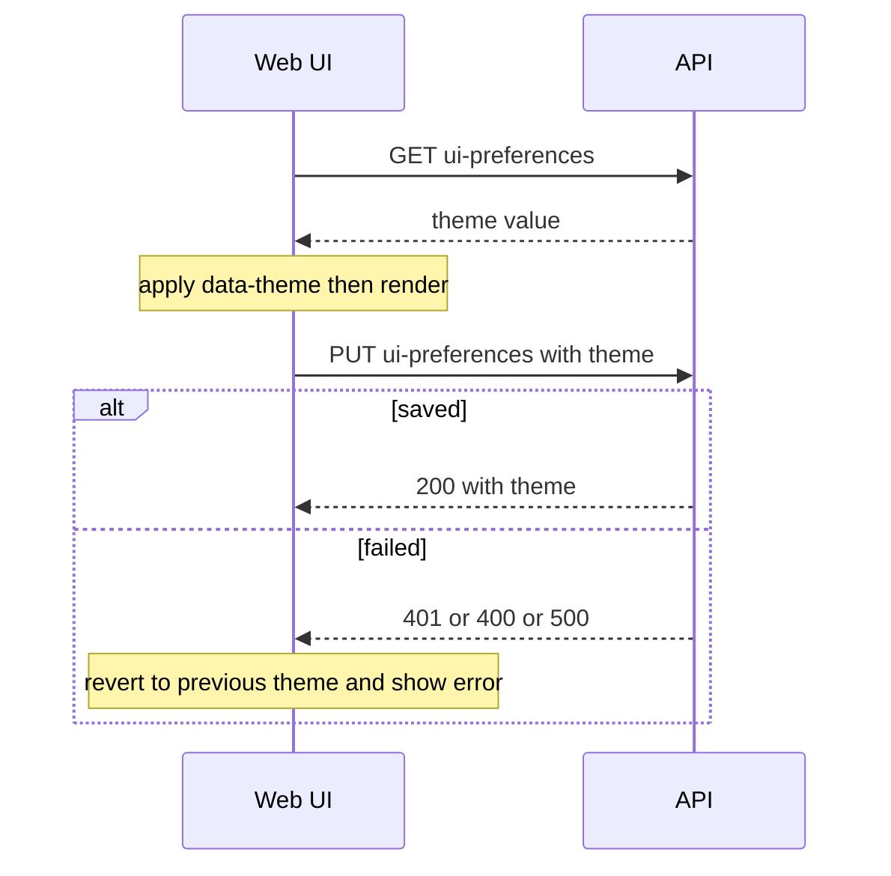

# Design Document

## Overview
**Purpose**: Web UI（管理画面）にダークモードを実装する。配色は「OS 規定」「ライト」「ダーク」から選べ、選択は api（サーバ側）に保存して、どのブラウザでも同じ表示にする。

**Users**: 管理者は、ダッシュボードの切り替えボタンでテーマを変える。未ログインの利用者は、初期設定・ログイン画面で保存済みのテーマを見る。

**Impact**: api に表示設定の保存と `GET/PUT /v1/ui-preferences` を追加する。web は色を CSS 変数に一本化し、取得完了まで描画しない仕組みを `main.tsx` の Provider 順に加える。

### Goals
- 既定は OS の配色に従い、ボタンで「OS 規定 → ライト → ダーク」を循環できる（要件 1）。
- 選択を api に保存し、未ログインでも保存済みのテーマを読める（要件 2・3）。
- 取得完了まで描画せず、白いちらつきを出さない（要件 4）。
- 両テーマで本文のコントラスト比 4.5:1 以上を保つ（要件 5）。
- 画面確認（Playwright）で、3通りのテーマと取得の挙動を実ブラウザで確かめる（利用者の指示）。

### Non-Goals
- ゲートウェイの運用設定（`UserSettings`）へのテーマの追加。
- ブラウザ（localStorage）への保存とキャッシュ。
- 初期設定・ログイン画面での切り替えボタン（要件 1.5 は全画面ではなく、ログイン後の全画面を対象とする）。
- 配色の全面的なデザイン刷新。既存の色の意味は保つ。
- Service Worker の変更。

## Boundary Commitments

### This Spec Owns
- 表示設定の保存（`$STATE_DIR/ui-preferences.json`）と、その読み書きの規則（未保存は `system`、破損時も `system`）。
- `GET/PUT /v1/ui-preferences` の契約と、その認可の区分（GET は公開、PUT は管理者のみ）。
- Web のテーマの解決・適用（`data-theme`・`theme-color`）・取得と保存・切り替えボタン。
- `web/src/styles.css` の色の変数（トークン）と、ダーク用の値。
- 画面確認（`web/tests/screens/`）の内容。

### Out of Boundary
- `UserSettings` とその保存・プロキシへの通知（`settings-store.ts`・`notifySettings`）。
- 認証の仕組み（`AuthContext`・セッション・ログイン処理）。本 spec は `AuthContext` を変更しない。
- Service Worker（`web/public/sw.js`）と `index.html` の構造（テーマのための変更はない）。
- proxy・インストーラ・`e2e/hosted`（既存の E2E スイート）。

### Allowed Dependencies
- api: `stateDir()`（`providers/provider-state-paths.ts`）、`requireOperatorSession`（既存の認可の仕組み。公開ルートの登録だけを足す）、`ErrorResponseSchema`、`UnauthenticatedError`。
- web: 生成クライアント（`generated/api/default/default.ts`）のみで API を呼ぶ。`ToastProvider`（通知）と `describeApiError`（エラー文言）。
- web の依存方向: `theme-preference`（純粋な関数）← `apply-theme` ← `ThemeContext` ← `ThemeToggleButton`・`App`・`main`。

### Revalidation Triggers
- `GET/PUT /v1/ui-preferences` の形（`theme` の値の集合）または認可の区分の変更（`UNAUTHENTICATED_ROUTES` を含む）。
- CSS 変数（トークン）の名前の変更。`data-theme` の値（`light`・`dark`）の変更。
- `ToastProvider` の通知関数の変更。
- Provider の順序（`main.tsx`）の変更（取得完了まで描画する前提が崩れる）。

## Architecture

### Existing Architecture Analysis
- api は Fastify 5 と TypeBox。ルートは `routes/<機能>.ts` の `register…Route` プラグイン。`app.ts` で登録し、`/v1/*` は `requireOperatorSession` の preHandler で認可する。
- 状態ファイルは `stateDir()` 配下の単一 JSON（read-modify-write、排他なし）。
- web は React 18 と Vite 5。`main.tsx` で `ToastProvider` > `AuthProvider` > `Root` を組み、`Root` は認証状態の取得中に `null` を返す（取得完了まで描画しない既存の作法）。
- API 呼び出しは `orval` の生成クライアントに限る（`web/src/generated/` は生成物で、Git には含めない）。

### Architecture Pattern & Boundary Map



**Architecture Integration**:
- 選択パターン: 既存の「ルート・ストア・スキーマ」の分割を api に、「純粋な関数・Context・表示部品」の分割を web に当てはめる。
- ドメインの分離: 表示設定はゲートウェイ設定（`UserSettings`）と別のストアにする。
- 既存パターンの維持: `register…Route`、TypeBox のスキーマ、`ErrorResponseSchema`、`ToastProvider`、`Root` の取得中の `null`。
- 新規の要素の理由: `ui-preferences` ストアは保存先を分けるため。`theme-preference` は判定を DOM から切り離してテストするため。
- ステアリング準拠: 本体コードに分岐を増やさない。新規ファイルは先頭に `// 責務: …` を書き、コメントと識別子は日本語。

### Technology Stack

| Layer | Choice / Version | Role in Feature | Notes |
|-------|------------------|-----------------|-------|
| Frontend | React 18.3・Vite 5（既存） | テーマの Context・切り替えボタン・取得の待ち合わせ | 新規の依存なし |
| Frontend 画面確認 | `@playwright/test` 1.63.0（ルートの devDependency、既存） | 画面の確認（3テーマ・取得の空白・差し戻し） | `web` のスクリプトから実行 |
| Backend | Fastify 5・TypeBox 0.33（既存） | `GET/PUT /v1/ui-preferences` | 新規の依存なし |
| Data | 状態ディレクトリ内の JSON（既存の作法） | テーマの値の保存 | `ui-preferences.json` |
| Runtime | Node.js 22（既存） | api・web の実行 | 変更なし |

## File Structure Plan

### Directory Structure
```
api/src/
├── schemas/
│   └── ui-preferences.ts          # テーマの値と GET/PUT のスキーマ（新規）
├── ui-preferences/
│   ├── ui-preferences-store.ts    # 表示設定の読み書き。未保存・破損は system（新規）
│   └── ui-preferences-store.test.ts  # 規則の単体テスト（新規）
└── routes/
    ├── ui-preferences.ts          # GET（公開）・PUT（管理者）（新規）
    └── ui-preferences.test.ts     # 認可・検証・保存の統合テスト（新規）

web/src/
├── theme/
│   ├── theme-preference.ts        # 循環・解決・表示名・theme-color の値（純粋な関数。新規）
│   ├── theme-preference.test.ts   # （新規）
│   ├── apply-theme.ts             # html の data-theme と meta theme-color の書き換え（新規）
│   └── apply-theme.test.ts        # （新規）
├── contexts/
│   ├── ThemeContext.tsx           # 取得・保存・OS 配色の購読・取得完了までの描画の待ち合わせ（新規）
│   └── ThemeContext.test.tsx      # （新規）
└── components/theme/
    ├── ThemeToggleButton.tsx      # 「テーマ: OS 規定」などの表示と循環（新規）
    └── ThemeToggleButton.test.tsx # （新規）

web/tests/screens/
├── mock-api.ts                    # API のモック（認証・テーマの保存値・保存の成否）（新規）
├── smoke.spec.ts                  # 土台の確認（ヘッダーの描画・テーマの属性）（新規）
├── theme.spec.ts                  # 3テーマ・切り替え・OS 配色への追従・theme-color・コントラスト・ダイアログ（新規）
├── theme-states.spec.ts           # 取得中の空白・取得失敗・保存失敗（新規）
└── （playwright.screens.config.ts は web 直下に新規）
```

### Modified Files
- `api/src/app.ts` — `registerUiPreferencesRoute` を登録する。
- `api/src/auth/require-operator-session.ts` — `UNAUTHENTICATED_ROUTES` に `GET /v1/ui-preferences` を加える（PUT は含めない）。
- `web/src/main.tsx` — Provider を `ToastProvider` > `ThemeProvider` > `AuthProvider` > `Root` の順にする。
- `web/src/App.tsx` — ヘッダー（`header.app-header`）にテーマの切り替えボタンを置く。
- `web/src/styles.css` — `:root` の変数を増やし、直接書かれた色（約44か所）を変数に置き換える。`:root[data-theme="dark"]` を加える。
- `web/package.json` — スクリプト `test:screens` を加える。
- `web/src/generated/` — `npm run generate:api-client` で再生成する（Git 管理外）。

## System Flows



- 起動時、`ThemeProvider` は取得が終わるまで子要素を描画しない。取得が失敗したら `system` として描画を続ける（要件 3.4、4.1、4.2）。
- 保存は楽観的に画面へ反映し、失敗したら差し戻す（要件 2.3）。保存中は切り替えボタンを無効にし、連続の書き込みを防ぐ。

## Requirements Traceability

| Requirement | Summary | Components | Interfaces | Flows |
|-------------|---------|------------|------------|-------|
| 1.1 | 循環「OS 規定 → ライト → ダーク」 | ThemeToggleButton, theme-preference | nextThemePreference | 保存フロー |
| 1.2 | 押した直後に全体を新しい配色で表示 | ThemeProvider, apply-theme | setPreference, applyResolvedTheme | 保存フロー |
| 1.3 | OS 規定は OS の配色に従う | theme-preference, ThemeProvider | resolveTheme | 起動フロー |
| 1.4 | OS 規定で OS の変更に再読み込みなしで追従 | ThemeProvider | matchMedia の change 購読 | — |
| 1.5 | ログイン後の全画面で切り替えボタンを表示 | App（header）, ThemeToggleButton | — | — |
| 2.1 | 選んだテーマを api に保存 | ThemeProvider, ui-preferences route | PUT /v1/ui-preferences | 保存フロー |
| 2.2 | 他のブラウザでも保存済みテーマで表示 | ThemeProvider, ui-preferences route | GET /v1/ui-preferences | 起動フロー |
| 2.3 | 保存失敗で差し戻し、通知 | ThemeProvider, ToastProvider | setPreference | 保存フロー |
| 2.4 | 値は3種類だけ受け付ける | ui-preferences schema | UiPreferencesUpdateBody | — |
| 2.5 | 3種類以外は保存せず 400 | ui-preferences schema, Fastify 検証 | 400 invalid_input | — |
| 2.6 | 未保存は system として扱う | ui-preferences-store | getUiPreferences | — |
| 3.1 | 未ログインでも保存済みテーマを適用 | ThemeProvider, ui-preferences route | GET（公開） | 起動フロー |
| 3.2 | 未ログインの応答はテーマの値だけ | ui-preferences route, schema | UiPreferences | — |
| 3.3 | 未ログインで他の設定やアカウント情報を返さない | ui-preferences route | UiPreferences（theme のみ） | — |
| 3.4 | 取得失敗は system で続行 | ThemeProvider | — | 起動フロー |
| 4.1 | 取得中は空白 | ThemeProvider | — | 起動フロー |
| 4.2 | 取得完了後に取得したテーマで描画 | ThemeProvider | — | 起動フロー |
| 4.3 | 最初の描画から正しい配色 | ThemeProvider, apply-theme | applyResolvedTheme | 起動フロー |
| 5.1 | 本文のコントラスト比 4.5:1 以上 | styles.css（トークン）, 画面確認 | — | — |
| 5.2 | 成功・警告・エラーの色の意味を両テーマで保つ | styles.css（ok・warn・danger） | — | — |
| 5.3 | 入力欄・ボタン・枠線を背景から視覚的に区別できる（数値の基準は設けず、画面確認で目視により判断する） | styles.css（border・input-border） | — | 画面確認（目視） |
| 5.4 | ダークで全画面の要素を暗い配色にする | styles.css（トークン）, 画面確認 | — | — |
| 6.1 | テーマ切り替え時に theme-color を更新 | apply-theme | applyResolvedTheme | 保存フロー |
| 6.2 | OS 規定で OS に応じた theme-color | apply-theme, theme-preference | THEME_COLOR | 起動フロー |
| 7.1 | 未ログインの PUT は保存せず 401 | ui-preferences route, require-operator-session | UnauthenticatedError | 保存フロー |
| 7.2 | PUT は管理者セッションに限って受け付ける | ui-preferences route, require-operator-session | UNAUTHENTICATED_ROUTES | — |

## Components and Interfaces

| Component | Domain/Layer | Intent | Req Coverage | Key Dependencies (P0/P1) | Contracts |
|-----------|--------------|--------|--------------|--------------------------|-----------|
| ui-preferences schema | api/schemas | テーマの値とリクエスト・応答の形 | 2.4, 2.5, 3.2 | TypeBox (P0) | API |
| ui-preferences store | api/ui-preferences | 保存先の読み書き・既定値・破損時の扱い | 2.1, 2.6 | stateDir (P0) | Service |
| ui-preferences route | api/routes | GET（公開）と PUT（管理者） | 2.1, 2.5, 3.1, 3.2, 3.3, 7.1, 7.2 | store (P0), requireOperatorSession (P0) | API |
| theme-preference | web/theme | 循環・解決・表示名・theme-color の値 | 1.1, 1.3, 6.2 | なし | Service |
| apply-theme | web/theme | `<html>` と `meta` の書き換え | 1.2, 4.3, 6.1 | theme-preference (P0) | Service |
| ThemeProvider | web/contexts | 取得・保存・OS 配色の購読・取得完了までの待ち合わせ | 1.2, 1.4, 2.1, 2.2, 2.3, 3.1, 3.4, 4.1, 4.2, 4.3, 6.1 | 生成クライアント (P0), ToastProvider (P1) | Service, State |
| ThemeToggleButton | web/components | 切り替えボタンの表示と循環 | 1.1, 1.5 | ThemeProvider (P0) | State |
| styles（トークン） | web/styles | 両テーマの色 | 5.1, 5.2, 5.3, 5.4 | なし | — |

### api / schemas

#### ui-preferences schema（`api/src/schemas/ui-preferences.ts`）

| Field | Detail |
|-------|--------|
| Intent | テーマの値の集合と、GET・PUT の形を1か所で定める |
| Requirements | 2.4, 2.5, 3.2 |

**Contracts**: API [x]

```typescript
import { Type, type Static } from "@sinclair/typebox";

export const ThemePreferenceSchema = Type.Union([
  Type.Literal("system"),
  Type.Literal("light"),
  Type.Literal("dark"),
]);
export type ThemePreference = Static<typeof ThemePreferenceSchema>;

// GET の応答（未ログインでも返す。テーマの値だけを含む）。
export const UiPreferencesSchema = Type.Object({ theme: ThemePreferenceSchema });
export type UiPreferences = Static<typeof UiPreferencesSchema>;

// PUT の要求。
export const UiPreferencesUpdateBodySchema = Type.Object({ theme: ThemePreferenceSchema });
export type UiPreferencesUpdateBody = Static<typeof UiPreferencesUpdateBodySchema>;
```

**Implementation Notes**
- Validation: 3種類以外は Fastify のスキーマ検証で 400 になる（`app.ts` の `isSchemaValidationError` により `invalid_input`）。
- Risks: 値を増やすと、web の `ThemePreference` と `theme-preference.ts` の循環の順序も変える必要がある（Revalidation Triggers）。

### api / ui-preferences

#### ui-preferences store（`api/src/ui-preferences/ui-preferences-store.ts`）

| Field | Detail |
|-------|--------|
| Intent | `$STATE_DIR/ui-preferences.json` の読み書きと、既定値・破損時の扱い |
| Requirements | 2.1, 2.6 |

**Responsibilities & Constraints**
- 保存先は `join(stateDir(), "ui-preferences.json")`。`STATE_DIR` を変えれば、テストでも差し替えられる。
- 表示設定だけを扱い、`UserSettings` や プロキシへの通知を呼ばない（Decision 1）。

**Dependencies**
- Outbound: `stateDir()` — 保存先（P0）
- External: なし

**Contracts**: Service [x] / State [x]

```typescript
export function getUiPreferences(): UiPreferences;
// 未保存、またはファイルが読めない・スキーマに合わない場合は { theme: "system" } を返す（例外は投げない）。

export function updateUiPreferences(body: UiPreferencesUpdateBody): UiPreferences;
// ファイルへ書き込み、更新後の値を返す。書き込みの失敗は呼び出し元の 500 として扱う。
```

- Preconditions: `body.theme` は3種類のいずれか（route 側の検証で保証する）。
- Postconditions: 成功した `updateUiPreferences` の後の `getUiPreferences` は同じ値を返す。
- Invariants: 返す値は常に3種類のいずれか。

**Implementation Notes**
- Integration: 既存の `settings-store.ts` と同じく、`mkdirSync(dirname)` のあと `writeFileSync`。排他はしない（単一管理者・低頻度更新）。
- Validation: 読み込みで不正な値（3種類以外）は `system` に丸める。
- Risks: 書き込みの同時実行は排他しない。管理者は1人で、切り替えボタンは保存中に無効にするため、実用上の問題は小さい。

#### ui-preferences route（`api/src/routes/ui-preferences.ts`）

| Field | Detail |
|-------|--------|
| Intent | テーマの取得（公開）と保存（管理者のみ） |
| Requirements | 2.1, 2.5, 3.1, 3.2, 3.3, 7.1, 7.2 |

**Contracts**: API [x]

| Method | Endpoint | Request | Response | Errors |
|--------|----------|---------|----------|--------|
| GET | /v1/ui-preferences | なし | UiPreferences（`theme` のみ） | 500 |
| PUT | /v1/ui-preferences | UiPreferencesUpdateBody | UiPreferences | 400 invalid_input, 401 unauthenticated, 500 |

- `GET` は `UNAUTHENTICATED_ROUTES` に載せるため、未ログインでも 200 を返す。応答は `getUiPreferences()` の値そのものにし、他の項目を含めない（3.3）。
- `PUT` は既定の認可（`requireOperatorSession`）で保護する。未ログインは `UnauthenticatedError` により 401 になる（7.1）。
- 応答のスキーマに 401 を宣言する（生成クライアントの型に反映するため。`routes/operator-session.ts` と同じ作法）。

**Implementation Notes**
- Integration: `app.ts` に `app.register(registerUiPreferencesRoute)` を足す。`require-operator-session.ts` の `UNAUTHENTICATED_ROUTES` に `"GET /v1/ui-preferences"` を足す。
- Validation: 不正な `theme` は 400。
- Risks: `UNAUTHENTICATED_ROUTES` に `PUT` を誤って足すと、未ログインで書き換えられる。テストで確かめる。

### web / theme（純粋な関数）

#### theme-preference（`web/src/theme/theme-preference.ts`）

| Field | Detail |
|-------|--------|
| Intent | テーマの循環・解決・表示名・`theme-color` の値を、DOM から切り離して定める |
| Requirements | 1.1, 1.3, 6.2 |

**Contracts**: Service [x]

```typescript
export type ThemePreference = "system" | "light" | "dark";
export type ResolvedTheme = "light" | "dark";

/** 「OS 規定 → ライト → ダーク → OS 規定」の順に次の値を返す。 */
export function nextThemePreference(current: ThemePreference): ThemePreference;

/** OS がダークかどうか（prefersDark）と選択から、表示するテーマを決める。 */
export function resolveTheme(preference: ThemePreference, prefersDark: boolean): ResolvedTheme;

/** 表示名（ボタンの文言）。例: system は「OS 規定」。 */
export const THEME_LABEL: Record<ThemePreference, string>;

/** ブラウザへ伝える表示色（`meta name="theme-color"`）。 */
export const THEME_COLOR: Record<ResolvedTheme, string>;
```

- Preconditions: なし（全ての入力に値を返す）。
- Postconditions: `resolveTheme("system", true)` は `dark`。`resolveTheme("light", true)` は `light`。
- `THEME_COLOR.light` は現行の `#0969da` を維持する。`THEME_COLOR.dark` は実装時に画面確認で決める初期値 `#0d1117` とする。

#### apply-theme（`web/src/theme/apply-theme.ts`）

| Field | Detail |
|-------|--------|
| Intent | 解決後のテーマを `<html>` と `meta` に書く |
| Requirements | 1.2, 4.3, 6.1 |

**Contracts**: Service [x]

```typescript
/** `<html>` の data-theme と color-scheme、meta theme-color を書き換える。副作用のみで値は返さない。 */
export function applyResolvedTheme(resolved: ResolvedTheme): void;
```

- `resolved` が `dark` なら `data-theme="dark"`、`light` なら `data-theme="light"`。`color-scheme` は同じ値を CSS で指定する（styles 側）。
- `meta[name="theme-color"]` が無ければ作らず、何もしない（`index.html` には既存の meta がある）。

### web / contexts

#### ThemeProvider（`web/src/contexts/ThemeContext.tsx`）

| Field | Detail |
|-------|--------|
| Intent | テーマの取得・保存・OS 配色の購読を行い、取得が終わるまで子要素を描画しない |
| Requirements | 1.2, 1.4, 2.1, 2.2, 2.3, 3.1, 3.4, 4.1, 4.2, 4.3, 6.1 |

**Responsibilities & Constraints**
- 取得は `getV1UiPreferences()`、保存は `putV1UiPreferences({ theme })`（生成クライアントのみ）。
- 取得中は `null` を返す（4.1）。取得後に `applyResolvedTheme` を呼んでから子要素を描画する（4.3）。
- `matchMedia("(prefers-color-scheme: dark)")` の `change` を購読し、`system` のときだけ再適用する（1.4）。
- 保存中（`saving`）は連続の保存を受け付けない。

**Dependencies**
- Outbound: 生成クライアント `getV1UiPreferences` / `putV1UiPreferences`（P0）
- Outbound: `useToast`（`notifications/ToastProvider`）（P1）— 保存失敗の通知に使う
- Outbound: `describeApiError` / `describeThrownError`（P1）— 通知文言

**Contracts**: Service [x] / State [x]

```typescript
export interface ThemeContextValue {
  preference: ThemePreference;
  resolved: ResolvedTheme;
  saving: boolean;
  /** 指定のテーマへ切り替えて保存する。保存に失敗したら切り替え前へ戻し、通知する。 */
  setPreference: (next: ThemePreference) => Promise<void>;
}

export function ThemeProvider({ children }: { children: ReactNode }): JSX.Element | null;
export function useTheme(): ThemeContextValue; // Provider の外では例外を投げる（useAuth と同じ作法）
```

- State: `loading`（取得中。`null` を返す）→ `ready`（`preference` を保持）。取得の失敗は `ready` で `system` とする（3.4）。
- 応答の形が `theme` の3種類以外のときも `system` とする（取得失敗と同じ扱い）。

**Implementation Notes**
- Integration: `main.tsx` で `ToastProvider` の内側に置く。`AuthProvider` より外に置き、取得完了まで `AuthProvider` も描画されないようにする。
- Validation: `setPreference` は保存に成功した後も、サーバの応答の `theme` で状態を上書きする（サーバが正）。
- Risks: 取得失敗時にサーバの値と画面が異なる可能性がある（3.4 の仕様どおり）。次回の起動で正しい値に戻る。

### web / components

#### ThemeToggleButton（`web/src/components/theme/ThemeToggleButton.tsx`）

| Field | Detail |
|-------|--------|
| Intent | 現在のテーマを表示し、押すたびに次のテーマへ切り替える |
| Requirements | 1.1, 1.5 |

**Implementation Notes**
- 表示: `テーマ: ${THEME_LABEL[preference]}`。`aria-label` も同じ文言にする。
- `saving` の間は `disabled`。`type="button"`。
- 配置: `App.tsx` のヘッダー（`header.app-header`）。ログインや初期設定の画面には置かない（1.5 はログイン後の画面が対象）。

### web / styles

#### styles（トークン）（`web/src/styles.css`）

| Field | Detail |
|-------|--------|
| Intent | 色を変数に一本化し、両テーマの値を定める |
| Requirements | 5.1, 5.2, 5.3, 5.4 |

**Token 一覧（初期値。ライト・ダークの順）**

| トークン | ライト | ダーク（初期値） | 用途（現状の直接指定を含む） |
|----------|--------|------------------|------------------------------|
| `--page-bg` | `#f6f8fa` | `#0d1117` | ページ・折りたたみの背景 |
| `--surface` | `#ffffff` | `#161b22` | カード・入力欄・ダイアログの背景 |
| `--surface-hover` | `#ddf4ff` | `#1b2b3d` | 選択・ホバーの背景 |
| `--text` | `#1f2328` | `#e6edf3` | 本文の文字 |
| `--text-on-accent` | `#ffffff` | `#ffffff` | アクセント色の上の文字・チェック記号 |
| `--accent` | `#0969da` | `#1f6feb` | ボタン・リンク（白文字とのコントラスト確保） |
| `--border` | `#d0d7de` | `#30363d` | 枠線 |
| `--input-border` | `#d0d7de` | `#3d444d` | 入力欄の枠線 |
| `--muted` / `--muted-bg` | `#57606a` / `#eaeef2` | `#8b949e` / `#21262d` | 補足の文字・背景 |
| `--ok` / `--ok-bg` | `#1a7f37` / `#dafbe1` | `#3fb950` / `#0f2e1a` | 成功 |
| `--warn` / `--warn-bg` | `#9a6700` / `#fff8c5` | `#d29922` / `#3d2e00` | 警告（`--warning-text` の `#bf8700` も含む） |
| `--danger` / `--danger-bg` | `#cf222e` / `#ffebe9` | `#f85149` / `#3d1418` | エラー |
| `--tint` | `#f0f6ff` | `#14233a` | タブの選択中の背景 |
| `--star-active` | `#bf8700` | `#e3b341` | お気に入りの星（選択中） |
| `--scroll-thumb` / `--scroll-thumb-active` | `#c1c7cd` / `#a8b0b8` | `#3d444d` / `#6e7681` | 横スクロールのつまみ（通常・操作中） |
| `--overlay` | `rgba(31, 35, 40, 0.4)` | `rgba(1, 4, 9, 0.6)` | ダイアログの背景の覆い |
| `--shadow` | `rgba(31, 35, 40, 0.15)` | `rgba(1, 4, 9, 0.5)` | ドロップダウン・ポップアップの影 |

- `:root` にライトの値、`:root[data-theme="dark"]` にダークの値を書く。`:root[data-theme="dark"] { color-scheme: dark; }` を加え、スクロールバーとフォーム部品を揃える（5.3）。
- 直接書かれた色（`#fff`・`#f6f8fa`・`#ddf4ff`・`#f0f6ff`・`#bf8700`・`rgba(...)` など、CSS 内の約44か所）は、上の表のトークンへ置き換える。対応表は実装時に作り、差分はレビューで確かめる。
- 初期値は実装時の画面確認で調整する。調整の基準は 5.1（本文 4.5:1 以上）・5.2（状態の色の意味）・5.3（枠線の視覚的な区別。数値の基準は設けず目視で判断する）。

**Implementation Notes**
- Validation: 画面確認（`theme.spec.ts`）が、代表的な文字の要素について `getComputedStyle` の色と背景色からコントラスト比を算出する。
- Risks: 置き換えの漏れは、画面確認の目視と色の一覧（`rg` で `#` と `rgba` を探す）で防ぐ。

## Data Models

### Logical Data Model
- 表示設定は1件（単一管理者）。`{ theme: "system" | "light" | "dark" }`。
- 保存先: `$STATE_DIR/ui-preferences.json`（JSON）。無い・壊れている・値が不正なら `system` として扱う。
- 整合性: 書き込みは単一プロセスの read-modify-write（既存の作法）。

### Data Contracts & Integration
- API: `GET /v1/ui-preferences` → `{ "theme": "system" | "light" | "dark" }`。`PUT /v1/ui-preferences` ← 同じ形。
- 生成クライアント: `getV1UiPreferences()`・`putV1UiPreferences({ theme })`（orval の `tags-split` により `web/src/generated/api/default/default.ts` に出る）。

## Error Handling

### Error Strategy
- 取得（GET）の失敗・不正な応答: 画面は `system` で描画を続ける（3.4）。エラーは利用者に出さない（テーマは補助的な表示のため）。
- 保存（PUT）の失敗: 切り替え前のテーマへ戻し、`describeApiError` の文言を `ToastProvider` で通知する（2.3）。
- 未ログインの PUT: 401。画面では、既存の認証の仕組み（`AuthContext` の定期確認）がログイン画面へ切り替える。

### Error Categories and Responses
- **Invalid input（400）**: 3種類以外の `theme`。Fastify の検証で `invalid_input`。画面からは起きない（ボタンは3種類しか出さない）。
- **Unauthenticated（401）**: セッションの期限切れ。通知し、次の確認でログイン画面へ戻る。
- **Server（500）**: 書き込みの失敗。通知し、差し戻す。

### Monitoring
- api の書き込み失敗は、既存のロガー（`request.log.error`）で記録される（既存の経路に従う）。

## Testing Strategy

### Unit Tests（api）
- `ui-preferences-store.test.ts`: 未保存なら `system`、保存後に同じ値を返す、壊れた JSON・不正な値は `system` になる、`STATE_DIR` を差し替えて書き込み先が切り替わる。
- `ui-preferences.test.ts`（route 統合）: 未ログインの GET は 200 で `{ theme }` のみを返す（3.1・3.2・3.3）。未ログインの PUT は 401 で保存されない（7.1）。ログイン済みの PUT は保存され、GET で同じ値になる（2.1・2.2）。`theme: "auto"` は 400（2.5）。`UNAUTHENTICATED_ROUTES` に PUT が含まれないことを、PUT が 401 になることで確かめる（7.2）。
- テストは `setUpAuthenticatedOperator`（`api/src/auth/test-support.ts`）と `withAuthenticatedInject` を使う既存の作法に従う。

### Unit Tests（web）
- `theme-preference.test.ts`: 循環の順序（system → light → dark → system）（1.1）。`resolveTheme` の全組み合わせ（1.3）。`THEME_COLOR` の値（6.2）。
- `apply-theme.test.ts`: `data-theme` と `theme-color` の値（1.2・6.1）。
- `ThemeContext.test.tsx`: 取得中は子要素を描画しない（4.1）。取得後に `data-theme` が設定されてから子要素が描画される（4.3）。取得失敗で `system` の描画（3.4）。保存失敗で切り替え前へ戻り、通知が出る（2.3）。OS 配色の変化で `system` の表示が変わる（1.4）。`matchMedia` は jsdom に無いため、テスト内でスタブする。
- `ThemeToggleButton.test.tsx`: 表示文言と循環（1.1）。保存中は無効（連続の保存の防止）。

### Screen Tests（画面確認。E2E の代わりに実ブラウザで確認）
`web/tests/screens/theme.spec.ts` を `web/playwright.screens.config.ts` で実行する（`npm run test:screens -w web`）。`vite preview` で配信し、API は `page.route` でモックする（compose スタック不要）。

- 初期設定・ログイン画面（未ログイン）: 保存済みの `dark` が反映される（3.1）。スクリーンショットを3テーマで撮る。
- ダッシュボード（ログイン済み）: 「OS 規定」「ライト」「ダーク」の3通り。`colorScheme` を `light`・`dark` に切り替えて確認（1.3）。切り替えボタンの循環と即時の反映（1.1・1.2）。
- 取得の空白: GET の応答を遅らせ、取得中に `#root` が空であることを確かめる（4.1）。取得後に描画される（4.2）。
- 取得失敗: GET を 500 にし、`system` で描画されること（3.4）。
- 保存の失敗: PUT を 500 にし、切り替え前のテーマへ戻り、通知が出ること（2.3）。
- コントラスト: 代表的な要素（見出し・本文・ボタン・入力欄の文字）の `getComputedStyle` の色と背景色から比を算出し、4.5:1 以上を確かめる（5.1）。
- 出力: スクリーンショットを `e2e/artifacts/screens/` に保存する。

### Integration（既存）
- 既存の `npm test` は api・web の単体テストと、中立性・インストーラの検査を含む。今回の変更で既存の画面テストが壊れないことを確かめる。
- 既存の hosted E2E（`e2e/hosted`）は CI の対象で、今回は実行の対象に追加しない。影響の有無は実装時に `e2e/hosted/specs` を読んで確かめる。

## Optional Sections

### Security Considerations
- 公開の `GET` が返すのは `theme` の値だけ（3.3）。
- `PUT` は既存の管理者セッション（Cookie・有効期限）で保護する（7.2）。
- CSRF: 既存の API と同じ Cookie 認証・同一オリジン（web のリバースプロキシ経由）の前提に従う。新規の対策は追加しない。

### Migration Strategy
- 既存の利用者への影響はない。`ui-preferences.json` が無ければ `system`（既存と同じ表示）になる。
- 切り替えの前に、api と web の両方を更新する（web は生成クライアントに依存する）。
- ロールバック: web を戻せば、テーマのボタンは消え、固定のライト表示に戻る。api の追加ルートは残ってよい。

## Supporting References
- 生成クライアントの関数名は orval の `tags-split` の規則（`getV1Operator` などと同じ形）に従う。実装時に生成物で確かめる。
