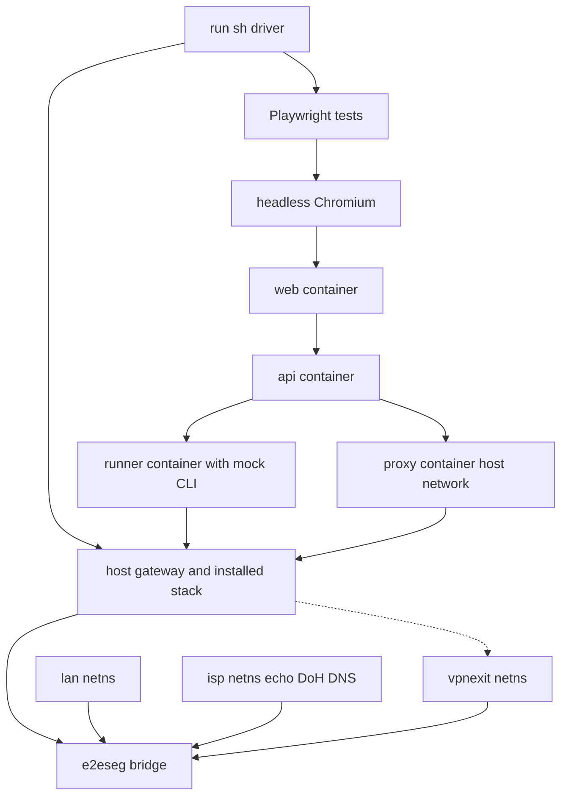
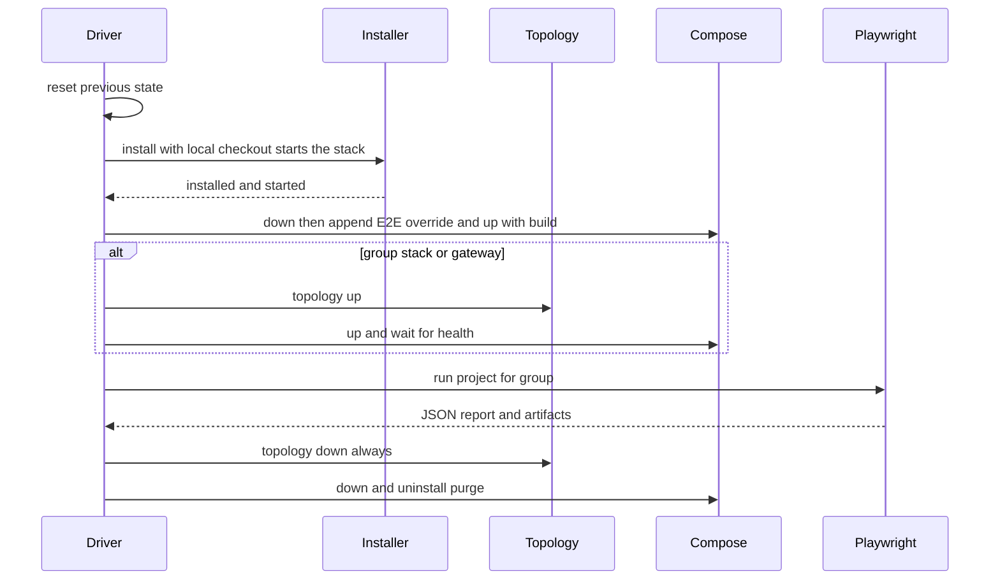

# Design Document

## Overview
**Purpose**: 本設計は、現行の実装（Web UI・API サーバ・ゲートウェイ・インストーラ）を結合した状態で検証する E2E テストの基盤を定める。GitHub-hosted runner 上で、本番と同じインストーラ・同じコンテナ構成・同じランナー本体を動かし、LAN クライアントから見た通信結果と、実ブラウザで見た画面の結果を検証する。

**Users**: 開発者（変更の回帰を確認する）と、後続の `cicd` spec（この E2E を CI から呼ぶ）。また、同じリポジトリの `vendor-live-e2e` spec（共有部品を使う）。

**Impact**: リポジトリに `e2e/` を新設する。`e2e/common/`（両 spec の共有部品）と `e2e/hosted/`（本 spec の E2E）を置く。`docker-compose.e2e-mock.yml` を作り直す。製品コード（`api/`・`web/`・`proxy/`・`installer/`・`vendors/`）は変更しない。欠陥を見つけた場合は報告し、本 spec では修正しない。

### Goals
- 要件 1〜13 の全受け入れ基準を、E2E のシナリオとして検証する。
- 1 回の実行（`e2e/hosted/run.sh`）で、全シナリオの合否と成果物を出す。
- 外部の VPN アカウントと秘密情報を使わない。

### Non-Goals
- 実 VPN ベンダーへの接続、実 LAN・Raspberry Pi 実機、ホストの実際の再起動。
- LXC・macvlan 固有の構成と、検証サーバ上での実行。
- CI のトリガー・権限・並列化（`cicd` spec）。
- フロントエンドの単体テスト（既存の `npm test`）。
- 実 VPN の試験（`vendor-live-e2e` spec）。

## Boundary Commitments

### This Spec Owns
- `e2e/common/` 配下の全て（両 spec が使う API クライアント・API の型・報告の契約）。
- `e2e/hosted/` 配下の全て（駆動スクリプト、トポロジ、テスト用サービス、モック CLI、Playwright の試験）。
- `docker-compose.e2e-mock.yml`（E2E 専用の compose の上書き。hosted 専用）。
- リポジトリの `package.json`（`devDependencies`: `@playwright/test` 1.63.0・`tsx` 4.x・`vitest` 2.1.x・`dns-packet`、および `test:e2e`・`test:vendor-live`・`test:e2e-unit` の scripts）と、`.gitignore`（`e2e/artifacts/`）。
- テスト用の証明書・名前の対応表（`e2e/hosted/zone/records.json`）と、IP の割り当て計画。

### Out of Boundary
- 製品コードの変更（API・Web・proxy・installer）。欠陥の修正は、対象の spec で行う。
- 本番のランナーのイメージ（`vendors/<id>/Dockerfile`）・プロファイル（`profile.json`）の変更。
- `e2e/vendor-live/`（実 VPN の試験。所有は `vendor-live-e2e`）。
- CI の起動条件・権限・結果の報告（`cicd` spec）。
- 検証サーバ（192.168.3.240）・LXC・`.env` の VERIFY_* の利用。

### Allowed Dependencies
- 製品の公開面のみに依存する: HTTP API（`/v1/...`）、Web UI の画面と `aria-label`、インストーラのコマンド（`install.sh install|update|uninstall|status`、`setup.sh` のオプション）、compose のサービス名（`web`・`api`・`proxy`・`runner-<id>`）、ランナーのバイナリ許可（`RUNNER_ALLOWED_BINARY`）、ベンダーのプロファイル（argv・出力パターン）。
- 製品の内部（関数・内部の型・ファイルの中の処理）には依存しない。
- 外部の依存は、テストの実行環境（Playwright 1.63.0、Node.js 22、tsx、Docker、nftables、iproute2、openssl）に限る。

### Revalidation Triggers
- ベンダーのプロファイル（`argv`・`placeholders`・出力パターン）、またはランナーのバイナリ許可の変更。
- API のルート・レスポンスコード・設定のキー（`settings` のスキーマ）の変更。
- インストーラのオプション名、`status` の出力、`.env` の `COMPOSE_FILE` の形式の変更。
- compose のサービス名・ソケット名（`runner-<id>.sock`）・ポート（既定 8080、ホスト 18080）の変更。
- ゲートウェイの LAN・WAN IF の判定（`connection-monitor.ts` の VPN IF 判定）の変更。
- `e2e/common/` の契約（`api-client.ts`・`report.ts`・`api-types.ts`）の変更（両 spec の再検証）。

### Shared File Ownership（`e2e-tests` と `vendor-live-e2e` の共通。両 design で同一）

| パス | 所有 | 利用する spec | 役割 |
| --- | --- | --- | --- |
| `e2e/common/api-client.ts` | `e2e-tests` | 両方 | CA を指定する HTTPS クライアント。Cookie の保持、タイムアウト |
| `e2e/common/api-types.ts` | `e2e-tests` | 両方 | 両方が使う API 応答の型（`api/openapi.json` と一致させる） |
| `e2e/common/report.ts` | `e2e-tests` | 両方 | `TestResult` 型、秘密の除外、成果物の書き出し |
| `package.json`（devDependencies と scripts）・`.gitignore` | `e2e-tests` | 両方 | 実行基盤。`vendor-live-e2e` は変更しない |
| `e2e/package.json`・`e2e/tsconfig.json`・`e2e/types/` | `e2e-tests` | 両方 | ESM 指定、型検査の設定、`dns-packet` の型宣言 |

- 依存の向き: `e2e/hosted/` → `e2e/common/` ← `e2e/vendor-live/`。`e2e/common/` は両方に依存しない。
- 共有部品の契約を変えると、両 spec の再検証が必要になる（両 spec の Revalidation Triggers に記載）。
- 成果物は `e2e/artifacts/hosted/`（`e2e-tests`）と `e2e/artifacts/vendor-live/`（`vendor-live-e2e`）に分ける。

## Architecture

### Existing Architecture Analysis
- 本番は、ホスト上の `install.sh`（systemd の単位と `/opt` 配下の取得先）と、`docker compose`（`docker-compose.yml` ＋ `compose/*.yml` ＋ ベンダーの `compose.yml`）で動く。
- ゲートウェイ（`proxy`）は `network_mode: host` でホストのネットワーク名前空間を直接操作する。ベンダーのランナーも `network_mode: host`。
- API からゲートウェイへは mTLS（`GATEWAY_PORT`、既定 8443）。API からランナーへは UDS（`/var/run/vpngw-ctl/runner-<id>.sock`）。
- トンネル検出は、`ip route get 1.1.1.1` の出口 IF が LAN IF と異なるかで行う（`connection-monitor.ts`）。
- 既存の E2E（HEAD）は LXC 前提で、作業ツリーでは削除済み。本設計は参照しない。

### Architecture Pattern & Boundary Map
本番の構成をホスト上でそのまま動かし、テスト専用の部品（ISP・VPN 出口・LAN クライアント・モック CLI）を外側に置く。



**Architecture Integration**:
- 選択したパターン: 本番構成の再利用（ホスト上の本番ランナー＋模擬の外部）。
- 境界: 製品（本番のイメージ・インストーラ）と、テスト（`e2e/`）を分ける。テストは製品の公開面だけを使う。
- 既存パターンの維持: ランナーは `dist/runner.js` の本体、ベンダーは `profile.json` の契約、LAN IF と WAN IF は同一。
- 新規コンポーネントの理由: 外部の模擬（ISP・VPN 出口・LAN クライアント）は、本番にはない。実機の代わりに必要。

### Dependency Direction
- 層は次の順に依存する（左から右へのみ依存する）: 共有部品（`common/*`） → 証明書・IP 計画（`hosted/lib/env.sh`・`hosted/lib/certs.sh`） → トポロジ（`hosted/lib/topology.sh`）と模擬サービス（`hosted/services/*`） → 導入と起動（`hosted/lib/provision.sh`） → テストの補助（`hosted/fixtures/*`） → テスト本体（`hosted/specs/*`） → 駆動（`hosted/run.sh`）。
- 本番のイメージ（`vendors/*`・`proxy`・`api`・`web`）は、テストから上位の層へ依存しない。

### Technology Stack

| Layer | Choice / Version | Role in Feature | Notes |
| --- | --- | --- | --- |
| E2E ランナー | Playwright Test 1.63.0 | テストの実行、結果の一覧、スクリーンショット・トレース | devDependencies に固定 |
| 実ブラウザ | Chromium（Playwright 同梱、headless） | Web UI の操作と表示の確認 | `npx playwright install --with-deps chromium` |
| 実行 | `tsx` 4.x（devDependencies に固定） | TypeScript の直接実行（模擬サービス・モック CLI・集約・両 spec の入口） | 全 TypeScript を同じ実行方式にする |
| 単体テスト | `vitest` 2.1.x（devDependencies に固定） | 共有部品と vendor-live の純粋な関数の単体テスト。対象ファイルの隣に `*.test.ts` を置く | 既存の proxy・api・web と同じ版系・同じ置き場所 |
| 駆動・トポロジ | POSIX sh・iproute2・nftables・openssl | netns・ブリッジ・証明書の作成と破棄 | 既存の PoC で確認済み |
| 模擬サービス | Node.js 22（`node:https`・`dns-packet`） | ISP の echo・DoH・DNS | `dns-packet` を devDependencies に固定 |
| モック CLI | TypeScript（単一ファイル、`tsx` で実行） | 両ベンダーの CLI の代替 | 出力契約は `vendors/*/profile.json` と `samples.json` に従う |
| 共有の HTTPS | `node:https`（`ca` を指定） | `e2e/common/api-client.ts` | 検証を無効化しない |
| コンテナ | Docker Compose v2（runner 26.04 上で 5.x を確認） | 本番と同じ構成の起動 | `docker-compose.e2e-mock.yml` で上書き |

## File Structure Plan

### Directory Structure
```
e2e/
├── common/                             # 両 spec の共有部品（所有: e2e-tests）
│   ├── api-client.ts                   # CA を指定する HTTPS クライアント。Cookie、タイムアウト
│   ├── api-types.ts                    # 両 spec が使う API 応答の型（api/openapi.json と一致）
│   ├── report.ts                       # TestResult 型、秘密の除外、成果物の書き出し（5.4 の規則の唯一の実装）
│   ├── api-client.test.ts              # CA の検証、Cookie の解析（単体）
│   └── report.test.ts                  # 秘密の文字列が成果物に現れないこと（単体）
├── package.json                        # "type": "module"（e2e 配下を ESM として扱う）
├── tsconfig.json                       # 型検査（moduleResolution: bundler、strict）
├── types/
│   └── dns-packet.d.ts                 # dns-packet の使う範囲の型宣言（同梱の型が無いため）
├── hosted/                             # hosted runner の E2E（所有: e2e-tests）
│   ├── run.sh                          # 駆動。グループの順次実行、初期化、結果の集約（1.1〜1.4）
│   ├── playwright.config.ts            # グループ（プロジェクト）、ワーカー 1、成果物の保存（1.5、12）
│   ├── lib/
│   │   ├── env.sh                      # 定数（パス、IP 計画、ポート、グループ名）
│   │   ├── certs.sh                    # テスト用 CA とサーバ証明書（SAN に 192.168.50.254）（8.6）
│   │   ├── topology.sh                 # netns・ブリッジ・VPN 出口の作成と破棄、LAN 側の実行（5〜7）
│   │   ├── provision.sh                # bootstrap の生成、install、.env の上書き、起動と待機（1.2、9）
│   │   ├── diagnose.sh                 # 失敗時の診断の収集（ip route・nft・docker logs）（1.4、1.5）
│   │   └── summarize.ts                # Playwright の JSON を TestResult に変換し、common/report で書く（1.1）
│   ├── services/
│   │   ├── isp-https.ts                # echo（送信元 IP を返す）と DoH（RFC 8484 の POST）
│   │   ├── isp-dns.ts                  # 平文 DNS（UDP・TCP）。DoH と同じゾーンを参照
│   │   ├── zone.ts                     # 対応表の読み込みと名前の解決（DoH と平文 DNS が共有）
│   │   └── isp.test.ts                 # echo・DoH・平文 DNS の単体テスト
│   ├── zone/
│   │   └── records.json                # 名前→IP の対応表（中継・迂回・リダイレクトの判定に使う）
│   ├── vendors/
│   │   ├── mock-cli/
│   │   │   └── mockvpn.ts              # 公式 CLI の代替。呼び出し名で両ベンダーの契約を切り替える（3、4、8）
│   │   ├── protonvpn/Dockerfile        # 本番のランナー本体（dist/runner.js）＋モック CLI（D-Bus・NM なし）
│   │   └── adguardvpn/Dockerfile       # 同上（adguardvpn-cli の位置にモック CLI を置く）
│   ├── proxy/
│   │   └── Dockerfile                  # 本番の proxy イメージに、テスト CA を信頼ストアへ追加する層（8.6）
│   ├── fixtures/
│   │   ├── api.ts                      # common/api-client を Playwright のフィクスチャで包む（API は 127.0.0.1:3000、api-ca で検証）
│   │   ├── lan.ts                      # lan netns でのコマンド実行（結果は stdout・終了コードで返す）
│   │   ├── web.ts                      # ログイン・設定ダイアログ・通知の操作ヘルパ
│   │   └── admin.ts                    # テスト用の管理者資格情報の生成（実行ごとに乱数）
│   └── specs/
│       ├── lifecycle/installer.spec.ts      # 導入・更新・削除・状態確認（9.1〜9.6）
│       ├── ui/auth.spec.ts                  # 初期設定・ログイン・管理者の変更（2.1〜2.10）
│       ├── ui/vendor-session.spec.ts        # VPN アカウントのログイン・ログアウト（3.5〜3.7）
│       ├── ui/connection.spec.ts            # 接続・切断・接続ログ・失敗時の表示（3.1〜3.4、12）
│       ├── ui/locations.spec.ts             # 接続先・お気に入り・ベンダー切り替え（4.1〜4.10）
│       ├── ui/settings.spec.ts              # 設定の保存と再表示・不正値（13.1〜13.3）
│       ├── ui/responsive.spec.ts            # 1280・600・420px（11.1〜11.5）
│       ├── api/restart.spec.ts              # 再起動依頼（10.1〜10.4）
│       ├── gateway/transparent.spec.ts      # 透過ゲートウェイ（5.1〜5.4、13.4）
│       ├── gateway/dns.spec.ts              # DNS 中継と 53 番リダイレクト（6.1〜6.4）
│       ├── gateway/explicit-proxy.spec.ts   # 明示的プロキシ（7.1〜7.3）
│       └── gateway/verification.spec.ts     # 動作検証と出口 IP の観測（8.1〜8.6）
├── vendor-live/                        # 実 VPN の試験（所有: vendor-live-e2e。詳細はその design）
└── artifacts/                          # 実行ごとの成果物（git 管理外）
    ├── hosted/                         # 本 spec の成果物（summary.txt、<group>/、diag/）
    └── vendor-live/                    # vendor-live-e2e の成果物
docker-compose.e2e-mock.yml             # 作り直す（hosted 専用。ランナーのビルド差し替え、proxy の上書き、user の統一）
package.json                            # devDependencies（@playwright/test 1.63.0・tsx・vitest 2.1.x・dns-packet）、scripts（test:e2e・test:vendor-live・test:e2e-unit）
.gitignore                              # e2e/artifacts/ を追加
```

### Modified Files
- `docker-compose.e2e-mock.yml` — 既存の参照先（削除済みの `e2e/lib/e2e-vendors.sh`）を取り除き、ランナーのビルドを `e2e/hosted/vendors/*/Dockerfile` へ、proxy のビルドを `e2e/hosted/proxy/Dockerfile` へ差し替える。
- `package.json` — `@playwright/test` 1.63.0・`tsx` 4.x・`vitest` 2.1.x・`dns-packet` を devDependencies に固定して追加する。scripts: `test:e2e` = `sh e2e/hosted/run.sh`、`test:vendor-live` = `tsx e2e/vendor-live/main.ts`、`test:e2e-unit` = `vitest run e2e`。既存の `test` は変えない。
- `.gitignore` — `e2e/artifacts/` を追加する。

## Requirements Traceability

| Requirement | Summary | Components | Interfaces | Flows |
| --- | --- | --- | --- | --- |
| 1.1, 1.2, 1.3, 1.4, 1.5, 1.6 | 1 回の実行、グループ単位の初期化、終了結果、成果物、秘密情報なし | Driver, Provisioner, Diagnostics, Summarize | `run.sh` の終了コード、`artifacts/hosted/` | 実行シーケンス |
| 2.1, 2.2, 2.3, 2.4, 2.5, 2.6, 2.7, 2.8 | 初期設定、ログイン、試行制限、401、ログアウト | Web UI（対象）、AuthSpec、ApiClient | `POST /v1/operator`、`POST /v1/operator/session`、`GET /v1/operator/session` | UI 操作 |
| 2.9, 2.10 | 管理者アカウントの変更、現在のパスワードの検証 | AuthSpec、ApiClient | `PUT /v1/operator` | UI 操作 |
| 3.1, 3.2, 3.3, 3.4 | 接続・切断、ランナー停止時の失敗、接続ログ | ConnectionSpec、MockCli、Topology | `PUT /v1/connection`、`GET /v1/connection/log` | 接続フロー |
| 3.5, 3.6, 3.7 | VPN アカウントのログイン・ログアウト・失敗時の表示 | VendorSessionSpec、MockCli | `GET/POST/DELETE /v1/session` | 接続フロー |
| 4.1, 4.2, 4.3, 4.4, 4.5, 4.6, 4.7, 4.8, 4.9, 4.10 | 接続先・お気に入り・ベンダー切り替え、失敗時の状態維持 | LocationsSpec、ApiClient、MockCli | `GET /v1/connection/available-locations`、`PUT/DELETE /v1/connection/locations/:id/favorite`、`PUT /v1/providers/active` | 切り替えフロー |
| 5.1, 5.2, 5.3, 5.4 | 透過ゲートウェイの VPN 経由、Kill Switch、フェイルオープン、迂回 | TransparentSpec、Topology、Isp、VpnExit | LAN 側の `curl`（`fixtures/lan.ts`） | 通信の確認 |
| 6.1, 6.2, 6.3, 6.4 | DNS 中継、53 番リダイレクト、failClosed、fallback | DnsSpec、IspDns、IspDoh | LAN 側の名前解決（`lan.ts` から `getent hosts` や `dig @<サーバ>` を実行） | 名前解決 |
| 7.1, 7.2, 7.3 | 明示的プロキシの許可、拒否、VPN 経由 | ExplicitProxySpec、Topology | LAN 側の `curl -x` | 通信の確認 |
| 8.1, 8.2, 8.3, 8.4, 8.5, 8.6 | 動作検証の開始・結果・409・対象外・出口 IP の観測・全項目の合格 | VerificationSpec、ApiClient、ProxyTrust | `POST /v1/verifications`、`GET /v1/verifications/:id`、`PUT .../client-observations/egress-ip` | 検証フロー |
| 9.1, 9.2, 9.3, 9.4, 9.5, 9.6 | 導入・更新・削除・purge・状態確認 | LifecycleSpec、Provisioner | `install.sh install|update|uninstall|status` | 導入フロー |
| 10.1, 10.2, 10.3, 10.4 | 再起動依頼、二重依頼、ホスト側の仕組みの欠如 | RestartSpec、Topology | `POST /v1/gateway/reboot`、依頼用ディレクトリ | 再起動フロー |
| 11.1, 11.2, 11.3, 11.4, 11.5 | 3 種類の画面幅、横スクロールの有無、通知の位置 | ResponsiveSpec | Playwright の `viewport` | UI 操作 |
| 12.1, 12.2, 12.3, 12.4 | 実ブラウザでの画面の確認、画面上の結果の確認、JS エラーの失敗扱い、エラー通知 | 全 UI の Spec、Web helper | `page`、`pageerror`、`console` | UI 操作 |
| 13.1, 13.2, 13.3, 13.4 | 設定の保存、再表示、不正値の拒否、設定の反映 | SettingsSpec、ApiClient、TransparentSpec | `GET/PUT /v1/connection/config` | 設定フロー |

## Components and Interfaces

### 駆動・準備

| Component | Domain/Layer | Intent | Req Coverage | Key Dependencies (P0/P1) | Contracts |
| --- | --- | --- | --- | --- | --- |
| Driver（`hosted/run.sh`） | 駆動 | グループの順次実行、初期化、集約 | 1.1〜1.4 | Provisioner (P0), Topology (P0), Playwright (P0), Summarize (P1) | CLI |
| Provisioner（`hosted/lib/provision.sh`） | 準備 | 本番と同じインストーラでの導入、`.env` の上書き、起動 | 1.2, 9.1〜9.6 | install.sh (P0), docker compose (P0) | CLI |
| Topology（`hosted/lib/topology.sh`） | 準備 | netns・ブリッジ・VPN 出口の作成と破棄 | 5.1〜5.4, 6.1〜6.4, 7.1〜7.3 | iproute2 (P0), nftables (P1) | CLI |
| Certs（`hosted/lib/certs.sh`） | 準備 | テスト用 CA とサーバ証明書 | 8.6, 12.1 | openssl (P0) | CLI |
| Diagnostics（`hosted/lib/diagnose.sh`） | 駆動 | 失敗時の診断の収集 | 1.4, 1.5 | docker (P1) | CLI |
| Summarize（`hosted/lib/summarize.ts`） | 報告 | Playwright の JSON を `TestResult` に変換し、`common/report` で書く | 1.1, 5.1, 5.4 | common/report (P0) | CLI |

#### Driver（`e2e/hosted/run.sh`）
| Field | Detail |
| --- | --- |
| Intent | 3 グループを、各グループの初期化の後で順次実行し、結果を 1 つにまとめる |
| Requirements | 1.1, 1.2, 1.3, 1.4, 1.5 |

**Responsibilities & Constraints**
- グループの順序: `lifecycle` → `stack` → `gateway`。各グループの前に、前回の残りを全て消す（netns・compose・インストール済みの状態）。
- 失敗したグループがあっても、残りのグループは実行する。終了コードは、1 つでも失敗があれば非ゼロ。
- 成果物は `e2e/artifacts/hosted/<group>/` に保存する。

**Dependencies**
- Outbound: Provisioner, Topology, Diagnostics, Summarize — 準備と後始末（P0）
- Outbound: Playwright — テストの実行（P0）

**Contracts**: CLI [x]

##### CLI Contract
- `sh e2e/hosted/run.sh [--group <lifecycle|stack|gateway>...]`
- 終了コード: 0（全合格）、1（いずれかが失敗）、2（準備の失敗。テストを実行できなかった）。
- 出力: グループごとの合否一覧（`e2e/artifacts/hosted/summary.txt`）と、Playwright の JSON レポート。

**Implementation Notes**
- Integration: `package.json` の `test:e2e` から呼ぶ。
- Validation: 準備（インストール・起動）が失敗したグループは、そのグループの全テストを失敗として記録する（1.1 の一覧に残す）。
- Risks: 3 回のインストールで実行時間が伸びる（後述の Open Questions）。

#### Provisioner（`e2e/hosted/lib/provision.sh`）
| Field | Detail |
| --- | --- |
| Intent | 本番と同じインストーラで導入し、E2E 専用の上書きを加えて起動する |
| Requirements | 1.2, 9.1〜9.6 |

**Responsibilities & Constraints**
- ローカルのチェックアウトを取得元にした `install.sh` を作る（`build-bootstrap.sh <ref> <commit> file://<checkout>`）。
- `sudo sh install.sh install --set PROVIDERS=protonvpn,adguardvpn --set LAN_IFACE=e2eseg --set WEB_PORT=18080` で導入する。設定は `--set KEY=VALUE` で渡す（`--no-start` は install の経路には無い）。
- install は導入の中で起動まで行う（PoC で確認: 78 秒、4 コンテナが起動し、Web UI が HTTPS で 200）。その後 `compose down` で本番の構成を止める。
- `.env` の `COMPOSE_FILE` の末尾へ `docker-compose.e2e-mock.yml` を追記し、`compose up -d --build` で起動し直す（モックのランナーを使うため）。
- 起動後、`api` の health と、`web` の応答（HTTPS）を待つ。待機の上限は 120 秒。
- 導入時の本番ランナーのビルド（外部の取得を含む）は、モックに置き換わるまで実行される。PoC の PROVIDERS=adguardvpn では成功した。protonvpn の本番ビルド（apt リポジトリ）は PoC では未確認（Open Questions Q6）。

**Contracts**: CLI [x]

##### CLI Contract
- `provision_install <checkout> <commit>` → 導入の成功・失敗（終了コード）。
- `provision_start` → compose の起動と待機（終了コード）。
- 外部へのアクセスは、ベースイメージと npm・apt の取得に限る。ルートの既定経路の切り替え（後述 Topology）は、この後に行う。

#### Topology（`e2e/hosted/lib/topology.sh`）
| Field | Detail |
| --- | --- |
| Intent | 本番と同じ単一 NIC の構成を、ブリッジ 1 本とネットワーク名前空間で再現する |
| Requirements | 5.1〜5.4, 6.1〜6.4, 7.1〜7.3, 3.3 |

**Responsibilities & Constraints**
- `topology_up` は、ブリッジ `e2eseg` を作り、`lan`・`isp`・`vpnexit` を接続する。ホストの既定経路を `isp`（192.168.50.254）へ向ける。
- `topology_down` は、全てを元に戻す（`always()` の後始末。既定経路の復元を含む）。
- `lan_exec` は `ip netns exec lan` で、LAN クライアント側のコマンドを実行する。

**IP 計画**

| 要素 | アドレス | 備考 |
| --- | --- | --- |
| ブリッジ `e2eseg`（ホスト） | 192.168.50.1/24 | LAN IF と WAN IF を兼ねる（本番の単一 NIC と同じ） |
| `lan`（LAN クライアント） | 192.168.50.10/24、既定経路 192.168.50.1 | 透過ゲートウェイの LAN 側 |
| `isp`（上位ルータ・echo・DoH・DNS） | 192.168.50.254/24 | 既定経路の次ホップ。`verifyEchoUrl` は `https://192.168.50.254/` |
| `vpnexit`（VPN 出口、LAN 側） | 192.168.50.200/24 | VPN 接続時の送信元 IP（echo から見える） |
| VPN トンネル（ホスト側 `vpn0`） | 10.66.0.1/30 | モック CLI が作る |
| VPN トンネル（出口側） | 10.66.0.2/30 | `vpnexit` 側で masquerade |

**Dependencies**
- Inbound: Driver, TransparentSpec, DnsSpec, ExplicitProxySpec — 準備と検証（P0）
- Outbound: iproute2, nftables — ネットワークの構成（P0）

**Contracts**: CLI [x]

##### CLI Contract
- `topology_up` / `topology_down`（冪等）。
- `lan_exec <cmd...>` → stdout・stderr・終了コード。

**Implementation Notes**
- Validation: `topology_up` 後に、`lan` から `isp` へ届くこと、`ip route get 1.1.1.1` の IF が `e2eseg` であることを確認する。
- Risks: ホストの既定経路を変えるため、runner 上の他の通信（GitHub への通信など）が止まる。成果物のアップロードは、`topology_down` の後に行う。

#### Certs（`e2e/hosted/lib/certs.sh`）・Diagnostics（`e2e/hosted/lib/diagnose.sh`）・Summarize（`e2e/hosted/lib/summarize.ts`）
- Certs: テスト用 CA を実行ごとに作る。サーバ証明書の SAN は `IP:192.168.50.254`。CA の秘密鍵はリポジトリに含めない。
- Diagnostics: 失敗時に `ip route`・`nft list ruleset`（ホスト）・`docker compose logs` を `e2e/artifacts/hosted/<group>/diag/` へ保存する。
- Summarize: Playwright の JSON 結果を `common/report.ts` の `TestResult` に変換し、`summary.txt` と合わせて書き出す。報告の規則（秘密の除外）は `common/report.ts` の 1 か所だけで実装する。

### 共有部品（所有: e2e-tests）

| Component | Domain/Layer | Intent | Req Coverage | Key Dependencies | Contracts |
| --- | --- | --- | --- | --- | --- |
| ApiClient（`common/api-client.ts`） | 共有 | CA を指定する HTTPS、Cookie、タイムアウト | 2.x, 13.x（hosted）、1.7, 1.8, 6.1, 6.2（vendor-live） | node:https (P0) | Service |
| Report（`common/report.ts`） | 共有 | `TestResult`、秘密の除外、成果物の書き出し | 5.1〜5.4 | — | Service |

- ApiClient: 証明書は呼び出し側が渡す CA で必ず検証する。検証を無効化するオプションは持たない。 接続の失敗（transport）は、TLS の失敗を区別するための任意の `code`（Node のエラーコード）を持つ。hosted は、導入したスタックが生成した `api-ca.crt` を CA として使う（API は `https://127.0.0.1:3000`、SAN に 127.0.0.1 を含む）。
- Report: `TestResult`（`name`・`requirement`・`outcome`・`expected?`・`observed?`・`reason?`）と、秘密を含まない書き出し関数を提供する。値に資格情報・Cookie・承認コードを含めない検査を、書き出しの前に行う。

```typescript
interface TestResult {
  readonly name: string;          // 試験名
  readonly requirement: string;   // 要件 ID（例: 1.1）
  readonly outcome: "pass" | "fail";
  readonly expected?: string;
  readonly observed?: string;     // 秘密は含めない
  readonly reason?: string;
}
function writeReport(dir: string, results: readonly TestResult[], forbidden: readonly string[]): Promise<void>;
```

### 模擬サービス（ISP・VPN 出口・モック CLI）

| Component | Domain/Layer | Intent | Req Coverage | Key Dependencies | Contracts |
| --- | --- | --- | --- | --- | --- |
| IspHttps（`hosted/services/isp-https.ts`） | 模擬 | echo（送信元 IP を text で返す）と DoH（RFC 8484） | 5.1, 6.1, 8.5 | Certs (P0), zone (P0) | API |
| IspDns（`hosted/services/isp-dns.ts`） | 模擬 | 平文 DNS（UDP・TCP）。フォールバック先・リダイレクトの対象 | 6.2, 6.4 | zone (P0) | API |
| MockCli（`hosted/vendors/mock-cli/mockvpn.ts`） | 模擬 | 両ベンダーの CLI の代替。ログイン・接続・状態・一覧を再現 | 3.1〜3.7, 4.1〜4.10 | samples.json（契約）、Topology（P0） | CLI |

#### IspHttps
- echo: `GET /` → 200、本文は要求元の IPv4 アドレス（改行付きの text）。`verifyEchoUrl` と egress-probe が使う。
- DoH: `POST /dns-query`（`application/dns-message`）→ `zone/records.json` の対応表で応答。対応が無い名前は NXDOMAIN。
- 停止の制御: 試験用に、DoH の応答を止める（`SIGSTOP`）・再開する（`SIGCONT`）。6.3 と 6.4 で使う。

#### MockCli
- 呼び出し名で契約を切り替える: `protonvpn`（`/usr/bin/protonvpn`）と `adguardvpn-cli`（`/usr/local/bin/adguardvpn-cli`）。
- 実装するコマンド（プロファイルの argv と一致させる）: Proton 版は `signin --totp <user>`（stdin: パスワード、2FA）・`signout`・`connect [--country XX]`・`disconnect`・`status`・`countries list`・`config list`。AdGuard 版は `login`・`logout`・`connect -l <loc> -y`・`disconnect`・`status`・`list-locations`・`license`。
- 出力: `samples.json` の該当ケースと同じ形式（Proton: `Status: Connected`、AdGuard: `Connected to <CITY> in TUN mode, running on <iface>`）。
- 状態: `/var/lib/mockvpn/<vendor>.json`（ログイン状態・プラン・接続先・既定経路の退避）。
- 接続: `vpn0`（ホスト側）を作り、`vpnexit` 側と対にする。既定経路を `vpn0` へ移す。切断で、退避した既定経路へ戻し、`vpn0` を削除する。
- ログイン: 認証情報は、テストが生成した値のみを受け付ける。プランは有料（`paid`）に固定する（無料プランの制限は対象外）。
- ip の操作は `sudo -n` で行う（本番の adguardvpn イメージと同じ前提）。

**Implementation Notes**
- Validation: `samples.json` の各ケースを、モックの出力と突き合わせる（別のテストとして実装する）。
- Risks: モックは CLI の不具合を再現しない。

### ランナー・プロキシの上書き（イメージ）

| Component | Domain/Layer | Intent | Req Coverage | Key Dependencies | Contracts |
| --- | --- | --- | --- | --- | --- |
| RunnerMockImage（`hosted/vendors/*/Dockerfile`） | 上書き | 本番のランナー本体＋モック CLI。D-Bus・NM なし | 3, 4, 8 | proxy の dist (P0), mock-cli (P0) | Image |
| ProxyTrustImage（`hosted/proxy/Dockerfile`） | 上書き | 本番の proxy イメージに、テスト CA を追加 | 8.6 | 本番の proxy イメージ (P0) | Image |
| ComposeOverride（`docker-compose.e2e-mock.yml`） | 上書き | ビルドの差し替え、ユーザーの統一、ポートの確認 | 1.2, 9.1 | docker compose (P0) | Compose |

- RunnerMockImage: `context: .`（本番と同じ）。`RUNNER_ALLOWED_BINARY` は本番と同じ値（`/usr/bin/protonvpn`・`/usr/local/bin/adguardvpn-cli`）。ユーザーは 10001 に統一する（Proton 版の本番の `0:0` は、E2E では使わない）。
- ProxyTrustImage: 本番の proxy の上に、テスト CA を `/usr/local/share/ca-certificates/` へ入れて `update-ca-certificates` を実行する。
- ComposeOverride: 公開ポートは本番の `WEB_PORT`（18080）で指定するため、ポートの差し替えは不要。`vendor-live-e2e` はこのファイルを使わない。

## System Flows

### 実行シーケンス（グループごと）



- `lifecycle` グループは、導入・更新・削除をテストの中で行う。上記の「Installer」の段は、テストが担う。
- 導入（ビルドを含む）は、トポロジを上げる前に終える（既定経路の切り替え前に、外部への取得を済ませる）。
- 再起動テスト（10.2）の前に、`vpngwgui-reboot.path` を停止する。依頼ファイルが作られても、ホストが再起動しないようにするため（後述の R7）。テスト後に再開する。

### 通信の確認フロー（透過ゲートウェイ）

- 接続時: `lan_exec curl https://192.168.50.254/` の応答（送信元 IP）が `192.168.50.200` になる（5.1）。
- 未接続・Kill Switch 有効: 同じ `curl` が失敗する（5.2）。
- 未接続・Kill Switch 無効: 同じ `curl` が成功し、応答は `192.168.50.1`（ホストの WAN 側アドレス）になる（5.3）。
- 迂回: 迂回対象のドメインを `lan` で引く。中継の応答の IP が `isp` の IP になり、直接経路で届く（5.4）。

## Data Models

### テストの識別子と計画（静的）
- 組み込み値は `hosted/lib/env.sh` に置く: ブリッジ名、IP 計画（上の表）、ポート（Web 18080、echo 443、DoH 443）、グループ名。
- `hosted/zone/records.json`: `{ "records": [{ "name": "echo.bypass.test", "a": "192.168.50.254" }, { "name": "dns.e2e.test", "a": "192.168.50.254" }, ...], "directAnswers": [{ "name": "redirect.e2e.test", "a": "203.0.113.99" }] }` の形。中継経由の応答（`192.168.50.254`）と、直接の応答（`203.0.113.99`）を分ける。6.2 の判定に使う。

### 実行の成果物（秘密を含まない）
- `e2e/artifacts/hosted/summary.txt`: グループごとの合否（1.1）。`common/report.ts` の形式。
- `e2e/artifacts/hosted/<group>/`: Playwright の JSON レポート、失敗時のスクリーンショット・トレース（1.5）、`diag/`（失敗時の診断）。

## Error Handling

### Error Strategy
- 準備（導入・起動・トポロジ）の失敗: そのグループを中止し、全テストを「準備の失敗」として記録する。後始末は必ず実行する（`trap`）。
- テストの失敗: Playwright の失敗として記録し、スクリーンショット・トレースを残す。
- 製品の欠陥の疑い（期待と異なる応答）: テストは失敗させる。テストの側で期待値を緩めない。

### Error Categories and Responses
- **準備の失敗（exit 2）**: インストーラ・compose・トポロジの失敗。診断を収集し、グループを飛ばす。
- **テストの失敗（exit 1）**: 期待との不一致。スクリーンショット・トレースを保存する。
- **画面の JS エラー（12.3）**: `page.on('pageerror')` と `console` の `error` を集め、シナリオの終了時に 1 件でもあれば失敗にする。

### Monitoring
- 各グループの `diag/` に、`ip route`・`nft list ruleset`・compose のログを保存する。

## Testing Strategy

E2E そのものが検証の本体のため、ここには検証の項目（シナリオ）を要件に対応させて示す。共有部品（`common/`）の単体テストは、`test:e2e-unit` で実行する。

### E2E: lifecycle グループ（9.1〜9.6）
- 導入後の `status` が導入済みを示す（9.1）。
- 指定した版へ `update` し、`status` に版が反映される（9.2）。
- `uninstall` で、サービス定義・ホストの規則・取得先が消える（9.3）。
- `uninstall --purge` で、設定・データ・導入メタ情報が消える（9.4）。`--purge` なしでは残る（9.5）。
- 削除後の `status` が未導入を示す（9.6）。

### E2E: stack グループ（UI・API）
- 初期設定・ログイン・試行制限・401・管理者の変更（2.1〜2.10、12.1）。
- VPN アカウントのログイン・ログアウト・失敗（3.5〜3.7）。
- 接続・切断・接続ログ・ランナー停止時の失敗（3.1〜3.4）。
- 接続先・お気に入り・ベンダー切り替えの成功と失敗の各状態（4.1〜4.10）。
- 設定の保存・再表示・不正値（13.1〜13.3）。
- 再起動依頼・二重依頼・ホスト側の仕組み欠如（10.1〜10.4）。
- 3 種類の画面幅（11.1〜11.5）。画面の JS エラーの扱い（12.3）と、API のエラー時の通知（12.4）。

### E2E: gateway グループ（通信・検証）
- 透過ゲートウェイの 4 つの挙動（5.1〜5.4）と、設定の反映（13.4）。
- DNS 中継・53 番リダイレクト・failClosed・fallback（6.1〜6.4）。
- 明示的プロキシの許可・拒否・VPN 経由（7.1〜7.3）。
- 動作検証の開始・結果・409・対象外・出口 IP の観測・全項目の合格（8.1〜8.6）。

### 単体テスト（共有部品）
- `common/api-client.test.ts`: 取り込んだ CA で検証できない証明書を拒否すること。`Set-Cookie` の解析。
- `common/report.test.ts`: 与えた秘密の文字列が、成果物に現れないこと（要件 5.4 の規則）。

### 検証の補助（モックの契約）
- モック CLI の出力と `vendors/*/samples.json` の突き合わせ（テスト名は、サンプルのケース名を使う）。

## Security Considerations
- リポジトリは PUBLIC。E2E は、外部の秘密情報（`.env` の VERIFY_*、トークン）を読まない。資格情報は実行ごとに乱数で作る（`hosted/fixtures/admin.ts`）。
- テスト CA の秘密鍵は、実行ごとに作り、成果物に含めない。
- API への通信は、導入したスタックの `api-ca.crt` で検証する（検証を無効化しない）。
- ホストに root で導入する。runner は使い捨てのため、他の実行と共有しない（hosted runner を前提とする）。
- `pull_request_target` は使わない（`cicd` spec の制約）。

## Performance & Scalability
- 目標の実行時間は未決定（Open Questions）。
- ビルドのキャッシュ（Docker のレイヤー）を、3 グループで共有する。

## Migration Strategy
- 既存の `e2e/`（HEAD の 55 ファイル）は参照しない。作業ツリーで削除済みの状態をそのまま使い、新規ファイルで置き換える。
- `docker-compose.e2e-mock.yml` は作り直す。旧 `e2e/` を参照する記述は残さない。

## Open Questions / Risks
- **Q1（解決済み）**: hosted runner で `systemctl enable --now` とインストーラの単位が動くことを PoC で確認した（ブランチ `poc/hosted-runner-installer`、run 41278083962）。導入 78 秒、`uninstall --purge` で単位・設定・ソースが消えることを確認。ただし `systemctl is-system-running` は `degraded` を返した。原因は未調査（後述の Q7）。
- **Q6（新）**: protonvpn の本番ランナーのビルド（apt の Proton リポジトリ）は、導入時に走る。PoC では adguardvpn のみで確認した。本番のビルドが失敗した場合、導入自体が失敗する。
- **Q7（新）**: `degraded` の原因。ランナーの既存の失敗した単位か、本システムの単位かを切り分ける。本システムの単位が失敗していれば、導入の検証（9.1）の前提が崩れるため、最初の実装タスクで調べる。
- **R7（新・重要）**: 再起動の依頼ファイルは、`vpngwgui-reboot.path` が検知すると `vpngwgui-reboot.service`（`systemctl reboot`）を起動する。E2E の再起動テストでこれを動かすと、ランナーが再起動してジョブが失われる。対策: 10.2 の前に `reboot.path` を停止し、テスト後に再開する。依頼ファイルの作成と 409 の判定は、停止のまま確認できる。
- **Q2（実行時間）**: 3 回のインストールと起動の合計時間の上限。目標は、CI の時間制限を見て `cicd` spec で決める。
- **Q3（ProxyTrust の妥当性）**: 本番の proxy イメージのベースに対して、テスト CA の層が正しく効くか。実装時に、検証の出口 IP 確認（8.6）で確かめる。
- **Q4（DoH の忠実度）**: 模擬 DoH が RFC 8484 の要求を満たすか。プロキシの DoH クライアントとの互換性は、6.1 の検証で確かめる。
- **Q5（モックの範囲）**: 無料プラン（`restrictions`）の挙動は対象外とした。要件に含めるかは、要件の見直しで決める。
