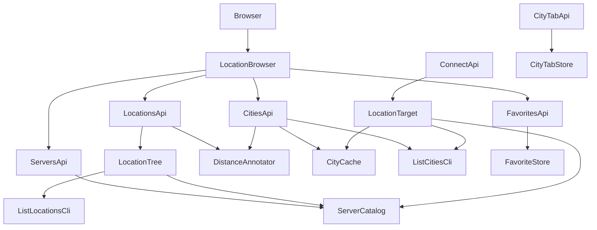
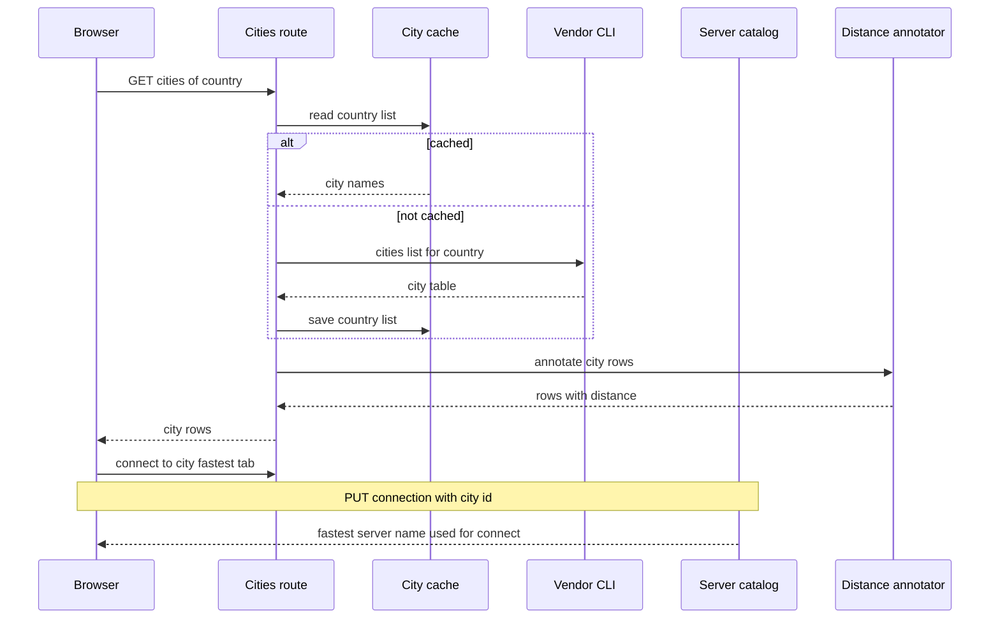

# Design Document

## Overview

**Purpose**: 両プロバイダの接続先を、国 → 都市 → サーバの階層で選べる同じ UI を提供する。ProtonVPN は都市とサーバの一覧を追加し、AdGuard VPN は平らな都市の一覧を国の下に組み替える。

**Users**: 都市を指定して接続したい利用者。プロバイダごとの接続の仕方（都市の最速サーバ・サーバの選択）を選ぶ。

**Impact**: 接続先の一覧の応答が、国の行の一覧（既存）に加えて、都市の一覧・サーバの一覧・お気に入りの一覧を返す。接続は国の行を受け付けなくなり、都市とサーバの行で接続する。

**設計の状態**: 要件 5-5・4-7・6-6 を改訂済み（2026-11-08）。D1 は (a)（都市名のみ）で確定し、(b)（都市と国の両方を渡す形式）は AdGuard VPN CLI に拒否されたため不採用。2026-11-09 に CLI 1.7.12 でも Tokyo で同じ拒否結果を確認した。D7 は方針 A で決定: 一覧に無いお気に入りのサーバは、AdGuard VPN では `connect -l <国名>` で国名接続しお気に入りを削除、ProtonVPN ではフォールバックせず CLI を呼ばずにエラーを返しお気に入りを残す。2026-11-08 の記録では CLI 1.8.2 とされていたが、検証サーバの導入版は 1.7.12 であり、版の記録に不整合がある。国名接続（`connect -l <国名>`）は、2026-11-09 に CLI 1.7.12 で「South Korea」の接続に成功し確認した。日本は検証環境の接続先に届かず未確認。ProtonVPN の国名接続は使わない。D7 の国接続は `connect -l <国名>` の書式で確定。一覧外お気に入りの挙動は profile の locationTarget 宣言で指定し、型はベンダー名を含まない（2026-11-08 改訂）。D5 は実装時の確認事項。

### Goals
- 国 → 都市 →（ProtonVPN のみ）サーバの画面を、両プロバイダで同じ操作にする（要件 1・2・3）
- ProtonVPN の都市の一覧を、国を開いたときに一度だけ取得して保存する（要件 5）
- 都市の行は最速のサーバ、サーバの行はそのサーバで接続する（要件 6）
- お気に入りを、都市とサーバの単位でプロバイダごとに保存する（要件 4）
- 距離順（`location-distance-sort`）と ping 順を、一覧の種類に応じて適用する（要件 7）

### Non-Goals
- 距離の計算・距離順の規則（`location-distance-sort` が担う。本 spec は注釈を掛けるだけ）
- Secure Core のサーバの表示、無料プランでの都市・サーバの指定（既存の制限に従う）
- 接続・切断の処理そのものの変更（接続先の解決のみ拡張する）
- 国の行からの接続（要件 6-6）

## Boundary Commitments

### This Spec Owns
- 接続先の階層の組み立て: 国の一覧（既存の取得の結果を階層として整える）、都市の一覧（ProtonVPN は国ごとの取得・保存・再取得・破棄）、サーバの一覧（キャッシュの読み取り）
- AdGuard VPN の一覧の組み替え（都市の平らな行 → 国の行の下に都市）
- 都市の一覧のタブ（「最速サーバ」「サーバを選択」）の保存（プロバイダごと）
- お気に入り（都市・サーバ。プロバイダごと。表示名を含む保存形式）と、旧形式の非表示
- 接続先の解決（ID → 接続引数）: 都市は最速サーバ名、サーバはサーバ名、国の行は拒否
- 階層の画面（国・都市・サーバの画面、戻る操作、スワイプ、タブ、☆、距離表示の組み込み）
- プロファイル宣言の拡張（都市の一覧の取得、サーバ一覧の読み方、サーバ名での接続）

### Out of Boundary
- 距離の計算・距離順の規則・大圏距離（`location-distance-sort`）。本 spec は `annotateDistances` を呼ぶだけで、行の並びの規則を持たない
- ping の計測と ping の順（既存の `location-list-parser` の並べ替え）
- プラン制限の判定（既存の capability と学習の仕組み）
- 接続・切断の実行（既存の `apply-connection` の手順。接続先の解決だけ差し替える）
- 無料プランの一覧（既存の参考一覧 `plan-locations`）

### Allowed Dependencies
- `location-distance-sort` の公開 API: `annotateDistances`（distance-annotator）、`getGeoIndex`（国の首都の座標）。依存の向きは本 spec → 距離 spec の一方向とする
- 既存: `getActiveProvider`、`providerStatePath`（保存先）、`executeVendorCommand`（CLI 実行）、`resolveArgv`（プレースホルダ検証）、`capability-evaluator`、`restriction-learner`（制限の学習）、`PROVIDER_CACHE_DIR`（サーバ一覧キャッシュの場所）
- 公開データ・外部通信: 使わない（座標は同梱データ）

### Revalidation Triggers
- 接続先 ID の形式（`LOCATION_ID_PATTERN`）の変更（お気に入り・前回接続の保存に影響）
- 接続先の応答の形（`LocationSchema` と新しい階層の応答）の変更（web の生成クライアントと `location-distance-sort` に影響）
- お気に入りの保存形式の変更
- プロファイル宣言（`listCities`・`serverCatalog`・`connect`）の変更
- `connect` の引数の扱い（サーバ名・都市名・国コード）の変更。`apply-connection` の接続先の解決に影響
- E2E のモック（`e2e/vendors/mockproton`）の変更（`e2e-tests` と共有する）

## Architecture

### Existing Architecture Analysis
- 接続先の一覧は、ベンダーの CLI を実行してから表を解析する。CLI の出力の書式はプロファイルの宣言で指定する（`table`・`connectName`）。
- 接続の解決は ID を一覧から引く（`apply-connection`）。階層を増やすと、一覧に現れない接続先（未取得の国の都市）を ID から解決する必要が生じる。
- お気に入りと前回接続は、ID の配列・ID の単一値で保存する（プロバイダごと）。表示名を持たないため、一覧の取得なしでは表示できない。
- web の一覧は、タブと絞り込みを持つ平らな一覧（`LocationList`）。階層の画面は無い。

### Architecture Pattern & Boundary Map



**Architecture Integration**:
- 純粋な層（階層の組み立て `location-tree`、サーバの選択 `server-catalog`、表の解析 `city-list-parser`）と、保存を伴う層（都市のキャッシュ、お気に入り、タブ）を分ける。ルートは組み合わせるだけにする。
- 依存の向き: `profile`（宣言）← `providers`・CLI 実行 ← `locations`（解析・階層・保存）← `routes` ← web。距離 spec（`distance-annotator`）は `locations` から呼ばれる側であり、本 spec の部品に依存しない。
- 既存のパターンを保つ: ベンダーの差は宣言に置く。保存はプロバイダごとの `$STATE_DIR/providers/<ID>/`。認可は既定の preHandler。

### Technology Stack

| Layer | Choice / Version | Role in Feature | Notes |
|-------|------------------|-----------------|-------|
| Frontend | React 18・Vite 5（既存） | 階層の画面、戻る、スワイプ | 生成クライアント（orval）経由 |
| Backend | Fastify 5・TypeBox（既存） | 階層・都市・サーバ・タブの API | 既存の `schemas/` と同じ作法 |
| Data | ProtonVPN CLI（`cities list`・`countries list`）、サーバ一覧キャッシュ（JSON） | 都市の名前、サーバの一覧 | キャッシュは CLI が更新する |
| Storage | `$STATE_DIR/providers/<ID>/` の JSON | 都市のキャッシュ、お気に入り、タブ | 既存と同じ作法（単一 JSON） |

## File Structure Plan

### Directory Structure
```
api/src/locations/
├── city-list-parser.ts        # 都市の一覧（「Cities in …」の表）の解析（純粋関数）
├── location-tree.ts           # 国の行の組み立て（ProtonVPN は国の表、AdGuard は都市の行から国を作る）（純粋関数）
├── server-catalog.ts          # サーバ一覧キャッシュの読み取り、有効・非 Secure Core の判定、最速サーバの選択（純粋関数＋読み取り）
├── city-cache-store.ts        # 国ごとの都市の一覧の保存・読み取り・破棄
├── city-tab-store.ts          # 都市の一覧のタブの保存（プロバイダごと）
├── location-target.ts         # 接続先 ID → 接続引数の解決（都市→最速サーバ、サーバ→サーバ名、国→拒否）
├── location-id.ts             # （変更）サーバの ID 形式（srv-）を追加
├── favorite-locations-store.ts # （変更）表示名を含む保存形式。旧形式は非表示
└── *.test.ts

api/src/routes/
├── connection-locations.ts    # （変更）国の一覧の組み立てを location-tree に任せる。お気に入りの取得を追加
├── connection-cities.ts       # 都市の一覧（取得・再取得）
├── connection-servers.ts      # サーバの一覧
└── connection-city-tab.ts     # 都市の一覧のタブ（取得・保存）

api/src/schemas/
├── location.ts                # （変更）国・都市・サーバ・お気に入りの応答の形
└── city-tab.ts                # タブの要求・応答

api/src/connection-state/
└── apply-connection.ts        # （変更）接続先の解決を location-target に任せる

api/src/profile/
└── profile.schema.ts          # （変更）listCities・serverCatalog の宣言を追加

vendors/protonvpn/profile.json # （変更）cities list・サーバ一覧の読み方・サーバ名での接続
vendors/adguardvpn/profile.json # （変更なし。AdGuard の接続引数は都市名）

api/src/app.ts                 # （変更）新しいルートを登録

web/src/locations/
├── location-browser-state.ts  # 階層の状態遷移（国・都市・サーバ、戻り先、タブの保持）（純粋関数）
└── location-filter.ts         # （変更）お気に入りの一覧（都市・サーバ）の絞り込み

web/src/hooks/
├── useCityList.ts             # 都市の一覧の取得・再取得
├── useServerList.ts           # サーバの一覧の取得
├── useCityTab.ts              # 都市の一覧のタブの取得・保存
├── useSwipeBack.ts            # 一覧の上での右スワイプ（左から右）の検出
└── useLocations.ts            # （変更）お気に入りの一覧と再計測の経路

web/src/components/dashboard/
├── LocationList.tsx           # （変更）階層の画面を組み立てる（タブ・絞り込みの平らな一覧は廃止）
├── LocationBrowser.tsx        # 階層の画面（国・都市・サーバの切り替え）
├── LocationBackBar.tsx        # 戻るボタンとタブの行（上部の同じ行。左詰め）
├── CityList.tsx               # 都市の一覧（最速サーバ・サーバを選択）
├── ServerList.tsx             # サーバの一覧（Score の順。検索窓なし）
└── LocationRow.tsx            # （変更）サーバの行（Score・負荷・階層）と距離の表示

e2e/vendors/mockproton/        # （変更）cities list とサーバ一覧キャッシュの模擬（e2e-tests と共有）
web/src/generated/             # 生成物（手で編集しない）
```

### Modified Files
- `api/src/schemas/location.ts` — 国・都市・サーバ・お気に入りの応答の形を分ける。`distanceKm` を都市の行にも持つ
- `api/src/locations/favorite-locations-store.ts` — 保存形式を、ID の配列から表示名を含む項目の配列に変える。旧形式は読まない
- `api/src/locations/location-id.ts` — サーバの ID（`srv-` の接頭辞）を追加する
- `api/src/connection-state/apply-connection.ts` — 接続先の解決を `location-target` に置き換える（国の行は拒否）
- `api/src/profile/profile.schema.ts` — `listCities`（都市の一覧）と `serverCatalog`（サーバ一覧キャッシュの項目名）を任意の宣言として追加する
- `vendors/protonvpn/profile.json` — `listCities`・`serverCatalog` を宣言し、`connect` の引数をサーバ名にする
- `web/src/components/dashboard/LocationList.tsx`・`LocationRow.tsx`・`web/src/hooks/useLocations.ts`・`web/src/locations/location-filter.ts`

## System Flows

### 都市の一覧（ProtonVPN）と最速サーバ接続



- 都市の一覧は、国ごとに一度だけ取得し、保存された一覧を使う（要件 5-1・5-2）。取得に失敗したときは、再取得の操作で取り直す（要件 5-3・5-4）。
- 距離の注釈は、取得した一覧（キャッシュからでも）に毎回掛ける。距離の計算は同梱データで行うため、外部通信は生じない。
- 再計測（要件 5-5）は、都市の一覧の保存だけを破棄し、国の一覧を取り直す。サーバ一覧は CLI が管理するキャッシュのため、本 spec では破棄しない（D6 の決定）。

## Requirements Traceability

| Requirement | Summary | Components | Interfaces | Flows |
|-------------|---------|------------|------------|-------|
| 1.1 | 国の行を選ぶと都市の一覧に切り替わる | LocationBrowser, location-browser-state | 画面の状態遷移 | — |
| 1.2 | 都市の一覧の左上に「‹ 国一覧」 | LocationBackBar | — | — |
| 1.3 | 戻るボタンで国の一覧に戻る | LocationBrowser | — | — |
| 1.4 | 右スワイプで一つ上の階層へ | useSwipeBack, LocationBrowser | — | — |
| 1.5 | 国の一覧ではスワイプで戻らない | useSwipeBack | — | — |
| 1.6 | 上の階層に戻ってもタブの状態を保つ | location-browser-state, useCityTab | — | — |
| 2.1 | サーバの段がある場合、二つのタブを表示 | CityList, location-browser-state | プロバイダの機能の判定 | — |
| 2.2 | サーバの段がない場合、「最速サーバ」のみ | CityList | — | — |
| 2.3 | 「最速サーバ」で都市を選び、［接続］で接続する | CityList, ConnectApi, location-target | `PUT /v1/connection` | 都市の一覧 |
| 2.4 | 「サーバを選択」で都市を選ぶとサーバの一覧へ | CityList, ServerList | `GET /v1/connection/locations/{cityId}/servers` | — |
| 2.5 | タブの選択を保存する | CityTabApi, city-tab-store | `PUT /v1/connection/city-tab` | — |
| 2.6 | 国を選ぶと保存されたタブで表示 | CityTabApi, useCityTab | `GET /v1/connection/city-tab` | — |
| 2.7 | タブの保存が無ければ「最速サーバ」 | city-tab-store | 既定値 | — |
| 3.1 | 都市の有効なサーバを Score の小さい順に一覧 | server-catalog, ServerList | `GET /v1/connection/locations/{cityId}/servers` | — |
| 3.2 | 行にサーバ名・階層・負荷・Score を表示 | ServerList, LocationRow | 応答の項目 | — |
| 3.3 | 無料と有料を区別するフィルタを付けない | ServerList | — | — |
| 3.4 | 無効なサーバを表示しない | server-catalog | — | — |
| 3.5 | サーバの一覧に検索窓を出さない | ServerList | — | — |
| 3.6 | サーバの一覧の上に要約の行を出さない | ServerList | — | — |
| 3.7 | サーバを選び、［接続］でそのサーバ名で接続 | location-target, ConnectApi | `PUT /v1/connection` | — |
| 4.1 | お気に入りをプロバイダごとに保存 | favorite-locations-store | `PUT/DELETE /v1/connection/locations/{locationId}/favorite` | — |
| 4.2 | 都市の行に ☆（最速サーバ・サーバの段がない場合） | CityList | — | — |
| 4.3 | 「サーバを選択」の都市の行には ☆ を出さない | CityList | — | — |
| 4.4 | サーバの行に ☆ | ServerList | — | — |
| 4.5 | ☆で行の選択状態を変えない | LocationRow | — | — |
| 4.6 | 「お気に入り」タブに都市とサーバの両方 | favorites route, LocationBrowser | `GET /v1/connection/favorites` | — |
| 4.7 | 「お気に入り」のサーバを選び、［接続］でそのサーバへ接続。一覧に無いとき、AdGuard VPN は接続中なら切断して国名接続し、お気に入りを無通知で削除する。ProtonVPN は CLI を呼ばずエラーにし、お気に入りを残す | location-target, FavoriteStore | `PUT /v1/connection` | — |
| 4.8 | 旧形式の国の単位のお気に入りは表示・接続しない | favorite-locations-store | 読み取りで除外 | — |
| 5.1 | 初めて国を選ぶと都市の一覧を取得して保存 | connection-cities, city-cache-store, city-list-parser | `GET /v1/connection/locations/{country}/cities` | 都市の一覧 |
| 5.2 | 保存済みの一覧は使い、再取得しない | city-cache-store | — | 都市の一覧 |
| 5.3 | 取得できなければエラーと再取得のボタン | connection-cities, CityList | エラー応答 | — |
| 5.4 | 再取得のボタンで取り直す | connection-cities | `POST /v1/connection/locations/{country}/cities/refresh` | — |
| 5.5 | 再計測で都市の一覧の保存を破棄（サーバ一覧は CLI 管理のため対象外） | connection-locations（再計測）, city-cache-store | `POST /v1/connection/locations/refresh` | — |
| 5.6 | 接続に使うサーバ名はサーバの一覧から取る | server-catalog, location-target | — | — |
| 6.1 | 都市の行は最速サーバへ接続 | location-target, server-catalog | `PUT /v1/connection` | 都市の一覧 |
| 6.2 | AdGuard の都市の接続は都市名を渡す（D1 の決定） | location-target（AdGuard 分） | 接続の引数 `-l <都市名>` | — |
| 6.3 | サーバの行はそのサーバ名を渡す | location-target | — | — |
| 6.4 | 接続中の行に「接続中」 | location-tree, LocationRow | 既存の接続状態 | — |
| 6.5 | 接続が許可されないプランでは接続しない | 既存の制限（connectToLocation） | 既存の 403 | — |
| 6.6 | 国の行（国 ID）からの接続を拒否する。4-7 の AdGuard VPN の国名接続はお気に入りサーバの解決であり、国 ID からの接続ではない | location-target（国の行は拒否） | 400 | — |
| 7.1 | ping 計測可の国の行は、都市の ping の最小値の順 | location-tree | — | — |
| 7.2 | ping 計測可の都市の行は ping の順 | location-tree | — | — |
| 7.3 | ping 計測不可の国の行は距離順 | DistanceAnnotator（distance-sort） | `annotateDistances` | — |
| 7.4 | ping 計測不可の都市の行は距離順・お気に入りを先頭 | DistanceAnnotator（distance-sort） | `annotateDistances` | 都市の一覧 |
| 7.5 | ping 計測不可の案内を出さない | LocationList | — | — |
| 7.6 | 国の行に ping の値を出さない | location-tree, LocationRow | — | — |
| 8.1 | 一覧の UI は規約に従う | LocationBrowser 全体 | — | — |
| 8.2 | 説明・要約・ヒントを出さない | LocationBrowser, ServerList | — | — |
| 8.3 | Score は値として表示し、説明は出さない | ServerList | — | — |
| 8.4 | 距離の表示（ping 計測不可のとき） | LocationRow | `distanceKm` | — |

## Components and Interfaces

| Component | Domain/Layer | Intent | Req Coverage | Key Dependencies (P0/P1) | Contracts |
|-----------|--------------|--------|--------------|--------------------------|-----------|
| CityListParser | locations | 都市の一覧の表を解析する | 5.1 | CLI 出力（P0） | Service |
| LocationTree | locations | 国の行を組み立てる（ProtonVPN と AdGuard の形の違いを吸収） | 7.1, 7.2, 7.6, 6.4 | ListLocations 結果（P0） | Service |
| ServerCatalog | locations | サーバ一覧キャッシュを読み、都市のサーバ・最速サーバを返す | 3.1, 3.4, 5.6, 6.1 | キャッシュ（P0）、profile.serverCatalog（P0） | Service |
| CityCacheStore | locations | 国ごとの都市の一覧を保存・破棄する（サーバ一覧は対象外） | 5.1, 5.2, 5.5 | providerStatePath（P0） | State |
| CityTabStore | locations | 都市の一覧のタブを保存する | 2.5, 2.6, 2.7 | providerStatePath（P0） | State |
| FavoriteStore | locations | 表示名を含むお気に入りを保存し、旧形式を除外する | 4.1, 4.6, 4.8 | providerStatePath（P0） | State |
| LocationTarget | locations | 接続先 ID を接続引数へ解決する（AdGuard VPN のお気に入りサーバ不在時の国名接続と、ProtonVPN のエラー結果を含む） | 2.3, 3.7, 4.7, 5.6, 6.1, 6.2, 6.3, 6.6 | ServerCatalog（P0）、CityCacheStore（P0）、ListCities（P1） | Service |
| DistanceAnnotator | locations（距離 spec） | 行へ距離を付け、距離順に並べる | 7.3, 7.4, 8.4 | 距離 spec（P0） | Service |
| LocationBrowser | web | 国・都市・サーバの画面の切り替え | 1.1〜1.6, 4.6 | location-browser-state（P0） | — |
| CityList | web | 都市の一覧（タブ・☆） | 2.1〜2.4, 4.2, 4.3, 5.3 | useCityList（P0） | — |
| ServerList | web | サーバの一覧 | 3.1〜3.6, 4.4, 8.3 | useServerList（P0） | — |
| LocationBackBar | web | 戻るボタンとタブの行 | 1.2 | — | — |

### locations

#### CityListParser
| Field | Detail |
|-------|--------|
| Intent | 「Cities in <国名>:」の見出しに続く表（City・Features の列）から都市名を取り出す |
| Requirements | 5.1 |

##### Service Interface
```typescript
function parseCityList(stdout: string, options: { city: string }): string[];
// 失敗時: 表のヘッダが見つからないときは例外（書式の変更を、空の一覧にして隠さない）
// 空行・区切り行・案内文は読み飛ばす。都市名は列の桁位置で切り出す（都市名に空白を含むため）。
```
- 出力の順序は表の順。重複は除く。

#### LocationTree
| Field | Detail |
|-------|--------|
| Intent | 国の行を、ベンダーの一覧の形から組み立てる（ping の値と、国の行の並び順の根拠を含む） |
| Requirements | 7.1, 7.2, 7.6, 6.4 |

##### Service Interface
```typescript
interface CountryRow {
  readonly country: string;        // 小文字の ISO 国コード
  readonly countryName: string;
  readonly id: string;             // 国の行の ID（国単位の接続には使わない）
  readonly pingMs?: number;        // 都市の ping の最小値（ping 計測可のプロバイダのみ。表示はしない）
  readonly hasServerStage: boolean; // サーバの段があるか（プロバイダの判定）
}
function buildCountryRows(input: {
  readonly source: "countryTable" | "cityRows";  // ProtonVPN は国の表、AdGuard は都市の行から組む
  readonly rows: ReadonlyArray<{ country: string; countryName: string; city?: string; pingMs?: number }>;
  readonly pingMeasurable: boolean;
}): CountryRow[];
```
- 並び: ping 計測可 → 国の代表 ping の小さい順（7.1）。計測不可 → 並べ替えは距離注釈に任せる（国名順のまま）。
- 国の行の ping は応答に含めず、並べ替えの根拠としてだけ使う（7.6）。

#### ServerCatalog
| Field | Detail |
|-------|--------|
| Intent | サーバ一覧キャッシュから、都市のサーバと最速サーバを返す |
| Requirements | 3.1, 3.4, 5.6, 6.1 |

##### Service Interface
```typescript
interface ServerRecord {
  readonly name: string;      // 接続時の指定名（例: "CH-US#13"）
  readonly country: string;   // 小文字の国コード
  readonly city: string;
  readonly tier: "free" | "paid";
  readonly load: number;      // 負荷（%）
  readonly score: number;     // 小さいほど速い
}
function serversInCity(catalog: CatalogFile, country: string, city: string): ServerRecord[];   // 有効・非 Secure Core・Score 昇順
function fastestServer(catalog: CatalogFile, country: string, city: string): ServerRecord | undefined;
function readCatalog(providerId: string, declaration: ServerCatalogDef): CatalogFile;          // 読めなければ例外（CLI の書式の変更を隠さない）
```
- 有効: キャッシュの有効フラグが真。Secure Core: 機能ビットの bit 1 が立つもの（宣言の `secureCoreBit`）。
- Score が同じ場合は名前の昇順（決定的な順序）。

#### CityCacheStore
| Field | Detail |
|-------|--------|
| Intent | 国ごとの都市の一覧を保存し、再計測で破棄する |
| Requirements | 5.1, 5.2, 5.5 |

##### State Management
- 保存先: `$STATE_DIR/providers/<ID>/cities/<国コード>.json`。内容: `{ "country": "US", "cities": ["Chicago", …] }`。
- 読み取り: 無い・壊れている場合は未保存として扱う（例外にしない）。
- 破棄: 再計測のとき、その ID の全国分を削除する。

#### LocationTarget
| Field | Detail |
|-------|--------|
| Intent | 接続先 ID を、CLI の接続引数へ解決する |
| Requirements | 2.3, 3.7, 4.7, 5.6, 6.1, 6.2, 6.3, 6.6 |

##### Service Interface
```typescript
type ConnectTarget =
  | { readonly kind: "city"; readonly locationId: string; readonly country: string; readonly connectName: string } // 都市の最速サーバ名
  | { readonly kind: "server"; readonly locationId: string; readonly country: string; readonly connectName: string }
  | { readonly kind: "cityByName"; readonly locationId: string; readonly country: string; readonly connectName: string } // 都市名を渡す（D1 の決定）
  | { readonly kind: "countryFallback"; readonly provider: string; readonly locationId: string; readonly country: string; readonly connectName: string; readonly removeFavorite: true } // 宣言 locationTarget の unavailableFavorite が countryFallback のプロバイダ。connectName は国名。接続中なら切断してから国名で接続し、お気に入りを削除する
  | { readonly kind: "favoriteUnavailable"; readonly provider: string; readonly locationId: string; readonly error: "favorite_unavailable"; readonly removeFavorite: false }; // 宣言の unavailableFavorite が error のプロバイダ。CLI を呼ばず、お気に入りを残す
// 依存: 国の一覧・都市の一覧（キャッシュ）・サーバの一覧（カタログ）・保存済みのお気に入り（FavoriteStore の項目。国名と削除の対象を得るため）
interface ConnectTargetDependencies { locations; cities; servers; favorites }
function resolveConnectTarget(provider: Provider, locationId: string, dependencies: ConnectTargetDependencies): Promise<ConnectTarget>;
// 失敗時: 未知の ID・未取得の都市・サーバが無い → 400（未知の接続先）
//        国の ID → 400（国の行からは接続しない。要件 6-6）
//        一覧に無いお気に入り → 宣言された unavailableFavorite の動作に従う
```
`provider` には宣言の値（プロバイダ ID）をそのまま入れる。ベンダー名は本体コードに書かない（要件 7.3 の中立性。禁止語は vendors の宣言から自動で作られ、check:neutrality が検査する）。一覧外のお気に入りの挙動は、プロファイルの locationTarget 宣言で指定する。
- ID の解釈: `srv-` で始まればサーバ、それ以外は都市（国コード・都市のスラッグ）。国の行の ID は国の一覧に含まれるものとして拒否する。
- 都市の解決: 国の都市の一覧（キャッシュ。無ければ取得）からスラッグが一致する都市を探し、その最速サーバ名を返す。
- お気に入りのサーバの解決（D7）: サーバ一覧に無いとき、AdGuard VPN は `countryFallback` を返す。呼び出し側は接続中なら切断してから、そのお気に入りの国名（`connectName`）で `connect -l <国名>` を実行し、お気に入りを表示・通知せず削除する。ProtonVPN は `favoriteUnavailable` のエラー結果を返し、CLI を呼ばず、お気に入りを残す。エラー表示は既存の方法に従う。国の行の ID は、どちらの結果とも別に 400 で拒否する（6-6）。

#### FavoriteStore
| Field | Detail |
|-------|--------|
| Intent | お気に入りを表示名付きで保存し、旧形式の国の単位の項目を除外する |
| Requirements | 4.1, 4.6, 4.8 |

##### State Management
- 保存先: `$STATE_DIR/providers/<ID>/favorite-locations.json`。内容: `{ "version": 2, "items": [{ "id", "kind": "city" | "server", "country", "countryName", "city", "serverName"? }] }`。
- 旧形式（`{ "ids": [...] }`）は読まない（要件 4-8）。書き込みで旧形式は消える。
- 上限: 200 件（既存の上限を保つ）。

### Routes（API の契約）

| Method | Endpoint | Request | Response | Errors |
|--------|----------|---------|----------|--------|
| GET | /v1/connection/locations | — | CountryRow 相当の国の行（距離・ping・接続中） | 422, 403, 502, 504 |
| POST | /v1/connection/locations/refresh | — | 国の行（都市の保存を破棄し、国の一覧を取り直す） | 同上 |
| GET | /v1/connection/locations/{country}/cities | — | CityRow[]（距離・お気に入り・前回接続） | 403（プラン制限）, 422, 502 |
| POST | /v1/connection/locations/{country}/cities/refresh | — | CityRow[]（その国の保存を破棄して取り直す） | 同上 |
| GET | /v1/connection/locations/{cityId}/servers | — | ServerRow[]（Score 昇順） | 404（サーバの段がない・未知の都市） |
| GET | /v1/connection/favorites | — | FavoriteItem[] | — |
| PUT | /v1/connection/locations/{locationId}/favorite | 表示名付きの項目 | お気に入りの応答 | 400 |
| DELETE | /v1/connection/locations/{locationId}/favorite | — | お気に入りの応答 | 400 |
| GET | /v1/connection/city-tab | — | `{ tab: "fastest" \| "select" }` | — |
| PUT | /v1/connection/city-tab | `{ tab }` | 同上 | 400 |

- 接続は既存の `PUT /v1/connection`（`locationId`）を使う。解決は `LocationTarget` が行う。
- 応答の形は `schemas/location.ts` に定める。`LocationSchema` の `distanceKm` は都市の行にも付く。

## Data Models

### Logical Data Model
- 都市の一覧: 国コード → 都市名の配列（プロバイダごと）。
- お気に入り: 項目（ID・種類・国・国名・都市・サーバ名）の配列（プロバイダごと、上限 200）。
- 都市のタブ: 「最速サーバ」か「サーバを選択」（プロバイダごと）。
- サーバの一覧: CLI が更新するキャッシュ（読み取り専用）。本 spec は保存しない。

### Data Contracts & Integration
- サーバ一覧キャッシュの項目（ProtonVPN。実機で確認）: `LogicalServers[]` の各項目の `Name`・`Tier`・`Features`（bit 1 が Secure Core）・`ExitCountry`・`City`・`Load`・`Score`・`Status`。
- 都市の一覧の表（ProtonVPN）: 見出し「Cities in <国名>:」、列 `City`・`Features`。
- 国の表（ProtonVPN）: 列 `Code`・`Country`（既存）。
- サーバ ID: `srv-` と、サーバ名を小文字にし、`#` を `-` にした値（例: `CH-US#13` → `srv-ch-us-13`）。

## Error Handling

### Error Strategy
- 都市の一覧の取得失敗: エラーと再取得のボタンを出す（要件 5-3）。保存は行わない。
- サーバ一覧の読み取り失敗・書式の変更: 例外として報告する（空の一覧で隠さない）。
- 接続先の解決の失敗（未知の ID・未取得・国の行）: 400。接続は行わない。
- 制限（無料プラン）: 既存の制限の仕組み（学習・403）で扱う。

### Error Categories and Responses
- **User Errors (4xx)**: 国の行からの接続 → 400。未知の接続先 → 400。タブの値が不正 → 400。
- **System Errors (5xx)**: CLI の失敗 → 422 や 502（既存の分類）。書式の変更 → 500（例外）。

### Monitoring
- 既存のログに従う。都市の取得の失敗と、サーバ一覧の書式の変更は、ログに残す。

## Testing Strategy

### Unit Tests
- `city-list-parser.test.ts`: 都市名に空白を含む表（Phnom Penh）、空行・案内文の読み飛ばし、見出しが無い場合の例外。
- `server-catalog.test.ts`: Secure Core の除外（bit 1）、無効なサーバの除外、Score 昇順と同値の決定的な順序、最速サーバの選択（Chicago の例）。
- `location-tree.test.ts`: ProtonVPN（国の表）と AdGuard（都市の行）の国の行の組み立て、国の行の ping が最小値になること、ping 計測可の並び順。
- `favorite-locations-store.test.ts`: 表示名付きの保存と読み取り、旧形式の除外、上限 200 件。
- `location-target.test.ts`: 都市 → 最速サーバ名、サーバ → サーバ名、国の行 → 400、未知の ID → 400。サーバ一覧に無いお気に入りは、AdGuard VPN で `countryFallback`（国名接続・お気に入り削除・無通知）、ProtonVPN で `favoriteUnavailable`（CLI を呼ばず、お気に入りを保持）となることを確認する。2026-11-08 の実接続記録では CLI 1.8.2 とされていたが、検証サーバの導入版は 1.7.12 で版の記録に不整合がある。国名接続の仕組みは 2026-11-09 に CLI 1.7.12 で「South Korea」の接続に成功し確認した。日本は検証環境の接続先に届かず未確認（テストでは引数の組み立てを確認）。
- `city-cache-store.test.ts`: 保存・読み取り・破棄（再計測）、壊れたファイルは未保存。
- `city-tab-store.test.ts`: 既定は「最速サーバ」、保存と読み取り。

### Integration Tests
- `connection-cities` ルート: 初回は CLI を呼んで保存し、2 回目は CLI を呼ばない（要件 5-2）。取得失敗はエラーになり、再取得で取り直せる（要件 5-3・5-4）。距離が付き、お気に入りの都市が先頭になる（要件 7-4）。
- `connection-servers` ルート: Secure Core とサーバの無効が除かれ、Score 順になる（要件 3-1・3-4）。
- `connection-locations` ルート: 再計測で都市の保存が破棄され、サーバ一覧キャッシュは破棄されない（要件 5-5）。AdGuard の一覧は国の下に都市が並ぶ（要件 7-1・7-2）。
- `apply-connection`: 都市 ID の接続が最速サーバ名で CLI を呼ぶ（要件 6-1）。国の ID は CLI を呼ばずに拒否する（要件 6-6）。一覧に無いお気に入りは、AdGuard VPN で接続中なら切断後に `connect -l <国名>` を呼び、お気に入りを無通知で削除する。ProtonVPN では CLI を呼ばずエラーにし、お気に入りが残ることを確認する（要件 4-7）。
- `location-target`（要件 4-7）: 一覧に無いお気に入りのサーバについて、AdGuard VPN は `countryFallback` を返す。接続中なら切断後に `connect -l <国名>` で接続し、お気に入りが削除され、表示・通知が無いことを確かめる。2026-11-09 に CLI 1.7.12 で「South Korea」の接続に成功し国名接続の仕組みを確認した。日本は検証環境の接続先に届かず未確認。ProtonVPN は `favoriteUnavailable` のエラーとなり CLI を呼ばず、お気に入りが残ることを確かめる。エラー表示には既存の方法を使う。

### E2E/UI Tests
- 国 → 都市 → サーバの遷移、「‹ 国一覧」、右スワイプでの戻り、タブの保持（要件 1.1〜1.6）。
- 「サーバを選択」でサーバの一覧に進み、サーバの ☆ でお気に入りに登録し、「お気に入り」タブから接続できる（要件 4.4・4.6・4.7）。
- 旧形式のお気に入りが表示されないこと（要件 4.8）。
- 両プロバイダで、同じ操作の階層が出ること（要件 8.1）。

### Performance
- 都市の一覧は国ごとに一度だけ CLI を呼ぶ。2 回目以降はキャッシュを使う（要件 5-2）。
- サーバの一覧はキャッシュの読み取りのみ。行数（数百件）に対して線形。

## Security Considerations
- 接続の引数（サーバ名・都市のスラッグ）は、既存のプレースホルダ検証（正規表現・許可値）を通す。都市名の検証は、キャッシュ由来の値だけを許可する。
- お気に入りとタブの保存は、運用者の認可（既定の preHandler）の下で行う。

## Integration & Migration Notes
- お気に入りの保存形式が変わる。旧形式は読まず非表示にする（要件 4-8）。ファイルの移行は行わない。
- `LOCATION_ID_PATTERN` にサーバ ID（`srv-`）を加えるため、既存の ID の検査は影響を受けない（既存の形式は従来どおり通る）。
- E2E のモック（`e2e/vendors/mockproton`）に、cities list とサーバ一覧キャッシュを追加する（`e2e-tests` と共有）。
- 生成クライアント（`web/src/generated`）は `npm run generate:api-client` で更新する。

## Open Questions / Risks

- **D1（決定: (a)。(b) は CLI が拒否したため不採用）**: AdGuard VPN の都市の接続は都市名だけを渡す。2026-11-08 の記録では CLI 1.8.2 とされていたが、検証サーバの導入版は 1.7.12 であり、版の記録に不整合がある。2026-11-09 に導入済み CLI 1.7.12 で `connect -l "Tokyo, Japan"` と `connect -l "Tokyo, JP"` を試し、いずれも `There is no location with the specified city name, country name, or ISO code` で拒否された。`connect -l "Tokyo"` は都市として認識されたが、2 回とも `None of the endpoints are available` で接続失敗した（エンドポイント／ネットワークの問題であり、書式の問題ではない）。比較の `connect -l "Seoul"` は接続成功後に切断した。以上から (b) の「都市, 国」形式は不採用とする。都市名のみを渡し、同名の都市が別の場所に解決されるリスクは利用者が許容する（2026-11-09 の決定）。国名接続（`connect -l <国名>`）は、2026-11-09 に CLI 1.7.12 で「South Korea」の接続に成功し確認した。日本は検証環境の接続先に届かず未確認。
- **D2（確認済み・2026-11-08）**: 隔離された検証コンテナで、サーバ名（`US-IL#378`）による接続を実際に確認した（`research.md` §8）。無効なサーバ名は拒否され、フォールバックの接続は起きない。都市の行とサーバの行の接続は、サーバ名で行う。`--city` は代替にしない（今回は同じサーバを選んだが、要件 6-1 の Score の規則と常に一致する保証はない）。
- **D3（決定）**: brief の「国の行からは国を指定して接続する」は、要件 6-6 と食い違う。要件を優先し、国の行からの接続は行わない。
- **D4（決定）**: 国コードの対応（`countryAliases`）は、プロファイルの最上位に一つだけ置く。参考一覧（`availableLocations`）と距離の注釈（`location-distance-sort`）の両方が、この共通の対応を使う。距離 spec の設計の `locationDistance.countryAliases` は、この共通の対応に改める（同 spec の設計を改訂する）。
- **D5（Tier の意味）**: サーバ一覧の `Tier` の 0 を無料とみなしている（要確認。表示の階層だけに影響する）。
- **D7（決定・2026-11-08、方針 A）**: お気に入りのサーバが現在のサーバ一覧に無いときの動作はプロバイダごとに異なる。AdGuard VPN は接続中なら切断し、お気に入りの国名で `connect -l <国名>` を実行する。お気に入りは表示・通知せず削除する。2026-11-08 の記録では CLI 1.8.2 とされ、`connect -l Japan -y` の実接続（TOKYO、TUN mode、出口国コード JP）が記録されているが、検証サーバの導入版は 1.7.12 であり、版の記録に不整合がある。国名接続（`connect -l <国名>`）は、2026-11-09 に CLI 1.7.12 で「South Korea」の接続に成功し確認した。日本は検証環境の接続先に届かず未確認。ProtonVPN は国名接続を使わず、CLI を呼ばずにエラーを返し、お気に入りを残す。エラー表示は既存の方法に従う。国の行（国 ID）からの接続は引き続き拒否する（要件 6-6）。
- **D6（決定・2026-11-08）**: サーバ一覧キャッシュは CLI が管理する。本 spec は保存・破棄をしない（要件 5-5 を改訂）。キャッシュが古い場合の扱いは、実装時に確かめる。
