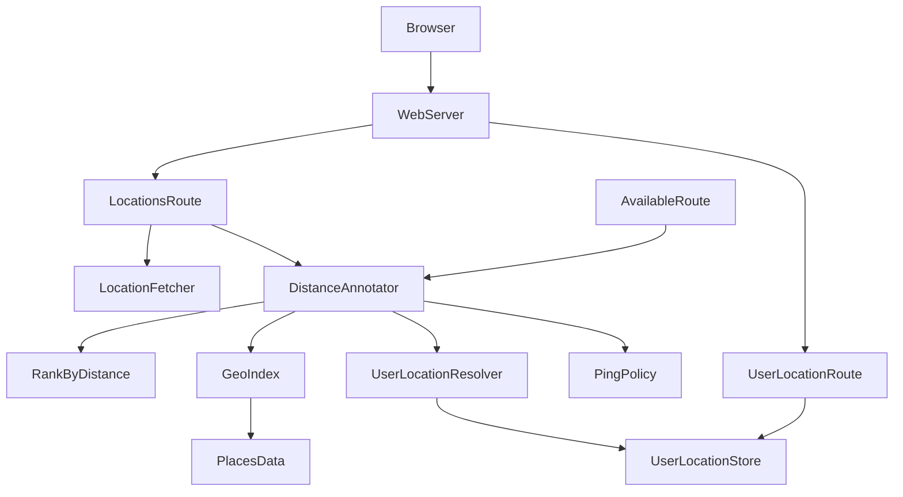
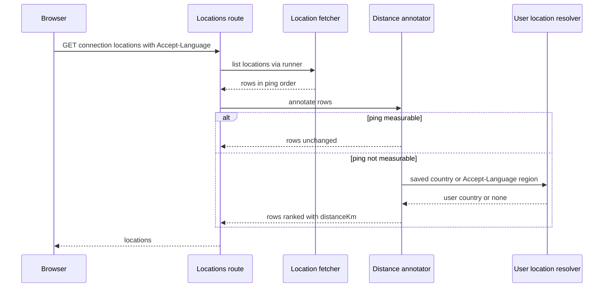

# Design Document

## Overview

**Purpose**: ping を計測できないプロバイダ（現在は ProtonVPN）の接続先一覧を、利用者の国の首都からの大圏距離で並べ、各行に距離（約 N km）を表示する。

**Users**: ProtonVPN を使い、接続先を ping の代わりに距離で判断したい利用者。利用者の場所を設定する運用者。

**Impact**: 接続先一覧（`GET /v1/connection/locations`）とプランの参考一覧（`GET /v1/connection/available-locations`）の応答に、任意の `distanceKm` が加わる。設定画面に「利用者の場所」のタブが加わる。座標は配布物に同梱するデータから引き、実行時に外部へ通信しない。

### Goals
- ping を計測できないとき、国の行と都市の行を利用者の国の首都からの距離の近い順に並べる（要件 1・4・5）
- 利用者の場所を、保存された値、ブラウザの言語設定の地域の順に決める（要件 2）
- 座標を同梱データから引き、外部へ情報を送らない（要件 3）
- 利用者の場所を運用者が設定・既定値へ戻せる（要件 6）

### Non-Goals
- 都市の一覧の取得・保存・表示（`location-city-selection` が担う）。本 spec は、都市の行が渡されたときに並べる規則と距離の計算だけを提供する。
- ping の計測、接続・切断、プラン制限の判定の変更
- サーバの一覧（Score の順）への距離の適用
- GeoIP などによる利用者の場所の自動推定
- 座標データの実行時の更新・外部からの取得

## Boundary Commitments

### This Spec Owns
- 同梱の公開データ（Natural Earth 5.1.2 の populated places）と、その生成スクリプト
- 国の首都と都市の座標の参照（国コードと都市名の照合、人口による選択）
- 大圏距離の計算と、表示用の丸め（小数点以下第一位）
- 距離による並べ替えの規則（お気に入りの都市の先頭配置、距離が無い接続先の後ろ配置）
- 利用者の場所の決定（保存された値 → ブラウザの言語設定の地域 → 無し）と、その保存先（`$STATE_DIR/user-location.json`）
- 利用者の場所の API（`/v1/user-location`）と、設定画面の「利用者の場所」タブ
- 一覧・参考一覧の各行の距離の表示と、応答の `distanceKm` フィールド

### Out of Boundary
- 都市の一覧の取得・保存、都市の行の組み立て（`location-city-selection`）。本 spec は行の配列を受け取るだけで、行の組み立てを変えない。
- ping の計測と ping 値の並べ替え（既存の `location-list-parser` の並べ替えのまま）
- 接続・切断、お気に入りの保存（既存の `favorite-locations-store`）、前回接続の保存
- capability の判定ロジック（既存の判定を使う。新たな判定は加えない）
- プラン参考一覧の取得（既存の `plan-locations` を使う）
- 設定画面の他のタブ、ui-preferences（テーマ）

### Allowed Dependencies
- 既存の `capability-evaluator`（`isPingMeasurable` を export して使う。判定の規則は変えない）
- 既存の `getActiveProvider`（ベンダーの宣言を読む）、`stateDir`（保存先）
- 既存の `favorite-locations-store` と `last-location-store`（読み取りのみ）
- 公開データ（同梱の JSON。実行時のネットワーク通信は行わない）
- 実行環境の `Intl.DisplayNames`（国名の表示）

### Revalidation Triggers
- `LocationSchema` または参考一覧の応答の形の変更（web の生成クライアントと両 spec に影響）
- `connection-locations` ルートで行を組み立てる箇所の変更（`location-city-selection` が行の形を変えるとき）
- `profile.schema` の `countryAliases` の変更、または `vendors/*/profile.json` の `countryAliases` の変更
- `src/geo/places.json` の再生成（データ源の版の変更）
- 距離の並べ替え規則（要件 1 の順序）の変更

## Architecture

### Existing Architecture Analysis
- 接続先一覧は `routes/connection-locations.ts` が `fetchLocations`（CLI 実行）の結果を返す。並べ替えは `location-list-parser.ts` の `sortByPing` が担う（ping が無い接続先は CLI の出力順のまま）。
- 利用者設定の保存は `ui-preferences-store.ts` の作法（`$STATE_DIR` の単一 JSON。読めない場合は既定へ丸める）に従う。
- 認可は `requireOperatorSession` が `/v1/*` 全体に掛かり、例外は `UNAUTHENTICATED_ROUTES` で列挙する。
- 国名は `plan-locations.ts` が `Intl.DisplayNames(["ja"])` で解決している。
- ベンダー固有の値（国コードの対応）は `profile` の宣言に置く（`plan-locations` の `countryAliases` と同じ作法）。

### Architecture Pattern & Boundary Map



**Architecture Integration**:
- Selected pattern: 純粋関数の層（大圏距離・並べ替え・照合）と、保存を伴う層（利用者の場所）を分け、ルートは両者を組み合わせるだけにする。
- Dependency direction: `geo`（データ・計算）← `locations`（並べ替え・利用者の場所・注釈）← `routes`（HTTP）← web。上位から下位への import は行わない。
- Domain/feature boundaries: 距離の注釈（`DistanceAnnotator`）は行の配列を受け取り、行を増減・組み立てしない。都市の一覧の変更は、この注釈の入力を変えるだけで済む。
- Existing patterns preserved: ベンダー差分は `profile` の宣言に置く。保存は `$STATE_DIR` の単一 JSON。認可は既定の preHandler。
- New components rationale: `GeoIndex` は、同梱データの照合（首都・都市の選択）を一箇所に集めるため。`RankByDistance` は、要件 1 の規則を純粋関数にして単体で検証するため。
- Steering compliance: 本体コードにベンダー名を書かない（中立性の検査）。ベンダー固有の国コードは `profile` へ。コメントと識別子は日本語。

### Technology Stack

| Layer | Choice / Version | Role in Feature | Notes |
|-------|------------------|-----------------|-------|
| Frontend | React 18・Vite 5（既存） | 距離の表示、「利用者の場所」タブ | 生成クライアント（orval）経由で API を呼ぶ |
| Backend | Fastify 5・TypeBox（既存） | 距離の注釈、利用者の場所の API | 既存の `schemas/` と同じ作法 |
| Data | Natural Earth 5.1.2 populated places（同梱 JSON） | 国の首都と都市の座標 | パブリックドメイン。生成スクリプトで作る（`scripts/build-geo-places.mjs`） |
| Storage | `$STATE_DIR/user-location.json` | 利用者の場所（保存された国コード） | 単一 JSON。読めなければ未保存扱い |
| Runtime | Node.js 22（既存） | 大圏距離の計算（三角関数のみ） | 外部パッケージを追加しない |

## File Structure Plan

### Directory Structure
```
scripts/
└── build-geo-places.mjs            # 生成: Natural Earth の dbf から api/src/geo/places.json を作る（依存なし）

api/src/geo/
├── places.json                     # 生成物（手で編集しない）。国の首都・都市の座標
├── places-data.ts                  # 同梱データの読み込みと型（PlaceRecord）
├── great-circle.ts                 # 大圏距離と表示用の丸め（純粋関数）
├── geo-index.ts                    # 首都・都市の照合と、国の選択肢（純粋関数。データを受け取る）
└── *.test.ts

api/src/locations/
├── rank-by-distance.ts             # 距離による並べ替えの規則（純粋関数）
├── distance-annotator.ts           # 行に distanceKm を付け、並べ替える（ping が計測できないときだけ）
├── user-location-resolver.ts       # 利用者の場所の決定（保存値・Accept-Language）と Accept-Language の解析（純粋関数）
├── user-location-store.ts          # 利用者の場所の保存・読み取り・削除（$STATE_DIR）
└── *.test.ts

api/src/schemas/
└── user-location.ts                # 利用者の場所の要求・応答の TypeBox スキーマ

api/src/routes/
└── user-location.ts                # GET/PUT/DELETE /v1/user-location

web/src/components/dashboard/
└── UserLocationPanel.tsx           # 設定画面の「利用者の場所」タブの内容
```

### Modified Files
- `api/src/schemas/location.ts` — `LocationSchema` に任意の `distanceKm` を追加する。
- `api/src/routes/connection-locations.ts` — 応答の直前で `annotateDistances` を通す（一覧の取得と お気に入り処理は変えない）。
- `api/src/routes/connection-available-locations.ts` — 参考一覧の行に `annotateDistances` を通し、応答スキーマに `distanceKm` を加える。
- `api/src/capabilities/capability-evaluator.ts` — `isPingMeasurable(profile)` を export する（既存の判定を関数に切り出すだけ。判定の結果は変えない）。
- `api/src/profile/profile.schema.ts` — 国コードの対応 `countryAliases`（ベンダーの国コード → 同梱データの国の識別キー）を、プロファイルの最上位の任意項目として追加する。参考一覧の `availableLocations.countryAliases` は、この共通の対応へ統合する（`location-city-selection` の D4 の決定）。
- `api/src/app.ts` — `registerUserLocationRoute` を登録する。
- `vendors/protonvpn/profile.json` — 最上位の `countryAliases` に `UK→GB`、`XK→KOS` を宣言する。参考一覧で使っていた `availableLocations.countryAliases`（`UK→GB`）は削除し、この共通の対応に統合する。
- `web/src/components/dashboard/LocationRow.tsx` — `distanceKm` があれば「約 N km」を表示する。
- `web/src/components/dashboard/AvailableLocations.tsx` — 参考一覧の国の行に距離を表示する。
- `web/src/components/dashboard/SettingsDialog.tsx` — タブ `userLocation`（「利用者の場所」）を、「メンテナンス」の前に加える。
- `web/src/generated/api/**` — `npm run generate:api-client` で再生成する（手で編集しない）。

## System Flows



- 距離の注釈は、ping が計測できるプロバイダでは何もしない（要件 1-3）。
- 利用者の場所が決まらない、または利用者の国の首都が無い場合も、行は変えない（要件 2-3・3-6）。
- 距離が決まらない行は、距離の決まった行の後ろに、既存の順序のまま置く（要件 1-6）。

## Requirements Traceability

| Requirement | Summary | Components | Interfaces | Flows |
|-------------|---------|------------|------------|-------|
| 1.1 | 国の行を首都からの距離順に並べる | DistanceAnnotator, RankByDistance | `annotateDistances`, `rankByDistance` | 一覧取得 |
| 1.2 | 都市の行を距離順に並べる | DistanceAnnotator, GeoIndex | `annotateDistances`, `cityOf` | 一覧取得 |
| 1.3 | ping が計測できるときは距離順を適用しない | DistanceAnnotator, PingPolicy | `isPingMeasurable` | 一覧取得 |
| 1.4 | お気に入りの都市を先頭、残りを距離順 | RankByDistance | `rankByDistance` の `favoriteFirst` | 一覧取得 |
| 1.5 | 同じ距離は既存の順序を保つ | RankByDistance | 安定ソート | 一覧取得 |
| 1.6 | 距離が無い接続先は後ろに置く | RankByDistance | 距離 undefined は末尾 | 一覧取得 |
| 2.1 | 保存された場所を使う | UserLocationResolver, UserLocationStore | `resolveUserLocation` | 一覧取得 |
| 2.2 | 地域を含む最初の言語の地域を既定にする | UserLocationResolver | `parseAcceptLanguageRegions` | 一覧取得 |
| 2.3 | 決まらなければ距離の順を適用しない | UserLocationResolver, DistanceAnnotator | 戻り値 `country: undefined` | 一覧取得 |
| 3.1 | 国の首都の座標を同梱データから引く | GeoIndex, PlacesData | `capitalOf` | 一覧取得 |
| 3.2 | 都市の座標を同梱データから引く | GeoIndex | `cityOf` | 一覧取得 |
| 3.3 | 同名の都市は人口の多い方を使う | GeoIndex | `cityOf` の選択 | — |
| 3.4 | 座標は同梱し、実行時に外部へ通信しない | PlacesData, 生成スクリプト | 同梱 JSON の読み込み | — |
| 3.5 | 座標が無い接続先は距離なしで表示する | DistanceAnnotator | 距離 undefined | 一覧取得 |
| 3.6 | 利用者の場所の座標が無ければ順序を保つ | DistanceAnnotator | 基点 undefined で無変更 | 一覧取得 |
| 4.1 | 利用者の国の首都からの大圏距離を計算する | GreatCircle | `greatCircleKm` | 一覧取得 |
| 4.2 | 都市の行も同じ基点から計算する | GreatCircle, GeoIndex | `greatCircleKm`, `cityOf` | 一覧取得 |
| 4.3 | 「約 N km」を小数点以下第一位で表示する | GreatCircle, LocationRow | `roundToTenth`, 表示 | — |
| 4.4 | 距離が決まらなければ表示しない | LocationRow | `distanceKm` が無い | — |
| 5.1 | 参考一覧も同じ規則で並べる | DistanceAnnotator（参考一覧の経路） | `annotateDistances` | 参考一覧取得 |
| 5.2 | 参考一覧の距離無しの項目は後ろに置く | RankByDistance | 距離 undefined は末尾 | 参考一覧取得 |
| 6.1 | 運用者が国を選ぶ | UserLocationPanel, UserLocationRoute | `PUT /v1/user-location` | — |
| 6.2 | 保存した国を次の要求から適用する | UserLocationStore, DistanceAnnotator | 保存の読み取り | 一覧取得 |
| 6.3 | 既定値に戻す | UserLocationRoute, UserLocationStore | `DELETE /v1/user-location` | — |
| 6.4 | 既定の場所を使うときに注記を表示する | UserLocationPanel | `source === "browser"` の注記 | — |
| 6.5 | 未ログインの変更を拒否する | UserLocationRoute（既定の認可） | 401 | — |

## Components and Interfaces

| Component | Domain/Layer | Intent | Req Coverage | Key Dependencies (P0/P1) | Contracts |
|-----------|--------------|--------|--------------|--------------------------|-----------|
| PlacesData | geo | 同梱データを型付きで読む | 3.1, 3.2, 3.4 | places.json (P0) | State |
| GreatCircle | geo | 大圏距離と丸め | 4.1, 4.2, 4.3 | なし | Service |
| GeoIndex | geo | 首都・都市の照合と国の選択肢 | 3.1, 3.2, 3.3 | PlacesData (P0) | Service |
| RankByDistance | locations | 距離による並べ替えの規則 | 1.4, 1.5, 1.6, 5.2 | GreatCircle (P0) | Service |
| UserLocationResolver | locations | 利用者の国の決定と Accept-Language の解析 | 2.1, 2.2, 2.3 | UserLocationStore (P1) | Service |
| UserLocationStore | locations | 保存された国の読み書き | 2.1, 6.2, 6.3 | stateDir (P0) | State |
| DistanceAnnotator | locations | 行へ距離を付け、並べ替える入口 | 1.1, 1.2, 1.3, 3.5, 3.6, 5.1, 6.2 | RankByDistance (P0), GeoIndex (P0), UserLocationResolver (P0), PingPolicy (P0) | Service |
| PingPolicy | capabilities | ping 計測の可否（既存の判定を export） | 1.3 | profile (P0) | Service |
| UserLocationRoute | routes | 利用者の場所の取得・保存・既定へ戻す | 6.1, 6.3, 6.5 | UserLocationResolver (P0), GeoIndex (P0) | API |
| LocationRow / AvailableLocations | web | 距離の表示 | 4.3, 4.4 | 生成型 (P1) | — |
| UserLocationPanel | web | 設定の「利用者の場所」タブ | 6.1, 6.3, 6.4 | 生成クライアント (P0) | — |

### geo

#### PlacesData

| Field | Detail |
|-------|--------|
| Intent | 同梱データを読み込み、型付きの配列として提供する |
| Requirements | 3.1, 3.2, 3.4 |

**Responsibilities & Constraints**
- 同梱の `places.json` を一度だけ読む。形式が想定と違えば起動時に失敗する（ビルドの欠陥を実行時に隠さない）。
- 国の識別キーは ISO 3166-1 alpha-2。対応が無い場合（コソボ）は、データ源の 3 文字コードを使う。

**Contracts**: State [x]

##### State Management
```typescript
interface PlaceRecord {
  readonly key: string;        // 国の識別キー（"JP"、コソボは "KOS"）
  readonly name: string;       // 表示名（データ源の名称）
  readonly nameEn: string;     // 英語名
  readonly nameAscii: string;  // ASCII 名
  readonly population: number; // 人口（POP_MAX）
  readonly latitude: number;
  readonly longitude: number;
  readonly capitalTier: 0 | 1 | undefined; // 0: Admin-0 capital, 1: Admin-0 region capital, undefined: それ以外
}
```
- 同梱の形式は、行ごとの配列（`[key, name, nameEn, nameAscii, population, latitude, longitude, capitalTier]`）。項目の並びは生成スクリプトと `places-data.ts` の両方で定義し、テストで一致を確かめる。

**Implementation Notes**
- Integration: 生成物を `api/src/geo/places.json` に置き、`import ... with { type: "json" }` で読む（`tsc` が `dist` へ複写する。PoC で確認済み）。JSON の型推論に頼らず、件数と行の形を検査してから型を付ける（PoC で、推論のままでは代入エラーになることを確認）。
- Validation: 件数（7,342）と、代表的な国の首都（JP・BO・ZA）が含まれることを単体テストで確かめる。形式が想定と違えば起動を失敗させる。
- Risks: 同梱データの容量は、PoC で 531 KB と測定済み（見積もりより小さい）。

#### GreatCircle

| Field | Detail |
|-------|--------|
| Intent | 二点の地球表面上の最短距離（km）と、表示用の丸め |
| Requirements | 4.1, 4.2, 4.3 |

##### Service Interface
```typescript
interface Coordinate {
  readonly latitude: number;   // 度（-90〜90）
  readonly longitude: number;  // 度（-180〜180）
}
function greatCircleKm(from: Coordinate, to: Coordinate): number; // 球面（半径 6371.0088 km）上の距離
function roundToTenth(km: number): number;                         // 小数点以下第一位へ丸める
```
- Preconditions: 緯度・経度は有限の数。
- Postconditions: 同一点の距離は 0。対称（`from` と `to` を入れ替えても同じ）。
- 検算: 東京–大阪は 396.4 km（単体テストで確認）。

#### GeoIndex

| Field | Detail |
|-------|--------|
| Intent | 国の首都と都市の座標を、国の識別キーと都市名から引く |
| Requirements | 3.1, 3.2, 3.3 |

##### Service Interface
```typescript
interface CountryOption { readonly code: string; readonly name: string; }

interface GeoIndex {
  hasCountry(countryKey: string): boolean;
  capitalOf(countryKey: string): Coordinate | undefined;
  cityOf(countryKey: string, cityName: string): Coordinate | undefined;
  countryOptions(): readonly CountryOption[];
}
function createGeoIndex(places: readonly PlaceRecord[]): GeoIndex;
function getGeoIndex(): GeoIndex; // 同梱データから作る単一インスタンス
```
- 首都の選択: `capitalTier` が 0 の記録のうち人口の最も多いもの。無ければ 1 の記録のうち人口の最も多いもの。どちらも無ければ `undefined`（要件 3-1、プエルトリコ）。
- 都市の照合: `key` が一致し、`name`・`nameEn`・`nameAscii` のいずれかが都市名と一致する記録（アクセント・大文字小文字・記号を無視して比較）。候補が複数なら人口の最も多いもの（要件 3-3）。
- 国の選択肢: 首都が引ける国のみ。名前は `Intl.DisplayNames(["ja"], {type: "region"})`、無ければデータの名称。

##### Preconditions / Postconditions
- `capitalOf`・`cityOf` は同じ入力に対して常に同じ結果を返す（純粋）。
- 該当が無ければ `undefined`（例外を投げない）。

**Implementation Notes**
- Integration: 照合の正規化は、検証（research.md）で使った規則（NFKD・結合記号の除去・小文字・英数字以外の除去）と同じにする。
- Validation: 単体テストで、東京（JP）、ボリビアの首都（ラパス）、プエルトリコ（無し）、同名のコロンバス（オハイオ）、英語名での一致（コペンハーゲン）を確かめる。
- Risks: 都市名の取りこぼし（検証では 196 件中 192 件が一致、残り 4 件は同梱データに無い）。取りこぼしは距離なしで表示する（要件 3-5）。

### locations

#### RankByDistance

| Field | Detail |
|-------|--------|
| Intent | 行の配列を、お気に入り・距離・既存の順序の規則で並べ替える |
| Requirements | 1.4, 1.5, 1.6, 5.2 |

##### Service Interface
```typescript
interface RankOptions<T> {
  readonly basis: Coordinate;                                   // 利用者の国の首都
  readonly coordinateOf: (row: T) => Coordinate | undefined;    // 行の座標（都市の行は都市、国の行は首都）
  readonly favoriteFirst: (row: T) => boolean;                  // true の行は距離より前に置く（都市の行のお気に入りだけ true）
}
function rankByDistance<T>(rows: readonly T[], options: RankOptions<T>): Array<T & { distanceKm?: number }>;
```
- 並び順: `favoriteFirst` が true の行（元の相対順）→ 距離の小さい順 → 距離が無い行（元の相対順）。
- 距離は `roundToTenth` 済みの値を付ける。距離が無い行には `distanceKm` を付けない。
- 入力の配列は変更しない（新しい配列を返す）。

#### DistanceAnnotator

| Field | Detail |
|-------|--------|
| Intent | 一覧・参考一覧の行に距離を付け、ping が計測できないときだけ並べ替える |
| Requirements | 1.1, 1.2, 1.3, 3.5, 3.6, 5.1, 6.2 |

##### Service Interface
```typescript
interface DistanceRow {
  readonly country: string;     // 小文字の国コード（ベンダーの値）
  readonly city?: string;       // 都市の行のみ
  readonly favorite: boolean;
}
interface DistanceContext {
  readonly pingMeasurable: boolean;                       // isPingMeasurable(profile)
  readonly countryAliases: Readonly<Record<string, string>>; // ベンダーの国コード → 同梱データの国の識別キー
  readonly userCountry: string | undefined;               // 解決済みの利用者の国（ISO 2 文字の大文字）
}
function annotateDistances<T extends DistanceRow>(
  rows: readonly T[],
  context: DistanceContext,
  geo: GeoIndex,
): Array<T & { distanceKm?: number }>;
```
- `pingMeasurable` が true なら、入力と同じ行の配列を返す（要件 1-3）。
- 利用者の国が無い、または利用者の国の首都が引けなければ、入力と同じ行の配列を返す（要件 2-3・3-6）。
- 国の識別キーは `countryAliases` を先に適用する（無ければ大文字の国コード）。
- 都市の行の座標は `cityOf`、国の行の座標は `capitalOf`。引けなければ距離なし（要件 3-5）。
- `favoriteFirst` は「都市の行」かつ「お気に入り」のとき true（要件 1-4。国の行には適用しない）。

**Implementation Notes**
- Integration: ルートでは、一覧の取得後・応答の直前に一度だけ呼ぶ。行の組み立て（都市の行の作成）は行わない。
- Validation: 単体テストで、ping 計測可・不可、利用者の場所の有無、距離が無い行の末尾送り、都市の行のお気に入り先頭を確かめる。
- Risks: `location-city-selection` の都市の行が入るまでは、国の行のみが対象になる。

#### UserLocationResolver

| Field | Detail |
|-------|--------|
| Intent | 利用者の国を、保存された値・ブラウザの言語設定の順に決める |
| Requirements | 2.1, 2.2, 2.3 |

##### Service Interface
```typescript
type UserLocationSource = "saved" | "browser" | "none";
interface ResolvedUserLocation {
  readonly country: string | undefined; // ISO 2 文字の大文字
  readonly source: UserLocationSource;
}
function parseAcceptLanguageRegions(header: string | undefined): string[];
function resolveUserLocation(input: {
  readonly saved: string | undefined;
  readonly acceptLanguage: string | undefined;
  readonly isKnownCountry: (code: string) => boolean;
}): ResolvedUserLocation;
```
- 解析: 言語タグを並びの順に見て、地域サブタグ（2 文字の英字。文字種の 4 文字のサブタグは飛ばす）を取り出す。`es-419` のような数字の地域は対象外。品質値（`q`）では並べ替えない（要件 2-2 の「最初の言語」）。
- 決定: 保存値があり既知の国ならそれ（`saved`）。無ければ解析結果の最初の既知の国（`browser`）。無ければ `none`。

#### UserLocationStore

| Field | Detail |
|-------|--------|
| Intent | 運用者が保存した利用者の国を、`$STATE_DIR/user-location.json` に読み書きする |
| Requirements | 2.1, 6.2, 6.3 |

##### State Management
- 形式: `{ "country": "JP" }`。保存しない（削除）場合はファイルが無い。
- 読み取り: 無い・読めない・形式が不正な場合は未保存として扱う（例外を投げない。表示の補助情報のため）。
- 書き込み: 保存先のディレクトリを作成して書く。失敗は呼び出し元へ伝える（500）。
- 同時書き込みは排他しない（運用者が一人。既存の `ui-preferences-store` と同じ作法）。

#### PingPolicy（既存の変更）

`api/src/capabilities/capability-evaluator.ts` に次を export する。

```typescript
function isPingMeasurable(profile: VendorProfile): boolean; // profile.features?.locationPing !== false
```
- 既存の `pingMeasurement` の判定はこの関数を使うように置き換えるが、判定の結果は変えない。

### routes

#### UserLocationRoute

| Field | Detail |
|-------|--------|
| Intent | 利用者の場所の取得・保存・既定へ戻す（`/v1/user-location`） |
| Requirements | 6.1, 6.3, 6.5 |

##### API Contract
| Method | Endpoint | Request | Response | Errors |
|--------|----------|---------|----------|--------|
| GET | /v1/user-location | — | UserLocation | 401 |
| PUT | /v1/user-location | `{ country: string }` | UserLocation | 400（既知の国でない）, 401 |
| DELETE | /v1/user-location | — | UserLocation | 401 |

```typescript
interface UserLocation {
  readonly saved: string | null;     // 保存された国（無ければ null）
  readonly effective: string | null; // 実効の国（保存 → 要求の Accept-Language。無ければ null）
  readonly source: "saved" | "browser" | "none";
  readonly countries: readonly CountryOption[]; // 設定画面の選択肢
}
```
- 認可は既定の preHandler（`requireOperatorSession`）に任せ、`UNAUTHENTICATED_ROUTES` には加えない。
- `effective` と `source` は、この要求の `Accept-Language` で決める（設定画面を開いている端末の言語で、既定値の注記を出す）。

### Modified contracts

#### LocationSchema（`schemas/location.ts`）
- `distanceKm: Type.Optional(Type.Number())` を追加する。ping の値とは排他（ping が計測できない場合のみ付く）。

#### 参考一覧の応答（`routes/connection-available-locations.ts`）
- 行に `distanceKm: Type.Optional(Type.Number())` を追加する。

#### profile（`profile.schema.ts`・`vendors/protonvpn/profile.json`）
```json
"countryAliases": { "UK": "GB", "XK": "KOS" }
```
- 任意項目。省略時は国コードをそのまま使う。

### web

- `LocationRow`: `location.distanceKm` があれば「約 N km」を、`toFixed(1)` の値で表示する。ping の列とは排他で、どちらも無い行は何も出さない（要件 4-3・4-4）。
- `AvailableLocations`: 国の行に同じ表示を加える。
- `UserLocationPanel`（設定の「利用者の場所」タブ）:
  - 初期表示で `GET /v1/user-location` を読み、現在の国を示す。
  - 国の選択（`countries` の一覧）と「保存」（`PUT`）、「既定値に戻す」（`DELETE`）を置く。
  - `source === "browser"` のとき、「既定値はブラウザの言語設定から推定したもので、現在の場所と異なる場合があります」を表示する（要件 6-4）。
  - 失敗時は既存の `describeApiError` の表示を使う。
  - 生成クライアントの関数（`getV1UserLocation` など）だけを使う。

## Data Models

### Logical Data Model
- 同梱データ: 7,342 件の記録（国の識別キー・名称・人口・座標・首都の区分）。運用時には変更しない。
- 保存データ: `$STATE_DIR/user-location.json` の 1 件（国コード）。

### Data Contracts & Integration
- 同梱データの生成: `scripts/build-geo-places.mjs` が、Natural Earth 5.1.2 の `ne_10m_populated_places.dbf` を読み、`api/src/geo/places.json` を書く。入力の SHA-256（zip: `cd149186f03d2603e0410da399b980a4357d0ac32d3a2305a49ed3dffcc41d7b`）と件数（7,342）をスクリプトの出力に記録する。
- 国の識別キーの規則: `ISO_A2` が `-99` の記録は `ADM0_A3` を使う（コソボ＝`KOS`）。
- 首都の区分: `FEATURECLA` の `Admin-0 capital`（区分 0）と `Admin-0 region capital`（区分 1）。`Admin-0 capital alt`（例: 日本の京都）は使わない。

## Error Handling

### Error Strategy
- 同梱データの欠陥（形式不正・件数の不一致）: 起動時に失敗する（Fail Fast）。
- 距離が引けない（国・都市・首都が無い、利用者の国が無い）: 例外にせず、距離なしで既存の順序を保つ（Graceful Degradation。要件 3-5・3-6・2-3）。
- 保存ファイルの欠陥: 未保存として扱う（既定へ丸める）。
- 利用者の場所の保存に未知の国: 400（`ErrorResponse`）。

### Error Categories and Responses
- **User Errors (4xx)**: 未知の国コード → 400。未ログイン → 401（既定の認可）。
- **System Errors (5xx)**: 保存先への書き込み失敗 → 500。距離の計算は外部依存が無いため、5xx の経路を持たない。

### Monitoring
- 利用者の場所の保存・削除を監査ログへ記録するかは、既存の運用設定の変更と揃える（既存の方針を実装時に確認する）。

## Testing Strategy

### Unit Tests
- `great-circle.test.ts`: 東京–大阪の距離（396.4 km）、同一点（0）、対称性、`roundToTenth` の丸め。
- `rank-by-distance.test.ts`: 距離の昇順、距離の無い行の末尾、同距離の元の順序、`favoriteFirst` の行の先頭化（その中の距離順）、入力を変えないこと。
- `geo-index.test.ts`: 東京が JP の首都、ラパスが BO の首都（人口の多い方）、区分 1 だけを持つ香港（HK）で首都が引けること、プエルトリコの首都が無いこと、京都（区分 alt）が JP の首都にならないこと、Columbus（US）がオハイオを選ぶこと、Copenhagen（DK）が英語名で一致すること、Ashburn（US）が無いこと。
- `user-location-resolver.test.ts`: `ja-JP` → JP、`en;q=0.8, ja-JP` → JP（順序どおり）、`zh-Hant-TW` → TW、`es-419` の飛ばし、ヘッダ無し、未知の国の飛ばし、保存値の優先。
- `user-location-store.test.ts`: 無いファイル、壊れた JSON、未知の国の保存値は未保存扱い。保存・削除の往復。
- `distance-annotator.test.ts`: ping 計測可 → 無変更、利用者の場所無し → 無変更、`UK`→GB・`XK`→KOS の対応、都市の行のお気に入り先頭。

### Integration Tests
- `connection-locations`（ルート）: ping を計測できないベンダーで、国の行に `distanceKm` が付き距離順になる。ping を計測できるベンダーでは `distanceKm` が付かず、ping の順のまま。
- `connection-available-locations`（ルート）: 参考一覧の行に距離が付き、距離の無い項目は末尾。
- `user-location`（ルート）: 未ログインで 401、未知の国で 400、保存後の GET が `source: "saved"`、DELETE 後に `browser` へ戻る。

### E2E/UI Tests
- `UserLocationPanel`: 初期表示の国、保存の送信、既定値へ戻す、`browser` 時の注記の表示。
- `LocationRow`: 距離がある行は「約 N km」（小数点以下第一位）、無い行は何も表示しない、ping の列と排他。
- `SettingsDialog`: 「利用者の場所」タブが「メンテナンス」の前にあり、「出典」タブが無いこと。

### Performance
- 距離の注釈は一覧の行数（数百件）に対して線形で、外部通信を伴わない。同梱データは初回のみ読む。

## Security Considerations
- 利用者の場所の変更は運用者の認可（既定の preHandler）でのみ行う。
- 実行時に外部へ送る情報はない（座標の取得は同梱データで行う）。`Accept-Language` は要求の中でのみ使い、保存しない（運用者が保存したときだけ保存する）。
- 同梱データには、国の識別キー・名称・人口・座標・首都の区分だけを含める。ベンダーの名称や CLI の名前は含めない。

## Integration & Migration Notes
- 移行: 既存の利用者の状態は変わらない（`user-location.json` は無ければ既定の動作）。
- 既存の ping 順の一覧（ping を計測できるベンダー）は、応答に `distanceKm` が付かないため変わらない。
- `openapi.json` と生成クライアントは `npm run generate:api-client` で更新する（`web/src/generated/` は手で編集しない）。
- ローカルの検証は、`tests/`（受け入れテスト）と既存の E2E の mock（ProtonVPN の一覧）で行う。E2E の範囲は `e2e-tests` の spec が決める。

## Open Questions / Risks
- **都市名の取りこぼし（4 件）**: Novi Travnik・Schaan・Ashburn・Secaucus は同梱データに無い。要件どおり距離なしで表示する。取りこぼしの件数は、都市の一覧が実装された後に、実際の一覧で再確認する。
- **Accept-Language の転送（PoC で確認済み）**: 本番と同じ `@fastify/http-proxy` 10.0.2 で、ヘッダは上流へそのまま届いた（`research.md` §8.1）。TLS 構成での確認は、受け入れテスト（タスク 9.1）で行う。
- **同梱データの容量（PoC で測定済み）**: 531 KB（7,342 件）。対象行の絞り込みは不要。
- **お気に入りの国の行**: 国の行では先頭配置をしない（要件 1-4 は都市の一覧のみ）。国単位のお気に入りの表示は `location-city-selection` の要件 4-8 に従う。

## Supporting References
- 検証の結果（同梱データの件数、照合の結果、首都の区分）は `research.md` に記録する。
