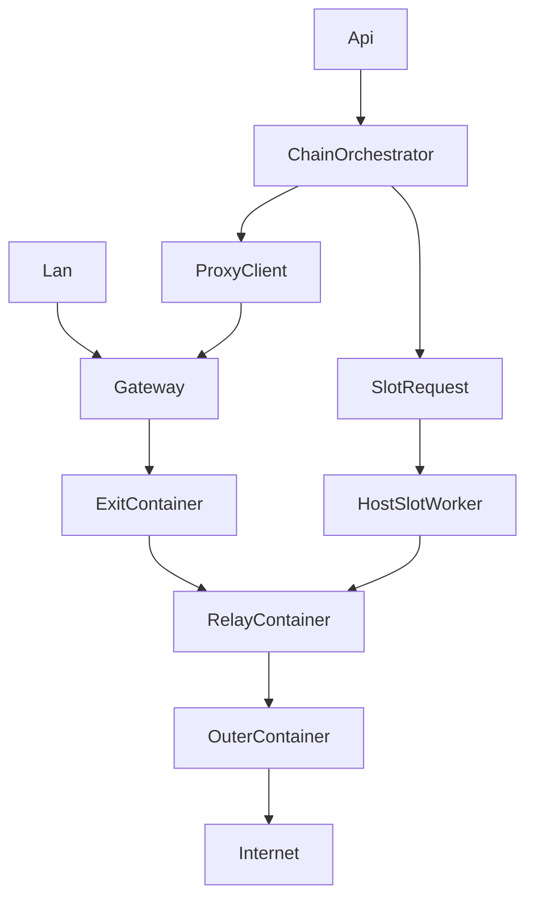
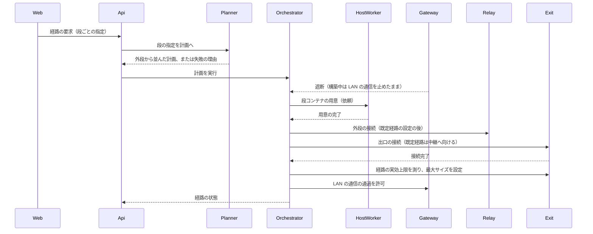

# Design Document

## Overview
この spec は、出口の接続先に出る前に、n 段（出口を含む接続の本数）の経路を組む仕組みを、バックエンド（API・ゲートウェイ・ランナー・ホスト制御）として定める。画面は含まない（`multihop-ui` で扱う）。

**Purpose**: 利用者が、経由する国を段ごとに選んで、出口へ接続できるようにする。
**Users**: 利用者（経路の指定と状態の確認）と、運用者（ホストへの導入と段コンテナの管理）。
**Impact**: 接続の仕組みが「ホストにトンネルを 1 本作る」から、「出口コンテナがトンネルを持ち、ゲートウェイは LAN の通信を出口コンテナへ転送する」へ変わる。段数 1 の接続も同じ構成で扱う（構成を一つにする）。

### Goals
- 段数 n の経路を、段ごとの接続先・提供元・選び方で組めること（要件 1・2・3）
- 段の切断時の動作を、段ごとに遮断または継続で選べること（要件 4）
- 経路の状態と、経路を通る通信の経路・最大サイズを、段数に応じて正しく保つこと（要件 5・6）
- 段のログインを、段の再作成の前後で維持すること（要件 7）

### Non-Goals
- 画面（タブ・スイッチ・一覧）。`multihop-ui` で扱う。
- 同時接続の上限の設定・検出・拒否（要件 1.2）。規約への注意表示は画面の扱い。
- 長い転送の安定性の保証（注意事項として discovery の section 17 に記録）。
- 既存のベンダー機能 Secure Core（アプリに機能がないため、扱わない）。
- 明示的プロキシモード。ホストの経路で通信するため、VPN を迂回して外へ出るおそれがあり、出口コンテナ方式と両立しない。本 spec では無効化し、再実装は別の spec で扱う（利用者の判断: 障害になる場合は削除してよい）。
- 都市の一覧の取得・保存、座標の仕組み（`location-city-selection`・`location-distance-sort`）。

## Boundary Commitments

### This Spec Owns
- 経路（段の列）の計画・接続・切断・状態の一貫性（API の経路の状態）
- 段の接続先の選び方（ランダム・プロバイダ選択・手動選択）の解決
- 出口コンテナへの LAN の経路（ゲートウェイの転送規則。出口コンテナが使えないときの遮断を含む）
- 出口コンテナの NAT と Kill Switch（出口コンテナの中）
- 段ごとのネットワーク・NAT・既定経路（中継コンテナの中）
- 段ごとの最大サイズ（経路の実測による出口の MTU 設定）
- 段の識別（デバイス）と、段のコンテナ（ネットワーク・MAC・ボリューム・ランナーの識別子）の対応
- 段コンテナの作成・作り直しを依頼する仕組み（ホスト側の常駐処理を含む）

### Out of Boundary
- 画面、規約の注意表示、接続先の一覧の取得（`location-city-selection`・`location-distance-sort` の仕事）
- 既存の 1 プロバイダの切替（`providers/provider-switcher.ts`）の業務。経路の実行中の切替は禁止する（6.3）。
- ベンダーの CLI の内部動作（ログインの処理・トンネルの張り方）。ベンダーの宣言（`profile.json`）と、ランナーの entrypoint に閉じる。
- 迂回（bypass）と DNS 中継の、出口コンテナ方式への移行は、既存機能の維持として本 spec の移行タスクで再検証する（移行の検証項目）。

### Allowed Dependencies
- API → proxy: 既存の proxy クライアント（`proxy-client.ts`）の経路と、ランナーのコマンド実行（`executeVendorCommand`）。
- proxy → ランナー: 既存の UDS 転送（`runner-forward.ts`）。段の識別子を加えて宛先を決める。
- proxy → ホスト常駐処理: 依頼ファイル（`host-reboot.ts` と同じ方式）。Docker の操作権限は持たせない。
- ゲートウェイ（ホスト）→ 出口コンテナ: ホストの転送規則で、出口コンテナのネットワークへ送る（トンネルはホストに作らない）。
- ベンダーの宣言: `vendors/<ID>/profile.json` の宣言（段の選び方の規則、未ログインの判定）。本体のコードにベンダーの分岐を書かない。

### Revalidation Triggers
- 経路の状態の形（段の列・段の状態）の変更 → API・画面（`multihop-ui`）の再検証
- 段の識別子（デバイス）の採番・保存形式の変更 → 段コンテナの作成と既存のログインの再検証
- 出口コンテナへの転送規則（ホストの規則・出口コンテナの NAT と Kill Switch）の変更 → 段数 1 を含む全接続の再検証（検証サーバ）
- 中継コンテナの規則の変更 → 段数 2 以上の接続の再検証（検証サーバ）
- 段コンテナの作成方式（依頼の形式・常駐処理の配置）の変更 → インストーラの再検証
- ベンダーの選び方の宣言（`hopSelection`）の変更 → 段の選び方の再検証
- 迂回・DNS 中継の経路の変更 → 既存機能の再検証

## Architecture

### Existing Architecture Analysis
- ゲートウェイ（`proxy`）は `network_mode: host` で動き、単一の `vpnIface` を前提にする（`gateway-controller.ts`）。
- ランナーも `network_mode: host` で動くため、トンネルはホストに作られる。出口コンテナ方式では、トンネルはランナーのコンテナの中に作られ、ホストへは作らない（移行の対象）。
- ランナーは 1 ベンダーに 1 コンテナ。UDS は `runner-<vendorId>.sock`。
- 接続状態は 1 プロバイダに 1 つ（`connection-state-store.ts`）。
- ホスト操作は依頼ファイル（`host-reboot.ts`）で行う前例がある。
- 維持する境界: API はゲートウェイとランナーを HTTPS・UDS 経由でのみ操作する（`tech.md`）。ベンダー固有の値は `profile.json` に置く（`structure.md`）。

### Architecture Pattern & Boundary Map（出口コンテナ方式）

全ての VPN の段（出口を含む）は、ベンダーごとの専用の bridge ネットワーク上のコンテナ（ランナー）で動く。ホストのネットワーク名前空間にはトンネルを作らない。LAN の通信は、ゲートウェイ（ホスト）から出口コンテナへ転送し、出口コンテナが自分のトンネルから外へ出す。



- **出口コンテナ**: 経路の最後の段（出口）のランナー。LAN からの転送を受け、自分のトンネル経由で外へ出す。NAT と Kill Switch を出口コンテナの中で行う。段数 1 の接続も、この構成で扱う。
- **ゲートウェイ（proxy、ホスト）**: LAN の通信を出口コンテナのネットワークへ転送する（ホストの規則）。出口コンテナの状態が取れない、または接続していないときは、LAN の通信を遮断する（fail closed）。ホストの既定経路（wan）は、LAN の通信には使わない。
- **中継コンテナ（段数 2 以上の内側の段）**: 外側の段のネットワーク上で動く。内側の段の通信を、自分のトンネル経由で外側へ送る（NAT と既定経路は、そのコンテナの中で行う）。
- **ベンダーのランナー**: 出口コンテナにも中継コンテナにもなる。役割（出口・中継）は接続の計画で決まる。ベンダーの分岐は本体に書かず、コンテナ内の規則は共通の部品で生成する。
- Selected pattern: 段の列（経路）を、API が計画し、ホストの規則と各コンテナの規則で実現する。段の列は API の状態として持つ。
- Domain boundaries: 計画・選択（API）、LAN の転送（ゲートウェイの規則）、段の中の転送（出口コンテナと中継コンテナの規則）、段コンテナの作成（ホスト常駐処理）。
- Existing patterns preserved: `host-reboot.ts` の依頼ファイル方式、`profile.json` の宣言、`runner-<vendorId>.sock` の UDS 転送。
- Steering compliance: ベンダーの分岐を本体に書かない。`proxy` は host ネットワークのまま、転送規則だけを持つ（トンネルは持たない）。

**Dependency direction** (each layer imports only from layers to its left):
Types（スキーマ・型） → Pure logic（ChainPlanner・HopSelector・規則の生成・PathMtu の解析） → Stores（ChainStateStore・DeviceRegistry） → Orchestration（ChainOrchestrator） → Routes / Gateway channel。

### Technology Stack

| Layer | Choice / Version | Role in Feature | Notes |
|-------|------------------|-----------------|-------|
| Backend / Services | TypeScript（strict）・Fastify 5・TypeBox | 経路の計画・状態・API 契約 | 既存の `api`・`proxy` を拡張 |
| Infrastructure / Runtime | Docker（bridge ネットワーク・固定 MAC・ボリューム）、nftables・policy routing（ホストと各コンテナ） | LAN から出口コンテナへの転送、段ごとの網と通信の経路 | 段コンテナの作成はホスト常駐処理が行う。ランナーのイメージに nftables を含める |
| Host control | POSIX `sh`（インストーラの一部） | 段コンテナの作成・作り直しの依頼の処理 | `shellcheck` で検査 |

## File Structure Plan

### Directory Structure
```
api/src/multihop/                          # 経路の計画・選択・状態（新規ドメイン）
├── chain-spec.ts                          # 経路の指定のスキーマと型（実装済み）
├── result.ts                              # 判別可能な結果型の小さな部品（実装済み）
├── hop-selector.ts                        # 段ごとの接続先の選び方（実装済み）
├── chain-planner.ts                       # 段の指定を、外段から並んだ計画へ変換する（実装済み）
├── chain-orchestrator.ts                  # 経路を外段から順に接続・切断する（ゲートウェイの転送規則の切り替えを含む）
├── chain-state-store.ts                   # 接続状態（ChainStatus）の唯一の保存先と照合
└── device-registry.ts                     # デバイス（段）と MAC・ボリューム・ランナーの識別子の対応
api/src/schemas/multihop.ts                # 経路の要求・応答の TypeBox スキーマ
api/src/routes/connection-chain.ts         # 経路の API（要求の受理・状態の返却）
proxy/src/network/exit-gateway.ts          # LAN から出口コンテナへの転送規則（ホスト側）（純粋な規則生成＋適用）
proxy/src/network/exit-container-rules.ts  # 出口コンテナ内の NAT と Kill Switch、中継コンテナ内の段の規則
proxy/src/network/path-mtu.ts              # 経路の実効上限の DF 付き探索と、出口の MTU 設定
proxy/src/host-control/slot-request.ts     # 段コンテナの作成・作り直しを依頼ファイルで出す
installer/slot-worker.sh                   # ホスト常駐処理（依頼を読み、段コンテナを作る・作り直す）
```

### Modified Files
- `api/src/profile/profile.schema.ts` — 段の選び方の規則（`hopSelection`）を、ベンダーの宣言として追加（実装済み）
- `vendors/adguardvpn/profile.json` — `hopSelection` を宣言（対象の値: ping・最小）（実装済み）
- `vendors/protonvpn/profile.json` — `hopSelection` を宣言（対象の値: Score・最小、`VPN/serverlist.json` の項目）（実装済み）。未ログインの判定は既存の `account.notLoggedInPattern`（`Authentication required`。検証で確認済み）を使う
- `api/src/locations/location-fetcher.ts` — 候補の値（ping・Score）を含む `LocationCatalog` を作る（既存の一覧の取得を拡張）。Score は既存の `availableLocations` と同じ読み取り専用の経路で `VPN/serverlist.json` から読む
- `api/src/connection-state/connection-state-store.ts` — 保存先を `chain-state-store.ts` の `ChainStatus` に一本化する。既存の読み出し口は、`ChainStatus` から既存の接続状態の形に変換して返す
- `proxy/src/network/gateway-controller.ts` — 単一の `vpnIface`（ホストのトンネル）を、出口コンテナの状態（接続・ネットワーク）を取って転送規則を組み替える方式へ置き換える
- `proxy/src/network/connection-monitor.ts` — 段ごとのトンネルの状態を、API の問い合わせに応じて返す
- `proxy/src/gateway-channel/runner-forward.ts` — 段の識別子つきの宛先（`/runners/<vendorId>/<slot>/*`）を、段のランナーの UDS へ転送する
- 明示的プロキシ（`proxy/src/explicit-proxy/`）— 本 spec では無効化する（Non-Goals を参照）

### Compose / Vendor Files
- `compose/gateway.yml` — 段コンテナ用の依頼ディレクトリをマウントする（既存の `host-ctl` と同じ方式）。ランナーの bridge ネットワーク（ベンダーごと）を宣言する
- `vendors/<ID>/compose.yml` — ランナーを `network_mode: host` から、ベンダー専用の bridge ネットワークへ移す（出口コンテナ方式）。段コンテナの定義は持たない（段コンテナはホスト常駐処理が作る）
- `vendors/<ID>/Dockerfile` — 出口・中継コンテナの規則に使う nftables を含める

## Behavioral Contracts (EARS)

各コンポーネントの振る舞いを、要件と同じ EARS 形式で定める。括弧内は対応する要件 ID。Preconditions・Postconditions（Components 節）は、この節の文から導く。

### ChainPlanner
- When 段数 n = 1 の計画が要求されたとき、the ChainPlanner shall 出口だけを含む計画を返す。(1.3)
- When 段の指定が与えられたとき、the ChainPlanner shall 段を外側から内側の順に並べた計画を返す。(1.1, 1.5)
- When 段の指定に切断時の動作が含まれるとき、the ChainPlanner shall 段ごとの切断時の動作を計画に保持する。(4.3)
- If いずれかの段の候補が空のとき、the ChainPlanner shall `no-candidate` を、その段の位置とともに返す。(2.6)
- If いずれかの段の提供元が、利用できないプランのとき、the ChainPlanner shall `plan-unavailable` を、その段の位置と理由とともに返す。(3.3)
- If いずれかの段のログインが失われているとき、the ChainPlanner shall `relogin-required` を、その段の位置とともに返す。(7.2)

### HopSelector
- While 段の選び方が random である間、the HopSelector shall 候補から無作為に 1 つを選ぶ。(2.1)
- Where 段の選び方が provider である場合、the HopSelector shall 段の提供元の `hopSelection` の規則に従って接続先を選ぶ。(2.2)
- When 段の提供元が `exit` であるとき、the HopSelector shall 出口の接続先と同じ提供元の候補から選ぶ。(2.3)
- Where 段の選び方が manual である場合、the HopSelector shall 指定された接続先を、その段の接続先として返す。(2.4)
- While 段の選び方が random または provider である間、the HopSelector shall 選ばれた接続先を読み取り専用として返す。(2.5)
- When 段の選び方が変更されたとき、the HopSelector shall その段の接続先を変更後の選び方で決め直す。(2.7)

### ChainOrchestrator
- When 経路の接続が要求されたとき、the ChainOrchestrator shall 段を外側から順に、段コンテナの用意、既定経路の設定、接続の順で実行する。(1.1, 3.1, 3.2)
- If いずれかの段の接続が完了しないとき、the ChainOrchestrator shall 接続済みの段を外側から順に切断し、失敗した段の位置と理由を返す。(1.4)
- When 経路の接続が完了したとき、the ChainOrchestrator shall 経路の実効上限を測り、出口の最大サイズを設定する。(6.2)
- When 段が追加されたとき、the ChainOrchestrator shall 経路の実効上限を測り直し、出口の最大サイズを設定し直す。(6.4)
- While 別の接続または切断が実行中である間、the ChainOrchestrator shall 新しい経路の要求を拒否する。(6.3。排他制御。Preconditions を参照)
- When 経路の接続が要求されたとき、the ChainOrchestrator shall 段ごとにログイン状態を、profile の `account` 操作の `notLoggedInPattern` で確認する（AdGuard VPN: `Please log in|not logged in`、ProtonVPN: `Authentication required`）。(7.2)
- If いずれかの段のログインが失われているとき、the ChainOrchestrator shall 接続を開始せず、その段の位置と `relogin-required` を返す。(7.2)

### ChainStateStore
- While 経路が接続中である間、the ChainStateStore shall 段ごとの位置・接続先・提供元・状態を、外側から内側の順で返す。(1.5, 5.1)
- When いずれかの段の状態が変わったとき、the ChainStateStore shall 変わった段の位置と新しい状態を返す。(4.6, 5.2)
- While 段数が 1 である間、the ChainStateStore shall 保存されている `ChainStatus` を、既存の接続状態の形に変換して返す。(5.3)
- The ChainStateStore shall 接続状態の保存先を 1 つだけ持つ。(1.3, 5.3)

### ConnectionMonitor
- While 経路が接続中である間、the API shall proxy に段ごとのトンネルの状態を、既存の接続監視と同じ間隔で問い合わせる。(5.2, 4.6)
- When 段の状態が前回の問い合わせと異なったとき、the ChainStateStore shall 変わった段の位置と新しい状態を保存する。(4.6, 5.2)
- If 段の状態の問い合わせが失敗したとき、the ChainStateStore shall 経路の状態を `unknown` とし、LAN からの通信を遮断したままにする。(4.4, 4.5)

### DeviceRegistry
- When デバイスが登録されたとき、the DeviceRegistry shall MAC アドレスとボリュームを決めて保存し、以後その変更を受け付けない。(7.1)
- When デバイスが登録されたとき、the DeviceRegistry shall そのデバイスの提供元を記録する。(3.1)

### ExitGateway と出口コンテナの規則
- While 経路が接続中である間、the ExitGateway shall LAN からの通信を出口コンテナのネットワークへ転送する。(6.1)
- If 出口コンテナが接続していない、または状態を取れないとき、the ExitGateway shall LAN からの通信を遮断する。(4.1, 4.4)
- While 経路が接続中でない間（構築中を含む）、the ExitGateway shall LAN からの通信を遮断する（fail closed）。(4.1, 6.1)
- When 全段の接続と出口の最大サイズの設定が完了したとき、the ExitGateway shall LAN からの通信の通過を許可する。(6.1)
- While 段が接続中の間、the 出口コンテナの規則 shall 自分のトンネル経由の外向き通信だけを許可し、トンネルを経由しない外向き通信を遮断する（Kill Switch）。(4.1, 6.1)
- If 切断時の動作が `blockAll` の段が切断されたとき、the ExitGateway shall 経路上の通信を遮断する。(4.1)
- If 切断時の動作が `dropHop` の段が切断されたとき、the 中継コンテナの規則 shall その段を経路から外し、外側の段への既定経路を残りの段へ向け直す。(4.2)
- If 切れた段を外した後も経路が成立しないとき、the ExitGateway shall 経路上の通信を遮断する。(4.5)

### PathMtu
- When 経路が接続されたとき、the PathMtu shall DF ビットを立てた探索で、経路の実効上限を測る。(6.2)
- While 経路の実効上限が測れている間、the PathMtu shall 上限以下の大きさの通信が通るよう、出口の最大サイズを設定する。(6.3)
- If 探索の結果が得られないとき、the PathMtu shall 既存の最大サイズを変更しない。(6.2)

### SlotRequest と HostSlotWorker
- When 段コンテナの用意が要求されたとき、the SlotRequest shall 依頼ファイル `requests/<requestId>.json`（項目: requestId・deviceId・provider・mac・volume・createdAt）を、一時名で書いてから改名して置く。(1.2, 7.1)
- While 応答ファイル `responses/<requestId>.json` が未着の間、the SlotRequest shall 1 秒ごとに応答を確かめ、180 秒を超えたら `timeout` として返す。(1.2, 1.4)
- When 依頼を受けたとき、the HostSlotWorker shall 依頼の mac と volume が DeviceRegistry の値と一致するかを確かめ、一致しなければ `rejected` を応答に書く。(7.1)
- When 段コンテナの作成が完了したとき、the HostSlotWorker shall `done` を応答に書く。(1.2)
- If 段コンテナの作成が失敗したとき、the HostSlotWorker shall `failed` と理由を応答に書く。(1.2)
- The HostSlotWorker shall 同じ requestId の依頼を、二度作成しない。(1.2)

### 接続の経路 API（connection-chain route）
- If 変更できない段の変更が要求されたとき、the connection-chain route shall 変更を拒否し、理由を返す。(2.5)

## System Flows

### 経路の接続（出口コンテナ方式・段数 n）



- 接続は外段から順に行う。段ごとに「既定経路の向きを変える → その段を接続する」の順。内段が失敗したら、接続済みの外段から順に切断する（要件 1.4）。
- 構築中は、LAN の通信を遮断したままにする。全段の接続と出口の最大サイズの設定が終わってから、通過を許可する（要件 4.1）。
- 段コンテナの用意は、依頼と応答の完了で行う。完了を待つ時間には上限を設ける（Error Handling 参照）。

## Requirements Traceability

| Requirement | Summary | Components | Interfaces | Flows |
|-------------|---------|------------|------------|-------|
| 1.1 | 段数 n の経路で、出口の前に n − 1 段の入口を経由して接続する | ChainPlanner, ChainOrchestrator, RelayRules | `planChain`, `connectChain` | 経路の接続 |
| 1.2 | 段数・同時接続の本数に上限を設けない | HostSlotWorker, DeviceRegistry, SlotRequest | `requestSlot` | 経路の接続 |
| 1.3 | 段数 1 の接続は、今の接続と同じ結果 | ChainPlanner, ChainStateStore | `planChain`（段数 1）, `ChainStatus` | 経路の接続 |
| 1.4 | 段の接続が完了しないとき、経路を完了させず、失敗した段と理由を返す | ChainPlanner, ChainOrchestrator | `ChainError` | 経路の接続 |
| 1.5 | 経路の段の並び（入口から出口）を保持する | ChainStateStore | `ChainStatus` | — |
| 2.1 | ランダムの段は、候補から無作為に選ぶ | HopSelector | `resolveHop` | — |
| 2.2 | プロバイダ選択の段は、提供元の規則（ping・Score の最小）で選ぶ | HopSelector, profile の `hopSelection` | `resolveHop` | — |
| 2.3 | プロバイダ選択の既定の提供元は、出口と同じ | HopSelector | `HopSpec.provider` | — |
| 2.4 | 手動選択の段は、指定された接続先を使う | HopSelector | `resolveHop` | — |
| 2.5 | ランダム・プロバイダ選択の段は、選ばれた接続先を返し、変更を受け付けない | HopSelector, connection-chain route | `ChainStatus.hops[].selection` | — |
| 2.6 | 候補がない段は、接続を開始せず、候補がないことを返す | ChainPlanner | `ChainError` | — |
| 2.7 | 段の選び方を変えたら、その段の接続先を決め直す | HopSelector | `resolveHop` | — |
| 3.1 | 段ごとに提供元が異なる経路を、1 つの経路として扱う | ChainPlanner, ChainOrchestrator, DeviceRegistry | `HopPlan.provider` | 経路の接続 |
| 3.2 | 出口と同じ提供元の段も、異なる提供元と同じ方法で扱う | ChainOrchestrator | `HopPlan` | 経路の接続 |
| 3.3 | 提供元のプランで利用できない組み合わせは、接続を開始せず理由を返す | ChainPlanner | `ChainError` | — |
| 4.1 | 既定は、いずれかの段の切断で通信を遮断する | ExitGateway, ExitContainerRules | `buildExitGatewayRules` | 経路の接続 |
| 4.2 | 「切れた段を外して継続」の段は、切断時に経路から外し、残りで継続する | RelayRules, ConnectionMonitor, ChainStateStore | `RelayInput.onFailure` | — |
| 4.3 | 切断時の動作を、段ごとに指定する | ChainPlanner | `HopSpec.onFailure` | — |
| 4.4 | 出口が切れたら、通信を遮断し、切断として返す | ExitGateway, ConnectionMonitor | `ChainStatus.state` | — |
| 4.5 | 切れた段を外した後も経路が成立しないとき、遮断し切断として返す | ExitGateway, ConnectionMonitor | `ChainStatus.state` | — |
| 4.6 | 段が切断されたら、段の位置と取られた動作を返す | ConnectionMonitor, ChainStateStore | `ChainEvent` | — |
| 5.1 | 接続中は、各段の接続先（入口から出口）と状態を返す | ChainStateStore, connection-chain route | `ChainStatus` | — |
| 5.2 | 段の状態が変わったら、段の位置と新しい状態を返す | ConnectionMonitor, ChainStateStore | `ChainEvent` | — |
| 5.3 | 段数 1 の接続は、今の接続状態と同じ内容を返す | ChainStateStore | `ChainStatus`（段数 1） | — |
| 6.1 | 通信は、すべての段を経由して出口へ送る | ExitGateway, ExitContainerRules, RelayRules | `buildExitGatewayRules`, `buildRelayRules` | 経路の接続 |
| 6.2 | 経路の実効上限に合わせて、通信の最大サイズを設定する | PathMtu | `measureExitMtu` | 経路の接続 |
| 6.3 | 実効上限以下の大きさの通信を、途中で止めずに通す | PathMtu | `measureExitMtu` | — |
| 6.4 | 段が追加されて上限が下がったら、最大サイズを設定し直す | PathMtu, ChainOrchestrator | `measureExitMtu` | — |
| 7.1 | 段のログインを、段の再作成の前後で維持する | DeviceRegistry, HostSlotWorker | `DeviceRecord` | — |
| 7.2 | 段のログインが失われたら、段の接続を開始せず、再ログインが必要と返す | ChainOrchestrator, ChainPlanner | `ChainError`（`relogin-required`） | — |

## Components and Interfaces

### Summary

| Component | Domain/Layer | Intent | Req Coverage | Key Dependencies (P0/P1) | Contracts |
|-----------|--------------|--------|--------------|--------------------------|-----------|
| ChainPlanner | api / 計画 | 段の指定を、外段から並んだ計画へ変換する | 1.1, 1.3, 1.4, 2.6, 3.3 | HopSelector (P0), profile (P1) | Service |
| HopSelector | api / 選択 | 段ごとの接続先を、選び方から決める | 2.1–2.5, 2.7 | profile の `hopSelection` (P0) | Service |
| ChainOrchestrator | api / 実行 | 計画を、外段から順に接続・切断する | 1.1, 1.4, 3.1, 3.2, 6.3, 6.4, 7.2 | ProxyClient (P0), ChainStateStore (P0), DeviceRegistry (P0) | Service |
| ChainStateStore | api / 状態 | 接続状態（ChainStatus）を唯一の保存先で保持し、変化を返す | 1.3, 1.5, 4.6, 5.1–5.3 | ConnectionMonitor の結果 (P0) | State |
| DeviceRegistry | api / 識別 | デバイス（段）と MAC・ボリューム・識別子の対応を保持する | 3.1, 7.1 | HostSlotWorker (P1) | State |
| ExitGateway | proxy / 通信 | LAN から出口コンテナへの転送と、遮断・通過の切り替え | 4.1, 4.4, 4.5, 6.1 | nftables (P0) | Service |
| ExitContainerRules | runner / 通信 | 出口コンテナ内の NAT と Kill Switch | 4.1, 6.1 | runner の nftables (P0) | Service |
| RelayRules | runner / 通信 | 中継コンテナ内の段ごとの既定経路と NAT、切断時の動作 | 1.1, 4.2, 6.1 | ExitContainerRules (P1) | Service |
| PathMtu | proxy / 通信 | 経路の実効上限を DF 探索し、出口の MTU を設定する | 6.2, 6.3, 6.4 | ICMP（既存の command-runner） (P0) | Service |
| ConnectionMonitor | proxy / 監視 | 段ごとのトンネルの状態を、API の問い合わせに応じて返す | 4.2, 4.4–4.6, 5.2 | fetchProxyStatus (P0), ExitGateway (P1) | Service |
| SlotRequest | proxy / 依頼 | 段コンテナの作成・作り直しを依頼ファイルで出す | 1.2, 7.1 | HostSlotWorker (P0) | Batch |
| HostSlotWorker | host / 常駐処理 | 依頼を読み、段コンテナを作る・作り直す | 1.2, 7.1 | Docker（ホスト） (P0) | Batch |
| connection-chain route | api / 経路 API | 経路の要求・状態・変更の拒否を HTTP で受ける | 2.5, 5.1 | ChainOrchestrator (P0) | API |

### API / 経路

#### ChainPlanner

| Field | Detail |
|-------|--------|
| Intent | 段の指定（出口と段ごとの指定）を、外段から並んだ計画へ変換する。計算のみで副作用を持たない。 |
| Requirements | 1.1, 1.3, 1.4, 2.6, 3.3 |

**Contracts**: Service [x]

##### Service Interface
```typescript
interface ChainPlanner {
  planChain(input: ChainSpec, catalog: PlanInput): Result<ChainPlan, ChainError>;
}

// 経路の指定（ChainSpec）は api/src/multihop/chain-spec.ts のスキーマで定める（実装済み）。
// hops は出口に近い順（hops[0] が出口の 1 つ前）。手動選択の段だけが manualLocationId を持つ。
type HopPlan = {
  position: number;                  // 出口からの位置（出口の 1 つ前が 1、出口は 0）
  locationId: string;
  provider: string;
  deviceId: string;                  // 段のデバイス（DeviceRegistry の識別子）
  onFailure: "dropHop" | "blockAll";
};
type ChainPlan = {
  hops: ReadonlyArray<HopPlan>;      // 外段から順（接続の順序）
  exit: HopPlan;
};
type ChainError =
  | { kind: "no-candidate"; hopIndex: number }
  | { kind: "plan-unavailable"; hopIndex: number; reason: "plan" | "rule-missing" | "provider-required" | "device" }
  | { kind: "relogin-required"; hopIndex: number };
type Result<T, E> = { ok: true; value: T } | { ok: false; error: E };
```
- Preconditions: 提供元は、プロファイル登録（ベンダーの ID）から導出した値だけを使う。
- Postconditions: 戻り値の `hops` は外段から並ぶ。段数は `hops.length + 1`。
- Invariants: 段ごとの `onFailure` は、計画に変わらず残る。

#### HopSelector

| Field | Detail |
|-------|--------|
| Intent | 段ごとの接続先を、選び方（ランダム・プロバイダ選択・手動選択）から決める。 |
| Requirements | 2.1–2.5, 2.7 |

**Contracts**: Service [x]

##### Service Interface
```typescript
interface HopSelector {
  resolveHop(hop: HopSpec, context: HopSelectionContext): Result<LocationCandidate, HopSelectionError>;
}
type LocationCandidate = {
  locationId: string;
  provider: string;
  values: Readonly<Record<string, number>>; // hopSelection の value が参照する値（例: ping・Score）
};
type HopSelectionError =
  | { kind: "no-candidate" }
  | { kind: "rule-missing"; provider: string }
  | { kind: "provider-required" };
```
- Preconditions: `candidates` は全提供元の候補。提供元の絞り込みは本関数で行う。
- Postconditions: 戻り値は `candidates` の要素。`provider` が `exit` のときは出口と同じ提供元の候補を使う。

#### ChainOrchestrator

| Field | Detail |
|-------|--------|
| Intent | 計画を外段から順に接続し、失敗時は接続済みの段を外側から切断する。構築中は LAN の通信を遮断し、完了後に通過させる。 |
| Requirements | 1.1, 1.4, 3.1, 3.2, 6.3, 6.4, 7.2 |

**Contracts**: Service [x]

##### Service Interface
```typescript
interface ChainOrchestrator {
  connectChain(plan: ChainPlan): Promise<Result<ChainStatus, ChainError | SlotError>>;
  disconnectChain(): Promise<Result<ChainStatus, ChainError>>;
}
```
- Preconditions: 同時に実行する経路の接続・切断は 1 つだけ（既存の `assertNotSwitching` と同じ排他）。経路の実行中は、プロバイダの切替を拒否する（6.3）。
- Postconditions: 成功時、`ChainStatus.state` は `connected`。失敗時は、接続済みの段がすべて切断され、LAN の通信は遮断されたままである。
- Invariants: 段の接続順は、常に外段から内段（経路の順）。

#### ChainStateStore

| Field | Detail |
|-------|--------|
| Intent | 接続状態（ChainStatus）を唯一の保存先で保持し、段ごとの変化を返す。 |
| Requirements | 1.3, 1.5, 4.6, 5.1–5.3 |

##### State Management
```typescript
type ChainState = "connected" | "disconnected" | "blocked" | "unknown";
type ChainHopStatus = {
  position: number;
  locationId: string;
  provider: string;
  selection: "random" | "provider" | "manual";
  state: "connected" | "disconnected";
  onFailure: "dropHop" | "blockAll";
};
type ChainStatus = { state: ChainState; hops: ReadonlyArray<ChainHopStatus>; exitMtu?: number };
```
- Persistence & consistency: 接続状態の保存先は API のストア 1 か所。起動時に proxy の実際の状態と照合する（既存の `reconcileLocation` と同じ方針）。切替（`switchProvider`）と照合は、この保存先だけを見る。
- Concurrency strategy: 経路の変更は `ChainOrchestrator` の排他の中でだけ書く。

**Implementation Notes**
- Integration: 段数 1 の状態は、同じ `ChainStatus` を既存の接続状態の形に変換して返す（要件 5.3）。
- Validation: 段の並び（position）が連続し、外側から内側の順であることを、保存前に確かめる。
- Risks: 段の状態の問い合わせの失敗時は `unknown` とし、遮断を続ける。

#### DeviceRegistry

| Field | Detail |
|-------|--------|
| Intent | 段（デバイス）ごとに、提供元・MAC・ボリューム・ランナーの識別子の対応を保持する。 |
| Requirements | 3.1, 7.1 |

##### State Management
- State model: `DeviceRecord = { deviceId: string; provider: string; mac: string; volume: string; runnerSlot: string }`。`mac` と `volume` は、デバイスを登録したときに決め、以後変えない。
- Persistence & consistency: 登録の保存先は API の永続ボリューム。`mac` の変更は許さない（要件 7.1）。
- Concurrency strategy: 登録は 1 か所（API）だけが書く。

#### ExitGateway・ExitContainerRules・RelayRules

| Field | Detail |
|-------|--------|
| Intent | LAN から出口コンテナへの転送（ホスト側）、出口コンテナ内の NAT と Kill Switch、中継コンテナ内の段の規則を、純粋な規則の生成として定め、適用する。 |
| Requirements | 1.1, 4.1, 4.2, 4.4, 6.1 |

##### Service Interface
```typescript
interface ExitGatewayRules {
  buildExitGatewayRules(input: ExitGatewayInput): string;   // ホストの nftables 規則文（純粋関数）
}
type ExitGatewayInput = {
  lanIface: string;
  exitBridgeIface: string;   // 出口コンテナのネットワークのインターフェース（ホスト側）
  exitContainerAddress: string;
  blocked: boolean;          // true のとき、LAN の通信を全て遮断する
};

interface ExitContainerRules {
  buildExitContainerRules(input: ExitContainerInput): string; // 出口コンテナ内の nftables 規則文
}
type ExitContainerInput = {
  lanNet: string;            // ゲートウェイからの転送の送信元
  tunnelIface: string;
  killSwitch: true;          // 出口コンテナは常に Kill Switch を持つ
};

interface RelayRules {
  buildRelayRules(input: RelayInput): string;                 // 中継コンテナ内の規則文
}
type RelayInput = {
  innerNet: string;
  tunnelIface: string;
  outerGateway: string;      // 外側の段のアドレス（既定経路の向き）
  onFailure: "dropHop" | "blockAll";
};
```
- Preconditions: インターフェース名・アドレス・CIDR は形式を検証してから規則へ埋め込む（既存の `ruleset.ts` と同じ方針）。
- Postconditions: `blocked` が真のとき、生成される規則は LAN の通信を全て遮断する。
- Invariants: 出口コンテナの規則は、トンネルを経由しない外向き通信を常に遮断する（Kill Switch）。

**Implementation Notes**
- Integration: 既存の `ruleset.ts` の方針（インターフェース名の検証、fail closed）を踏襲する。出口コンテナの規則は、そのコンテナの中で適用する。
- Validation: 規則の生成は純粋関数として試験する。実際の適用は、検証サーバで確かめる。
- Risks: 出口コンテナの Kill Switch の抜け（トンネルを経由しない外向き通信）。試験でトンネルを切って確かめる。

#### PathMtu（proxy）

| Field | Detail |
|-------|--------|
| Intent | 外へ出る経路の実効上限を DF 付き ICMP で探索し、出口のトンネルの MTU を設定する。 |
| Requirements | 6.2, 6.3, 6.4 |

##### Service Interface
```typescript
interface PathMtu {
  measureExitMtu(exitContainer: string, target: string): Promise<Result<{ payloadMax: number; tunnelMtu: number }, "unreachable">>;
  applyExitMtu(exitContainer: string, tunnelMtu: number): Promise<void>;
}
```
- Preconditions: 探索の宛先は、経路の外へ出る到達先（既定は 1.1.1.1）。
- Postconditions: `tunnelMtu` は、探索で通った IP サイズ以下。
- Invariants: 探索の結果が得られないとき、既存の MTU を変えない。

#### SlotRequest / HostSlotWorker

| Field | Detail |
|-------|--------|
| Intent | 段コンテナの作成・作り直しを、ホスト側の常駐処理へ依頼ファイルで出す（Docker の権限を API に渡さない）。 |
| Requirements | 1.2, 7.1 |

**Contracts**: Batch [x]

##### Batch / Job Contract
- Trigger: 段（デバイス）の登録・作り直しの要求（ChainOrchestrator から）
- Input / validation: 依頼ファイル `requests/<requestId>.json`（requestId・deviceId・provider・mac・volume・createdAt）。常駐処理は、MAC と ボリューム名を `DeviceRegistry` の値と照合してから作る。
- Output / destination: 段コンテナ（ネットワーク・MAC・ボリューム・ランナーの識別子を固定）。結果は応答ファイル `responses/<requestId>.json`（`done`・`failed`・`rejected`）に書く。
- Idempotency & recovery: 同じ requestId は二度処理しない。同じデバイスの作り直しは、ボリュームを残して既存のコンテナを置き換える。`timeout` は依頼側が 180 秒で判定する。

**Implementation Notes**
- Integration: 依頼ディレクトリは `compose/gateway.yml` と同じ方式でマウントする。常駐処理は installer が配布する。
- Validation: 常駐処理の検査は `shellcheck` と、依頼の形式の試験（tests）で行う。
- Risks: 常駐処理の遅延が経路の接続を遅らせる（Error Handling の上限を設ける）。

## Data Models

### Domain Model
- 経路（Chain）: 出口と、外段から並んだ段（Hop）の列。不変条件: 段の位置は連続し、外段から内段の順。
- 段（Hop）: デバイス（DeviceRecord）に対応する、1 本のトンネル。段の選び方（HopSpec）と切断時の動作（onFailure）を持つ。
- 出口（Exit）: 経路の最後の段。出口コンテナのトンネルを持ち、LAN の通信の出口になる。
- デバイス（DeviceRecord）: 提供元・MAC・ボリューム・ランナーの識別子。登録の時点で決まり、以後変わらない。

### Logical Data Model
- `ChainStatus`（ChainStateStore の節を参照）。段の位置を主キーとする。
- `DeviceRecord`: 主キーは `deviceId`。`mac` は一意。`volume` は一意。

### Data Contracts & Integration
- 経路の要求・応答は TypeBox スキーマ（`api/src/schemas/multihop.ts`）で定義し、OpenAPI に出す（既存の仕組み）。
- 段の選び方の規則（`hopSelection`）は、profile のスキーマ（`profile.schema.ts`）に定義する（実装済み）。

## Error Handling

### Error Strategy
- 計画の段階で失敗する要因（候補なし・提供元のプラン・再ログイン）は、接続を開始せず、段の位置と理由を返す（Fail Fast）。
- 接続の段階で失敗したら、接続済みの段を外側から切断し、経路の状態を切断として返す。LAN の通信は遮断したままにする（fail closed）。

### Error Categories and Responses
- **利用者の誤り（4xx）**: 候補なし、手動の接続先が存在しない、変更不可の段の変更要求 → 段の位置と理由を返す。
- **接続の失敗（5xx）**: 段の接続が完了しない、段コンテナの用意が上限時間内に終わらない → 接続済みの段を外側から切断し、失敗した段を返す。
- **ログインの失効**: 段のログイン状態が失われた → 接続を開始せず、`relogin-required` を返す。

### Monitoring
- 段ごとの状態の変化を `ChainEvent` として記録する（監査ログ・既存の接続ログ）。
- 段コンテナの用意の時間を計測し、上限時間の目安とする（Open Questions）。

## Testing Strategy

- **Unit Tests**:
  1. `chain-planner`: 段数 1 の計画、外段から並ぶこと、候補なし・提供元のプラン・再ログイン・規則なしの失敗（要件 1.3・1.4・2.6・3.3・7.2）（実装済み）
  2. `hop-selector`: ランダム（乱数を注入）、プロバイダ選択の規則（ping・Score の最小）、既定の提供元が出口と同じになること（要件 2.1–2.3）（実装済み）
  3. `exit-gateway` と `exit-container-rules`: 遮断（blocked）の規則、Kill Switch の規則、中継の既定経路の規則が仕様どおりであること（要件 4.1・4.2・6.1）
  4. `path-mtu`: DF 探索の結果の解析（通った最大と通らない最小）（要件 6.2）
- **Integration Tests**:
  1. `chain-orchestrator`（ProxyClient を差し替え）: 外段から順の接続、途中の段の失敗で接続済みの段が外側から切れ、LAN の通信が遮断されたままになること（要件 1.1・1.4・4.1）
  2. `device-registry` と `slot-request`: 同じ MAC・ボリュームで作り直すと、ログインの状態が残る依頼になること（要件 7.1）
  3. `connection-chain` route: 変更不可の段の変更要求が拒否されること（要件 2.5）
- **E2E/UI Tests**: 対象外（画面は `multihop-ui`）。
- **Acceptance（検証サーバ、手動）**:
  1. 段数 1・2・3・5 の経路を、出口コンテナ方式で接続し、LAN（検証用のクライアント）からの通信が出口の IP で出ることを確かめる（要件 1.1・1.3・3.1・6.1）
  2. 段の再作成の前後でログインが残ることを確かめる（要件 7.1）。未ログインの段で接続が止まることを確かめる（要件 7.2）
  3. トンネルを切ったとき、LAN の通信が遮断されることを確かめる（要件 4.1・4.4）
  4. 長い転送（10 MB 以上）の全量取得を、段数ごとに確かめる（注意事項。要件の制約ではない）

## Security Considerations
- 段コンテナの作成は、ホスト常駐処理だけが行う。API と proxy に Docker の操作権限を渡さない。
- 依頼ファイルは、既存の再起動依頼と同じ権限・配置で置く。常駐処理は依頼の内容（MAC・ボリューム名）を `DeviceRegistry` の値と照合する。
- ログイン情報（トークン）は、段ごとのボリュームに保存する（既存の方式）。経路の状態・ログには、トークンを含めない。
- 出口コンテナの Kill Switch は、トンネルを経由しない外向き通信を遮断する。ホストの既定経路（wan）を LAN の通信に使わない。
- 明示的プロキシは、ホストの経路で通信するため本 spec では無効化する（VPN の迂回による漏えいを防ぐ）。

## Performance & Scalability
- 段の接続は、段ごとに外段から順に行うため、接続時間は段数に比例する（約 1 段あたり数十秒を見込む。検証で計測）。
- 経路の実効上限は、接続時に 1 回測る。段の追加・削除のときに測り直す。
- 段数の上限は設けない（要件 1.2）。段が増えると、遅延が積み上がる（実測: AdGuard VPN 1 段 約 0.5 秒、5 段 約 2.4 秒の往復時間）。遅延は仕様上の制約ではなく、利用者への注意の対象。
- Score の読み出し（`VPN/serverlist.json`、約 26 MB）は、API で結果を保持して、キャッシュの更新時刻が変わったときだけ読み直す（模擬データでの解析は約 0.16 秒）。

## Migration Strategy
- 既存のランナーは `network_mode: host` で動いている。出口コンテナ方式へは、ベンダーごとに bridge ネットワークへ移す（`vendors/<ID>/compose.yml`）。
- 段数 1 の接続も、出口コンテナ方式で扱う。移行の検証は、既存の 1 段接続（段数 1）が従来と同じ結果（同じ出口 IP・LAN からの通信が通ること）になることを確かめる。
- 迂回（bypass）と DNS 中継は、出口コンテナ方式で動くように移す。既存の挙動を、移行の検証項目として確かめる（既存機能の維持）。
- 明示的プロキシは、本 spec では無効化する。再実装は別の spec で扱う。
- 段数 2 以上の経路での切替（`switchProvider`）は禁止する（経路を先に切断する）。

## Open Questions / Risks
1. **段コンテナの用意の上限時間（暫定値 180 秒）**: 依頼と応答の形式、状態、タイムアウトは SlotRequest の EARS で定義済み。上限の値は検証で計測して確定する。
2. **本番の経路での MTU**: 検証サーバの経路で実測した値は、本番の経路（既定経路が本番ゲートウェイを経由）と異なる可能性がある。接続のたびの実測で補う。
3. **既存 spec との衝突**: `location-city-selection`・`location-distance-sort` と、接続状態・一覧のコードを同時に触る。統合の順序を tasks で決める。
4. **出口コンテナ方式の検証**: ゲートウェイからの転送と、出口コンテナ内の NAT と Kill Switch の組み合わせは、検証サーバで初めて確かめる（設計の前提）。
5. **迂回と DNS 中継の移行**: 出口コンテナ方式で既存の挙動を保つ方法は、移行の作業の中で確かめる。
6. **要件 1.2 と段のデバイスの関係（解決: 意図どおり）**: 段数に上限は設けないが、段ごとに別のログイン（デバイス）が必要なため、同時に張れる段数は登録済みのデバイス数で実質的に決まる。
