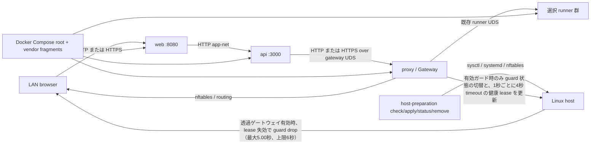
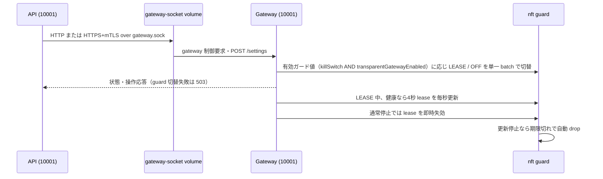
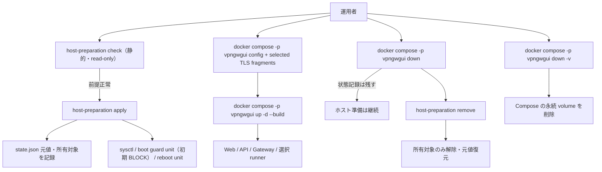
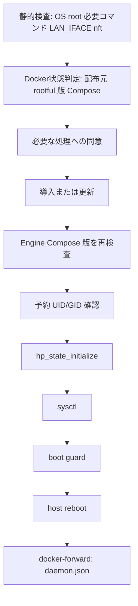

# 技術設計: single-node-deployment

## Overview

本設計は、Web・API・Gateway と選択したベンダー runner を Debian 12 以降または Ubuntu 22.04 以降の1台の Linux ノード上の Docker Compose で運用する方式を定める。nftables/systemd による boot guard を適用・確認できない環境はサポートせず、ホスト準備を失敗させる。対象は家庭・小規模 LAN の運用者と管理画面の利用者であり、Compose による起動・更新・停止・削除と、これに必要な最小限のホスト準備を提供する。

Web HTTPS は既定 OFF、API→Gateway TLS も既定 OFF とし、2区間を独立に設定する。Web→API は Compose 内の HTTP、API→Gateway は API と Gateway のみが共有する filesystem UDS を使う。管理者認証、VPN 操作、runner 制限、永続データの通常保持は維持する。旧インストーラの構成生成・常設コマンドと分離配置を撤去する。

### Goals
- root Compose 単独と標準 Compose merge で単一ノード構成を定義する。
- check/apply/status/remove のホスト準備と、透過ゲートウェイ停止時の転送遮断を明確な所有境界で実装する。
- 2つの通信保護設定、証明書検証、Cookie Secure、E2E の契約を固定する。
- Compose の通常操作でデータを保持し、明示的な `down -v` のみを永続データ削除操作とする。

### Non-Goals
- 複数ノード、役割選択・遠隔配置・ペアリング、旧方式からの移行。
- Web/API のプロセス統合、外部向け証明書自動取得、VPN 機能やベンダー固有動作の変更。
- Docker Engine または Compose plugin の撤去、常設の Docker installer/update/uninstall コマンド、Docker 28 以上の導入済み版の更新。

## Boundary Commitments

### This Spec Owns
- root Compose のサービス定義、ベンダー fragment の merge 契約、固定 project 名と永続 volume の命名。
- ホスト準備の check/apply/status/remove 契約、製品所有のホスト状態記録、boot guard、host-reboot 依頼、透過ゲートウェイ停止時の lease guard、Gateway に反映できない有効ガード値変更の拒否。
- Web/API/proxy の通信設定、UDS の所有・権限、TLS 証明書入力と失敗動作。
- hosted E2E と手動 vendor-live の新しい API 到達・通信保護契約、配布・README・steering の更新。

### Out of Boundary
- 隣接仕様 `e2e-tests` の全般的な VPN シナリオ追加、`vendor-live-e2e` のベンダー別検証内容、`multihop-backend` の多段接続実装。
- `location-city-selection` と `location-distance-sort` の機能・UI契約変更。
- ベンダー bundle の宣言内容や runner→Gateway の既存 `ctl-socket` プロトコル変更。
- 既存 LAN 入力ポート・DNS・迂回・Kill Switch の機能設計変更。ただし起動・停止遮断との接続点は対象（Gateway に反映できない有効ガード値変更の拒否を含む）。

### Allowed Dependencies
- Compose v2 の標準 `-f`/`COMPOSE_FILE` merge と Docker named volumes。`include`、専用 generator、役割別 Compose の自動生成は禁止。
- Node.js の `node:http`/`node:https`/`node:net`、Undici `socketPath`、Fastify の現行プロキシ API。`@fastify/http-proxy` は Fastify 5 対応の最新 11.x（調査時点で 11.6.9、11.6.6 以上）へ `web/package.json` と lockfile で限定更新する。
- Linux systemd、sysctl、nftables、既存の Docker Engine。ベンダー差は `vendors/<ID>/profile.json` と各 bundle 内へ閉じる。
- TypeScript strict、`any` 禁止、実運用コード・コメントにベンダー ID/表示名/CLI 名を記載しない。

### Revalidation Triggers
- 環境変数名・既定値・証明書形式/パス、UDS パス・所有者・モードを変更した場合。
- Compose project 名、サービス名、volume 名、fragment merge 順またはホスト準備が所有する設定を変えた場合。
- guard の切替主体（boot unit と proxy の2者）、6秒の上限、lease 期限、guard の nftables 順序・遮断範囲を変えた場合。
- 有効ガード値変更（`killSwitch && transparentGatewayEnabled`）の反映契約（Gateway 反映成功後にだけ保存、失敗は 503）または API の設定再通知の周期を変えた場合。
- API/Web の公開ポート、Cookie の Secure 判定、Web→API または API→Gateway の transport を変えた場合。
- 隣接する5仕様の前提、配布物の構成、runner の制御許可リストを変えた場合。

## Architecture

### Existing Architecture Analysis

現在は root `docker-compose.yml` が空の anchor で、`compose/{web,api,gateway}.yml` と選択 runner の fragment を `installer/setup.sh` が合成する。API は HTTPS/TCP、Gateway は host network 上の TLS/TCP、Web は HTTPS/TCP 固定であり、API・Web の証明書はホスト PKI に依存する。runner の制御 socket は `ctl-socket` volume 上の別 UDS である。既存 API 認証・データ volume・proxy の LAN 操作責務は保持する。

### Architecture Pattern & Boundary Map

**選択パターン**: Compose root に共通サービスを集約し、ベンダー fragment は標準 merge で追加する単一ホスト構成。アプリケーション間の制御面は専用 UDS、ブラウザ入口は Web のみとする。ホスト準備は Compose と独立し、状態の変更・復元だけを担う。



| レイヤー | 選択 / バージョン | 役割 | 制約 |
|---|---|---|---|
| Web | Fastify 5 / HTTP・HTTPS | SPA 配信、同一オリジン API proxy | HTTPS は `WEB_HTTPS_ENABLED` のみで決定 |
| API | Fastify 5 / HTTP | 認証・状態・操作、Gateway client | コンテナは `app-net` 内のみ listen |
| API→Gateway | Node/Undici UDS | gateway 制御 | TLS OFF は UDS 上 HTTP、ON は UDS 上 HTTPS+mTLS |
| Gateway | host network / UID 10001 | LAN 転送・制御 API | TCP 制御 listen を持たない |
| 配置 | Docker Compose v2 | 同一ホスト起動・更新 | project 名 `vpngwgui` 固定（上書き非対応） |
| ホスト | Debian 12+ / Ubuntu 22.04+、Docker 28+、systemd/nftables/sysctl | forwarding、必須 boot guard（初期 `BLOCK`）、reboot | check は前提・Docker version・daemon.json・FORWARD policy を読み取り専用で検査し、boot guard 適用/確認不能は apply が失敗する。daemon.json がない場合だけ設定を作成して Docker を再起動する。常駐監視 service を持たない |

**境界維持**: Web/API/proxy/runner の別プロセスを維持する。Gateway→runner の既存 UDS と API→Gateway の専用 UDS は別 volume・別 protocol owner とする。TLS は listener/client の選択で既存 Node transport を使い、新しい通信ライブラリや複数ホスト用接続先管理を導入しない。

## File Structure Plan

### Directory Structure

```text
compose/
  host-preparation.sh                 # 管理コマンド dispatcher の薄い入口
  host-preparation/                   # check/apply/status/remove と個別所有機能
    common.sh                         # OS・root・Docker非依存静的前提・state・安全なログ共通処理
    docker-install.sh                 # Docker/Compose の判定・同意・導入/更新・再検査
    docker-forward.sh                 # daemon.json forwarding の適用・復元と実効値確認
    state.sh                          # 元値・所有対象の読み書きと差分判定
    sysctl.sh                         # IP forwarding の適用・復元
    boot-guard.sh                     # 独立 guard table の初期 BLOCK と systemd unit
    host-reboot.sh                    # reboot request の systemd path/service
    tests/docker-install.test.sh      # Docker配布元判定・同意・導入/更新のスタブ単体テスト（実体は compose/host-preparation/tests/ 配下）
    tests/run.sh                      # host-preparation の単体テスト実行入口（同上）
  gateway-entrypoint.sh              # root で共有 volume を初期化後 UID/GID 10001 へ降格
api/src/
  server.ts                           # HTTP listener 起動
  app.ts                              # app 組み立て・Web HTTPS flag 注入
  routes/connection-config.ts         # 有効ガード値変更は Gateway 反映成功後にだけ保存
  proxy-client/gateway-transport.ts   # socketPath と HTTP/HTTPS agent 選択
  proxy-client/gateway-tls-options.ts # TLS cert/key/CA 読込・検証
proxy/src/
  server.ts                           # HTTP listener と gateway UDS bind/close
  gateway-channel/server.ts           # UDS 作成、mode/owner、stale socket 処理
  gateway-channel/tls-options.ts      # Gateway mTLS server option
  network/guard-ruleset.ts            # guard 状態ごとの nft batch 生成（純粋関数）
  network/gateway-guard.ts            # guard 状態の切替と、健康時だけ行う期限付き lease 更新
  network/gateway-stop-guard.ts       # 通常停止時の lease 失効
web/server/
  index.ts                            # HTTP/HTTPS listener 選択
  tls-options.ts                      # Web server cert/key 検証
installer/                            # 旧 installer command 群を撤去
```

### New Files

- `compose/host-preparation.sh` — `check|apply|status|remove` の CLI 引数検証と dispatcher。`--yes` は `apply` のみ受け付ける。更新・起動・停止・uninstall の常設コマンドを実装しない。
- `compose/host-preparation/common.sh` — 対応 OS (Debian 12+ / Ubuntu 22.04+)、root、Docker判定前の依存・静的前提検査、標準エラー報告。Docker の有無に依存する Compose/version/rootful 検査を分離する。
- `compose/host-preparation/state.sh` — `/var/lib/vpngwgui-host-preparation/state.json` を root:root 0600 で管理。初回値、現在値、製品所有パス、版を記録し、既存ファイルを無断上書きしない。
- `compose/host-preparation/sysctl.sh` — `net.ipv4.ip_forward` 等の必要値を確認・適用し、remove で記録済み元値へ戻す。外部変更が検出された値は上書きせず競合として報告。
- `compose/host-preparation/docker-install.sh` — Docker/Compose の配布元・rootful 状態・実効版・Compose plugin の read-only 判定と、apply 専用の同意・取得・導入/更新・再検査だけを担う。docker-ce と docker.io の併存、どちらでもない配布元（snap/手動バイナリ等）、判定不能は OS 標準版扱いとして自動更新・Compose 自動導入をせず案内して中止する。docker-ce 以外の28未満も更新しない。Compose 自動導入は Docker 公式版、Ubuntu標準 docker.io、Debian 12標準 docker.io の3分岐に限る。導入/更新・再検査は他のホスト変更・state 初期化より先に行う。Docker の導入記録は state に持たない。同意拒否または tty がなく `--yes` もない場合は非0終了し、`--yes` を案内する。daemon forwarding は扱わない。
- `compose/host-preparation/docker-forward.sh` — Docker 28+、daemon.json、実効 FORWARD policy を確認し、設定ファイルがない場合だけ `ip-forward-no-drop` を管理する。daemon forwarding の適用・復元を一本化し、Docker/Compose の導入判断・更新処理は持たない。
  - 所有する sysctl は、現行 installer（`installer/setup.sh` の `setup_sysctl`）が設定してきた値をそのまま引き継ぐ次の4つに限る: `net.ipv4.ip_forward=1`（LAN 転送に必要）、`net.ipv4.conf.all.send_redirects=0`、`net.ipv4.conf.default.send_redirects=0`、`net.ipv4.conf.<LAN_IFACE>.send_redirects=0`（透過ゲートウェイが LAN 端末へ ICMP redirect を送って経路が迂回されるのを避ける。現行の動作の維持であり、新しい挙動の追加ではない）。これ以外の sysctl を所有・永続化しない。単体テストで所有キーの完全な一覧を固定する。
- `compose/host-preparation/boot-guard.sh` — `DefaultDependencies=no` の oneshot systemd unit を設置し、`local-fs.target` の後、nftables.service の後かつ network-pre.target・docker.socket・docker.service の前に独立 `inet vpngwgui_guard` table を `BLOCK` 状態で作り直す。Docker socket 起動から Docker service が起動する経路も遮断する。既定依存による `After=basic.target` を作らず、`Conflicts=shutdown.target` と `Before=shutdown.target` を明示して停止順を保つ。unit は `[Install] RequiredBy=docker.service` を持ち、enable が作る `docker.service.requires/` の製品所有 symlink と systemd の `RequiredBy` を apply 後に検証する。guard の起動・適用が失敗すれば Docker の起動も失敗し、gateway/proxy は停止したままになる。既設の旧 unit は所有記録と既知の旧本文が一致する場合に限り apply で置換し、daemon-reload する。`remove` はリンク先がこの製品 unit と一致する依存 symlink、所有記録に一致する unit と guard table だけを削除し、外部リンクは保持する。起動後の状態切替は行わない。
- `compose/host-preparation/host-reboot.sh` — ホスト `/var/lib/vpngwgui-host-ctl` を専用 UID/GID `10001:10001` / mode 0700 で作り、systemd path unit が同ディレクトリの `reboot-request` を監視する。10001 は proxy image の `vpngwgui` UID/GID および Compose の `user: "10001:10001"` と一致する製品専用予約 ID であり、ホスト側に passwd/group の利用があれば `check` と `apply` は失敗する。root Compose は proxy だけにこの host dir を `/var/run/vpngw-host-ctl` へ read-write bind mount し、API/他 service には mount しない。proxy が作る request file は UID/GID `10001:10001` / mode 0600 / 内容 `vpngwgui-host-reboot-v1\n` とする。systemd service は実行前に symlink でない通常ファイル、owner UID 10001、mode 0600、固定内容の完全一致を検証する。検証失敗時は固定の再起動を行わず、要求を拒否・記録する。受理した要求はファイルを消費・削除した後、固定された `systemctl reboot` 以外を実行しない。
- `proxy/src/network/guard-ruleset.ts` — `BLOCK`/`LEASE`/`OFF` の各状態を表す nft batch と、lease 更新用 batch を生成する純粋関数。どの状態への切替も「chain を flush して目的の状態の規則を作り直す」単一 batch にする。
- `proxy/src/network/gateway-guard.ts` — 起動後の guard 状態の唯一の切替主体。適用中の有効ガード値 `killSwitch && transparentGatewayEnabled` に従い `LEASE` と `OFF` を切り替え、健康な間だけ1秒ごとに4秒 timeout の lease を更新する。更新停止から最大4秒で要素が失効する。
- `compose/gateway-entrypoint.sh` と `proxy/Dockerfile` — 既存の `USER vpngwgui` を削除し、Compose `gateway.yml` の `user: "10001:10001"` も削除して root entrypoint で起動する。実行イメージへ Alpine の `su-exec` package を追加する。root entrypoint が UDS volume を `chown 10001:10001`・`chmod 0700` してから `exec su-exec 10001:10001 ...` で UID/GID 10001 へ降格する。初回作成・再作成の root 所有を解消し、proxy 再起動時も同じ手順を使う。
- `api/src/proxy-client/gateway-transport.ts` — HTTP/HTTPS over UDS の選択と origin/servername 設定。
- `proxy/src/gateway-channel/server.ts` — `/run/vpngw-gateway/gateway.sock` の単一 owner bind、stale socket 判定と安全な cleanup。
- `api/src/web-security-config.ts` — `WEB_HTTPS_ENABLED` の strict boolean 読込と Cookie Secure 設定の供給。
- `proxy/src/network/gateway-stop-guard.ts` — SIGTERM 等の通常停止で lease を先に失効させ、その後 listener/server を閉じる。

### Modified Files

- `docker-compose.yml` — root に `name: vpngwgui` を宣言して project 名を固定し、`web`/`api`/`proxy`、`app-net`、`gateway-socket`、永続 volume を集約。project 名の上書きは非対応。TLS OFF 時の証明書 mount を持たない。既存 runner 制御用 named volume `ctl-socket` も root が宣言・所有する。現行 `compose/gateway.yml` と同じく、proxy に `ctl-socket:/var/run/vpngw-ctl` を mount し、`CTL_SOCKET_DIR` を `/var/run/vpngw-ctl` に設定する。vendor fragments の runner も同じ named volume を `/var/run/vpngw-ctl` に mount する。
- `compose/api-tls.yml`, `compose/web-tls.yml` — TLS ON 時だけ `COMPOSE_FILE` に加える標準 override。Gateway mTLS 用 fragment は API client cert/key/CA と proxy server cert/key/client CA を各 service に read-only mount し、Web 用 fragment は Web server cert/key だけを mount する。
- `compose/web.yml`, `compose/api.yml`, `compose/gateway.yml` — 撤去済み（現存する fragment は TLS 用の `compose/api-tls.yml` と `compose/web-tls.yml` のみ）。責務を root Compose へ移し、分離配置専用 fragment を残さない。
- `vendors/*/compose.yml` — bundle にだけ属する runner/cache mount を維持し、root merge 順・固定 project 名の説明へ更新。API mount 追加は引き続き標準 merge。
- `web/server/index.ts`, `web/server/tls-options.ts` — HTTP/HTTPS 分岐。HTTPS 有効時のみ TLS files を必須化し、不正なら起動失敗。
- `api/src/server.ts`, `api/src/app.ts` — 内部 HTTP listener、Web HTTPS flag による Secure Cookie、`trustProxy` 非使用。
- `api/src/server.ts`, `api/src/proxy-client/proxy-client.ts` — 起動時・周期の設定通知を直列キューに通し、送信直前に `getSettings()` を読む。
- `api/src/routes/connection-config.ts`, `api/src/schemas/*`（PUT の 503 応答）— 有効ガード値（`killSwitch && transparentGatewayEnabled`）が変わる PUT は、候補設定を proxy へ先に通知し、ruleset と guard 適用の 200 を確認してから保存する。失敗時は保存せず 503 とし、Kill Switch 変更を含む場合のコードは `kill_switch_not_applied`、透過ゲートウェイ設定だけの変更は `gateway_setting_not_applied` とする。
- Web の設定画面（Kill Switch の切替部品。対象ファイルはタスク化時に `rg` で確定）— 有効ガード値変更の通知が失敗したときは関連トグルを元に戻す。Kill Switch は透過ゲートウェイにのみ適用され、明示的プロキシのみのモードでは停止時遮断保証がない旨を表示する。
- `api/src/proxy-client/proxy-client.ts`, `api/src/proxy-client/gateway-tls-options.ts` — 専用 UDS transport と任意 mTLS。
- `proxy/src/server.ts`, `proxy/src/gateway-channel/tls-options.ts` — TCP 8443 listener を除去し、UDS HTTP/HTTPS listener と通常停止 hook を接続。`POST /settings` は `killSwitch && transparentGatewayEnabled` に応じた guard 切替を行い、切替失敗時は 503 `guard_apply_failed` を返す。これは proxy の内部契約で、API は公開応答として `kill_switch_not_applied`（Kill Switch の変更を含む場合）または `gateway_setting_not_applied`（透過ゲートウェイ設定だけの変更）へ変換する（`guard_apply_failed` は API の公開スキーマに含めない）。
- Gateway 権限契約 — UID 10001 は特権境界ではない。コンテナには既存の `NET_ADMIN` capability を維持し、`sudo` と Dockerfile の `vpngwgui ALL=(ALL) NOPASSWD:ALL` 設定を維持して、既存の `sudo nft`/`sudo ip` 操作を実行可能にする。実効境界は付与 capability、sudoers の許可範囲、UDS volume の所有者・mode（親 directory 0700、socket 0600）である。sudoers の許可範囲を後続実装で狭める場合は全ての既存ネットワーク操作を列挙して整合させる。
- `scripts/deploy-verify.sh` — root Compose とホスト準備方式に合わせ、merge/config、公開ポート、volume、TLS fragments、実行前提を検証。
- `web/package.json`, `package-lock.json` — Fastify 5 と互換の `@fastify/http-proxy` 最新 11.x（11.6.6 以上、調査時点 11.6.9）へ限定更新。
- `e2e/common/api-client.ts` — Web 公開 origin を base URL とし、既存の `/v1/...` 呼び出しを `/api/v1/...` に付加して要求する。Web proxy の `prefix: "/api"`, `rewritePrefix: ""` はこの prefix を strip して upstream に `/v1/...` を送る。HTTP/HTTPS module を URL scheme で選び、CA は HTTPS 時だけ Web 用に任意指定、未指定時も標準 trust store 検証を行う。
- `e2e/hosted/fixtures/stack.ts`, `e2e/hosted/lib/provision.sh` と `e2e/hosted/specs/api/{hierarchy,auth,reboot,locations,vpn}.spec.ts`, `e2e/hosted/specs/ui/setup-{views,screen-width,settings,login}.spec.ts`, `e2e/hosted/specs/gateway/{dns,verification,transparent,explicit-proxy}.spec.ts` — API URL を Web 公開 origin に変更し、client 要求を `/api/v1/...` 経由に統一。Web proxy が `/api` prefix を strip して API の実 `/v1/...` route へ渡す。root Compose/host preparation と TLS matrix fragments を使う。
- `e2e/hosted/fixtures/installer.ts`, `e2e/hosted/lib/certs.sh` — installer fixture を Compose fixture に置換し、ISP/DoH 模擬用証明書のみ維持。
- `e2e/vendor-live/lib/config.ts`, `prepare.ts` と関連テスト — Web 公開 URL の `/api` 経由へ変更。HTTPS 時のみ任意の Web 用 CA を使い、API CA は廃止。CI 起動拒否と資格情報の非受領を維持。
- `.github/workflows/release-installer.yml`, `.github/workflows/installer-check.yml` — installer 配布・検査を撤去し、Compose/host preparation 資材のリリース・検査に置換。
- `installer/setup.sh`, `installer/main.sh`, `installer/app.sh`, `installer/bootstrap.sh.tmpl`, `installer/build-bootstrap.sh`, `installer/config.schema`, `installer/app.conf`, `installer/tests/run.sh` — 旧導入・常設 command 層を削除。旧方式互換 shim は作らない。
- `README.md`, `.kiro/steering/tech.md`, `.kiro/steering/structure.md`, `.kiro/steering/product.md`, `.kiro/steering/roadmap.md` — Compose 運用、単一ノード境界、ホスト準備、HTTPS/TLS 設定、旧手順廃止に更新。

**境界注記**: 下記ファイル群の全件列挙は実装着手時に `rg` で旧 URL/PKI/installer 参照を棚卸ししてから tasks に確定する。tasks の `_Boundary:_` は「root Compose」「host-preparation」「通信 transport」「E2E」「配布・文書」「installer撤去」の単位で割り当て、同じ責務の所有ファイルを跨がせない。

## System Flows

### 制御通信と停止時遮断



設定の永続値は API の `api-data` volume 内 `/var/lib/vpngwgui/settings.json`（`api/src/settings/settings-store.ts`）にある。Gateway proxy は設定を永続化せず、API の `/net/settings` 通知（起動時と10秒周期の再通知、および設定変更時）で受けた値をメモリに保持して適用する。guard 有効値は `killSwitch && transparentGatewayEnabled` とし、guard は常に **proxy が適用した値** に従う。boot unit はホスト起動時に初期 `BLOCK` を適用し proxy が healthy になるまで維持する。proxy の内部 DEFAULT_SETTINGS（`transparentGatewayEnabled=false`）は API 設定通知前の適用値として扱わない。proxy は API から settings を少なくとも1回受信し、Gateway ruleset と guard を適用するまで healthy ではなく、boot `BLOCK` を維持する。明示的プロキシのみのモードでは停止時遮断保証をしない。ホスト側 service は設定を読まず、Docker CLI/socket を guard 判定に使わない。

有効ガード値が変わる PUT（`killSwitch` または `transparentGatewayEnabled` の変更）は、proxy に候補設定全体を先に通知し、ruleset と guard 適用の 200 を受けた場合だけ保存する。通知不能または proxy の `guard_apply_failed` は保存せず 503 とする。Kill Switch の変更を含む場合は既存名 `kill_switch_not_applied`、透過ゲートウェイ設定だけの変更は `gateway_setting_not_applied` を返す。両値の変更でも Kill Switch を含むため前者を使う。保存後に失敗した場合は 500 とし、proxy は10秒周期の永続値再通知で収束する。有効値が変わらない PUT は現行どおり保存後通知とし、通知失敗で PUT を失敗させない。

**通知の直列化**: API は単一プロセスなので、proxy への設定通知を1本の直列キュー（mutex）に通す。起動時の通知と10秒周期の再通知は、キューの順番が来た時点で `getSettings()` を読んでから送る。有効ガード値を変える PUT は「候補の通知 → 保存」をキューの1単位として実行する。これにより、PUT の前に読まれた古い値の再通知が PUT の後に proxy へ届いて、永続値と guard が食い違うことはない。proxy の `POST /settings` は受信順に1件ずつ処理する（`proxy/src/server.ts` の handler が内部の直列キューで順に適用し、同時に届いた要求を並行に適用しない）。

**PUT の期限と確定結果**: 有効ガード値を変える PUT は、キューの順番を待つ時間に上限（5秒）を持つ。上限までに順番が来なければ、キューから取り除いて候補の通知も保存も行わず、Kill Switch 変更を含む場合は `kill_switch_not_applied`、それ以外は `gateway_setting_not_applied` を返す。順番が来て候補を送った後は、proxy への要求の既存 timeout（5秒、`proxy-client.ts`）の結果で確定させる。timeout・接続失敗・503 はいずれも「保存しない・503」とする。timeout の場合、proxy 側では候補が適用済みのことがあり得るが、API は保存していないので、次の周期再通知（同じキューで保存済みの値を読む。最大10秒後）で proxy の値と guard は永続値へ戻る。利用者への応答（503）・永続値（変更前）・proxy の最終状態（永続値）は、次の再通知が proxy に届いて成功した後に一致する（proxy が停止中なら、再起動後の最初の成功した通知で一致する）。

透過ゲートウェイが有効な場合の遮断は、host が起動時に作る独立 nft table `inet vpngwgui_guard` で行う。Gateway の `inet vpngwgui` table とは別なので、Gateway table を作り直しても消えない。guard は forward hook の base chain `guard_forward`（type filter、priority -1、policy accept）を持ち、LAN interface 名をキーにした `type ifname` の set を使う。状態は排他的な `BLOCK`・`LEASE`・`OFF` の3つで、**初期 bootstrap と状態遷移 batch を分離する。boot unit の bootstrap は table/set/chain を一度作成して初期 `BLOCK` を構成する。状態遷移 batch は既存 chain/set の flush、および必要な rules/elements のみを行い、table/set/chain を再宣言しない。**batch は全体が適用されるか、何も変わらないかのどちらかである。bootstrap は表の共通の土台と初期 BLOCK を一度だけ実行する。以降の各状態遷移 batch は土台宣言を含まず、既存 chain/set に対して表の状態規則だけを実行する（`<LAN_IFACE>` は nft の文字列リテラルに置き換える）。

```nft
# boot unit bootstrap のみ（初回作成）
add table inet vpngwgui_guard
add set inet vpngwgui_guard healthy_lease4 { type ifname; flags timeout; }
add chain inet vpngwgui_guard guard_forward { type filter hook forward priority -1; policy accept; }

# BLOCK: LAN 起点の転送を無条件に drop（boot unit が適用）
flush chain inet vpngwgui_guard guard_forward
flush set inet vpngwgui_guard healthy_lease4
add rule inet vpngwgui_guard guard_forward iifname "<LAN_IFACE>" drop

# LEASE: lease 要素がある間だけ後続の Gateway chain に判定を委ね、失効したら drop（proxy が適用）
flush chain inet vpngwgui_guard guard_forward
flush set inet vpngwgui_guard healthy_lease4
add element inet vpngwgui_guard healthy_lease4 { "<LAN_IFACE>" timeout 4s }
add rule inet vpngwgui_guard guard_forward iifname @healthy_lease4 return
add rule inet vpngwgui_guard guard_forward iifname "<LAN_IFACE>" drop

# lease 更新: LEASE 中、健康な間だけ1秒ごと（proxy が適用）
flush set inet vpngwgui_guard healthy_lease4
add element inet vpngwgui_guard healthy_lease4 { "<LAN_IFACE>" timeout 4s }

# OFF: drop 規則を持たない（proxy が適用）
flush chain inet vpngwgui_guard guard_forward
flush set inet vpngwgui_guard healthy_lease4
```

`LEASE` への切替は lease 要素の追加と drop 規則の追加を同じ batch で行うので、`OFF`→`LEASE` でも `BLOCK`→`LEASE` でも、素通しや誤遮断の隙間は生じない。`return` は priority -1 の base chain の policy accept に戻り、後続 hook priority 0 の既存 Gateway `forward` chain が本来の判定を決める。Gateway table は (1) `ct status dnat accept`、(2) LAN 以外へ出る established reply accept、(3) 迂回用 `ct mark` accept、(4) VPN 出口への LAN 転送 accept と VPN→LAN established reply accept（VPN 未接続かつ Kill Switch false の場合だけ WAN 出口と WAN→LAN established reply も accept）、最後に未許可の LAN 入りを drop する。DNS prerouting redirect は forward の許可ではない。`LEASE` 中はこれらの経路を既存の判定に委ね、lease が失効すると LAN 起点を（DNAT 済み・迂回・VPN を含めて）先に drop する。専用の gateway-approved conntrack mark は使わない。各 batch は単体テストで生成結果を固定し、対象 OS で `nft -c` により構文を検証する。

**健康の定義**: proxy の UDS listener が稼働中で、API から settings を少なくとも1回受信して適用し、直近の Gateway ruleset 適用と検証が成功していること。初回 settings 適用までは healthy とせず boot `BLOCK` を維持する。要件 2.8 の「Gateway が停止している」は、proxy の停止・異常終了・hang、およびこの健康条件を失った状態を指す。lease 更新は proxy の event loop 上の1秒周期の処理で行うため、proxy の hang でも更新が止まる。不健康の間は更新しない（失効して drop）。健康が戻れば次の更新で lease を再発行し、転送が再開する。

**時間予算（透過ゲートウェイ有効時のみ）**: 異常停止の起点 t0 は、Gateway が異常終了した時刻、または健康の条件を失った時刻とする。最後の更新が t0 の直前でも、要素の失効まで4.00秒。nft の timeout 失効処理の誤差を最大0.50秒、次の forward packet が guard chain で drop に到達するまでを最大0.50秒と設計上配賦し、最悪値は `4.00 + 0.50 + 0.50 = 5.00秒 <= 6.00秒`（余裕1秒）。誤差の配賦は未実測の設計上限であり、対象 OS での実測で確認する。通常停止（SIGTERM / SIGINT / SIGQUIT）は graceful shutdown handler が lease を先に削除してから UDS listener/server と controller を閉じる。削除に失敗しても終了は妨げず、期限失効に委ねる。SIGKILL・クラッシュ・hang は期限失効で遮断する。通常運用中でも負荷で4秒を超えて更新が遅れれば誤遮断し得る。停止後に許可が続くこと（偽陰性）より、健康中の一時遮断（偽陽性）を優先する。更新失敗・失効・再発行は proxy の監査ログに記録し、`GET /net/status` と API の状態に guard の状態（`BLOCK`/`LEASE`/`OFF`、lease の有効・失効）と最終成功更新時刻を出す。

**保証範囲（透過ゲートウェイ有効時のみ）**: 最大6秒の遮断は、ホスト・カーネル・nftables が動作し、guard table が存在し、`LEASE` で lease が発行されていた状態から更新が止まり、4秒の timeout が実時間で進む通常条件を対象とする。ホストの停止、極端な CPU 飢餓・タイマー停止、Docker/systemd/nftables/カーネル自体の停止・拒否、guard table の外部削除、製品の LAN 経路を迂回する外部規則は保証外である。遮断の成立は常駐の監視 service に依存しないため、監視の停止という保証外の条件は存在しない。

### Guard 状態遷移

切替主体は2つに限る。systemd の boot unit（ホスト起動時の初期 `BLOCK` だけ）と、proxy（それ以外の全切替と lease 更新）である。

| 現状態 | イベント / 条件 | 次状態 | 実行者・操作 |
|---|---|---|---|
| 任意 | ホスト起動 | `BLOCK` | boot unit が Docker 起動前に `BLOCK` batch を適用し、成功を確認する |
| `BLOCK` | API settings を初めて受信・適用し、有効ガード値が true | `LEASE` | proxy が `LEASE` batch を適用後に healthy となる |
| `BLOCK` | API settings を初めて受信・適用し、有効ガード値が false | `OFF` | proxy が `OFF` batch を適用後に healthy となる |
| `BLOCK` | proxy が起動しない・健康にならない | `BLOCK` | 変化なし（要件 2.5 の「制御できるまで遮断」） |
| `LEASE` | healthy かつ有効ガード値 true が続く | `LEASE` | proxy が1秒ごとに lease を更新 |
| `LEASE` | 不健康・異常終了・SIGKILL・hang | `LEASE`（失効して drop） | 更新が止まり、5.00秒以内（上限6秒）に drop。健康が戻れば lease を再発行 |
| `LEASE` | 通常停止 | `LEASE`（即時に drop） | proxy が lease を削除してから終了 |
| `LEASE` | 設定通知で有効ガード値 true→false | `OFF` | proxy が Gateway settings と `OFF` batch を適用。どちらかが失敗したら 503 を返し、API は保存しない |
| `OFF` | 設定通知で有効ガード値 false→true | `LEASE` | proxy が Gateway settings を適用し、その後 `LEASE` batch を適用。いずれかの失敗は 503 とし、API は保存しない |
| `OFF` | false が続く／通常停止・異常停止 | `OFF` | 停止を理由に drop を加えない |
| `LEASE`/`OFF` | proxy の再起動（コンテナの再作成を含む） | 初回 settings 適用まで現状態 | 再起動中は状態を変更しない。`LEASE` は lease 自然失効で drop、`OFF` は OFF のままとする。初回 settings を受信・適用後に再判定する |
| 任意 | nft batch の適用失敗 | 現状態 | batch は全体が失敗するので状態は変わらない。lease 更新の失敗は失効（drop）に倒れる。設定変更に伴う切替の失敗は 503 として API へ返る |
| 任意 | `host-preparation remove` | guard なし | 所有記録に一致する boot unit と guard table を削除する |

起動時の boot guard は proxy が API settings を初回受信・適用するまで `BLOCK` を保持する。proxy の DEFAULT_SETTINGS は通知前に適用せず、healthy 判定にも使わない。proxy 再起動時は既存 state を操作せず、`LEASE` は lease 失効で drop、`OFF` は `OFF` のままとし、初回 settings 適用後に切り替える。両設定のいずれかにより有効値が変わる PUT は proxy 適用成功まで保存しないため、永続値と guard の食い違いを通常操作で生じさせない。既存 `installer/setup.sh:337-358` の DNAT accept boot guard は、新しい guard の `BLOCK` を適用・確認した後に撤去する。

### ホスト準備と Compose の責務



## Components and Interfaces

| Component | Intent | Req Coverage | Contract |
|---|---|---|---|
| Root Compose | サービス・内部 network・volume・公開ポートを定義し、runner 制御用 `ctl-socket` を所有 | 1.1–1.5, 6.1–6.7 | project `vpngwgui` 固定、標準 merge。proxy と vendor runners が `/var/run/vpngw-ctl` に共有 |
| Host Preparation CLI | ホスト設定の確認・適用・表示・解除 | 2.1–2.16 | `check|apply|status|remove` のみ。apply は静的検査、Docker導入処理、Docker再検査、予約ID確認、state初期化、ホスト設定の順 |
| Docker Install | Engine/Compose 配布元判定、同意、限定導入/更新、再検査 | 2.1, 2.10–2.14, 7.6, 8.9 | apply の前段のみ。daemon forwarding は所有しない |
| Docker Forward | Docker daemon forwarding 設定 | 2.9 | `daemon.json` と実効 FORWARD policy。導入後に動作 |
| Boot/Stop Guard | boot unit が初期 `BLOCK`。以後は proxy が適用中の Kill Switch に従い `LEASE`（失効時 drop）／`OFF`（drop なし）を切替 | 2.5, 2.8, 8.2 | 独立 host nft table、priority -1、状態ごとの単一 batch、4秒 timeout lease、最大6秒 |
| 有効ガード値変更の反映契約 | Gateway に反映できない有効ガード値変更を保存しない | 2.8 | `killSwitch && transparentGatewayEnabled` が変わる PUT は proxy 200 の後に保存、失敗は 503 |
| Web Transport | Browser→Web と Web→API | 3.1–3.6, 4.1–4.6 | HTTPS flag、内部 HTTP、Cookie flag |
| Gateway UDS | API→Gateway 制御 | 5.1–5.8 | HTTP または mTLS over filesystem UDS |
| Verification & Docs | hosted/vendor-live 検証と利用手順 | 8.1–8.6, 7.1–7.7 | hosted は mock、vendor-live は手動 |

### Compose / 永続化境界

**要件**: 1.1–1.5, 6.1–6.7, 7.1–7.5

- root `docker-compose.yml` は Web/API/proxy と共通 network/volume を定義する。ベンダー選択は `-f docker-compose.yml -f vendors/<ID>/compose.yml` または同等の `COMPOSE_FILE` を使い、並び順は root が先、vendor fragments が後。
- root `docker-compose.yml` は `ctl-socket` named volume の宣言元・所有者でもある。proxy の `ctl-socket:/var/run/vpngw-ctl` mount と `CTL_SOCKET_DIR=/var/run/vpngw-ctl` を root に置き、選択 vendor fragment の runner が参照する同名 volume を解決する。現行 `compose/gateway.yml` の volume 宣言・proxy mount と同じパス契約を保つ。
- top-level `name: vpngwgui` を宣言し、全 lifecycle command に `-p vpngwgui` を付ける。`COMPOSE_PROJECT_NAME` と `-p` は `name:` より優先され、他名は volume 名を変えるためサポートしない。API data、runner credentials/cache、gateway socket を別 volume にする。
- TLS の mount は標準 Compose merge fragment に分離する。TLS OFF の file list は証明書 mount を含めない。Web HTTPS ON のとき `compose/web-tls.yml`、Gateway TLS ON のとき `compose/api-tls.yml` を追加する。OFF→ON は対象 fragment・flag・path を設定して `config --quiet` 後に `up -d --force-recreate`、ON→OFF は fragment を外し flag を false にして同様に再作成する。Web/API の証明書 mount は用途別で共有 PKI mount にしない。
- API の通常公開ポートは無い。Web だけが host port を公開し、既定 `WEB_PORT=8080`。
- `docker compose -p vpngwgui config --quiet` を起動・更新前の必須 validation とし、Compose の非0終了を失敗として伝える。Compose が参照しない `.env` キーは無視される。検証するのは `LAN_IFACE` など製品が明示的に読む設定値であり、未知キーを Compose が拒否すると仮定しない。
- ベンダー fragment を外しても固定 project と volume 名が同じならデータは残る。再選択時に既存 volume を再利用する。`docker compose -p vpngwgui down` と `docker compose -p vpngwgui down --remove-orphans` は volume を保持し、明示的な `docker compose -p vpngwgui down -v` のみ永続 volume を消す。

### Host Preparation CLI

**要件**: 2.1–2.16, 6.5–6.6

| Command | 契約 |
|---|---|
| `check` | 読み取り専用の Docker 非依存静的検査（OS、root、Docker を除く必要コマンド、systemd、nft availability と許可時の `nft -c`、sysctl、LAN_IFACE）と Docker 状態検査を分ける。後者は rootful、Compose、配布元、実効Engine版を調べる。Docker未導入・docker-ce 28未満・対応配布元でのCompose欠落は apply 解消候補として合格扱いする。OS標準版28未満、rootless、配布元判定不能等は不合格。boot guard は試験適用しない。 |
| `apply` | check の成功フラグを必須条件としない。順序は (1) Docker非依存静的検査、(2) Docker判定・同意・導入/更新（`docker-install.sh`）、(3) rootful Engine・Compose plugin・Engine 28+ 再検査、(4) 予約 UID/GID 10001 確認、(5) `hp_state_initialize`、(6) sysctl、(7) boot guard、(8) host reboot、(9) docker-forward（daemon.json）。各段階の失敗は後続へ進まず非0。state 初期化前の失敗では Docker 以外のホスト設定を変更しない。 |
| `status` | 状態記録と実機設定を比較し、active / missing / drifted / foreign conflict を表示。変更しない。 |
| `remove` | 所有記録に一致するファイル・unit・rule のみ解除。記録後に外部変更された対象は削除せず競合を報告。sysctl は元値へ戻すが、対象値が製品適用値から変更済みなら復元しない。製品データ volume は触らない。 |

CLI の終了コードは成功 `0`、前提不合格・同意拒否・未対応配布元・処理失敗 `1`、引数/usage 不正 `2` とする。通常案内、同意に必要な対象・副作用・取得元・ハッシュ・段階表示は stderr に出し、機械利用可能な status/check 結果は stdout に出す。適用後の版は stderr に表示する。Docker 導入判断関数は判定結果を stdout の固定値 (`ready|install|upgrade|compose|unsupported`) で返し、診断を stderr に出す。導入関数は成功 `0`、失敗 `1` とし、部分実行段階を stderr に列挙する。



**ホスト準備 check/apply**: `common.sh` は Docker を必要としない静的検査（対応 OS、root、Docker を除く必要コマンド、`LAN_IFACE`、nftables availability と許可時の `nft -c`）を行う。Docker 状態検査は `docker-install.sh` に分け、rootful、Compose plugin、配布元、実効版を調べる。`check` は Docker 未導入・docker-ce 28未満・対応配布元での Compose 欠落を apply 解消候補として合格扱いする。`apply` は check の合格フラグを前提にせず、静的検査、Docker判定・同意・導入/更新、rootful Engine・Compose plugin・Engine 28+ の再検査、予約 UID/GID 10001 確認、`hp_state_initialize`、sysctl、boot guard、host reboot、docker-forward（daemon.json）の順で実行する。再検査未達なら state 初期化を含む後続ホスト設定へ進まず非0で終了する。boot guard の実適用・確認は apply が行い、BLOCK と unit の有効化に加えて Docker からの `RequiredBy` 依存を検証する。guard の起動・適用に失敗すると RequiredBy により Docker 起動も失敗し、gateway/proxy を起動させない。依存を適用・確認できない場合も非0で非対応環境とする。rootless Docker は不合格とする。

**LAN interface の取得元**: guard が使う `<LAN_IFACE>` の唯一の取得元は、Compose と同じ repository root の `.env` の `LAN_IFACE` とする（proxy も Compose 経由で同じ値を受け取る）。このため運用者は `apply` の前に `.env` を用意する。`check` は `LAN_IFACE` が未設定・名前の形式が不正（`[A-Za-z0-9._-]` 以外を含む）・ホストに存在しない場合を不足として報告する。未設定の場合は、既定ルートの interface を候補として表示するが、`.env` へは書き込まない（自動検出した値を黙って使わない）。`apply` は検証済みの値を `state.json` に記録し、boot unit の `BLOCK` batch に埋め込む。`status` は `.env` の値と記録値が異なれば drifted として報告し、運用者が `apply` を再実行して揃える。値が食い違っていても、proxy が健康になった後の guard の batch は proxy の値で chain を作り直すため、影響するのはホスト起動から proxy が健康になるまでの `BLOCK` の対象だけである。

初回の元値・変更対象は `/var/lib/vpngwgui-host-preparation/state.json` に root のみ読み書き可能で記録する。各対象に path、適用前後の値、hash、所有者、mode、導入版を保持する。`remove` は記録のない既存物を推測して削除しない。部分失敗時も state は保持し、再実行で残りを収束できる。

**Docker 配布元と版**: `dpkg-query -W -f '${Status} ${Version}' docker-ce` および docker.io で導入有無を判定し、Engine 実効版は daemon 稼働時の `docker version --format '{{.Server.Version}}'`、停止時の `dockerd --version` から取得する。両パッケージ併存、どちらでもない配布元（snap/手動バイナリ等）、判定不能は OS 標準版扱いとして案内して中止し、自動更新・Compose 自動導入をしない。docker-ce 以外の28未満も更新せず中止する。Docker 28以上は更新しない。CLI は `check|apply|status|remove` のみで、`--yes` は `apply` のみ許可する。

`apply` は Docker 非依存の静的検査後、Docker 判定・同意・導入/更新を行い、rootful Engine、Compose plugin、Engine 28+ を再検査する。再検査に失敗した場合、予約 UID/GID 確認・state 初期化を含む他のホスト設定へ進まない。未導入時は HTTPS で `https://get.docker.com` を一時ファイルへ取得し、URL・SHA-256・Engine と関連パッケージ（Compose plugin 含む）を OS package manager で導入する旨を示す。取得は curl、なければ wget。両方なければ同じ同意範囲に curl と ca-certificates の apt 導入も含める。表示後に同意を得て `sh` で無改変のスクリプトを実行する。製品はハッシュを固定照合しない。docker-ce 28 未満の更新同意では現行版、必要最低版、Docker と稼働中コンテナの再起動、公式スクリプトが既存 Docker 検出時に約20秒待機して続行することを表示し、更新後の実版を表示する。

Compose plugin がない場合の自動導入は3分岐のみとする。Docker 公式版は公式配布元の `docker-compose-plugin`、Ubuntu 標準 `docker.io` は Ubuntu 標準の `docker-compose-v2`、Debian 12 標準 `docker.io` は Docker 公式 apt repository を追加して `docker-compose-plugin` のみ導入する。Debian 12 では対象を1パッケージに限定し、実行前に `apt-get -s install --no-install-recommends docker-compose-plugin` で模擬実行する。`docker.io`/`containerd` 等 Engine 関連パッケージの削除・置換、または `docker-ce` 導入が含まれれば中止する。後日の apt upgrade/unattended-upgrades は未導入の `docker-ce` を新規導入せず `docker.io` を外さない。unattended-upgrades の既定対象はセキュリティ配布元のみ。apt preferences の pin は製品所有設定を増やすため採用しない。運用者による後日の手動 docker-ce 導入等のリスクは README に記し、運用者責任とする。導入パッケージ名と配布元追加有無を表示して同意を得る。取得は curl→wget、両方なければ同意内で curl と CA 証明書を導入する。失敗時は自動 rollback せず実行段階と手動確認事項を示し、Docker 以外のホスト設定が未変更であることを報告する。

Docker 関連導入/更新と再検査、予約 UID/GID 確認、`hp_state_initialize`、sysctl、boot guard、host reboot の後に `docker-forward.sh` が `daemon.json` (`ip-forward-no-drop`) 処理を実行する。`remove` は Docker、Compose plugin、追加した apt repository を撤去せず、製品固有設定だけを解除し「Docker は残る。必要なら手動で撤去」と常に表示する。Docker 導入記録を state に保存しないのは、製品が導入物を所有・撤去せず、remove の対象判定に必要ないためである。

`host-reboot` は API の既存管理者認証済み要求を proxy が受け、ホスト依頼ファイルを作る。専用 ID は proxy image の `vpngwgui` と Compose の `user: "10001:10001"` に合わせて UID/GID 10001 とし、他のホストアカウントと共有しない。host-preparation はこの数値を予約し、`check` と `apply` の双方で passwd の UID 10001 または group の GID 10001 が既存アカウントに使われていれば失敗する。ホスト上のディレクトリは `/var/lib/vpngwgui-host-ctl`（10001:10001、mode 0700）、依頼ファイルは UID/GID 10001 所有・mode 0600・内容 `vpngwgui-host-reboot-v1\n` とする。root Compose はこのパスを proxy コンテナの `/var/run/vpngw-host-ctl` へ read-write bind mount し、他サービスには mount しない。`api/src/proxy-client/proxy-client.ts` の再起動要求は API→proxy の新 gateway UDS を使う。systemd path unit はホストの `/var/lib/vpngwgui-host-ctl/reboot-request` を監視する。service は symlink 追跡をせず、通常ファイル・UID 10001・mode 0600・固定内容の全条件を実行直前に検証し、条件を満たさない依頼は拒否して記録する。受理した依頼は削除後に限り固定の `systemctl reboot` を実行する。runner の許可コマンド境界を拡張しない。

### Web / API の通信契約

**要件**: 3.1–3.6, 4.1–4.6

要件4.3（API host 非公開）と8.6（hosted/vendor-live 双方の対応）の要求内容は変更しない。検証クライアントの経路を Web 公開 origin `/api` に具体化し、非公開 API port と既存 E2E 分担を維持する。

| 設定 | 既定 | 必須設定 | 不足・不正時 |
|---|---|---|---|
| `WEB_HTTPS_ENABLED` | `false` | `true` のとき `WEB_TLS_CERT_FILE`, `WEB_TLS_KEY_FILE` | 不正 boolean は Web 起動失敗。true 時に cert/key 欠落・不正・鍵不一致なら HTTP へ降格せず起動失敗 |
| `WEB_TLS_CERT_FILE` | 未設定 | HTTPS 有効時 PEM certificate chain path | 読込不可・不正 chain は起動失敗 |
| `WEB_TLS_KEY_FILE` | 未設定 | HTTPS 有効時 PEM private key path | 読込不可・不正・cert と不一致なら起動失敗 |

`WEB_HTTPS_ENABLED` は root Compose の単一値を Web と API の両方へ渡す。Web の既定 host port は HTTP `8080`; HTTPS を有効にする場合も `WEB_PORT` を運用者が選ぶ（例 `8443`）。Compose は証明書ファイルを read-only mount し、無効時は証明書 mount 不要。

Web→API は `http://api:3000` のみ。API は `0.0.0.0:3000` を `app-net` 内で listen するが host port publish はしない。ブラウザ・hosted/vendor-live client は Web 公開 origin の `/api` 経由とする。現行 Web proxy は `prefix: "/api"`, `rewritePrefix: ""` であり、`/api/v1/...` の prefix を取り除いて API の実 `/v1/...` route に渡す。proxy failure は 502 と到達不能メッセージで返す。API 復旧後は同一 proxy 接続先で要求を再開できる。

API は内部 HTTP でも、`WEB_HTTPS_ENABLED=true` の場合に session cookie へ `Secure` を付ける。値は Compose 環境変数からのみ読み、`X-Forwarded-Proto` や `request.protocol` を信頼しない。`HttpOnly`, `SameSite`, session/auth flow は既存契約を保つ。

### API→Gateway UDS / TLS 契約

**要件**: 5.1–5.8

| 設定 | 既定 | 必須設定 |
|---|---|---|
| `GATEWAY_TLS_ENABLED` | `false` | strict boolean。API と Gateway に同じ値を渡す |
| `GATEWAY_TLS_CERT_FILE` | 未設定 | TLS ON 時 Gateway server certificate chain |
| `GATEWAY_TLS_KEY_FILE` | 未設定 | TLS ON 時 Gateway server private key |
| `GATEWAY_TLS_CA_FILE` | 未設定 | TLS ON 時 API が信頼する CA bundle |
| `GATEWAY_TLS_CLIENT_CERT_FILE` | 未設定 | TLS ON 時 API client certificate |
| `GATEWAY_TLS_CLIENT_KEY_FILE` | 未設定 | TLS ON 時 API client private key |
| `GATEWAY_TLS_SERVER_NAME` | `gateway.local` | server certificate SAN に一致する DNS SAN |

TLS ON は mTLS を継続する。API は CA chain と有効期限、SAN=`GATEWAY_TLS_SERVER_NAME` を検証し、client cert/private key を提示する。Gateway は client cert chain を同じ明示 CA trust bundle で検証し、TLS 1.2 以上を要求する。TLS/保護モード不一致（TLS listener/client の scheme mismatch）は通常の certificate validation failure と区別して、構造化ログ event `protection_mode_mismatch`、API の connection status field `protectionModeMismatch: true`、Web UI の「API と Gateway の通信保護設定が一致しません」表示で伝える。期限切れ・署名不正・SAN 不一致・鍵不一致・CA 不足・mTLS 不成立は API 側 health/control を失敗させ、構成エラーを運用者ログへ原因コード付きで示す。平文降格しない。発行物は運用者が用意し、compose secret/file bind mount を read-only で指定する。自動生成・自動配布はしない。

TLS OFF では証明書 path を参照せず、標準 root Compose にも証明書 mount を定義しない。TLS ON の `compose/api-tls.yml` だけが Gateway mTLS material の read-only mount を追加する。Web mount は独立の `compose/web-tls.yml` が担う。flag と fragment の不一致・TLS ON で設定不足は service startup failure とする。共有 `gateway-socket` volume は API と proxy のみ mount し、runner の `ctl-socket` と分離する。

UDS は `/run/vpngw-gateway/gateway.sock`。named volume は初回 root 所有で作成されるため、proxy root entrypoint が毎起動 mount root を `chown 10001:10001`, `chmod 0700` した後、`su-exec 10001:10001` で proxy を起動する。API は UID/GID 10001。socket mode は `0600`。proxy が唯一の bind owner。起動時は connect probe し、応答しない stale socket の場合に限り socket file と owner を確認して unlink する。稼働中 socket・非 socket・owner 不一致は削除せず起動失敗。通常停止は close 後 unlink。API は socket disappearance/ECONNREFUSED を transport unavailable として報告し、指数 backoff 再接続する。

### Lifecycle と文書

**要件**: 6.1–6.7, 7.1–7.5

```sh
# 初回・設定変更（ホスト準備は .env の LAN_IFACE を使うため、.env を先に用意する）
cp .env.example .env
# .env（LAN_IFACE を含む）と必要に応じて COMPOSE_FILE を編集
sudo compose/host-preparation.sh check
sudo compose/host-preparation.sh apply
sudo docker compose -p vpngwgui config --quiet
sudo docker compose -p vpngwgui up -d --build

# 更新（全サービスはローカル build のため pull は使わない）
# 新しい版の配布物で Compose 資材とホスト準備スクリプトを置き換え、.env は残す
sudo compose/host-preparation.sh apply
sudo docker compose -p vpngwgui config --quiet
sudo docker compose -p vpngwgui up -d --build

# 停止と通常の削除（データ保持）
sudo docker compose -p vpngwgui down

# 再起動・再作成
sudo docker compose -p vpngwgui up -d --force-recreate

# ホスト準備解除とデータ削除は明確に別操作
sudo docker compose -p vpngwgui down -v
sudo compose/host-preparation.sh remove
```

現行の Compose は全サービスが `build:` だけを持ち、公開 image を参照しない（GHCR 等への公開は範囲外）。このため更新は「新しい版の資材への置き換え → 冪等な `apply` → `docker compose -p vpngwgui config --quiet` → `docker compose -p vpngwgui up -d --build`」とし、`docker compose pull` を手順に含めない。常設 update/uninstall/status command は提供しない。host preparation `remove` は `docker compose -p vpngwgui down` が完了した後にだけ実行し、ホスト設定のみ解除して volume を削除しない。`down -v` は Compose persistent volume を不可逆削除するため README でデータ削除として明示する。vendor fragment を外す前に現在の fragment のまま `down` し、その後 `.env`/`COMPOSE_FILE` から fragment を外して `config --quiet`/`docker compose -p vpngwgui up` する。先に外して runner が orphan になった場合は fragment を戻して `docker compose -p vpngwgui down` するか、固定 project の orphan と volume 保持を確認した上で `docker compose -p vpngwgui down --remove-orphans` を使用する。通常手順で無条件に使わない。必須設定の未設定・不正値、TLS設定の片側不一致、未知 service dependency、壊れた Compose は `config` または service startup の段階で non-zero として止める。Compose が使わない `.env` の未知キーは無視される。

旧方式は未リリースのため bootstrap/installer の互換コマンドや移行を作らない。配布は Compose 資材、`.env.example`、ホスト準備スクリプト、README とし、旧 `release-installer.yml` は新 bundle 配布へ変更する。

## Requirements Traceability

| Requirement | Summary | Components | Interfaces | Flows |
|---|---|---|---|---|
| 1.1 | 全サービスを対応 OS の単一 Linux node に配置 | Root Compose | Compose project | Compose flow |
| 1.2 | Compose 起動で全サービス起動 | Root Compose | `up -d`、root 所有 `ctl-socket` | Compose flow |
| 1.3 | installer 生成不要 | Root Compose / Docs | static compose | lifecycle |
| 1.4 | remote placement 非提供 | Boundary / Docs | no remote CLI | — |
| 1.5 | vendor profile に従う | vendor fragments / runners、root 所有 `ctl-socket` | `-f` merge、runner volume 解決 | Compose flow |
| 2.1 | 対応環境・権限・Docker状態確認 | common / Docker Install | 静的検査と Docker 状態検査を分離 | host flow |
| 2.2 | LAN 転送・host 操作準備 | sysctl / boot guard | `apply` | host flow |
| 2.3 | 冪等適用 | state / host modules | `apply` | host flow |
| 2.4 | 失敗箇所・変更報告 | Host Preparation CLI | stderr/state。部分失敗は失敗段階と適用済み一覧を表示 | host flow |
| 2.5 | reboot 中転送遮断 | Boot Guard | 初期 `BLOCK`、Docker 起動前の独立 nft guard、priority -1 | boot flow |
| 2.6 | 管理者 reboot 要求 | API route / host-reboot | request file/systemd | reboot flow |
| 2.7 | 所有対象を識別・非所有設定を維持 | state / remove | ownership hash | remove flow |
| 2.8 | 透過ゲートウェイ有効時の停止遮断 | Gateway Guard / Stop Guard / nft guard / effective guard PUT 契約 | proxy が適用中の `killSwitch && transparentGatewayEnabled` で `LEASE`/`OFF` を切替。true は最大6秒、false は drop なし。effective 値変更は適用成功前に保存せず 503 | Guard 状態遷移 |
| 2.9 | daemon forwarding 設定 | Docker Forward | daemon.json ownership | host flow |
| 2.10 | 未導入 Docker の同意付き導入 | Docker Install / README | HTTPS script consent | apply flow |
| 2.11 | docker-ce 28 未満更新、標準版は案内して中止 | Docker Install | distribution/version result | apply flow |
| 2.12 | 配布元別 Compose plugin 導入 | Docker Install | apt package/repository consent | apply flow |
| 2.13 | 同意・tty 前に他設定を変更しない | CLI / Docker Install | `--yes` only on apply | apply flow |
| 2.14 | Docker 後の Engine 28+ 再検査、未達時に他設定を変更しない | Docker Install / CLI | rootful、Compose、Engine 28+ の再検査後に UID/state/設定へ進む | apply flow |
| 2.15 | remove は製品設定のみ、Docker残置表示 | Host Preparation CLI | remove output | remove flow |
| 2.16 | boot guard 適用と確認 | Boot Guard | apply validation | host flow |
| 3.1 | Web HTTPS 既定無効 | Web Transport | `WEB_HTTPS_ENABLED=false` | startup |
| 3.2 | HTTP 時証明書不要 | Web Transport | conditional TLS inputs | startup |
| 3.3 | HTTPS 有効化 | Web Transport | cert/key | startup |
| 3.4 | 証明書不正で fail closed | Web Transport | startup error | startup |
| 3.5 | 管理者認証維持 | API auth | existing session API | browser flow |
| 3.6 | HTTPS Cookie Secure | API security config | shared flag | browser flow |
| 4.1 | Web→API 内部 HTTP | Web Transport | `http://api:3000` | browser flow |
| 4.2 | API CA 不要 | Web/API | no API PKI | startup |
| 4.3 | API host 非公開 | Root Compose | no `ports` | network |
| 4.4 | same-origin API | Web proxy / E2E clients | Web origin `/api/v1` → prefix strip → API `/v1` | browser flow |
| 4.5 | API 不達エラー | Web proxy | 502 | failure flow |
| 4.6 | API 復旧後再開 | Web proxy | same upstream | recovery flow |
| 5.1 | Gateway TLS 既定無効 | Gateway UDS | `GATEWAY_TLS_ENABLED=false` | control flow |
| 5.2 | TLS OFF は証明書不要 | Gateway UDS | HTTP over UDS | control flow |
| 5.3 | TLS ON 証明書検証 | API/Gateway TLS | mTLS, SAN, CA | control flow |
| 5.4 | TLS error fail closed | API/Gateway TLS | strict validation | failure flow |
| 5.5 | 設定不一致を報告 | API/Gateway TLS | strict bool / startup | failure flow |
| 5.6 | Web/Gateway 設定独立 | Compose env | two flags | 4-way matrix |
| 5.7 | LAN から制御不可 | Gateway UDS | no TCP listener | network |
| 5.8 | 再起動で指定保護を適用 | API/Gateway transport | env + mounts | startup |
| 6.1 | Compose 更新 | Lifecycle docs | 資材置換 → apply → config → `up -d --build` | lifecycle |
| 6.2 | 設定等を保持 | Compose volumes | named volumes | lifecycle |
| 6.3 | vendor 一時無効でも保持 | vendor merge | fixed project/volumes | lifecycle |
| 6.4 | 通常削除でデータ保持 | Compose lifecycle | `down` | lifecycle |
| 6.5 | ホスト設定明示解除 | Host Preparation CLI | `remove` | remove flow |
| 6.6 | remove/down がデータ削除しない | Host Preparation / Compose | separate operations | remove flow |
| 6.7 | 不正構成を成功扱いしない | Compose / services | config/start exit、vendor runner の `ctl-socket` 参照解決 | startup |
| 7.1 | 新導入運用案内 | README | documented steps | lifecycle |
| 7.2 | 旧役割/remote 手順廃止 | Docs / installer removal | no legacy commands | — |
| 7.3 | 2区間の TLS 設定説明 | README | env/cert contract | startup |
| 7.4 | 新配布物を提供 | Release workflow | compose + host prep | release |
| 7.5 | 新規導入・移行非対応明記 | README | support boundary | — |
| 7.6 | Docker/Compose 配布元別導入と運用制約の説明 | README / Docker Install | Debian 12 repository、標準版28未満の非更新、自動 rollback なし | apply flow |
| 8.1 | VPN 既存機能維持 | API/proxy/runners | current APIs | hosted/live |
| 8.2 | LAN gateway 機能維持 | proxy / host config / Gateway Guard / nft guard | nft/routing/DNS。`LEASE` 中は既存 Gateway chain に判定を委ね、`OFF` は独立 drop なし | Guard 状態遷移 / hosted/live |
| 8.3 | default no cert end-to-end | Hosted E2E | Compose + HTTP defaults | hosted |
| 8.4 | 4組み合わせと不正 TLS | Testing Strategy | matrix | hosted |
| 8.5 | lifecycle と保持/削除 | Hosted lifecycle E2E | down/down -v | hosted |
| 8.6 | hosted と vendor-live 対応 | E2E clients | HTTP/HTTPS client | hosted/live |
| 8.7 | hosted CI に実資格情報なし | E2E separation | mock providers only | hosted |
| 8.8 | 許可コマンド制限維持 | runner command runner | exact allowlist | hosted/live |
| 8.9 | Docker 未導入新容器で導入から受入 | Docker Install / LXD lab | clean container apply | lab acceptance |

## Testing Strategy

### Unit Tests
- Docker導入 (2.1, 2.10–2.14, 7.6): `compose/host-preparation/tests/docker-install.test.sh` を各実行ファイル・入出力のスタブで確認し、`sh compose/host-preparation/tests/run.sh` で実行する。curl/wget fallback、dpkg-query 配布元判定、daemon稼働/停止時の版、曖昧な配布元中止、Debian apt simulation の拒否条件、Compose 3分岐、同意拒否・ttyなし・再検査失敗時に state/他設定が未変更、失敗時 rollback なし、README の7.6事項を検証する。
- Docker Forward (2.9): `docker-forward.sh` のテストで daemon.json が未作成のときだけ原子的に作成・所有記録し、既存 JSON を編集しないこと、Docker 再起動後の FORWARD policy 判定、競合時の案内、remove の所有ファイル判定を検証する。
- Web TLS config: flag の true/false、strict boolean、cert/key 欠落・不正・鍵不一致。
- API session cookie: Web flag true で Secure、false で非 Secure。`X-Forwarded-Proto` だけでは結果が変化しない。
- Gateway transport: UDS HTTP/HTTPS 切替、CA/SAN/client cert 検証、期限切れ・不正証明書・設定不一致の失敗と降格なし。
- Host preparation の LAN interface: `.env` の `LAN_IFACE` が未設定・不正・不在のとき `check`/`apply` が非0で止まり、未設定時は候補を表示するだけで `.env` を書き換えないこと。`apply` が記録値を boot unit の batch に埋め込むこと。`.env` を変えると `status` が drifted を報告すること。
- Host preparation state: 冪等 apply、元値記録、外部 drift を壊さない remove、partial failure report。boot unit の設置・再実行で重複しないこと、remove が所有記録に一致する unit と guard table だけを消すこと。
- Guard batch 生成（`guard-ruleset.ts`）: boot bootstrap が table/set/chain を一度作成すること。`BLOCK`/`LEASE`/`OFF`/lease 更新の各遷移 batch は chain/set flush と rules/elements のみを含み、table/set/chain を再宣言しないこと。`LEASE` batch が lease 要素と drop 規則を同じ batch に含むこと。`OFF` batch が drop 規則を含まないこと。
- Guard 遷移（`gateway-guard.ts`、nft 実行部は差し替え）: 遷移表の全行を検証する。boot `BLOCK` は API settings を初回受信・適用するまで維持し、それまでは proxy healthy としない。初期適用の `killSwitch && transparentGatewayEnabled` が true→`LEASE`、false→`OFF`。proxy 再起動では初回 settings 適用まで state を変更せず、既存 `LEASE` は lease の自然失効により drop、既存 `OFF` は OFF を維持する。健康な間だけ1秒周期で lease を更新し、不健康で更新を止めること。true→false も false→true も、Gateway ruleset の適用の後に guard を切り替えること。proxy 再起動時は健康になるまで guard を変更しないこと。batch 失敗で状態が変わらず `POST /settings` が 503 を返すこと。proxy 再起動時は初回 settings を受信・適用後にだけ有効ガード値で `LEASE`/`OFF` へ移ること。
- Gateway stop guard: SIGTERM / SIGINT / SIGQUIT で lease 削除が listener の close より先に行われること。削除失敗でも終了すること。`OFF` では停止時に drop を加えないこと。
- 有効ガード値変更の反映契約（API）: `killSwitch && transparentGatewayEnabled` が変わる PUT で、proxy 不達・503 のとき保存せず 503 を返すこと。Kill Switch 変更を含む場合は `kill_switch_not_applied`、その他は `gateway_setting_not_applied`。proxy 200 のときだけ保存すること。有効値を変えない PUT は通知失敗でも保存して 200 を返すこと（現行どおり）。周期再通知と PUT を同時に起こしても、最後に proxy へ届くのが保存済みの値であること（通知の直列化）。キュー待ちが5秒を超えた PUT は通知も保存もせず 503 になること。候補送信後に proxy 要求が timeout した場合、保存せず 503 を返し、次の周期再通知で proxy の値が永続値へ戻ること。
- 有効値変更の拒否表示（Web）: 503 で関係するトグルが元の値に戻り、Kill Switch が透過ゲートウェイのみ対象であること、明示プロキシのみでは停止時保証がないことを表示する。
- runner allowlist の維持。

### Integration Tests
- Root Compose + vendor fragments の `config --quiet` と merge 結果を検証し、stable project/volume names、fragment 除外・再追加時の data volume 再利用、および vendor runner が参照する `ctl-socket` named volume が root 宣言により解決され proxy と `/var/run/vpngw-ctl` を共有することを確認する。
- named volume 初回作成・proxy/API 再作成で entrypoint の chown と UID/GID 10001 降格が成立すること、UDS bind/connect、0700 parent/0600 socket、stale socket と再作成、稼働中/不正 owner socket の保護。
- API non-published、Gateway TCP control port 不存在、runner `ctl-socket` と gateway UDS volume の分離。
- 実機の nftables（対象 Debian/Ubuntu）: 各 batch を `nft -c` で構文検証し、適用する。同一状態遷移 batch を対象 OS 上で繰り返し適用し、成功することも確認する。`type ifname` timeout set の追加・更新・自然失効、`iifname @healthy_lease4 return` の後に priority 0 の Gateway chain の判定が行われること、失効時に DNAT 済み・DNS redirect 後・迂回・VPN 転送を含む LAN 起点が drop されること、Gateway table を作り直しても guard table と lease が残ることを確認する。
- systemd boot guard と nftables 起動順（Docker より前に `BLOCK`）。`OFF` 中の Compose stop で drop が生じないこと、`OFF→LEASE`・`LEASE→OFF` の切替中に素通しや誤遮断がないこと。
- TLS/保護モード不一致の専用ログ・status field・UI 表示、API/Web 到達不能時の明示的失敗、復旧後の再要求。

### E2E / Manual

| Web HTTPS | Gateway TLS | 検証 |
|---|---|---|
| OFF | OFF | TLS fragments/mount なしで起動、HTTP login と Web `/api` 経由の操作 |
| ON | OFF | Web TLS fragment のみ、valid cert、Secure cookie、Gateway TLS mount なし |
| OFF | ON | API Gateway-TLS fragment のみ、HTTP login、mTLS over UDS |
| ON | ON | 両 fragment、HTTPS login/Secure cookie と mTLS 独立動作 |

各行を hosted browser E2E で起動し、TLS ON 行では正しい server/client cert を使う。追加ケースで TLS ON の wrong CA、期限切れ、SAN 不一致、client cert 不足を個別に注入し、API control が失敗し平文へ切替わらないことを確認する。hosted stack は mock provider と synthetic cert のみ使用し、実 VPN credentials を environment/secret/artifact/hosted CI に渡さない。

- Hosted E2E は Docker 導入済み runner 上で実行するため Docker 導入/更新経路を扱わない。LXD 受入対象は Debian 12 の新規 container（Docker未導入、Compose plugin欠落）と既存 Docker 導入済み container。新規 container では Docker導入、Engine/Compose/28+再検査、ホスト準備、失敗段階を確認し、成功条件はCompose pluginとEngine 28+が利用可能でboot guardを含むホスト準備が成功すること (8.9)。
- Hosted E2E: 初期導入相当の Compose 起動、管理者登録/login/logout、Web 経由の mock VPN 操作、API 到達不能・復旧、4設定組み合わせ、lifecycle の update/recreate/down、volume data retention、明示的 `down -v` の削除、runner allowlist 拒否。
- Manual vendor-live: 開発者端末のみで、HTTP/HTTPS Web origin から同一 `/api` 経由で操作する。HTTPS の場合だけ任意 Web CA を指定でき、指定時に検証、未指定時は標準 trust store を使う。実 Gateway UDS 経由の操作と LAN egress を確認。既存 CI 起動拒否を残す。
- Hosted lifecycle: vendor fragment を残して `down` 後に除外し、orphan が残らないこと、`down`/条件付き `--remove-orphans` が volume を保持すること、再選択時の再利用を検証。
- 実測必須（透過ゲートウェイ有効かつ Kill Switch true）: SIGKILL、Gateway hang（プロセスの一時停止）、通常 `docker stop` で LAN 転送が止まる時刻を計測し、異常停止の起点から6秒以内、通常停止は終了前であることを確認する。lease の4秒失効も単独で計測する。
- 実測必須（透過ゲートウェイ有効かつ Kill Switch false）: 通常停止・SIGKILL で LAN 転送が止まらないこと。明示的プロキシのみは停止時遮断保証の試験対象外。
- 実測必須（適用不能な設定変更）: proxy 停止中に `killSwitch` または `transparentGatewayEnabled` を変える PUT が保存されず 503 となること。Kill Switch を含む場合の code と、Gateway 再開後の再試行を確認する。

## Security Considerations
- 公式導入スクリプトは HTTPS で Docker 公式 URL から取得し、運用者に URL と SHA-256 を表示して確認を促す。SHA-256 は表示のみで固定値照合しない。信頼の根拠は HTTPS と運用者自身の確認である。取得スクリプトは改変せず実行する。

- Gateway control に TCP socket/port を設けない。API と proxy のみが `gateway-socket` volume を mount し、UID/GID 10001、directory 0700、socket 0600 とする。LAN 制御口の露出を構造的に防ぐ。
- 初回 named volume の root 所有は root entrypoint が chown/mode 設定後に `su-exec` で UID/GID 10001 へ降格して解消する。
- boot guard はホスト起動時に常に LAN forward を遮断し、proxy healthy まで維持する。以後は proxy が適用した `killSwitch && transparentGatewayEnabled` に従う。true は lease 失効で遮断し、false は guard drop を持たない。明示的プロキシのみのモードは停止時保証の対象外。独立 nft table/priority -1 で DNAT 済み通信と Gateway table 再構成に対処する。
- guard の切替は、既に `NET_ADMIN` と nft 操作の権限を持つ proxy が行う。新たな権限の付与、ホスト側の常駐 service、Docker socket の mount、Docker CLI による設定の読み取りは導入しない。
- Gateway に反映できない有効ガード値変更は保存しない。利用者に変更が効いたと誤認させない。
- TLS 有効時に証明書検証を必須とし、不正・不一致で失敗する。HTTP/TLS 間の暗黙降格を禁止する。Web HTTPS と Gateway TLS は互いの flag を推論しない。
- 管理画面の operator setup/login/logout/session authorization を維持する。Web の same-origin proxy は API 認証の代替境界にしない。Cookie の Secure は `WEB_HTTPS_ENABLED` から決め、転送ヘッダーを信頼しない。
- runner の許可コマンドは既存の完全一致制約を維持し、通信方式の変更を理由に shell/任意コマンドを許可しない。
- Host preparation は既存の Docker daemon 設定や製品外の nft/sysctl/unit を上書き・削除しない。存在しない daemon.json を作った場合は製品所有として記録し、所有状態に差分があれば remove を止めて報告する。remove による daemon.json の削除を反映する Docker 再起動は運用者が行う。
- Compose TLS private key は read-only mount、root/運用者が管理し、ログへ出力しない。`.env` に秘密鍵や VPN 資格情報を入れない。

## Error Handling

`host-preparation check` は読み取り専用の静的 prerequisite 検査と Docker 状態検査を行う。静的前提（OS、root、Docker を除く必要コマンド、nft 構文、LAN_IFACE）と rootless・配布元等の解消不能な Docker 条件の失敗は非0で報告し、対応可能な Docker 導入・更新・Compose 欠落は apply の解消項目として合格扱いする。boot guard の実適用または適用後の nft table/chain/rule の確認に失敗した場合は `apply` が非0で終了し、その環境を非対応として報告する。status 表示だけで保証外運用を許す扱いにはしない。

| Failure | 挙動 |
|---|---|
| Compose merge/必須設定不正 | `docker compose -p vpngwgui config --quiet` が非0。起動・更新手順を続けず Compose の対象設定を示す。未使用 `.env` キーは Compose が無視し、製品設定の検査対象外 |
| Web HTTPS cert/key 不正 | Web 起動失敗。HTTP listener を作らない |
| Gateway TLS/mTLS 不正 | Gateway listener または API client 起動失敗。制御不可を示し HTTP に降格しない |
| API/Gateway 保護モード不一致 | 構造化ログに `protection_mode_mismatch` を記録し、status に同名の専用状態を出し、Web UI に保護モード不一致の説明を表示する。通常の到達不能/TLS 検証失敗と区別し、降格しない |
| Web→API unavailable | Web same-origin proxy が 502 を返す。Web は稼働継続し API 回復後再利用 |
| Host preparation の boot guard 適用/確認不能 | `apply` は非0。非対応環境として理由を表示し、製品を利用可能と扱わない |
| Host preparation 部分失敗 | 非0、失敗 action と適用済み action を表示、state を保ち再実行可能 |
| remove 中の ownership drift | 外部変更対象は保持、競合一覧を表示し、該当解除を非0で終える |
| Gateway 異常終了・hang | 透過ゲートウェイ有効時の `LEASE` は4秒の lease 失効後、最大6秒以内に遮断。`OFF` は drop を加えない |
| 有効ガード値の設定変更が proxy に適用できない | API は保存せず 503（Kill Switch を含む変更は `kill_switch_not_applied`、その他は `gateway_setting_not_applied`）。Web はトグルを戻し、明示的プロキシのみでは停止保証がない旨を示す |
| nft guard の状態切替の失敗 | batch 全体が失敗し状態は変わらない。`POST /settings` は 503 `guard_apply_failed`、API は有効ガード値を変える設定を保存しない。監査ログに記録 |
| lease 更新の失敗 | 次の成功まで lease は失効し drop（遮断側に倒れる）。監査ログと状態表示に出す |
| boot unit の `BLOCK` 適用・確認失敗 | host-preparation の `apply` を非0で終了し、非対応環境として報告する。proxy が後から guard を作り直せることを前提に起動を許可しない |
| UDS volume 初期化失敗 | root entrypoint が非0終了し Gateway は起動しない。`BLOCK` は維持、`LEASE` は自然失効、`OFF` は停止を理由に遮断しない |

## Open Questions

Docker 導入・更新と Compose plugin の配布元別パッケージ選択は利用者決定済み。ラボ受入では新規 LXD container の apt repository/network 条件と、失敗段階の記録を確認する。

### 未解決の設計判断

なし。

### 実装・受入検証で確認するリスク

- root Compose と host preparation の初回起動・再起動・停止を対応 Linux 実機で確認する。
- named volume 初回所有権、entrypoint 降格、UDS 0700/0600 と stale socket 再作成を確認する。
- Web HTTPS × Gateway TLS の4構成と TLS mount 分離を起動検証する。
- 透過ゲートウェイ有効かつ Kill Switch true の停止時間と4秒の lease 失効を実測し、6秒上限を確認する。Kill Switch false の停止後に遮断しないことも確認する。対象ホストの nft timeout の実効挙動と `return` 後の評価順は、実測で合格するまで受入リスクとする。
- 独立 nft guard が DNAT 済み通信を遮断し、Gateway table 再構成で消えず迂回されないことを実機確認する。
- `/api` prefix 契約、hosted/vendor-live の Web 公開 origin、vendor fragment 除外時の orphan と volume 保持を検証する。
