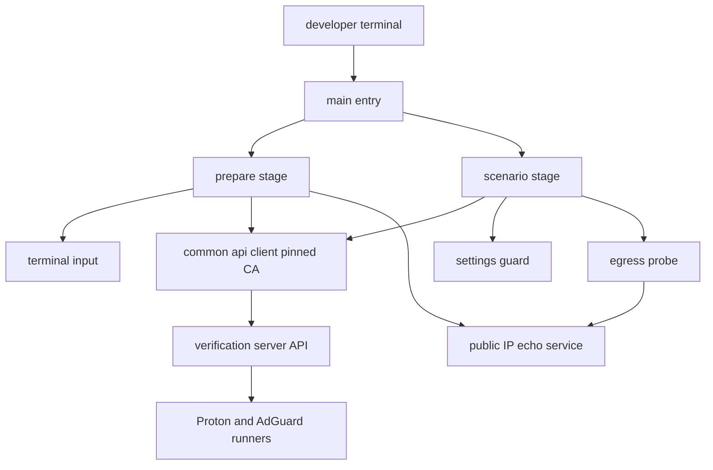
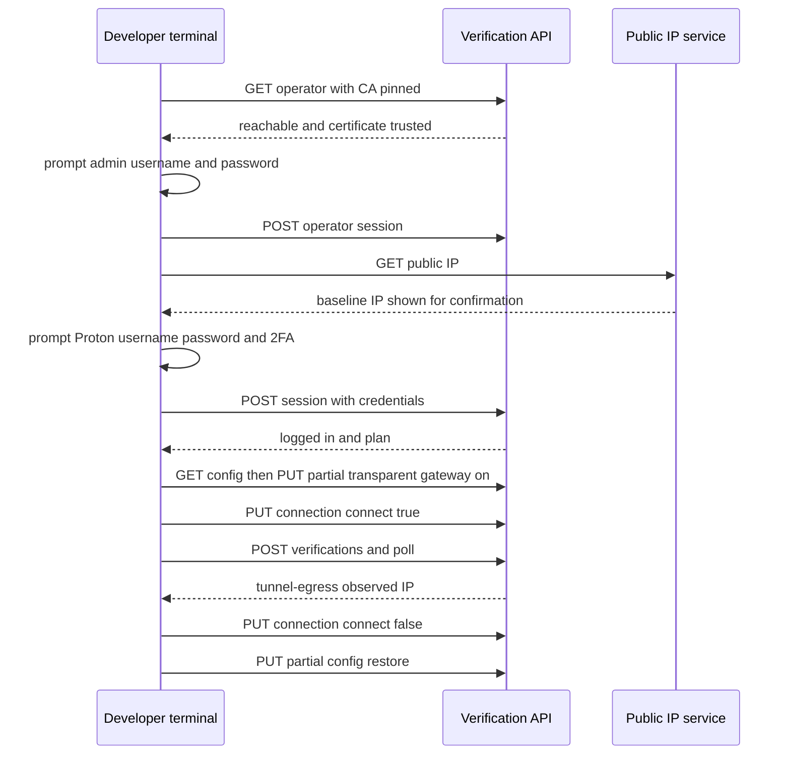

# Design Document

## Overview
**Purpose**: 本設計は、実際の VPN ベンダー（Proton VPN・AdGuard VPN）の runner を、検証サーバ（aitest）で試験する仕組みを定める。試験は、開発サーバの端末で 1 つのプロセスとして実行する。
前半は**準備処理**（管理者・ベンダーの認証を端末で対話的に行う）、後半は**試験**（準備処理で作ったログイン状態を使い、人の入力なしで接続・切断・出口 IP を確認する）である。

**Users**: 開発者。検証サーバのブラウザを開かずに、実 runner の接続が正しく動くことを確認する。

**Impact**: 新規の `e2e/vendor-live/` を追加する。HTTPS クライアント・API の型・結果の報告は、`e2e-tests` が所有する `e2e/common/` の共有部品を使う。`package.json` と `.gitignore` は `e2e-tests` が所有し、本 spec は変更しない。製品コード（`api/`・`web/`・`proxy/`・`installer/`・`vendors/`）は変更しない。検証サーバの設定は、試験の間だけ変え、試験の後に元へ戻す（要件 8）。

### Goals
- 端末の入力だけで、管理者・Proton・AdGuard の認証を済ませ、続けて試験を自動実行する（要件 1〜4）。
- 試験の結果を、端末に合否と理由で示す（要件 5）。
- 資格情報を、ファイル・ログ・成果物に残さない（要件 1.3、5.4）。

### Non-Goals
- 環境変数・設定ファイルによる資格情報の受け渡し（取り下げ済み）。
- CI での実行（要件 7.2）。hosted runner の E2E（`e2e-tests`）のモック構成。
- 開発サーバへの VPN 接続（開発サーバは試験の対象外）。
- AdGuard の device 認証の承認の自動化（要件 3.5 の範囲で、承認は開発者が行う）。

## Boundary Commitments

### This Spec Owns
- `e2e/vendor-live/` 配下の全て（準備処理、ベンダー別の認証、出口 IP の観測、前提の設定の有効化と復元、試験の手順）。
- 端末での対話入力（非表示の入力、承認の案内の表示）。
- 準備処理の一連の手順（API の到達と CA の確認、管理者の認証、ベンダーの認証、接続前の基準の記録）。

### Out of Boundary
- 製品の API・CLI・runner の挙動そのもの（変更しない）。出口 IP の観測手段（API の拡張）は本 spec の対象外。
- `e2e/common/`（`api-client.ts`・`api-types.ts`・`report.ts`。所有は `e2e-tests`。本 spec は利用するだけ）。
- `e2e/hosted/`（hosted runner の E2E の基盤・モック CLI・netns の模擬）、`docker-compose.e2e-mock.yml`（hosted 専用。本 spec は使わない）。
- `package.json`（`test:vendor-live` の script と `tsx` の devDependency を含む）と `.gitignore`（`e2e-tests` が所有）。
- CI の起動条件と権限（`cicd`）。
- 検証サーバへの手動の操作（sudo による CA の取り込みは、初回の一度だけの準備作業として `tasks` で扱う）。

### Allowed Dependencies
- 製品の公開面のみ: HTTPS の API（`/v1/operator`、`/v1/operator/session`、`/v1/session`、`/v1/providers`、`/v1/providers/active`、`/v1/connection`、`/v1/connection/config`、`/v1/connection/available-locations`、`/v1/verifications`）。
- `e2e/common/`（`api-client.ts`・`api-types.ts`・`report.ts`）。
- 実行環境は `e2e-tests` の `package.json` が定める（Node.js 22、`tsx`）。本 spec は依存を追加しない。
- 外部の IP 確認サービス（開発サーバの公開 IP の取得。検証サーバの `verifyEchoUrl` と同じ既定の URL を使う）。

### Revalidation Triggers
- API の認証の経路（管理者セッションの Cookie、未認証の許可経路）の変更。
- ベンダーのプロファイル（`login` の方式、`account` のプラン定義、`connect` の制限パターン）の変更。
- 設定のキー（`transparentGatewayEnabled`・`explicitProxyEnabled`・`verifyEchoUrl`）と、検証の項目 ID（`tunnel-egress`）の変更。
- API の証明書（発行元、SAN）の変更。取り込んだ CA が無効になる。
- `e2e/common/` の契約（`api-client.ts`・`report.ts`・`api-types.ts`）の変更（`e2e-tests` の design と両方で再検証）。

### Shared File Ownership（`e2e-tests` と `vendor-live-e2e` の共通。両 design で同一）

| パス | 所有 | 利用する spec | 役割 |
| --- | --- | --- | --- |
| `e2e/common/api-client.ts` | `e2e-tests` | 両方 | CA を指定する HTTPS クライアント。Cookie の保持、タイムアウト |
| `e2e/common/api-types.ts` | `e2e-tests` | 両方 | 両方が使う API 応答の型（`api/openapi.json` と一致させる） |
| `e2e/common/report.ts` | `e2e-tests` | 両方 | `TestResult` 型、秘密の除外、成果物の書き出し |
| `package.json`（devDependencies と scripts）・`.gitignore` | `e2e-tests` | 両方 | 実行基盤。`vendor-live-e2e` は変更しない |
| `e2e/package.json`・`e2e/tsconfig.json`・`e2e/types/` | `e2e-tests` | 両方 | ESM 指定、型検査の設定、`dns-packet` の型宣言 |

- 依存の向き: `e2e/hosted/` → `e2e/common/` ← `e2e/vendor-live/`。`e2e/common/` は両方に依存しない。
- 共有部品の契約を変えると、両 spec の再検証が必要になる（両 spec の Revalidation Triggers に記載）。
- 成果物は `e2e/artifacts/hosted/`（`e2e-tests`）と `e2e/artifacts/vendor-live/`（`vendor-live-e2e`）に分ける。

## Architecture

### Existing Architecture Analysis
- 製品の API は HTTPS（`api/src/server.ts`）。`/v1/` の大半は、管理者のセッション Cookie を要求する（`api/src/auth/require-operator-session.ts`）。未認証で呼べるのは `GET/POST /v1/operator`・`POST /v1/operator/session` のみ。
- VPN の認証は、`POST /v1/session`。資格情報は、CLI の標準入力に渡される（`loginMethod: credentials`）。AdGuard は `loginMethod: deviceUrl` で、承認 URL を `loginUrl` として返す。
- 出口 IP は、検証の項目 `tunnel-egress`（VPN インターフェース経由の観測値 `observed`）でのみ得られる。切断中は「未確認」になる。
- `tunnel-egress` は、透過ゲートウェイまたは明示的プロキシが有効なときだけ適用される（それ以外は対象外）。
- プラン制限の失敗は、HTTP 403（`operation_restricted`）で返る。

### Architecture Pattern & Boundary Map
準備処理と試験を、1 つのプロセスの 2 つの段階として直列に実行する。認証の状態（管理者セッション Cookie）をプロセス内で保持するため、2FA のコードの入力から試験までの時間を短く保てる。



**Architecture Integration**:
- 選択したパターン: 準備処理と試験を 1 プロセスの段階として直列化する。認証の状態はプロセス内に持つ。
- 境界: 端末の入力（対話）は準備処理だけが持つ。試験は入力を求めない。
- 既存のパターンの維持: API は製品の公開面だけを使う。HTTPS の仕組みと報告の契約は `e2e/common/` を使う（重複させない）。
- 新規コンポーネントの理由: 端末の入力・設定の復元・公開 IP の基準は、製品の API にない。試験の側に置く。

### Dependency Direction
`terminal`・`config`・`e2e/common/api-client` → `prepare`（ベンダー別の認証を含む）→ `settings`・`egress` → `scenarios` → `main`。
上位の層は下位の層にのみ依存する。`e2e/common/report` は全層の結果を受け取るが、資格情報は受け取らない（型の上で除外する）。

### Technology Stack

| Layer | Choice / Version | Role in Feature | Notes |
| --- | --- | --- | --- |
| 実行環境 | Node.js 22（開発サーバ） | 端末の対話入力、HTTPS クライアント | `e2e-tests` の実行基盤と同じ版系 |
| 言語・実行 | TypeScript、`tsx`（`e2e-tests` の `package.json` で固定） | 型付きの結果と API の契約 | `any` を使わない |
| HTTPS | `e2e/common/api-client.ts`（`node:https`、CA を指定） | API 呼び出し、証明書の検証 | 検証を無効化しない |
| 端末入力 | `node:readline` と TTY のエコー制御 | 資格情報・2FA のコードの非表示入力 | 入力内容を表示しない |
| 試験の順序 | 独自の逐次実行（`scenarios/`） | 状態を共有する試験の順序の保証 | Playwright は使わない |

## File Structure Plan

### Directory Structure
```
e2e/vendor-live/
├── main.ts                     # 入口。準備処理の後に試験を続けて実行し、終了コードを返す（要件 1, 4, 7）
├── lib/
│   ├── config.ts               # 検証サーバの URL、CA の場所、成果物の場所（秘密を含まない）（要件 1.7）
│   ├── terminal.ts             # 表示・非表示の入力、承認の案内の表示（要件 1.3, 2.2, 3.1）
│   ├── prepare.ts              # 準備処理の手順（API と CA の確認、管理者の認証、基準の記録）（要件 1.1〜1.11）
│   ├── public-ip.ts            # 開発サーバの公開 IP の取得（要件 1.11）
│   ├── public-ip.test.ts       # 公開 IP の書式の検査（単体）
│   ├── settings.ts             # 試験の前提の設定の有効化と復元（要件 8.1〜8.4）
│   ├── egress.ts               # 出口 IP の観測（検証の実行と tunnel-egress の読み取り）（要件 4.2, 4.3）
│   ├── egress.test.ts          # tunnel-egress の観測値の解釈（単体）
│   ├── config.test.ts          # 設定の読み取りと CI 拒否（単体）
│   ├── prepare-types.ts        # 準備処理の型（段・中止の理由・結果）
│   ├── prepare.test.ts         # CA で検証できない API での中止（単体）
│   └── vendors/
│       ├── proton.ts           # Proton のログイン（資格情報と 2FA の入力）（要件 2.1〜2.5）
│       ├── adguard.ts          # AdGuard の device 認証（承認の待ち）（要件 3.1〜3.5）
│       └── adguard.test.ts     # 承認の待ちと 5 分の上限（単体）
└── scenarios/
    ├── proton.ts               # Proton の試験（接続・切断・プラン制限）（要件 4.1〜4.8）
    └── adguard.ts              # AdGuard の試験（接続・切断・プラン制限）（要件 4.1〜4.8）
```

- 共有部品（所有: `e2e-tests`）: `e2e/common/api-client.ts`（HTTPS・CA・Cookie）、`e2e/common/api-types.ts`（API の型）、`e2e/common/report.ts`（`TestResult`、秘密の除外、書き出し）。本 spec のファイルには含めない。

### Modified Files
- なし。`package.json`（`test:vendor-live` の script と `tsx`）と `.gitignore`（成果物の除外）は `e2e-tests` が所有する。

## System Flows

### 準備処理と試験の流れ



- 準備処理の各段階は、失敗したら直ちに中止する。以降の段階を実行しない（要件 1.2, 1.8, 1.10, 2.3, 2.4, 3.4）。
- 2FA のコードは、入力の直後に送信する。資格情報の入力と 2FA の入力の間に、他の処理を挟まない。
- 設定の変更は、試験の前に記録し、試験の後（成功・失敗を問わず）に元へ戻す（要件 8.2, 8.3）。

## Requirements Traceability

| Requirement | Summary | Components | Interfaces | Flows |
| --- | --- | --- | --- | --- |
| 1.1, 1.2 | API の到達の確認、到達できなければ中止 | prepare, common/api-client | `probeApi` | 準備処理の 1 段目 |
| 1.3 | 入力内容を端末に表示しない | terminal | `promptSecret` | 準備処理 |
| 1.4 | 資格情報・2FA・セッションを書き出さない | common/report, prepare | 秘密型（`Secret`）の制約 | 全体 |
| 1.5 | 試験を人の入力なしで始められる状態にする | prepare, vendors | `VendorSessionState` | 準備処理の完了 |
| 1.6 | 検証サーバ上の手動の操作を要求しない | common/api-client | API のみ | 全体 |
| 1.7, 1.8 | CA で証明書を検証し、検証できなければ資格情報を求めない | common/api-client, config | `createApiClient` | 準備処理の 1 段目 |
| 1.9, 1.10 | 管理者の認証、失敗で中止 | prepare | `loginOperator` | 準備処理の 2 段目 |
| 1.11 | 開発サーバの公開 IP を基準として記録し表示 | public-ip, prepare | `fetchPublicIp` | 準備処理 |
| 2.1, 2.2, 2.3, 2.4, 2.5 | Proton の資格情報と 2FA の入力、失敗で中止、プランの表示 | vendors/proton | `loginProton` | 準備処理 |
| 3.1, 3.2, 3.3, 3.4, 3.5 | AdGuard の承認の案内、承認の待ち、時間切れで中止、Web UI を開かせない | vendors/adguard | `beginAdguardDeviceLogin`, `awaitAdguardApproval` | 準備処理 |
| 4.1 | 人の入力なしで試験を開始 | main, scenarios | `runScenarios` | 試験 |
| 4.2 | 接続後の VPN 経由の出口 IP が基準と異なる | egress, scenarios | `observeEgress` | 試験 |
| 4.3 | 切断後、VPN 経由の出口 IP が観測されない | egress, scenarios | `observeEgress` | 試験 |
| 4.4 | 両方のベンダーで 4.2・4.3 を確認 | scenarios/proton, scenarios/adguard | 試験の共通手順 | 試験 |
| 4.5 | 無料プランは接続先の選択が制限される | scenarios/proton, scenarios/adguard（AdGuard の期待値は観測で確定） | `connectWithLocation` | 試験 |
| 4.6 | 有料プランは指定した接続先へ接続できる | scenarios/proton, scenarios/adguard | `connectWithLocation` | 試験 |
| 4.7 | 途中の失効は、その試験の失敗として記録 | scenarios | `TestResult` | 試験 |
| 4.8 | 試験の終了時に切断した状態にする | scenarios | `ensureDisconnected` | 試験 |
| 5.1, 5.2, 5.3 | 試験ごとの合否、失敗の理由、失敗時の状態の保存 | common/report | `TestResult`, `writeReport` | 試験の後 |
| 5.4 | 成果物に秘密を含めない | common/report | 秘密の除外 | 試験の後 |
| 6.1, 6.2, 6.3 | 試験の前後の到達の確認、途中で届かなくなったら中止、理由を表示 | common/api-client, scenarios | `ApiResult` の `transport` | 試験 |
| 7.1, 7.2 | 開発サーバの端末から手動で起動。CI から起動しない | main | 起動の検査（CI 環境変数で拒否） | 起動 |
| 8.1, 8.2, 8.3, 8.4 | 試験の前提の設定の有効化、記録、終了後の復元、戻せなかったときの表示 | settings | `ensureEgressPrerequisite`, `restoreSettings` | 試験の前後 |

## Components and Interfaces

### 準備処理

| Component | Domain/Layer | Intent | Req Coverage | Key Dependencies (P0/P1) | Contracts |
| --- | --- | --- | --- | --- | --- |
| prepare | 準備 | API と CA、管理者、ベンダー、基準 IP の準備 | 1.1〜1.11 | common/api-client (P0), terminal (P0), vendors (P0), public-ip (P1) | Service |
| common/api-client（所有: e2e-tests） | 通信 | CA 固定の HTTPS、Cookie の保持、タイムアウト | 1.7, 1.8, 6.1, 6.2 | node:https (P0), config (P0) | Service |
| terminal | 入出力 | 表示・非表示の入力、案内 | 1.3, 2.2, 3.1 | node:readline (P0) | Service |

#### prepare
| Field | Detail |
| --- | --- |
| Intent | 試験の前に、認証と基準の準備を、端末の入力で行う |
| Requirements | 1.1〜1.11 |

**Responsibilities & Constraints**
- 段の順序: (1) API の到達と CA の検証、(2) 管理者の認証、(3) 公開 IP の取得（基準）、(4) ベンダーの認証。
- 段が失敗したら、その理由を端末に表示し、準備処理全体を中止する（試験は実行しない）。
- 準備処理の結果（`LiveSession`）は、プロセス内に保持する。ファイルには書かない。

**Dependencies**
- Inbound: main — 起動（P0）
- Outbound: common/api-client, terminal, vendors/*, public-ip — 通信と入力（P0）

**Contracts**: Service [x]

##### Service Interface
```typescript
type PrepareStep = "api" | "operator" | "public-ip" | "vendor";
type AbortReason =
  | { kind: "api-unreachable" }
  | { kind: "ca-untrusted" }
  | { kind: "operator-auth-failed" }
  | { kind: "public-ip-unavailable" }
  | { kind: "vendor-auth-failed" }
  | { kind: "vendor-unreachable" }
  | { kind: "device-approval-timeout" };

type PrepareOutcome =
  | { ok: true; session: LiveSession }
  | { ok: false; step: PrepareStep; reason: AbortReason };

interface LiveSession {
  readonly api: ApiClient;              // 管理者の Cookie を保持する（common/api-client）
  readonly baseline: { publicIp: string; measuredAt: string };
  readonly vendor: VendorSessionState;  // 試験に使うベンダーのログイン状態
}

function prepareVendor(vendor: VendorId, deps: PrepareDeps): Promise<PrepareOutcome>;
```
- Preconditions: 取り込み済みの CA が存在する。端末が対話可能（TTY）である。
- Postconditions: 成功時、管理者セッションと基準 IP が `LiveSession` に入る。失敗時、以降の段を実行しない。
- Invariants: 資格情報の値は `LiveSession` に含めない（型で除外する）。

##### 型の制約
- `Secret` は、読み取り専用の不透明な型（`brand`）。値は、認証の 1 回の要求の中でだけ取り出す。ログ・成果物の入力型として受け付けない。

**Implementation Notes**
- Integration: 1 回の入力で、準備処理の段ごとに 1 つの `PrepareOutcome` を返す。
- Validation: 段ごとの失敗理由が、端末に表示されることを確認する（要件 1.2、1.8、1.10、2.3、2.4、3.4）。
- Risks: 2FA のコードの有効期間（30 秒）との競合。入力の直後に送信し、保留しない。

#### common/api-client（所有: e2e-tests）
- 本 spec は、次の契約をそのまま使う。証明書の検証は、呼び出し側が渡す CA で必ず行い、検証を無効化しない（`rejectUnauthorized: false` を使わない）。管理者の Cookie（`Set-Cookie`）を保持し、以後の要求で送る。
- タイムアウト: 通常の要求 15 秒。接続（`PUT /v1/connection`）は 150 秒（ベンダーの接続の上限 90 秒より長くする）。
- 証明書の検証の失敗と到達の失敗は、`transport` として返す（`code` に Node のエラーコードを持つ）。`ca-untrusted` への分類は、準備処理の 1 段目で行う。

```typescript
// e2e/common/api-client.ts（所有: e2e-tests）
type ApiResult<T> =
  | { ok: true; status: number; body: T }
  | { ok: false; kind: "http"; status: number; error: string; message: string }
  | { ok: false; kind: "transport"; message: string; code?: string };
interface ApiClient {
  get<T>(path: string, timeoutMs?: number): Promise<ApiResult<T>>;
  post<T>(path: string, body?: unknown, timeoutMs?: number): Promise<ApiResult<T>>;
  put<T>(path: string, body: unknown, timeoutMs?: number): Promise<ApiResult<T>>;
  patch<T>(path: string, body: unknown, timeoutMs?: number): Promise<ApiResult<T>>;
  delete<T>(path: string, timeoutMs?: number): Promise<ApiResult<T>>;
}
function createApiClient(config: { baseUrl: string; caPath: string }): ApiClient;
```

#### terminal
| Field | Detail |
| --- | --- |
| Intent | 端末の入力と表示を行う |
| Requirements | 1.3, 2.2, 3.1 |

**Responsibilities & Constraints**
- `promptSecret` は、入力中の文字を表示しない（TTY のエコーを無効にする）。
- `promptLine` は、ユーザー名などの入力を表示する（秘密ではない値）。ただし、要件 1.3 に従い、ユーザー名も非表示にする設定を既定とする。
- `showDeviceLogin` は、承認の URL と確認コードを表示する。

**Contracts**: Service [x]

### ベンダーの認証

| Component | Domain/Layer | Intent | Req Coverage | Key Dependencies | Contracts |
| --- | --- | --- | --- | --- | --- |
| vendors/proton | ベンダー | 資格情報と 2FA のコードの入力、ログイン、プラン | 2.1〜2.5 | common/api-client (P0), terminal (P0) | Service |
| vendors/adguard | ベンダー | device 認証の開始、承認の待ち | 3.1〜3.5 | common/api-client (P0), terminal (P0) | Service |

- vendors/proton: `POST /v1/session` に `{username, password, twoFactorCode}` を送る。成功後、`GET /v1/session` でプラン（`free`・`paid`）を読む。
- vendors/adguard: `POST /v1/session`（本文なし）で `loginUrl` を得て端末に表示する。`GET /v1/session` の `loggedIn` を 5 秒間隔で確認し、300 秒を超えたら `device-approval-timeout` で中止する。承認は開発者の別の端末で行い、本ツールは検証サーバの画面を開かない（要件 3.5）。
- 両方のベンダーで、ログイン前に `PUT /v1/providers/active`（`{providerId}`）で対象のベンダーを有効にする。

### 試験の前提と観測

| Component | Domain/Layer | Intent | Req Coverage | Key Dependencies | Contracts |
| --- | --- | --- | --- | --- | --- |
| settings | 試験 | 出口 IP の検証に必要な設定を有効にし、記録し、戻す | 8.1〜8.4 | common/api-client (P0) | Service |
| egress | 試験 | 検証を実行し、`tunnel-egress` の観測値を読む | 4.2, 4.3 | common/api-client (P0), public-ip (P1) | Service |
| public-ip | 準備 | 開発サーバの公開 IP を取得する | 1.11 | node:https (P0) | Service |

#### settings
- `ensureEgressPrerequisite`: `GET /v1/connection/config` で `transparentGatewayEnabled` と `explicitProxyEnabled` を読む。どちらも無効なら、`transparentGatewayEnabled: true` を部分更新（`PUT /v1/connection/config`。本文は変更するキーだけ）で送る。変更前の値を `SettingsSnapshot` として返す。
- `restoreSettings(snapshot)`: 記録した値を部分更新で戻す。成功・失敗を問わず、試験の後に必ず呼ぶ（`finally`）。戻せない場合は `RestoreFailure` を返し、名前と値を端末に表示する（要件 8.4）。

```typescript
interface SettingsSnapshot {
  readonly transparentGatewayEnabled: boolean;
  readonly explicitProxyEnabled: boolean;
}
type RestoreResult = { ok: true } | { ok: false; failed: { name: keyof SettingsSnapshot; recorded: boolean }[] };
```

#### egress
- `observeEgress(session, expectation)`: `POST /v1/verifications` で検証を開始し（202）、`GET /v1/verifications/:id` を 2 秒間隔で、`state` が `completed` になるまで確認する（上限 180 秒）。`checks` の `tunnel-egress` を読む。
- 観測結果:
```typescript
type EgressObservation =
  | { kind: "observed"; ip: string }
  | { kind: "unconfirmed"; reason: string }   // 切断中など。要件 4.3 の判定に使う
  | { kind: "failed"; reason: string }
  | { kind: "not-applicable" };               // 前提の設定が無効（本来は settings で有効にしているため通常は起きない）
```
- 検証の同時実行（409）は、待って再試行する。

#### public-ip
- `fetchPublicIp()`: 開発サーバの既定経路から、IP 確認サービス（`https://api.ipify.org`、検証サーバの既定の `verifyEchoUrl` と同じ）へ要求し、IPv4 の書式の本文だけを受け付ける。書式が合わなければ `public-ip-unavailable`。

### 試験と報告

| Component | Domain/Layer | Intent | Req Coverage | Key Dependencies | Contracts |
| --- | --- | --- | --- | --- | --- |
| scenarios/proton | 試験 | Proton の接続・切断・プラン制限の確認 | 4.1, 4.4〜4.8 | egress (P0), settings (P0), common/api-client (P0) | Service |
| scenarios/adguard | 試験 | AdGuard の接続・切断・プラン制限の確認 | 4.1, 4.4〜4.8 | egress (P0), settings (P0), common/api-client (P0) | Service |
| common/report（所有: e2e-tests） | 報告 | 合否の表示、秘密を含まない成果物 | 5.1〜5.4 | — | Service |

- 試験の順序は、接続 → 出口 IP の確認 → 切断 → 切断後の確認 → 設定の復元 の順。各試験の前後で、API への到達を確認する（要件 6.1）。
- 途中の到達の喪失（`transport`）は、その試験を失敗として記録し、後続を中止する（要件 6.2、6.3）。
- 途中のログインの失効（`GET /v1/session` で `loggedIn: false`）は、その試験を失敗として記録する（要件 4.7）。
- プラン制限（無料プランで接続先を指定）は、HTTP 403 かつ `error: "operation_restricted"` を期待どおりとして合格にする（要件 4.5）。有料プランで同じ要求が 403 なら失敗（要件 4.6）。
- 試験の最後に、必ず切断を確認する（要件 4.8）。切断に失敗したら、その試験を失敗として記録する。
- `TestResult` の型と書き出しは `e2e/common/report.ts` を使う（本 spec では定義しない）。試験名は `proton/...`・`adguard/...` の形にする。

- report: `TestResult` の一覧を端末の表（合否・理由）に表示する。成果物（`e2e/artifacts/vendor-live/<日時>.json`）は、`TestResult` と設定の変更の記録だけを書く。書き出しは `common/report.ts` の `writeReport` が、与えた秘密の文字列を含まないことを検査する。
- 失敗時: 接続状態（`GET /v1/connection`）とベンダーの状態（`GET /v1/session` の `loggedIn` と `plan`）を、成果物に追加する（要件 5.3）。
- 成果物には、資格情報・2FA・Cookie・承認のコードを含めない（要件 5.4）。その検査は `common/report.test.ts` が担う。

## Data Models

### 実行時の状態（プロセス内。ファイルに書かない）
- `LiveSession`: 管理者セッション（Cookie）、基準の公開 IP、ベンダーのログイン状態（ベンダー ID、プラン）。
- `SettingsSnapshot`: 試験の前の設定の値（復元に使う）。

### 設定（ファイル。秘密を含まない）
- `config`: API の URL（`https://192.168.3.240:3000`）、取り込んだ CA の場所、成果物の場所。端末の引数、または開発者のユーザー設定ファイル（秘密を含まない）から読む。

### 成果物（秘密を含まない）
- `e2e/artifacts/vendor-live/<日時>.json`: 試験の結果（`TestResult[]`）、設定の変更と復元の記録、基準の公開 IP、検証サーバの API の URL。

## Error Handling

### Error Strategy
- 準備処理の失敗は、段の失敗として中止する（試験を実行しない）。
- 試験の失敗は、試験の結果として記録し、後続の試験は継続する（ただし、API への到達の喪失は後続を中止する）。
- 設定の復元は、試験の結果に関係なく試みる。

### Error Categories and Responses
- **準備処理の中止**（`AbortReason`）: 端末に理由（認証の失敗、接続の失敗、時間切れ、CA の検証の失敗）を表示し、終了コード 2 で終える。
- **試験の失敗**（`TestResult.outcome = fail`）: 期待と観測を表示し、終了コード 1 で終える。
- **設定の復元の失敗**（`RestoreFailure`）: 名前と記録した値を端末に表示し、終了コード 1 で終える。
- **成功**: 終了コード 0。

### Monitoring
- 試験の各段の開始と終了の時刻を、成果物に記録する（秘密を含まない）。

## Testing Strategy

本試験は、実際の検証サーバと実際の VPN に接続するため、自動の単体テストでは資格情報を扱わない。単体テストは、資格情報を使わない部分だけを対象にする。

### 単体テスト（資格情報を使わない。`npm run test:e2e-unit` で実行）
- public-ip（`lib/public-ip.test.ts`）: IPv4 以外の本文を拒否すること（要件 1.11）。
- egress（`lib/egress.test.ts`）: `tunnel-egress` の観測値の解釈（観測値・未確認・失敗の各区分を、要件 4.2・4.3 の判定に対応させる）。
- 共有部品の単体テスト（api-client の CA 検証・Cookie の解析、report の秘密の除外）は、`e2e/common/*.test.ts` が担う（`e2e-tests` の design を参照）。

### 実機の試験（開発者が実行する）
- Proton: 準備処理が成功し、接続後の出口 IP が基準と異なること（要件 4.2）。切断後に観測されないこと（4.3）。無料と有料のどちらの場合も、期待どおりのプラン制限が働くこと（4.5・4.6）。
- AdGuard: 承認の案内が表示され、承認の後に試験が通ること（要件 3.1〜3.3・4.4）。承認が 5 分以内に無い場合に中止すること（3.4）。
- AdGuard のプラン制限: 無料版の接続先指定の応答を、観測で確定した期待値と比べる（要件 4.5）。有料版で指定した接続先へ接続できる（4.6）。
- 設定の復元: 試験の後、設定が試験の前の値に戻っていること（要件 8.3）。
- 中断の確認: 試験の途中で中断しても、設定が戻ること（要件 8.3）。

## Security Considerations
- 資格情報（管理者・Proton）と 2FA のコードは、端末の非表示入力だけで受け取る。ファイル・環境変数・ログに書かない（要件 1.3・1.4）。
- API の証明書は、取り込んだ CA で必ず検証する。`rejectUnauthorized: false` は使わない（`common/api-client` の契約）。資格情報の送信前に検証する（要件 1.7・1.8）。
- 管理者のセッションは、試験の後に終了する（`DELETE /v1/operator/session`）。
- 成果物に、資格情報・Cookie・承認のコードを含めない（要件 5.4）。
- 開発サーバから検証サーバへの通信は、検証サーバの API のみ。CI からは起動しない（要件 7.2、起動時に CI 環境変数を検出したら拒否する）。

## Performance & Scalability
- 試験の所要時間は、接続（最大 90 秒）と検証（1 回あたり数十秒）による。プロバイダごとに数分を見込む。
- 検証の実行は直列にする（検証の同時実行は 1 件）。

## Migration Strategy
- 初回だけ、検証サーバの `api-ca.crt` を開発サーバへ取り込む（sudo による読み取り）。取り込みは、本ツールの外で行う初回の準備作業とし、以後は取り込んだ CA を使う（要件 1.7）。
- 取り込めない（sudo が使えない）場合、準備処理は CA の検証で中止する（要件 1.8）。

## Open Questions / Risks
- **R1: 2FA のコードの期限切れ**: 入力の直後に送信する。期限切れで失敗したら中止する（要件 2.3）。再入力は行わない（端末での選択）。
- **R2: 試験の途中の経路の変更**: 検証サーバのデフォルト経路が、VPN 接続で変わる。API の応答は LAN の経路で返る見込みだが、未確認。試験の前後で到達を確認し、到達できなければ中止する（要件 6.2）。実機の試験で確認する。
- **R3: 公開 IP の基準**: 同じ回線の前提は、準備処理で開発者が確認する（要件 1.11）。自動では検証できない。
- **R4（訂正）: AdGuard のプラン**: AdGuard のプロファイルは、プランを `license` の出力から判定する定義（`premium`・`free`）を持つ。`GET /v1/session` でプランが取れる。ただし無料版の接続先の制限は定義されていない（`restricts` が空で、`restrictedPattern` もない）。無料版で接続先を指定したときの応答は、実機で観測してから期待値を確定する（tasks の 2.6）。
- **R5: 設定の変更による影響**: 透過ゲートウェイを一時的に有効にすると、検証サーバの経路が変わる。試験の後に必ず戻す（要件 8.3）。戻せない場合は報告する（要件 8.4）。
- **R6: sudo が使えない**: CA の取り込みができない場合、試験は実行できない（要件 1.8）。
