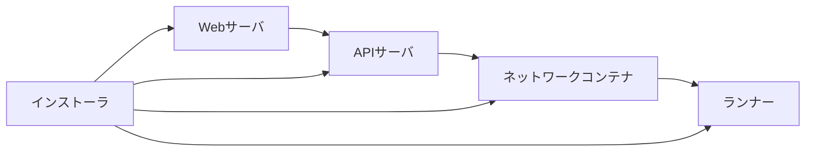
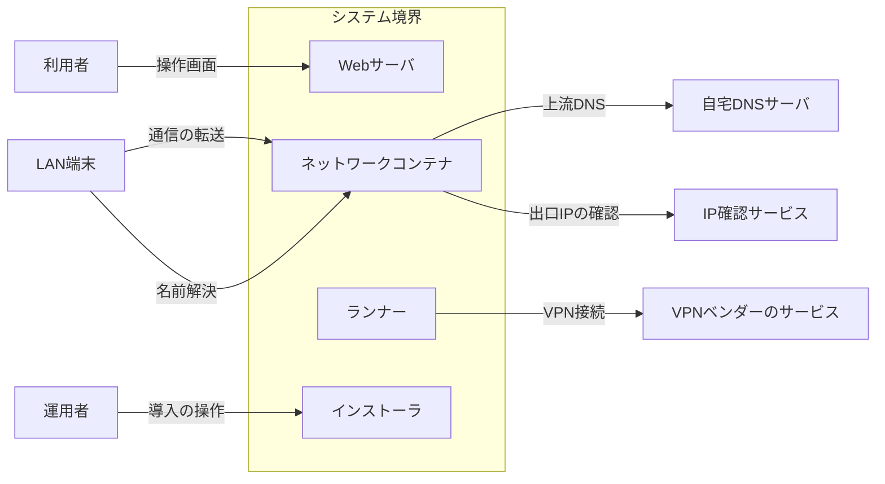
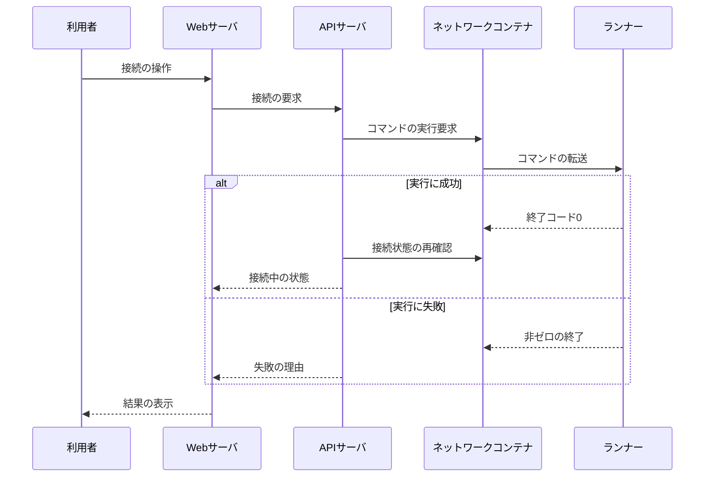
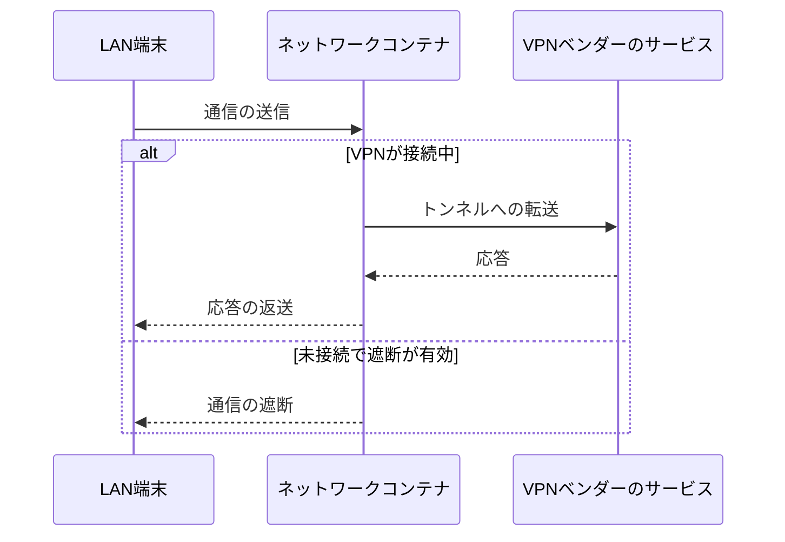
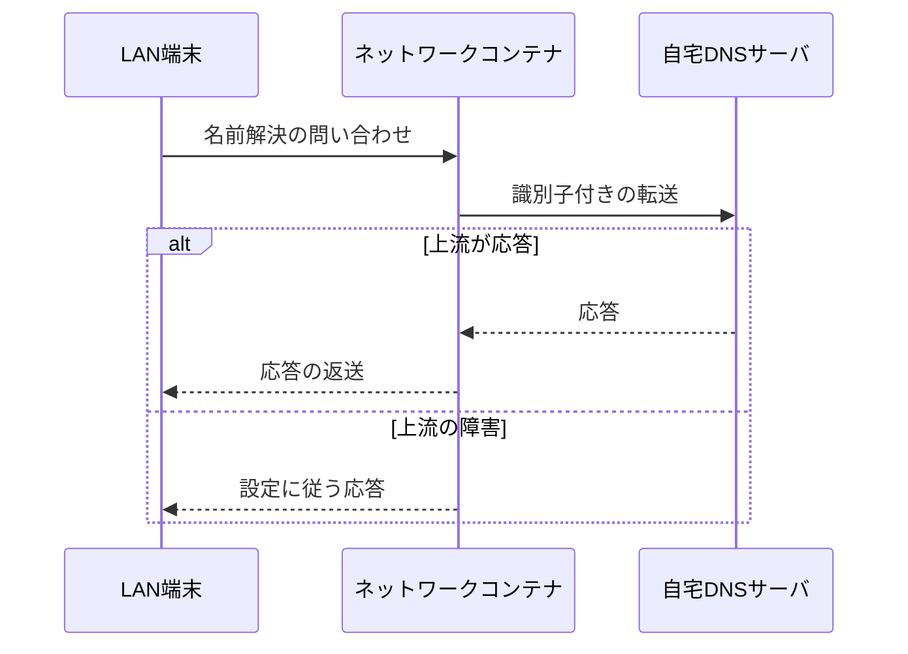
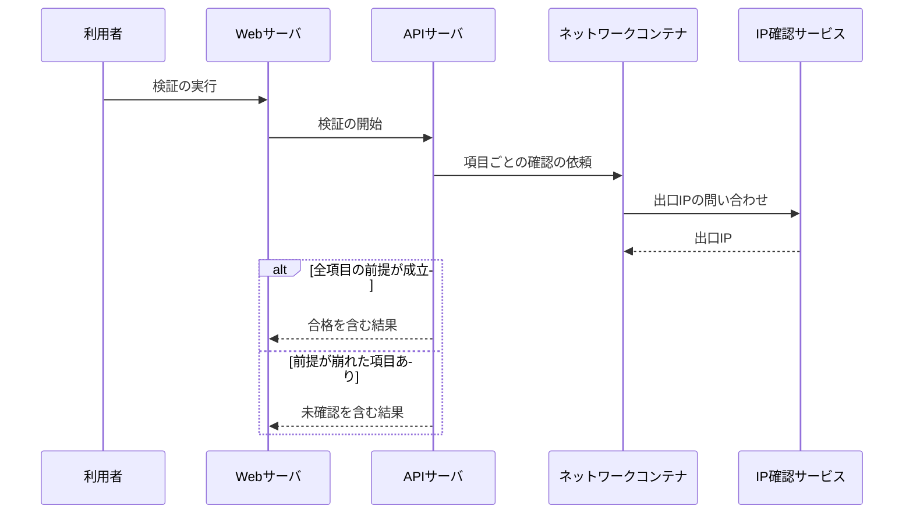
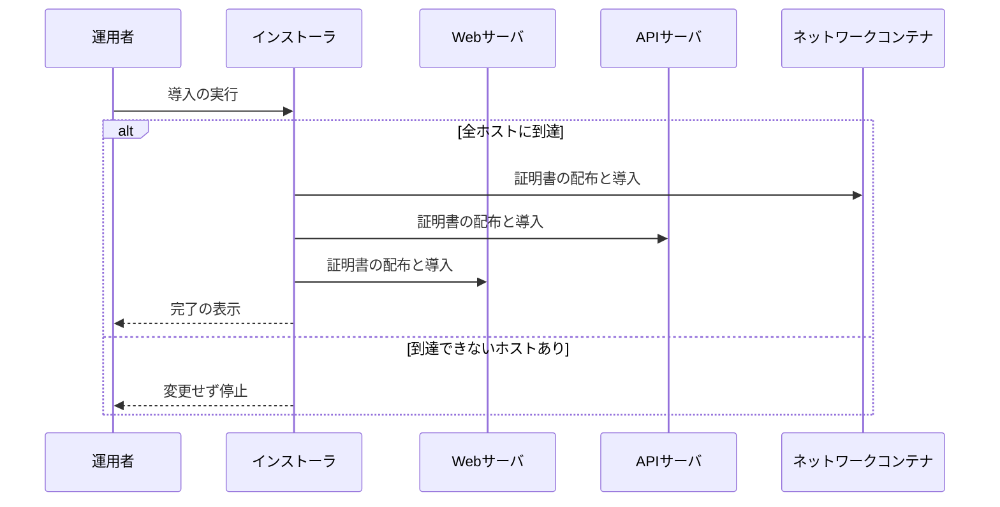

# VPNゲートウェイ管理 アーキテクチャ

## 1. 目的と範囲

本システムは、Linuxサーバをゲートウェイとして、LAN内の機器の通信をVPNトンネル経由で送出する。
利用者は、接続・切断・ベンダーの選択・各種設定を、CLIを入力せずにブラウザから行う。
VPNベンダーのクライアントCLIそのものは、システムの外側のソフトウェアとして扱う。

## 2. 構成要素

| 構成要素              | 種別 | 責務                                                 | 実装spec    |
| --------------------- | ---- | ---------------------------------------------------- | ----------- |
| 利用者                | 外部 | ブラウザで接続の操作と設定を行う                     | -           |
| LAN端末               | 外部 | ゲートウェイを経由して通信し、名前解決を依頼する     | -           |
| 運用者                | 外部 | インストーラを実行して導入と更新を行う               | -           |
| VPNベンダーのサービス | 外部 | トンネルの接続先となり、通信を中継する               | -           |
| 自宅DNSサーバ         | 外部 | 名前解決の問い合わせを受け、クライアント別に記録する | -           |
| IP確認サービス        | 外部 | 送信元のIPアドレスを応答する                         | -           |
| Webサーバ             | 内部 | 画面を配信し、APIサーバへ要求を転送する              | webserver   |
| APIサーバ             | 内部 | 操作を検証して解決し、ゲートウェイへ送る             | apiserver   |
| ネットワークコンテナ  | 内部 | 通信の転送・遮断・迂回・名前解決の中継を行う         | proxyserver |
| ランナー              | 内部 | ベンダーのCLIをコンテナ内で実行する                  | runner      |
| インストーラ          | 内部 | 各ホストへ導入し、証明書を生成して配布する           | installer   |

## 3. システム構成

呼び出しの依存方向は、画面から基盤へ向かい、インストーラの配置も含む。

## 4. 外部インターフェース

| IF           | 方向 | 外部の要素            | 内部の要素           | 方式                      | 認証                 |
| ------------ | ---- | --------------------- | -------------------- | ------------------------- | -------------------- |
| 操作画面     | 提供 | 利用者                | Webサーバ            | HTTPSの画面               | セッションCookie     |
| 通信の転送   | 提供 | LAN端末               | ネットワークコンテナ | IPv4の転送                | なし                 |
| 名前解決     | 提供 | LAN端末               | ネットワークコンテナ | UDPとTCPのDNS             | なし                 |
| 導入の操作   | 提供 | 運用者                | インストーラ         | コマンドラインとSSH       | SSHの鍵認証          |
| VPN接続      | 利用 | VPNベンダーのサービス | ランナー             | ベンダーCLIが張るトンネル | ベンダーのアカウント |
| 上流DNS      | 利用 | 自宅DNSサーバ         | ネットワークコンテナ | DoH                       | サーバ証明書の検証   |
| 出口IPの確認 | 利用 | IP確認サービス        | ネットワークコンテナ | HTTPS                     | なし                 |

システム境界の内側の要素と外部の要素は、IFの名前を付けた辺で結ばれる。

## 5. 機能

### 接続の操作

- 関与: 利用者, Webサーバ, APIサーバ, ネットワークコンテナ, ランナー

接続の操作は、解決されたコマンドがゲートウェイを経由してCLIの実行へ進む流れである。

### LAN端末の通信の転送

- 関与: LAN端末, ネットワークコンテナ, VPNベンダーのサービス

LAN端末の通信は、VPNの接続状態と遮断の設定に応じて、トンネルへ送られるか遮断される。

### 名前解決の中継

- 関与: LAN端末, ネットワークコンテナ, 自宅DNSサーバ

LAN端末の問い合わせは、クライアントを識別できる形で上流へ転送され、上流の障害時は設定に従って応答する。

### 設定の動作検証

- 関与: 利用者, Webサーバ, APIサーバ, ネットワークコンテナ, IP確認サービス

動作検証は、設定から導いた項目をAPIサーバが順に実行し、ゲートウェイの確認とブラウザの観測を合わせて判定する。

### 導入と証明書の配布

- 関与: 運用者, インストーラ, Webサーバ, APIサーバ, ネットワークコンテナ

導入は、全ホストへの到達性を確かめてから、証明書を配布してロールごとに導入する流れで進む。

## 6. データ

| データ                   | 保管場所                       | 書き込み主体         |
| ------------------------ | ------------------------------ | -------------------- |
| 利用者のアカウント       | APIサーバの状態ディレクトリ    | APIサーバ            |
| ユーザ向け設定           | APIサーバの状態ディレクトリ    | APIサーバ            |
| ベンダー別の接続状態     | APIサーバの状態ディレクトリ    | APIサーバ            |
| ベンダーのログイン情報   | ランナーの名前付きボリューム   | ランナー             |
| 証明書と秘密鍵           | 各ホストの証明書ディレクトリ   | インストーラ         |
| 転送ルールと迂回対象のIP | カーネルとネットワークコンテナ | ネットワークコンテナ |
| ロールの配置先の記録     | 導入ホストの環境設定ファイル   | インストーラ         |

## 7. 信頼と検証

| 対象                   | 信頼する前提                                     | 検証手段                                      | 根拠        |
| ---------------------- | ------------------------------------------------ | --------------------------------------------- | ----------- |
| 利用者の操作           | 認証済みのセッションを持つ利用者だけが操作できる | APIサーバがセッションを検証し未認証を拒否する | apiserver   |
| 画面から渡る値         | ブラウザの入力を信用しない                       | APIサーバが許可条件で毎回再検証する           | apiserver   |
| ゲートウェイの制御要求 | 証明書を持つAPIサーバだけが制御できる            | 受け口が証明書を検証し無効な接続を拒む        | proxyserver |
| ランナーの実行要求     | 自ベンダーのバイナリ以外は実行しない             | 許可バイナリと完全一致を照合する              | runner      |
| APIサーバへの転送      | 認証局の証明書を持つAPIサーバだけが宛先となる    | Webサーバが認証局で検証し省略しない           | webserver   |
| 秘密情報               | パスワードを引数とログに残さない                 | 標準入力だけへ渡し応答で伏字にする            | apiserver   |
| 証明書の配布           | 認証局の秘密鍵が配布物に含まれない               | 生成後に削除し配置先を所有者のみにする        | installer   |

## 8. 技術基盤

| 領域             | 採用                             | 理由                                             | 根拠        |
| ---------------- | -------------------------------- | ------------------------------------------------ | ----------- |
| 実行基盤         | Docker Composeのロール別ファイル | ホスト単位の分離配置をファイルの合成で切り替える | installer   |
| 通信の制御       | nftablesの専用テーブルと経路の印 | 既存のルールと衝突せず一括置換で遮断を保てる     | proxyserver |
| 制御チャネル     | 相互TLSのHTTPS                   | 到達性ではなく証明書で送信者を確認できる         | proxyserver |
| APIの基盤        | FastifyとTypeBoxとOpenAPIの生成  | 1つのスキーマで検証と仕様を得られる              | apiserver   |
| 画面             | ReactのSPAと同一オリジンの配信   | 状態を持つ操作画面を追加の設定なしで配信できる   | webserver   |
| ベンダー差の吸収 | プロファイルとベンダーバンドル   | ベンダーの追加をバンドルの追加だけで済ませられる | runner      |

## 9. 横断的制約

| 制約                 | 値           | 根拠        |
| -------------------- | ------------ | ----------- |
| 画面の状態の取得間隔 | 5秒          | webserver   |
| 接続状態の監視間隔   | 10秒         | proxyserver |
| 設定の再通知の間隔   | 10秒         | apiserver   |
| ログイン失敗の上限   | 1分あたり5回 | apiserver   |
| 上流DNSの打ち切り    | 5秒          | proxyserver |
| 動作検証の結果の保持 | 直近5件      | apiserver   |
| 標準入力の上限       | 4096バイト   | runner      |
| 起動確認の上限       | 180秒        | installer   |
| 証明書の有効期間     | 3650日       | installer   |
