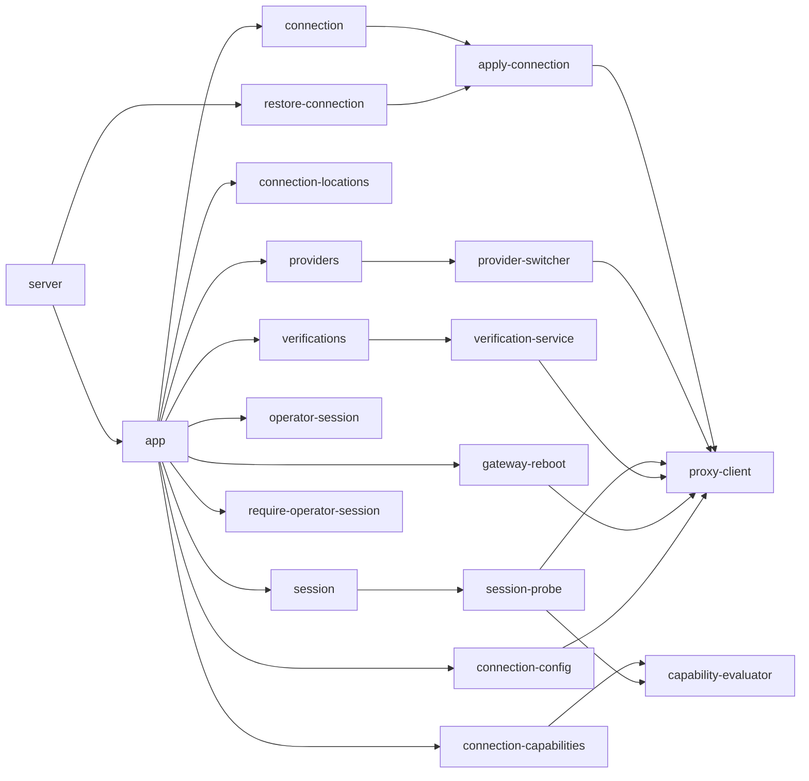
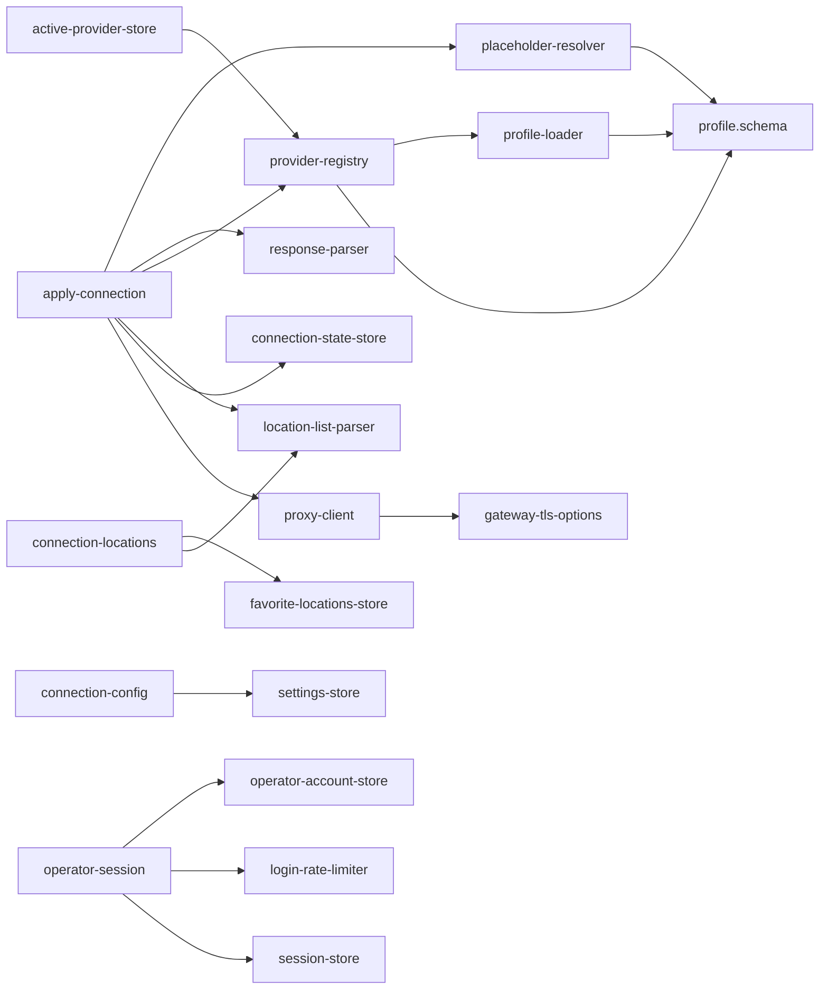
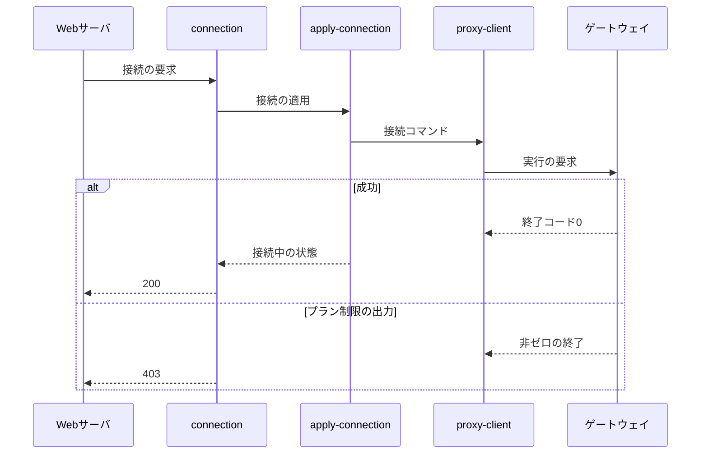
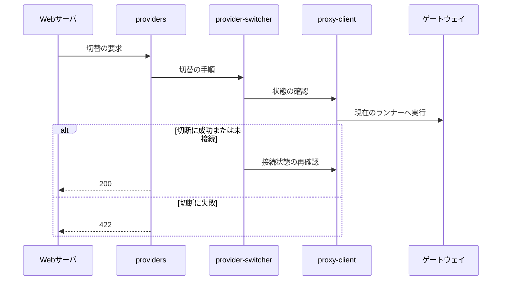

# APIサーバ 設計書

## 1. 構成

| パス                                                 | 責務                                                              |
| ---------------------------------------------------- | ----------------------------------------------------------------- |
| `api/src/server.ts`                                  | 起動。TLS待受、設定の通知と再通知、接続状態の復元                 |
| `api/src/app.ts`                                     | Fastifyの構築。ルート登録、認可フック、エラーのHTTPステータス対応 |
| `api/src/routes/connection.ts`                       | 接続状態の取得と、接続・切断                                      |
| `api/src/routes/connection-locations.ts`             | 接続先の一覧と、お気に入りの登録・解除                            |
| `api/src/routes/connection-capabilities.ts`          | 操作ごとの実行可否                                                |
| `api/src/routes/connection-config.ts`                | ユーザ向け設定の取得と更新                                        |
| `api/src/routes/providers.ts`                        | ベンダーの一覧と切替                                              |
| `api/src/routes/session.ts`                          | ベンダーへのログイン・ログアウト・状態                            |
| `api/src/routes/operator-session.ts`                 | 利用者のログイン・ログアウト                                      |
| `api/src/routes/verifications.ts`                    | 設定の動作検証                                                    |
| `api/src/routes/gateway-reboot.ts`                   | ゲートウェイ機の再起動の依頼                                      |
| `api/src/auth/require-operator-session.ts`           | 認可フック                                                        |
| `api/src/auth/operator-account-store.ts`             | 利用者アカウントのハッシュ保存と照合                              |
| `api/src/auth/session-store.ts`                      | ログインセッションの保持                                          |
| `api/src/auth/login-rate-limiter.ts`                 | ログイン失敗の回数制限                                            |
| `api/src/providers/provider-registry.ts`             | 有効なプロファイルの読み込みと保持                                |
| `api/src/providers/active-provider-store.ts`         | 選択中のベンダーの永続化                                          |
| `api/src/providers/provider-switcher.ts`             | ベンダーの切替手順                                                |
| `api/src/profile/profile-loader.ts`                  | プロファイルの検証付き読み込み                                    |
| `api/src/profile/profile.schema.ts`                  | プロファイルのスキーマ                                            |
| `api/src/profile/placeholder-resolver.ts`            | プレースホルダーの検証と引数配列の解決                            |
| `api/src/profile/response-parser.ts`                 | 状態出力の解析                                                    |
| `api/src/capabilities/capability-evaluator.ts`       | 操作の実行可否の算出                                              |
| `api/src/session/session-probe.ts`                   | ログイン状態とプランの判定                                        |
| `api/src/locations/location-list-parser.ts`          | 接続先の表の解析                                                  |
| `api/src/locations/favorite-locations-store.ts`      | お気に入りの永続化                                                |
| `api/src/connection-state/apply-connection.ts`       | 接続の実行と状態の保存                                            |
| `api/src/connection-state/connection-state-store.ts` | 接続先と国の保存                                                  |
| `api/src/connection-state/restore-connection.ts`     | 起動時の再接続                                                    |
| `api/src/settings/settings-store.ts`                 | ユーザ向け設定の検証と永続化                                      |
| `api/src/verification/verification-service.ts`       | 動作検証の項目の実行と保持                                        |
| `api/src/proxy-client/proxy-client.ts`               | ゲートウェイ制御チャネルのクライアント                            |
| `api/src/proxy-client/gateway-tls-options.ts`        | 相互TLSのクライアント証明書の読み込み                             |

## 2. 関係図・ワークフロー

ルートと実行の依存方向を示す。



プロファイル・保存・認証まわりの依存方向を示す。



接続の流れと、プラン制限による失敗の分岐を示す。



ベンダーの切替の流れと、切断失敗の分岐を示す。



## 3. 設計項目

### D-1: 起動と構成 (NFR-7, NFR-8)

| 環境変数                               | 内容                                                                   |
| -------------------------------------- | ---------------------------------------------------------------------- |
| `ENABLED_PROVIDERS`                    | 有効なベンダーID（カンマ区切り）。必須で、未設定・空なら起動に失敗する |
| `VENDORS_DIR`                          | バンドルの置き場（読み取り専用）。`<ID>/profile.json` を読む           |
| `STATE_DIR`                            | 永続化の基点。ベンダー別の状態は `providers/<ID>/` の下                |
| `GATEWAY_HOST` `GATEWAY_PORT`          | ゲートウェイの接続先。既定は `host.docker.internal` と8443             |
| `GATEWAY_TLS_*_FILE` `GATEWAY_PKI_DIR` | 相互TLSのCA・クライアント証明書・秘密鍵                                |
| `API_TLS_CERT_FILE` `API_TLS_KEY_FILE` | 待受のサーバ証明書                                                     |
| `PROVIDER_CACHE_DIR`                   | CLIのサーバ一覧のキャッシュ（読み取り専用）の置き場                    |
| `SETTINGS_RESYNC_INTERVAL_MS`          | 設定の再通知の間隔。既定10000                                          |

- 起動時に全プロファイルを検証し、1つでも不正なら起動に失敗する。ベンダーIDは `^[a-z][a-z0-9]{0,31}$`。
- 起動後、永続化済みの設定を数回リトライしてゲートウェイへ通知し、以後10秒周期で再通知する。通知は何度行っても結果が同じで、失敗は無視して次の周期で再試行する。ゲートウェイだけが再起動しても、最大約10秒で設定が戻る。
- 接続状態の復元は、起動を妨げないよう非同期で行う。
- OpenAPIはTypeBoxのスキーマから生成して公開し、Webのクライアント生成の唯一の入力とする。ゲートウェイとの内部通信はOpenAPIの対象に含めない。

### D-2: プロファイル (FR-1, FR-2)

```json
{
  "vendor": "<ID>", "displayName": "<表示名>", "binary": "/usr/local/bin/<CLI>",
  "outputFormat": "text", "loginMethod": "deviceUrl | credentials",
  "output": { "connectedPattern": "<正規表現>", "locationPattern": "<正規表現>" },
  "features": { "changeLocation": true, "locationPing": true },
  "actions": {
    "connect": { "argv": ["connect", "-l", "%LOCATION%"],
      "placeholders": { "LOCATION": { "pattern": "<正規表現>", "source": "locations" } },
      "timeoutMs": 30000, "restrictedPattern": "<正規表現>", "successPattern": "<正規表現>" },
    "login": { "completionPattern": "<正規表現>", "stdin": ["%PASSWORD%", "%TWO_FACTOR_CODE%"] },
    "listLocations": { "table": { "iso": "ISO", "country": "COUNTRY", "city": "CITY", "ping": "PING" },
      "connectName": { "from": "city | iso", "stripPattern": "<正規表現>" } },
    "account": { "notLoggedInPattern": "<正規表現>", "plans": [], "defaultPlan": { "id": "", "label": "" } }
  }
}
```

| 項目           | 規則                                                                                                                                                                                                  |
| -------------- | ----------------------------------------------------------------------------------------------------------------------------------------------------------------------------------------------------- |
| コマンド       | 引数配列で保持する。シェル文字列にしない                                                                                                                                                              |
| 必須           | `disconnect` `status`、`connect` と `connectAuto` の少なくとも一方、`loginMethod`、text形式の `output`、`listLocations` の `table` と `connectName`。欠けていれば起動に失敗し、暗黙の既定値を持たない |
| `source`       | `locations`（直前の一覧に含まれる指定名）・`input`（`pattern` のみで検証）・`secret`（`pattern` のみで検証し、引数に置けない）                                                                        |
| `pattern`      | 先頭が `-` でないこと（CLIのオプションと解釈させない）を必須とする。`secret` は制御文字を許さない                                                                                                     |
| 値の検証       | Web UIの選択に限っていても、APIが毎回再検証する。不一致は400                                                                                                                                          |
| ベンダー非依存 | コードはベンダーのID・名称・出力書式を持たない。分岐は `loginMethod` のような宣言された機構に対してだけ行う                                                                                           |

### D-3: ゲートウェイとの通信 (FR-1, NFR-5, NFR-7)

| 用途               | 要求                                                                                              |
| ------------------ | ------------------------------------------------------------------------------------------------- |
| CLIの実行          | `POST /runners/<ID>/exec` `{vendor, binary, resolvedArgv, timeoutMs, completionPattern?, stdin?}` |
| ランナーの確認     | `GET /runners/<ID>/health`                                                                        |
| 設定・状態・再確認 | `POST /net/settings`、`GET /net/status`、`POST /net/connection-checks`                            |
| 検証・再起動       | `POST /net/checks`、`/net/check-nonces`、`POST /net/host-reboot`                                  |

| 失敗                                            | HTTPステータス                                               |
| ----------------------------------------------- | ------------------------------------------------------------ |
| 入力・プレースホルダー・未知のベンダー          | 400                                                          |
| 未認証                                          | 401                                                          |
| プラン制限（`restrictedPattern` 一致）          | 403 `operation_restricted`                                   |
| プロファイルに操作が無い                        | 501 `operation_unsupported`                                  |
| ベンダー切替中・作成済み・検証実行中            | 409                                                          |
| CLIの非ゼロ終了                                 | 422 `{exitCode, stderr}`。標準エラーが空なら標準出力を載せる |
| 回数制限の超過                                  | 429                                                          |
| ゲートウェイへ到達できない・相互TLSの検証に失敗 | 502                                                          |
| 想定外の形状の応答                              | 500                                                          |
| タイムアウト                                    | 504                                                          |

- 送信は `undici` の `Agent({connect: {ca, cert, key}})` で行い、証明書の検証失敗はエラーとする。平文や検証省略へのフォールバックを持たない。接続はゲートウェイ1台につき1つのkeep-aliveプールを共有する。
- 全コマンドの要求と結果を、構造化した監査ログへ記録する。入力は秘密情報を除いた項目だけ、各エントリに操作対象のベンダーIDを付ける。

### D-4: ベンダーの選択と切替 (FR-3, NFR-2)

| 項目                       | 内容                                                                                                                |
| -------------------------- | ------------------------------------------------------------------------------------------------------------------- |
| `GET /v1/providers`        | `[{id, displayName, active, available, unavailableReason?}]`。利用可否はランナーの確認を並行して行い、2秒で打ち切る |
| `PUT /v1/providers/active` | ボディ `{providerId}`。成功で `{id, displayName}`                                                                   |
| 選択の保存                 | `$STATE_DIR/active-provider.json`。無い・壊れている・無効なIDなら有効なベンダーの先頭                               |
| ベンダー別の状態           | `providers/<ID>/` の接続状態・最後の接続先・お気に入り。判定のキャッシュと学習した制限はIDをキーに保持              |

切替の手順を示す。

| 順  | 内容                                                                                                            |
| --- | --------------------------------------------------------------------------------------------------------------- |
| 1   | 無効なIDは400。選択中と同じなら何もせず200                                                                      |
| 2   | 切替先のランナーが利用不可なら502                                                                               |
| 3   | 切替と接続・ログインの操作をAPI内で直列化する。切替中の操作は409 `provider_switching`。読み取りは影響を受けない |
| 4   | 現在のランナーが応答するなら `status` を実行し、接続中なら `disconnect` する。失敗したら切り替えず422           |
| 5   | 現在のランナーが応答しないときは、切断せずに切替を許可する                                                      |
| 6   | 選択を保存し、`switch-provider` を監査ログへ記録する                                                            |
| 7   | ゲートウェイへ接続状態の再確認を通知する。失敗しても切替は成功とする                                            |

- 選択中のランナーが後から止まっても、他のベンダーへ自動で切り替えない。

### D-5: 操作の実行可否 (FR-4, NFR-1)

操作の語彙は `login` `logout` `connectToLocation` `connectAuto` `changeLocation` `disconnect` `locationList` `locationFavorites` `pingMeasurement` で固定する。次の順に評価し、先に該当した原因を採用する。

| 順  | 原因             | 条件                                                                                                   |
| --- | ---------------- | ------------------------------------------------------------------------------------------------------ |
| 1   | `unsupported`    | 必要なアクションがプロファイルに無い。`changeLocation` と `pingMeasurement` は `features` の宣言も見る |
| 2   | `notLoggedIn`    | 未ログインと判定されたとき。`disconnect` と `login` は常に可。判定不能なら制限しない                   |
| 3   | `planRestricted` | 判定したプランの `restricts` に含まれる、または実行失敗から学習した                                    |

- `changeLocation` は `connectToLocation` に、`locationFavorites` と `pingMeasurement` は `locationList` に従う。`connectToLocation` と `locationList` は相互に依存し、片方だけ不可なら他方も同じ原因と理由文にする。
- 応答は操作ごとに `{available, reason?, message?}` で、全てのキーを常に返す。`message` は利用者向けの日本語で、判定不能でも200を返す。

| 判定                 | 内容                                                                                                                                       |
| -------------------- | ------------------------------------------------------------------------------------------------------------------------------------------ |
| `account` アクション | 副作用のない読み取り専用コマンド。未ログインのパターンに一致すれば未ログイン、非ゼロ終了なら不明、0なら `plans` を先頭から評価する         |
| キャッシュ           | 結果は30秒保持し、同時の要求は1回にまとめる。不明はキャッシュしない。ログイン・ログアウトの成功と学習の変化で破棄する                      |
| 失敗からの学習       | `connect` `connectAuto` `listLocations` の失敗出力が `restrictedPattern` に一致すれば、403で通知して対応する操作をプラン制限として記憶する |
| 学習の解除           | ログイン・ログアウトの成功とAPIの再起動                                                                                                    |

- プラン制限を理由に実行前の拒否はしない。CLIが最終の判断者であり、30秒古い判定でアップグレード直後の操作を塞がないためである。有料機能を試して判定することもしない。

### D-6: ログイン (FR-5, NFR-5)

| 方式          | `POST /v1/session` の入力と動作                                                                       |
| ------------- | ----------------------------------------------------------------------------------------------------- |
| `deviceUrl`   | 本文なし。`completionPattern` に一致するまでの出力から認証URLを抜き出し `{loginUrl?, message}` を返す |
| `credentials` | `{username, password, twoFactorCode?}`。本文が無ければ400。成功で `{message}`                         |

| 項目                 | 規則                                                                                                                                            |
| -------------------- | ----------------------------------------------------------------------------------------------------------------------------------------------- |
| 検証                 | ユーザー名は `USERNAME` の `pattern`、パスワードは1〜512文字で改行・NUL・制御文字を含まない、2段階認証コードは `^[0-9A-Za-z]{4,32}$`            |
| 受け渡し             | `login.stdin` のテンプレートに従って行を組み立て、実行要求の `stdin` に入れる。値が空の任意の行は出さない                                       |
| 秘匿                 | 監査ログの入力は `{username}` だけ。失敗時の標準エラーは応答へ入れる前にパスワードと2段階認証コードを伏字にする。リクエストログに本文を出さない |
| `GET /v1/session`    | `{loginMethod, loggedIn?, plan?: {id, label, usageNote?}}`。判定できなければ `loggedIn` を省く                                                  |
| `DELETE /v1/session` | ログアウトを実行し、保存済みの接続状態を消去する                                                                                                |

### D-7: 接続先 (FR-6)

| 項目       | 内容                                                                                                                                             |
| ---------- | ------------------------------------------------------------------------------------------------------------------------------------------------ |
| 取得       | `listLocations` を呼び出しごとに実行し、キャッシュしない。ヘッダ行から各列の開始位置を求めて固定幅の表を切り出し、ANSIを除去する                 |
| 並び       | 応答時間の昇順。取れない行は末尾。同値は元の順を保つ                                                                                             |
| ID         | `<国コード小文字>-<都市名のslug>`。slugはNFD正規化して分音記号を除き、小文字化し、英数字以外の連続を `-` 1つにする。何も残らなければ `location`  |
| 指定名     | プロファイルの `connectName` に従う（都市名または国コード。`stripPattern` に一致する部分を除く）                                                 |
| 解決       | 接続の要求は `locationId` を受け、その場で一覧を再取得して該当する行から指定名を得る。クライアントから都市名を受け取らない                       |
| お気に入り | `PUT/DELETE /v1/connection/locations/{id}/favorite` は何度行っても結果が同じ。形式 `^[a-z]{2}-[a-z0-9-]{1,64}$` のみ検証し、不正は400。上限200件 |
| 保存       | ベンダー別の単一JSON。無い・壊れているときは空として扱い、例外にしない                                                                           |
| 失敗       | 表の見出しが見つからない出力は想定外として500にする（書式の変更を空の一覧にしない）                                                              |

### D-8: 接続と復元 (FR-7)

| 要求                                                | 動作                                                                                                |
| --------------------------------------------------- | --------------------------------------------------------------------------------------------------- |
| `PUT /v1/connection` `connect=true` と `locationId` | `connectToLocation` が不可なら501。指定名を解決して実行する。接続中に別のIDで呼ぶと接続先を変更する |
| `connect=true` で `locationId` なし                 | `connectAuto` があれば実行する。成功しても接続先IDは保存せず、最後の接続先も更新しない。無ければ400 |
| `connect=false`                                     | 切断する。失敗は422                                                                                 |
| `GET /v1/connection`                                | `status` を実行して `{status, location?, country?, locationId?}` を返す                             |

- 成功したら、接続状態（接続先ID・国・都市名）と最後の接続先を保存する。自動接続は空の内容で保存し、「接続中だったこと」自体を残す。
- 状態の取得時、実際の都市名が保存時と異なれば国と接続先を返さず保存内容を消す。切断の観測と切断の成功でも消す。最後の接続先は切断しても消さない。
- `status` の非ゼロ終了も、`successPattern` に一致すれば成功として扱う（未ログイン時に非ゼロで終わるCLIのため）。
- 接続・切断・ログアウトの実行後とベンダー切替後に、ゲートウェイへ接続状態の再確認を通知する。失敗は握りつぶす。
- 起動時の復元: 選択中のベンダーの保存内容を読み、無ければ何もしない。ランナーの起動を数回リトライして待ち、現在の `status` が接続中なら何もせず、そうでなければ保存済みのIDで（自動接続だったなら指定なしで）接続する。失敗は警告にとどめ、起動を妨げない。

### D-9: ユーザ向け設定 (FR-8, NFR-8)

| 項目                                                         | 型・規則                                                                                                         |
| ------------------------------------------------------------ | ---------------------------------------------------------------------------------------------------------------- |
| `killSwitch`                                                 | 真偽。既定は真                                                                                                   |
| `transparentGatewayEnabled`                                  | 真偽。既定は真                                                                                                   |
| `explicitProxyEnabled` `explicitProxyAllowedCidrs`           | 真偽と、`a.b.c.d/n` のIPv4 CIDRの配列。違反は400                                                                 |
| `excludedDomains`                                            | `example.com`（完全一致）か `*.example.com`（サブドメインのみ）。ラベルは英数字とハイフンで63文字以内、最大200件 |
| `dnsRelayEnabled` `dnsUpstreamUrl` `dnsUpstreamCaPem`        | 真偽、`https://` のみ（クエリ・認証情報・フラグメント不可）、PEMは最大16KB                                       |
| `dnsFailureMode` `dnsFallbackServers` `dnsClientNameServers` | `failClosed                                                                                                      | fallback`、IPv4アドレス最大3件、IPv4アドレス最大3件 |
| `dnsRedirectEnabled` `dnsRedirectExcludedCidrs`              | 真偽、IPv4 CIDRの配列                                                                                            |
| `verifyEchoUrl`                                              | `https://` のURL。既定 `https://api.ipify.org`。ゲートウェイへの反映には含めない                                 |

- 透過ゲートウェイと明示的プロキシの両方が無効な設定、明示的プロキシを有効にして許可元が空の設定、中継を有効にして上流も公開DNSも空の設定、`fallback` で公開DNSが空の設定は400。項目の欠けた既存の設定ファイルは既定値で補う。
- 更新のたびに設定の全体を `POST /net/settings` で送る。通知に失敗しても更新自体は成功とし、再通知に委ねる。
- `GET /v1/connection/gateway` はゲートウェイの `GET /net/status` を中継する。到達できなければ502、応答が遅ければ504、想定外の形状の応答は500とする。状態はAPIが持たない。

### D-10: 利用者の認証 (FR-9, NFR-3, NFR-4)

| メソッド・パス                | 認証         | 内容                                                                                       |
| ----------------------------- | ------------ | ------------------------------------------------------------------------------------------ |
| `GET /v1/operator`            | 不要         | `{configured}`。有効なセッションがあれば `username` も含める                               |
| `POST /v1/operator`           | 未作成時のみ | 初回作成。作成済みなら409。成功でセッションを発行する                                      |
| `PUT /v1/operator`            | 必要         | `{currentPassword, username?, newPassword?}`。現在のパスワードが誤りなら401、変更なしは400 |
| `POST /v1/operator/session`   | 不要         | ログイン。不一致と未作成はいずれも401                                                      |
| `GET /v1/operator/session`    | 必要         | `{authenticated: true}`                                                                    |
| `DELETE /v1/operator/session` | 必要         | セッションを破棄してCookieを失効させる                                                     |

```text
Set-Cookie: vpngwgui_session=<id>; HttpOnly; SameSite=Lax; Path=/   （HTTPSで受けた接続には Secure も付く）
保存        $STATE_DIR/operator-account.json  {username, algorithm: "scrypt", salt, hash}
セッション  プロセスのメモリ（再起動で失効）
認可        上表の不要なもの以外の全 /v1/* へ preHandler を適用  -> 未認証は 401 {error: "unauthenticated"}
回数制限    POST /v1/operator/session と PUT /v1/operator の失敗を送信元IPごとに集計し、1分に5回を超えると 429
```

- 利用者のアカウントと、ベンダーのログイン状態は別のものとして、`/v1/operator` と `/v1/session` に分ける。

### D-11: プランの補足情報と参考一覧 (FR-12)

| 宣言（`account.plans[]`）                   | 内容                                                                                                                              |
| ------------------------------------------- | --------------------------------------------------------------------------------------------------------------------------------- |
| `usageNote.pattern`                         | `account` の出力（ANSI除去済み）への正規表現。第1キャプチャをそのまま補足情報として `plan.usageNote` に入れる。一致しなければ省く |
| `availableLocations.file`                   | `<PROVIDER_CACHE_DIR>/<ID>/` からの相対パス。`..` や絶対パスは無効（空の一覧）                                                    |
| `availableLocations.list` `country` `city`  | サーバ配列のキー、各サーバの国コードと都市名の項目名                                                                              |
| `availableLocations.where` `countryAliases` | 使えるサーバの条件（全て満たす）と、国コードの読み替え（名称の解決だけに使う）                                                    |

- `GET /v1/connection/available-locations` は、選択中のベンダーの現在のプランの宣言を読み、`{locations: [{code, name, cities}]}` を返す。`name` は日本語の国名で、解決できなければ国コード。都市は重複を除いて昇順、国は国名順。
- プラン不明・未ログイン・宣言なし・ファイルが読めないときは、200で空の一覧を返す。サーバのドメイン・IP・IDは含めない。ファイルは要求のたびに読む。
- 補足情報の取得に追加のコマンドは実行しない。ベンダー固有の文言や単位をコードに持たない。

### D-12: 設定の動作検証 (FR-10, NFR-6)

| ID                                                                   | 層   | 適用条件（設定のみから導く）                  | 実行場所     |
| -------------------------------------------------------------------- | ---- | --------------------------------------------- | ------------ |
| `gateway-rules`                                                      | 設定 | 透過ゲートウェイ                              | ゲートウェイ |
| `kill-switch-rules`                                                  | 設定 | 透過ゲートウェイかつKill Switch               | ゲートウェイ |
| `dns-relay-listening`                                                | 設定 | DNS中継                                       | ゲートウェイ |
| `dns-redirect-rules`                                                 | 設定 | DNS中継かつ53番の誘導                         | ゲートウェイ |
| `explicit-proxy-listening`                                           | 設定 | 明示的プロキシ                                | ゲートウェイ |
| `tunnel-egress`                                                      | 通信 | 透過ゲートウェイまたは明示的プロキシ          | ゲートウェイ |
| `dns-relay-resolve` `bypass-set` `bypass-routing` `bypass-isolation` | 通信 | DNS中継（迂回の3項目は迂回ドメインが1件以上） | ゲートウェイ |
| `explicit-proxy-egress`                                              | 通信 | 明示的プロキシ                                | ゲートウェイ |
| `client-egress`                                                      | 端末 | 透過ゲートウェイ                              | ブラウザ     |
| `dns-redirect-path`                                                  | 端末 | DNS中継かつ53番の誘導                         | ブラウザ     |

| 状態                                                            | 意味                                                                       |
| --------------------------------------------------------------- | -------------------------------------------------------------------------- |
| `pending` `running` `pass` `fail` `unconfirmed` `notApplicable` | 待機中・実行中・合格・不合格・未確認（前提が崩れたか端末側の事情）・対象外 |

- `POST /v1/verifications` は項目を決めて順に実行し、202で全項目が待機中または対象外の状態を返す。実行中があれば409 `verification_running`。`GET /v1/verifications/{id}` で進行と結果を取得し、`PUT .../client-observations/egress-ip` でブラウザが取得した出口IP（`{ip}`。失敗は `{ip: null}`。最初の提出だけを採用）を受け取る。
- 項目は1件ずつ実行する。前の項目が不合格・未確認でも続行する。各項目は最低400ミリ秒 `running` を保つ。ゲートウェイへの依頼が失敗した項目は不合格にせず、到達不能の理由で未確認とする。
- 端末の項目: `client-egress` はブラウザの出口IPがトンネルの出口IPと一致するかで判定する。順番が来てから15秒待っても提出が無ければ未確認。`dns-redirect-path` は使い捨ての名前を登録し、ブラウザが解決した記録（誘導された、または直近10分の誘導の実績）で合格、受信したが誘導されていなければ未確認、受信が無く実績もなければ未確認とする。故障と端末の事情を区別できないため、不合格にしない。
- 結果は直近5件だけをメモリに保持し、永続化しない。監査ログには対象項目数と結果ごとの件数だけを記録する。同時に1件までで、認証は他のAPIと同じである。

### D-13: ゲートウェイ機の再起動 (FR-11)

| 項目                      | 内容                                                                                       |
| ------------------------- | ------------------------------------------------------------------------------------------ |
| `POST /v1/gateway/reboot` | ボディ `{password}`。認証に加えて、ボディのパスワードを現在のアカウントに対して検証する    |
| 誤ったパスワード          | 401。ログインと同じ失敗回数の制限を共有し、超過は429                                       |
| 成功                      | ゲートウェイの `POST /net/host-reboot` へ依頼して `202 {requested: true}`                  |
| 依頼の失敗                | 到達不能・タイムアウトは502・504、ホスト側の仕組みが無いときは503                          |
| 監査                      | `gateway_reboot`（成功は `exitCode: 0`、失敗は `error`）を記録する。パスワードは記録しない |

## 4. エラー処理

| 事象                                    | 処理                                             |
| --------------------------------------- | ------------------------------------------------ |
| スキーマ検証の失敗                      | 400 `invalid_input`                              |
| プロファイルの不備・有効なベンダーが0個 | 起動に失敗する                                   |
| 状態ファイルが無い・壊れている          | 空として扱い、例外にしない                       |
| ログイン状態の判定に失敗                | 制限せず、操作はCLIの結果に従う                  |
| 設定の通知に失敗                        | 設定の更新は成功とし、再通知で再試行する         |
| 復元時のランナーの起動待ちが超過        | 警告を記録し、利用者が手動で接続できる状態を保つ |
