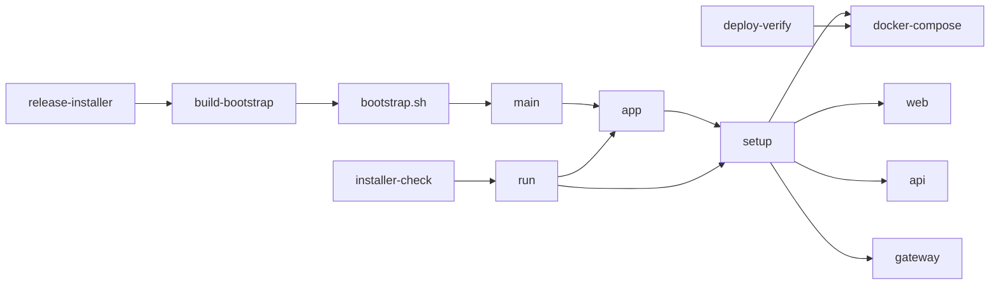
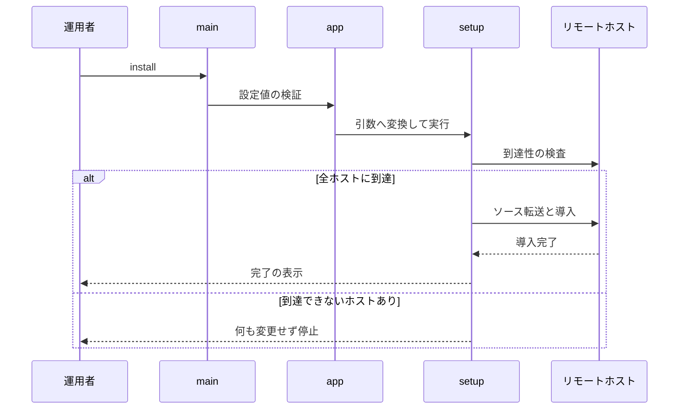

# インストーラ 設計書

## 1. 構成

| パス                                      | 責務                                                                         |
| ----------------------------------------- | ---------------------------------------------------------------------------- |
| `installer/setup.sh`                      | 本体インストーラ。トポロジー決定・証明書配布・ロール別導入・アンインストール |
| `installer/app.sh`                        | 設定値の検証と、設定値から本体インストーラの引数への変換                     |
| `installer/main.sh`                       | 共通部分。設定の読み書き・導入メタ情報・常設コマンドの提供                   |
| `installer/bootstrap.sh.tmpl`             | 頒布するスクリプトのひな形。ソースの取得と共通部分の呼び出し                 |
| `installer/build-bootstrap.sh`            | ひな形へ参照・コミット・取得元URLを埋め込み、頒布用スクリプトを出力する      |
| `installer/tests/run.sh`                  | root権限とネットワークを要さない自動検査                                     |
| `docker-compose.yml`                      | サービスを定義しない起点ファイル。composeのプロジェクト基準を固定する        |
| `compose/web.yml`                         | Webサーバのロール定義                                                        |
| `compose/api.yml`                         | APIサーバのロール定義                                                        |
| `compose/gateway.yml`                     | ゲートウェイ（ネットワークコンテナ）のロール定義                             |
| `.github/workflows/installer-check.yml`   | 構文・静的解析・自動検査のCI                                                 |
| `.github/workflows/release-installer.yml` | 頒布用スクリプトの生成と公開のCI                                             |
| `scripts/deploy-verify.sh`                | 作業ツリーを検証サーバへ転送して再ビルド・再起動する                         |

## 2. 関係図・ワークフロー

呼び出しと参照の依存方向を示す。



導入の流れと、到達性検査の失敗による分岐を示す。



## 3. 設計項目

### D-1: 引数と設定値 (FR-2, FR-3, NFR-4)

| 引数                        | 意味                                                                                   |
| --------------------------- | -------------------------------------------------------------------------------------- |
| `--providers <ID>,...`      | 有効にするベンダー。省略時は、`profile.json` と `compose.yml` を持つ全バンドル         |
| `--web-port <番号>`         | Web UIの公開ポート。優先順は引数、`.env` の既存値、既定443                             |
| `--lan-iface <名前>`        | LAN側インターフェース名。優先順は引数、`.env` の既存値、デフォルトゲートウェイの逆引き |
| `--redetect-lan-iface`      | 保存済みのLAN側インターフェース名を捨てて再検出する                                    |
| `--api` `--web` `--gateway` | ロールの配置先                                                                         |
| `--rotate-pairing`          | 証明書一式を再生成して再配布する                                                       |
| `--no-start`                | 起動をしない                                                                           |
| `--uninstall` `--keep-data` | アンインストール。`--keep-data` は `--uninstall` との併用だけを許す                    |

```text
設定キー  PROVIDERS WEB_PORT LAN_IFACE WEB_HOST API_HOST GATEWAY_HOST   # 値が空のキーは引数へ変換しない
検査      ベンダーID: ^[a-z][a-z0-9]*$ かつ 32文字以内、バンドルに profile.json と compose.yml がある
          ポート: 整数かつ 1〜65535
          全値: 文字種は [A-Za-z0-9.,:_-] のみ（シェルへの混入を防ぐ）
違反時    何も変更せずに停止する
```

### D-2: 処理の順序と冪等性 (FR-1, FR-4, NFR-1, NFR-3)

| 順  | 工程                       | 内容                                                                                                     |
| --- | -------------------------- | -------------------------------------------------------------------------------------------------------- |
| 0   | トポロジー決定・到達性検査 | ロールの配置先を決め、記録と照合し、全リモートホストへの到達性を検査する                                 |
| 1   | 証明書の生成と配布         | 実行ホストで生成し、各ロールの配置先へ配布する                                                           |
| 2   | 事前検査                   | root、Debian系（`ID`・`ID_LIKE`）、systemd、CPU（amd64・arm64・armhf）                                   |
| 3   | 依存の導入                 | `ca-certificates curl gnupg git iproute2 nftables`。Dockerは `docker compose version` が動けば何もしない |
| 4   | ホスト設定                 | ゲートウェイのロールだけ。IPフォワーディング・起動ガード・再起動の依頼受付                               |
| 5   | `.env` の更新              | 配置したロールに応じて、composeの合成と環境変数を書く                                                    |
| 6   | ベンダーのホスト側手順     | ゲートウェイのロールだけ。有効なベンダーのバンドルが持つ手順を実行する                                   |
| 7   | 起動                       | `docker compose up -d --build --remove-orphans`                                                          |
| 8   | 起動確認                   | Webのロールだけ。3秒間隔で最大180秒、`/api/v1/operator` の応答を待つ                                     |

- 無効にしたベンダーのランナーは `--remove-orphans` で停止・削除される。ベンダーのログイン情報のボリュームは残る。
- `.env` の更新は、対象キーの行だけを置き換え、他の行を保持する。同じ値での更新は内容を変えない。
- Dockerを新規に導入するとき、`/etc/docker/daemon.json` が無ければ `{"ip-forward-no-drop": true}` を先に作る。Docker 28以降はIPフォワーディングを有効化する際にFORWARDの既定ポリシーを遮断へ変えるため、nftablesの専用テーブルによる転送制御（フェイルオープン）が効かなくなるからである。既存の `daemon.json` は上書きしない。
- `--no-start` を指定すると、起動と起動確認を行わない。

### D-3: ホストへの変更 (FR-9)

| 変更先                                                   | 内容                                                                                                         | 作成するロール |
| -------------------------------------------------------- | ------------------------------------------------------------------------------------------------------------ | -------------- |
| `/etc/sysctl.d/99-vpngwgui.conf`                         | `ip_forward=1` と、`all`・`default`・LAN側IFの `send_redirects=0`。このファイルだけを `sysctl -p` で反映する | ゲートウェイ   |
| `/etc/systemd/system/vpngwgui-boot-guard.service`        | 起動直後に、LAN発の転送を遮断する専用テーブルを載せる                                                        | ゲートウェイ   |
| `/var/lib/vpngwgui-host-ctl`                             | 再起動の依頼ファイルの置き場。所有者10001、権限0700                                                          | ゲートウェイ   |
| `/etc/systemd/system/vpngwgui-reboot.path` と `.service` | 依頼ファイルを検知し、削除してから `systemctl reboot` を実行する                                             | ゲートウェイ   |
| `/etc/vpngwgui/pki`                                      | 証明書と秘密鍵。所有者10001、権限700                                                                         | 全ロール       |
| `/etc/apt/keyrings/docker.asc` ほか                      | Dockerの公式リポジトリの設定                                                                                 | 全ロール       |

- 起動ガードのユニットは `Before=network-pre.target docker.service`、`After=nftables.service` を持つ。起動時に既存ルールを消去する `nftables.service` が有効な環境でも、その後に適用される。
- 起動ガードの専用テーブルは、proxyが最初に受け取る設定で、全撤去と再構成（原子的置換）により置き換わる。
- 再起動の依頼ファイルは削除を先に行う。再起動後に依頼が残って再起動を繰り返さないためである。

### D-4: ロールの配置とトポロジー (FR-5, FR-7)

```text
単一ホスト    --api --web --gateway を全て省略    -> 3ロールをローカルへ配置
分離          1つでも指定                          -> 指定したロールだけ指定ホスト、他はローカル
導入の順      gateway -> api -> web                # web の起動確認が api の応答に依存するため
SSH           実行ユーザー（sudo なら $SUDO_USER）と同じユーザー名の鍵認証。ユーザー名・鍵・ポートの引数は無い
記録          .env に TOPOLOGY_WEB_HOST / TOPOLOGY_API_HOST / TOPOLOGY_GATEWAY_HOST / TOPOLOGY_RECORDED=1
再実行        指定（省略を含む）が記録と異なる -> 何も変更せず停止。変更はアンインストール後に再導入
```

- SSHとSCPは `StrictHostKeyChecking=no` と `BatchMode=yes` で実行し、ホスト鍵の確認プロンプトを出さず鍵認証のみとする。新規構築環境で `known_hosts` が空でも1回で完了させる割り切りであり、能動的な中間者攻撃への耐性は持たない。
- 同じホストへ複数のロールを指定した場合は、そのホストを1回だけ処理する。

### D-5: 到達性の検査とリモート導入 (FR-6)

| 段階           | 内容                                                                                                              |
| -------------- | ----------------------------------------------------------------------------------------------------------------- |
| 到達性の検査   | 全リモートホストへ `ssh <host> true` を実行する。1台でも失敗したら、どのホストにも変更を加えず停止する            |
| ソース転送     | `git archive HEAD` を `ssh` 経由で `/opt/vpngwgui` へ展開する。リモートにDocker・Node.jsの事前導入を要求しない    |
| 実行           | `sudo sh installer/setup.sh --only-roles <roles> ...` を実行する。`--only-roles` は内部専用で、利用者は指定しない |
| 引数の転送     | `--providers` はゲートウェイとAPIのホストへ、`--web-port` はWebのホストへ、指定時だけ転送する                     |
| 接続先の上書き | APIのホストへ `--gateway-host`、Webのホストへ `--api-origin https://<API>:3000` を渡す                            |

- 完了の表示は、全ロールの配置先、Web UIのURL、有効なベンダー、次の操作をまとめて出す。Web UIのポートは、Webの配置先で確定した値をsshで読み取って示す。

### D-6: 証明書の生成と配布 (FR-8, NFR-2)

| 経路              | 認証      | 生成物                                                                                     |
| ----------------- | --------- | ------------------------------------------------------------------------------------------ |
| ブラウザとWeb     | 片方向TLS | `web-server.crt` `web-server.key`（自己署名。SANはWebの配置先）                            |
| WebとAPI          | 片方向TLS | `api-ca.crt`、`api-server.crt` `api-server.key`（SANはAPIの配置先と `api`）                |
| APIとゲートウェイ | 相互TLS   | `gateway-ca.crt`、`proxy-server.crt` `proxy-server.key`、`api-client.crt` `api-client.key` |

```text
生成先      mktemp -d の作業用ディレクトリ（実行ホストのローカル）
削除        CA秘密鍵・署名要求・拡張ファイル・シリアルを生成後に削除する。配布するのは *.crt と *.key のみ
所有者      sudo 経由では作業用ディレクトリを $SUDO_USER へ chown する（scp を非特権で実行するため）
配置先      /etc/vpngwgui/pki  所有者 10001:10001、ディレクトリ 700、*.key 600、*.crt 644
リモート    scp で一時ディレクトリへ置き、sudo sh -c の中で移動・chown・chmod する
再実行      トポロジーが記録済みなら再生成しない。--rotate-pairing で全て再生成する
有効期間    3650日。失効と自動更新は提供しない
```

### D-7: composeの合成と環境変数 (FR-1, FR-5)

| `.env` のキー   | 書くロール        | 内容                                                                                                    |
| --------------- | ----------------- | ------------------------------------------------------------------------------------------------------- |
| `COMPOSE_FILE`  | 全ロール          | `docker-compose.yml` を先頭に、配置したロールのファイルと、有効なベンダーの `compose.yml` を `:` で連結 |
| `VPN_PROVIDERS` | API・ゲートウェイ | 有効なベンダーID（カンマ区切り）。APIは同じ値でプロファイルを読み込む                                   |
| `LAN_IFACE`     | ゲートウェイ      | LAN側インターフェース名                                                                                 |
| `WEB_PORT`      | Web               | 公開ポート。コンテナ内は8080で固定                                                                      |
| `API_ORIGIN`    | Web               | リバースプロキシ先。分離時だけ `https://<APIの配置先>:3000`                                             |
| `GATEWAY_HOST`  | API               | ゲートウェイの接続先。分離時だけ上書きし、既定は `host.docker.internal`                                 |
| `TOPOLOGY_*`    | 実行ホスト        | ロールごとの配置先の記録                                                                                |

- `docker-compose.yml` はサービスを持たない起点ファイルで、常に `COMPOSE_FILE` の先頭に置く。composeの相対パスの基準がリポジトリ直下に固定され、ベンダーバンドルの相対パスと両立する。`include:` は採用しない。
- APIのポート（既定3000）は、単一ホストでも常に公開する。分離構成でWebが別ホストから到達できるようにするためである。

### D-8: ベンダー固有のホスト手順 (FR-12)

| ファイル                         | 契約                                                                                |
| -------------------------------- | ----------------------------------------------------------------------------------- |
| `vendors/<ID>/install-host.sh`   | 存在するときだけ、rootの `sh` で実行する。冪等で非対話。非ゼロ終了は導入の中止      |
| `vendors/<ID>/uninstall-host.sh` | 存在するときだけ、アンインストールで実行する。非ゼロ終了でも後始末を続ける          |
| 実行時の環境                     | カレントディレクトリはバンドル。環境変数 `VPNGW_ROOT`（取得先）と `VPNGW_VENDOR_ID` |

- 共通のインストーラは、手順の中身を知らず、ベンダー名による分岐を持たない。Dockerのように全ベンダーに共通のものだけが共通側にある。
- アンインストールは、有効・無効を問わず全バンドルの `uninstall-host.sh` を対象にする。`.env` が古い、または無い場合があるためである。

### D-9: アンインストール (FR-10)

| 工程 | 内容                                                                                                              |
| ---- | ----------------------------------------------------------------------------------------------------------------- |
| 1    | `docker compose down --remove-orphans`。既定では `--volumes` も付け、ログイン情報も削除する。`--keep-data` で保持 |
| 2    | 起動ガードのユニットを `disable --now` して削除する                                                               |
| 3    | 再起動の依頼受付のユニットと依頼用ディレクトリを撤去する                                                          |
| 4    | `/etc/sysctl.d/99-vpngwgui.conf` を削除し、稼働中の `ip_forward` を0へ戻す                                        |
| 5    | `/etc/vpngwgui/pki` を撤去する                                                                                    |
| 6    | 全バンドルの `uninstall-host.sh` を実行する                                                                       |

- `--api` `--web` `--gateway` とは併用できない。後始末の範囲は、実行ホストの `.env` に記録されたトポロジーから決める。
- オーケストレーターで実行すると、記録済みの各ロールを後始末する。リモートのロールには同じ工程に加えて取得先ディレクトリの削除を `ssh` で送る。一部のホストで失敗しても他のホストの後始末を続け、最後に成否を一覧する。
- 記録の無いホストで実行すると、警告して自ホストのロールだけを後始末する。他のホストへは接続しない。
- 取得先ディレクトリの削除は、頒布された `uninstall` サブコマンドが行う。Docker本体・依存パッケージ・Dockerの公式リポジトリ設定は、他の用途と共有されうるため対象外とする。

### D-10: 頒布 (FR-11)

```text
GitHub Release（タグ）/ CIのartifact（ブランチ）
  install.sh  ... REF・COMMIT・REPO_URL が埋め込まれたブートストラップ
    -> git 導入 -> COMMIT を /opt/vpngwgui へ取得（取得後の HEAD が COMMIT と一致することを確認）
    -> installer/main.sh（共通部分）-> installer/app.sh -> installer/setup.sh
```

| 項目         | 内容                                                                                                                                                |
| ------------ | --------------------------------------------------------------------------------------------------------------------------------------------------- |
| 生成         | `sh installer/build-bootstrap.sh <REF> <COMMIT> <REPO_URL>`。REFは `refs/heads/` か `refs/tags/`、COMMITは40桁の16進、URLは `https://` か `file://` |
| 失敗時       | 引数が不正、またはひな形に置換漏れがあれば、何も出力せず終了コード1                                                                                 |
| トリガー     | ブランチへのpush、`v*` タグのpush、手動実行                                                                                                         |
| ブランチ     | `install.sh` と `install.sh.sha256` を artifact `installer-<ブランチ名>` として保存する                                                             |
| タグ         | 同じ2つをGitHub Releaseへ添付する。最新版と版固定のURLを提供する                                                                                    |
| 設定の保存先 | 取得先 `/opt/vpngwgui`、設定 `/etc/vpngwgui/vpngwgui.env`、メタ情報 `/var/lib/vpngwgui-installer/state`、常設コマンド `vpngwgui-ctl`                |
| 共通部分     | `installer/main.sh` と `installer/bootstrap.sh.tmpl` は共通プラグインの成果物で、このリポジトリでは編集しない                                       |

- `curl | sh` は、取得元（GitHub ReleaseのHTTPS）を信頼する方式である。取得するコミットを固定してSHAを照合するため、スクリプトとソースの食い違いは検出できる。`install.sh.sha256` で、保存して検証してから実行することもできる。

### D-11: 自動検査 (NFR-5)

| 検査の範囲                                             | 方法                                                                           |
| ------------------------------------------------------ | ------------------------------------------------------------------------------ |
| `app.sh` と `setup.sh` の構文                          | `sh -n`                                                                        |
| 設定値から引数への変換、空キーの省略、危険な文字の拒否 | `app.sh` の関数を設定ファイルを変えて実行                                      |
| 引数の解釈、ポート・ベンダー決定の優先順               | 偽のリポジトリを作り、`VPNGW_INSTALL_LIB=1` で関数だけを読み込んで実行         |
| 実際の導入・ホスト設定・起動                           | root権限とネットワークが要るため自動検査の対象外。クリーンな環境で実機検証する |

- CIは `sh -n`、`shellcheck`、`npm test` を実行する。

## 4. エラー処理

| 事象                                         | 処理                                           |
| -------------------------------------------- | ---------------------------------------------- |
| root権限でない・対象外のOS・CPU・systemd無し | 理由を示して停止する                           |
| 不正な引数・設定値                           | 何も変更せずに停止する                         |
| 記録済みと異なるトポロジー                   | 記録内容を示し、何も変更せずに停止する         |
| リモートホストへ到達できない                 | どのホストにも変更を加えず停止する             |
| ベンダーのホスト側手順の失敗                 | 起動の前に導入を中止する                       |
| Web UIが180秒以内に応答しない                | 失敗として停止し、ログの確認方法を示す         |
| アンインストールで一部のホストが失敗         | 他のホストの後始末を続け、最後に成否を一覧する |
