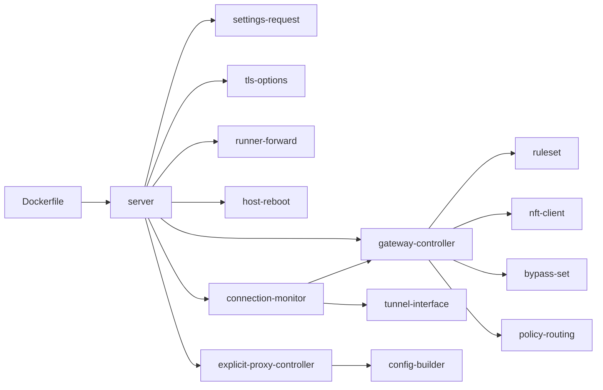
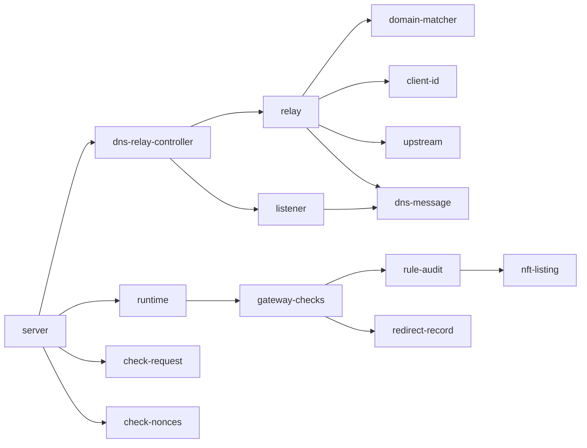
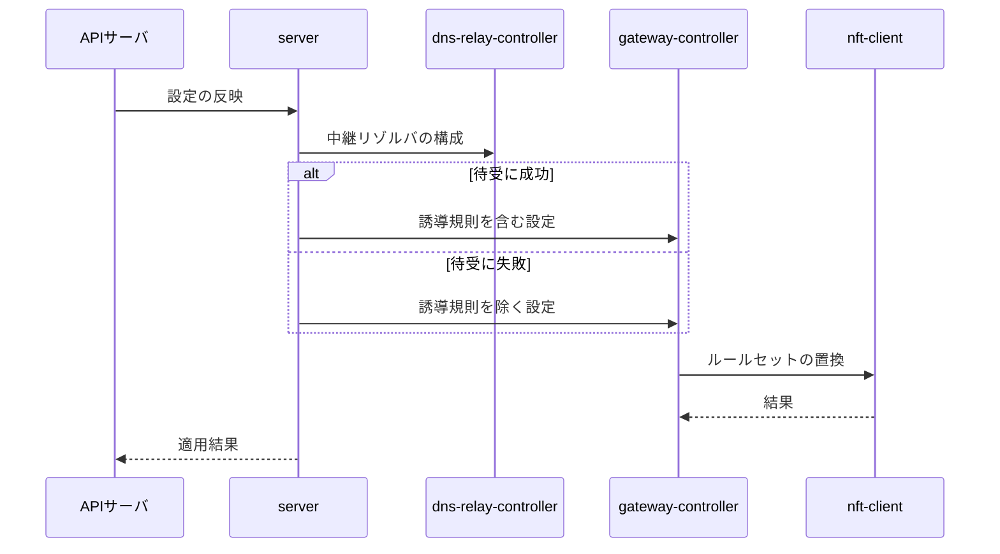
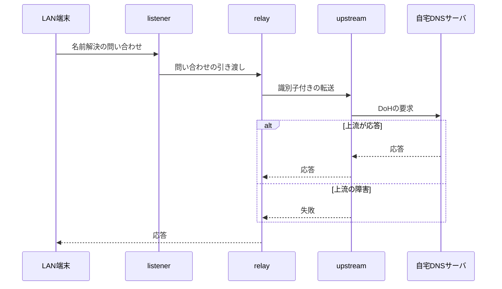

# ネットワークコンテナ 設計書

## 1. 構成

| パス                                                    | 責務                                                         |
| ------------------------------------------------------- | ------------------------------------------------------------ |
| `proxy/src/server.ts`                                   | 制御チャネルの受信口。経路の振り分けと各コントローラの起動   |
| `proxy/src/settings-request.ts`                         | 設定反映の要求の形状検証と、各コントローラ向けの設定への変換 |
| `proxy/src/gateway-channel/tls-options.ts`              | 制御チャネルの相互TLSの設定                                  |
| `proxy/src/gateway-channel/runner-forward.ts`           | ランナー宛の要求の転送                                       |
| `proxy/src/host-control/host-reboot.ts`                 | ホストの再起動の依頼ファイルの作成                           |
| `proxy/src/network/ruleset.ts`                          | nftablesのルールセットの組み立て                             |
| `proxy/src/network/gateway-controller.ts`               | 設定と接続状態に応じたルールの再構成の調停                   |
| `proxy/src/network/tunnel-interface.ts`                 | 経路の問い合わせによるトンネルのインターフェース検出         |
| `proxy/src/network/connection-monitor.ts`               | 接続状態の定期監視                                           |
| `proxy/src/network/nft-client.ts`                       | nftコマンドの実行                                            |
| `proxy/src/network/bypass-set.ts`                       | 迂回対象のIPアドレスと期限の保持                             |
| `proxy/src/network/policy-routing.ts`                   | 迂回用の経路規則の維持                                       |
| `proxy/src/explicit-proxy/config-builder.ts`            | 明示的プロキシの設定ファイルの組み立て                       |
| `proxy/src/explicit-proxy/explicit-proxy-controller.ts` | 明示的プロキシの起動・停止・再起動の調停                     |
| `proxy/src/dns-relay/domain-matcher.ts`                 | 迂回ドメインの照合                                           |
| `proxy/src/dns-relay/client-id.ts`                      | 上流へ渡すクライアント識別子の生成                           |
| `proxy/src/dns-relay/relay.ts`                          | 問い合わせの照合・転送・応答                                 |
| `proxy/src/dns-relay/upstream.ts`                       | 上流へのDoH転送と公開DNSへの転送                             |
| `proxy/src/dns-relay/listener.ts`                       | UDPとTCPの待受                                               |
| `proxy/src/dns-relay/dns-relay-controller.ts`           | 中継リゾルバの起動・停止・再構成の調停                       |
| `proxy/src/dns-relay/dns-message.ts`                    | DNSメッセージの解析と組み立て                                |
| `proxy/src/verification/gateway-checks.ts`              | 設定の動作検証の項目の実行                                   |
| `proxy/src/verification/rule-audit.ts`                  | 設定とルール一覧の照合                                       |
| `proxy/src/verification/nft-listing.ts`                 | nftの出力のルール単位への分解                                |
| `proxy/src/verification/check-nonces.ts`                | 検証用の名前の登録と受信の記録                               |
| `proxy/src/verification/redirect-record.ts`             | 誘導の直後かどうかの判定                                     |
| `proxy/src/verification/runtime.ts`                     | 検証の実行環境の組み立て                                     |
| `proxy/src/verification/check-request.ts`               | 検証の要求の形状検証                                         |
| `proxy/Dockerfile`                                      | ネットワークコンテナのイメージ                               |

## 2. 関係図・ワークフロー

ルール構成と制御チャネルまわりの依存方向を示す。



DNS中継と動作検証まわりの依存方向を示す。



設定の反映から、中継リゾルバの待受状態による分岐までを示す。



クライアントの問い合わせから応答までの流れと、上流の障害による分岐を示す。



## 3. 設計項目

### D-1: コンテナの権限と受け口 (NFR-6)

| 設定           | 値                                                                         | 理由                                                       |
| -------------- | -------------------------------------------------------------------------- | ---------------------------------------------------------- |
| `network_mode` | `host`                                                                     | LANから入る転送を、ベンダーCLIのトンネルまで直接届ける     |
| `cap_add`      | `NET_ADMIN`                                                                | nftablesと経路の操作。これ以外の権限と特権モードは使わない |
| 実行ユーザー   | UID 10001                                                                  | nftは `sudo nft -f -` で実行する                           |
| 受け口         | 制御チャネル（TCP `GATEWAY_PORT` 既定8443）と、ランナーとのUDS用ボリューム | ランナーとは同一ホストの共有ボリュームのUDSで通信する      |
| 特権ポート     | nodeバイナリへ `setcap cap_net_bind_service=+ep`                           | 非rootで53番を待ち受ける                                   |

- イメージにベンダーCLIを含めない。3proxyは公式リリースのソースを専用ビルドステージで構築し、バイナリ1つだけを実行イメージへ渡す。
- `docker compose` は `network_mode: host` と `networks` を併用できないため、このコンテナはAPIコンテナと同じブリッジに参加しない。

### D-2: 透過ゲートウェイのルールセット (FR-1, FR-2, NFR-1)

専用テーブル `inet vpngwgui` を使い、ホスト上の既存ルールと衝突させない。

| チェーン    | 条件                         | 規則                                                                                     |
| ----------- | ---------------------------- | ---------------------------------------------------------------------------------------- |
| postrouting | 常に                         | トンネルへ出る通信をマスカレード                                                         |
| forward     | 常に                         | `policy accept`。Docker公開ポート宛のDNAT済み通信を許可し、LAN以外へ向かう応答方向を許可 |
| forward     | VPN接続中                    | LANからトンネルへ許可、トンネルからLANへは確立済みのみ許可、トンネルからの新規接続は遮断 |
| forward     | Kill Switch無効かつVPN未接続 | LANから実回線への通信を許可（フェイルオープン）                                          |
| forward     | 常に末尾                     | LAN発の通信を遮断（Kill Switchの基礎）                                                   |

```text
nft -f - の1回の呼び出しで、先頭を  add table / delete table / add table  の順にして全体を置換する
```

- `policy accept` とし、遮断を末尾のLAN発の規則だけに限る。`policy drop` にすると、同居するコンテナのインターネット向け通信まで遮断される。
- 撤去と適用を別の呼び出しにすると、その間だけ規則が存在せずLAN機器の通信が漏れる。1回の置換で防ぐ。
- インターフェース名と埋め込む値は、規則へ入れる前に形式を検証し、不正なら適用を諦める。
- IPv6は転送も遮断もしない。LAN側ルータのRAを止めるか、端末のIPv6を無効にする運用で対処する。

### D-3: トンネルの検出と接続状態への追従 (FR-3, NFR-2)

| 項目       | 内容                                                                                                                              |
| ---------- | --------------------------------------------------------------------------------------------------------------------------------- |
| 検出       | `ip route get 1.1.1.1` の出力インターフェースを使う。LAN側と異なれば接続中、同じなら未接続                                        |
| 理由       | ベンダーのCLIはデフォルト経路を置換する型と、ポリシールーティングで別表へ誘導する型があり、実際の経路選択結果だけが両方に対応する |
| 契機       | APIサーバからの接続状態の再確認の通知と、10秒周期の監視                                                                           |
| 通知の応答 | `POST /net/connection-checks` は `200 {"checked": true}`。失敗しても200（`false`）とし、監視が追従する                            |
| 再構成     | インターフェース名が変わったときだけルールを置換する                                                                              |

### D-4: 起動時と設定の再通知 (FR-12)

| 場面             | 挙動                                                                         |
| ---------------- | ---------------------------------------------------------------------------- |
| コンテナの起動   | 既存のルールを撤去しない。最初の設定の受信まで、前回のルールが遮断を維持する |
| 最初の設定の受信 | 全撤去と再適用を原子的に行い、前回の異常終了の残骸も置き換える               |
| 同じ設定の再通知 | 前回の適用が成功していれば、ルールに触れない。失敗していれば再試行する       |
| ホストの起動直後 | 起動ガードの専用テーブルが、LAN発の転送を遮断する                            |
| 稼働状況の取得   | メモリ上の状態だけから導出する。取得のたびにnftやipを実行しない              |

- 稼働状況の `state` は `active`（適用中）、`stopped`（無効）、`unconfigured`（有効だがLAN側インターフェース未設定）、`error`（直近の適用が失敗、または再構成の完了前）。

### D-5: 明示的プロキシ (FR-4, NFR-7)

```text
auth iponly
allow * <CIDR>,<CIDR>...
deny *
socks -p1080
proxy -p3128
```

| 項目         | 内容                                                                                                                 |
| ------------ | -------------------------------------------------------------------------------------------------------------------- |
| 製品         | 3proxy（SOCKS5とHTTP CONNECTを1つで提供）。ポートは `EXPLICIT_SOCKS_PORT`（1080）と `EXPLICIT_HTTP_PORT`（3128）     |
| 認証         | 送信元IPだけ。許可元以外は `deny *`。CIDRは `a.b.c.d/n` の厳密な形式のみで、改行を含む値による設定行の注入を拒否する |
| 許可元が空   | 起動せず `unconfigured` とする                                                                                       |
| 設定ファイル | 一時ファイルへ書いてからrenameする                                                                                   |
| 設定変更     | SIGTERMを送り、終了を待ってから起動する（SIGKILLへの切替は10秒後）。最大約5秒応答しない                              |
| 異常終了     | 1秒、2秒、4秒と延ばし上限60秒で再起動。連続3回で `crashLoop`。30秒生き続ければ安定とみなして戻す                     |
| VPNの切替    | 3proxyは再起動しない。OSの経路に従って発信する                                                                       |
| 既知の制約   | Kill Switchの対象外。VPN未接続の間は実回線から直接送出する                                                           |

状態は `active`、`stopped`、`unconfigured`、`crashLoop`、`error` の5つで、異常は稼働状況の取得で利用者へ届く。接続ログは有効にしない。

### D-6: DNS中継リゾルバ (FR-6, NFR-4, NFR-5)

| 項目       | 内容                                                                                                                                      |
| ---------- | ----------------------------------------------------------------------------------------------------------------------------------------- |
| 待受       | LAN側IPv4と `127.0.0.1` のUDPとTCP。ポートは `DNS_RELAY_PORT`（53）。衝突時は `error` とし、10秒周期の再通知で再試行する                  |
| 処理       | 迂回リストと照合、上流へ転送、成功応答のAレコードを迂回setへ反映してから、応答をクライアントへ返す。応答は改変しない                      |
| 反映の順序 | setへの反映後に応答する。先に返すと、直後の最初の接続だけがVPN経由になる                                                                  |
| 照合       | `example.com` は自身だけ。`*.example.com` は全サブドメイン（複数階層）で自身を含まない。大文字小文字は区別せず末尾のドットは無視する      |
| 上流       | `<dnsUpstreamUrl>/<ClientID>` へDoH（`application/dns-message` のPOST）。システムのCAに加え、指定のCAで検証する                           |
| 障害       | 接続失敗・5秒の打ち切り・5xxのとき、`failClosed` はSERVFAIL、`fallback` は公開DNSへUDP（失敗時TCP）。NXDOMAINやブロック応答は障害にしない |
| 秘匿       | ドメイン名とクライアントはログに記録しない。履歴は自宅DNSサーバが持つ                                                                     |

クライアント識別子（ClientID）の規則を示す。

| 条件                             | ClientID                                                                                 |
| -------------------------------- | ---------------------------------------------------------------------------------------- |
| 既定                             | IPのドットをハイフンにした値（`192-168-3-25`。ドットは上流が異常応答を返すため使わない） |
| 名前の取得先に逆引きで名前がある | その名前を小文字化し、英数字以外の連続をハイフン1つにして63文字以内にした値              |
| ゲートウェイ自身（`127.0.0.1`）  | `explicit-proxy`                                                                         |
| 検証用の送信元（`127.0.0.2`）    | `vpngw-selfcheck`                                                                        |

- 名前の逆引きは、取得先へ平文で問い合わせる。待ち時間は1サーバ800ミリ秒、全体1秒までで、超えたらIPで進める。結果は名前ありを10分、なしを2分保持する。
- 中継リゾルバの停止や障害は、Kill Switch、転送、明示的プロキシの名前解決以外の動作に影響しない。待受に失敗している間は、名前解決を中継へ向ける設定（53番の誘導、3proxyの名前解決先）を入れない。

### D-7: ドメイン迂回の経路制御 (FR-5, NFR-3)

| 要素                          | 内容                                                                                                          |
| ----------------------------- | ------------------------------------------------------------------------------------------------------------- |
| set `bypass4`                 | `ipv4_addr` で期限付き。要素の期限は応答の保持時間に60秒を加える（保持時間が0なら60秒）。再応答で更新する     |
| チェーン `bypass_mark`        | LAN発で宛先がsetにある通信へ `0x100` の印を付ける（preroutingの `mangle` 優先度）                             |
| チェーン `bypass_mark_output` | 明示的プロキシのUIDの発信で宛先がsetにあるものへ印を付ける（`type route`）                                    |
| forward                       | 印付きのLAN発を、Kill Switchの遮断より前に許可する                                                            |
| postrouting                   | 印付きで実回線へ出る通信をマスカレードする。ホスト自身の発信は、送信元がVPN側のまま出て応答が戻らないため必要 |
| `ip rule`                     | `fwmark 0x100 lookup 100`（優先度100）。表100に、LAN側IFのデフォルトゲートウェイへのdefault経路を置く         |

- 再構成のたびに、保持中の要素を新しいテーブルへ同時に入れる。
- ゲートウェイは `ip -4 route show default dev <LAN側IF>` で検出し、検出できない間は直近の値を使う。
- 判定はIPアドレス単位のため、迂回対象と同じIPを共有する他のドメインの通信も迂回される。
- 単一NICでは、ICMPリダイレクトの送出を無効にする（インストーラが設定する）。クライアントが直接送って透過ゲートウェイを迂回するのを防ぐ。

### D-8: 53番リダイレクト (FR-7)

| 項目 | 内容                                                                                            |
| ---- | ----------------------------------------------------------------------------------------------- |
| 規則 | nat preroutingで、LAN発のUDP・TCPの宛先ポート53を、中継リゾルバの待受アドレスとポートへDNATする |
| 除外 | 宛先がゲートウェイ自身と、利用者が指定した除外CIDRに含まれるもの                                |
| 既定 | 無効。無効のとき、ゲートウェイをDNSサーバとして受け取った端末の問い合わせだけが中継される       |
| 制約 | 暗号化DNS（DoH・DoT）は対象にできない                                                           |

### D-9: 制御チャネル (FR-8)

| 経路                                        | 処理                                                                 |
| ------------------------------------------- | -------------------------------------------------------------------- |
| `POST /net/settings`                        | 設定の反映。`200 {"applied": boolean}`                               |
| `GET /net/status`                           | 稼働状況（透過ゲートウェイ・明示的プロキシ・DNS中継・LANのCIDR）     |
| `POST /net/connection-checks`               | 接続状態の即時の再確認                                               |
| `POST /net/checks` ほか `/net/check-nonces` | 設定の動作検証                                                       |
| `POST /net/host-reboot`                     | ホストの再起動の依頼                                                 |
| `/runners/<ベンダーID>/*`                   | 対応する `runner-<ベンダーID>.sock` へ転送。ソケットが無ければ `502` |

```text
https.createServer({ ca: gateway-ca, cert: proxy-server, key, requestCert: true, rejectUnauthorized: true })
```

- 検証に失敗した接続は確立しない。証明書ファイルが読めなければ起動時に例外で終了する。
- ベンダーIDは `[a-z0-9-]+` に限り、ソケットのディレクトリの外を指させない。
- ゲートウェイ機のファイアウォールで、`GATEWAY_PORT` への到達元をAPIサーバへ絞ることを推奨する。
- 設定反映の要求は、真偽値と文字列配列の形状だけをここで検証し、不正は400にする。個々のCIDRは設定ファイルの生成時に検証する。

### D-10: 設定の反映先 (FR-1, FR-4, FR-5, FR-6)

| 設定項目                                           | 反映先                                                   |
| -------------------------------------------------- | -------------------------------------------------------- |
| `killSwitch`                                       | 末尾の遮断とフェイルオープンの許可規則                   |
| `transparentGatewayEnabled`                        | テーブルの適用と撤去                                     |
| `excludedDomains`                                  | 中継リゾルバの迂回リスト                                 |
| `dnsRelayEnabled` ほか `dns` で始まる項目          | 中継リゾルバの起動・停止・上流・障害時の挙動・53番の誘導 |
| `explicitProxyEnabled` `explicitProxyAllowedCidrs` | 3proxyの起動・停止・許可元                               |

- 中継リゾルバを先に構成する。53番の誘導先と3proxyの名前解決先が、待受を前提とするためである。
- 明示的プロキシは、透過ゲートウェイの再構成とは独立して調停する。
- 3proxyの名前解決先は、中継リゾルバが待受中のときだけ `127.0.0.1` へ向ける。

### D-11: 設定の動作検証 (FR-9, FR-10)

| エンドポイント                 | 内容                                                                                                           |
| ------------------------------ | -------------------------------------------------------------------------------------------------------------- |
| `POST /net/checks`             | 1項目を実行し `{id, status, expected?, observed?, hint?, reason?, value?}` を返す。実行中に別の依頼が来れば409 |
| `POST /net/check-nonces`       | 使い捨ての名前をメモリ上に登録する                                                                             |
| `GET /net/check-nonces/<名前>` | `{received, redirected, recentRedirectedClients}`。未登録と期限切れは404                                       |

| 層  | 方法                                                                                                                                                 |
| --- | ---------------------------------------------------------------------------------------------------------------------------------------------------- |
| L1  | `nft list table` をルール単位へ分解し、チェーン・インターフェース・動作・set名の特徴で設定と照合する。あわせて `ip_forward` と待受を確認する         |
| L2  | トンネルへ束縛した `curl` で出口IPを取得する。中継リゾルバへ送信元 `127.0.0.2` で問い合わせる。経路は `ip -4 route get <IP> [mark 0x100]` で確かめる |

- 各操作の上限は、curl 8秒、中継への問い合わせ 8秒、nft 5秒、TCP接続 2秒。設定と状態は変更しない。
- 前提が崩れて判定できない項目は `unconfirmed` とし、実行中の例外も理由を付けて `unconfirmed` にする。
- set `redirected4`（`flags dynamic,timeout; timeout 10m`）へ、53番の誘導の前に `update @redirected4 { ip saddr timeout 10m }` を置く。要素の残り時間が `10分 − 5秒` 以上なら直前に誘導されたと判定する。
- 登録済みの名前は、上流へ転送せずNXDOMAINで応答し、登録名・受信時刻・誘導の有無だけを60秒保持する。送信元のIPと名前は保持しない。

### D-12: ホストの再起動依頼 (FR-11)

| 項目 | 内容                                                                                                                                         |
| ---- | -------------------------------------------------------------------------------------------------------------------------------------------- |
| 依頼 | 依頼用ディレクトリ（コンテナ内 `/var/run/vpngw-host-ctl`、環境変数 `HOST_CTL_DIR`）へ `reboot-request` を排他的に作成する                    |
| 応答 | 作成に成功すると `202 {"requested": true}`、既に残っていれば `409`、置き場が無い・書けないときは `503 {"error": "host_control_unavailable"}` |
| 実行 | ホスト側のsystemdのpathユニットが依頼ファイルを検知し、削除してから再起動する。ファイルの内容は読まない                                      |
| 監査 | `host_reboot_requested` を記録する                                                                                                           |

## 4. エラー処理

| 事象                             | 処理                                                                 |
| -------------------------------- | -------------------------------------------------------------------- |
| 設定の形状不正                   | 400。ルールは変更しない                                              |
| nftの適用に失敗                  | 状態を `error` とし、次の再通知で再試行する                          |
| LAN側インターフェースが未設定    | 透過ゲートウェイを構成せず撤去だけを行い、`unconfigured` を報告する  |
| 中継リゾルバの待受に失敗         | `error` とし、名前解決を中継へ向ける設定を入れず、再通知で再試行する |
| 3proxyのバイナリが無い・異常終了 | 異常終了として数え、再起動を試み続ける                               |
| ランナーのソケットが無い         | 502                                                                  |
| 無効なクライアント証明書         | 接続を確立しない                                                     |
| 検証の実行中の例外               | `unconfirmed` とし、理由に例外の内容を載せる                         |
