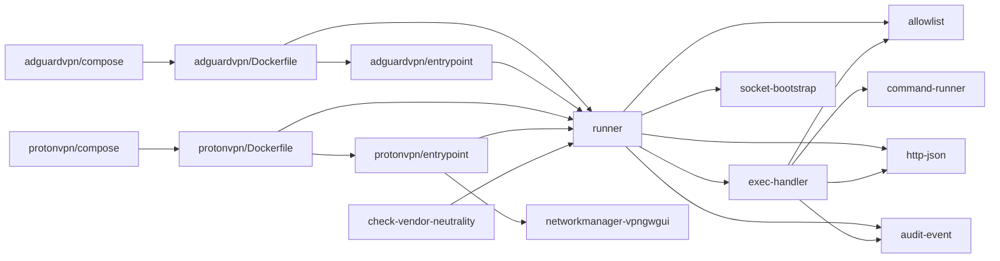
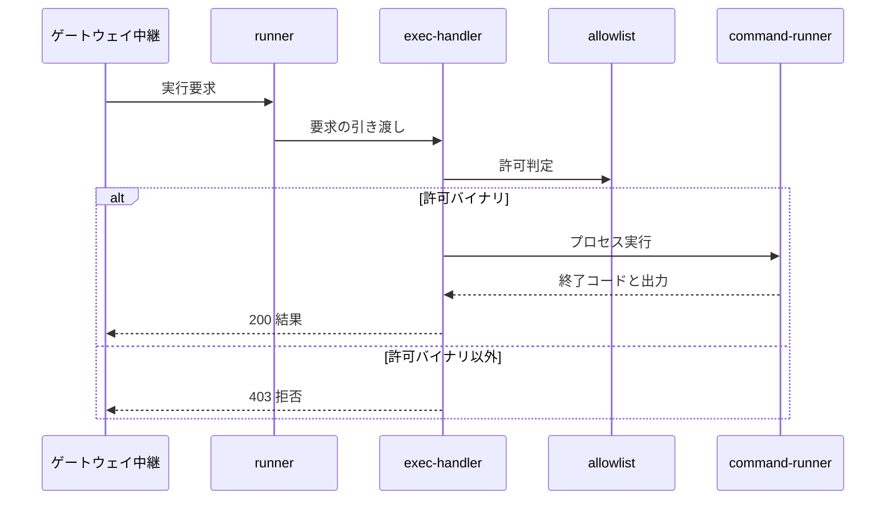

# ランナー 設計書

## 1. 構成

| パス                                             | 責務                                                                       |
| ------------------------------------------------ | -------------------------------------------------------------------------- |
| `proxy/src/runner.ts`                            | ランナーの起点。Unixドメインソケットで待ち受け、稼働確認と実行を振り分ける |
| `proxy/src/allowlist.ts`                         | 許可バイナリの照合                                                         |
| `proxy/src/exec/exec-handler.ts`                 | 実行要求の形状検証・許可判定・応答                                         |
| `proxy/src/exec/command-runner.ts`               | シェルを介さないプロセス実行と完了判定                                     |
| `proxy/src/lib/http-json.ts`                     | 要求本文の読み取りとJSON応答                                               |
| `proxy/src/lib/socket-bootstrap.ts`              | 残存ソケットの除去・待ち受け・権限制限                                     |
| `proxy/src/lib/audit-event.ts`                   | 監査ログの構造化出力                                                       |
| `vendors/adguardvpn/Dockerfile`                  | 単体バイナリ型CLIのランナーイメージ                                        |
| `vendors/adguardvpn/compose.yml`                 | 単体バイナリ型CLIのランナー定義とボリューム                                |
| `vendors/adguardvpn/entrypoint.sh`               | 識別子ファイルの復元とランナー本体の起動                                   |
| `vendors/protonvpn/Dockerfile`                   | 常駐サービス依存型CLIのランナーイメージ                                    |
| `vendors/protonvpn/compose.yml`                  | 常駐サービス依存型CLIのランナー定義とボリューム                            |
| `vendors/protonvpn/entrypoint.sh`                | 常駐サービス群の起動と権限降格                                             |
| `vendors/protonvpn/networkmanager-vpngwgui.conf` | ネットワーク管理サービスの管理対象を絞る設定テンプレート                   |
| `scripts/check-vendor-neutrality.mjs`            | 本番コードのベンダー固有語の検出                                           |

## 2. 関係図・ワークフロー

呼び出しとビルドの依存方向を示す。



実行要求を受けてから応答するまでの流れと、許可判定による分岐を示す。



## 3. 設計項目

### D-1: 受け口と稼働確認 (FR-5, FR-9, NFR-4)

| 項目          | 内容                                                                                     |
| ------------- | ---------------------------------------------------------------------------------------- |
| 待受          | 環境変数 `CTL_SOCKET_PATH` のUnixドメインソケットだけ。TCPは開かない                     |
| 権限          | 起動時に残存ソケットを削除し、待受後に `chmod 0770`。所有者は実行ユーザー（UID 10001）   |
| 受付の開始    | エントリポイントが実行環境を整えてから本体を起動する。ソケットが無い間は利用不可とみなす |
| `GET /health` | `200 {"ok": true, "binary": "<許可バイナリ>"}`。CLIを起動せず副作用を持たない            |
| `POST /exec`  | 実行要求。形状と許可の判定後に実行する                                                   |
| その他        | `404 {"error": "not_found"}`                                                             |

### D-2: 許可バイナリの照合 (FR-1)

```text
RUNNER_ALLOWED_BINARY=/usr/local/bin/<CLI>   # ビルド時にENVで焼き込む。composeでは上書きしない

isAllowedBinary(binary):
  allowed = env.RUNNER_ALLOWED_BINARY
  allowed が未設定、または "/" で始まらない  -> false   # 許可先が決まらない構成では何も実行しない
  return binary == allowed                              # 完全一致のみ
```

- 環境変数は呼び出しごとに読む。ランナーは自ベンダーのバイナリ1つだけを許可するため、別ベンダーのバイナリや任意のコマンドは実行できない。
- 許可リストは、管理者向け設定とユーザ向け設定から独立した、イメージ内の防御である。APIサーバが誤動作しても、任意コマンド実行の踏み台にならない。
- 検証用のモックベンダーだけが、composeでモックCLIの絶対パスを与える。

### D-3: 実行要求の検証と応答 (FR-1, NFR-1)

```json
{
  "vendor": "<ベンダーID>",
  "binary": "/usr/local/bin/<CLI>",
  "resolvedArgv": ["connect", "-l", "Tokyo"],
  "timeoutMs": 30000,
  "completionPattern": "<正規表現。省略可>",
  "stdin": "<文字列。省略可。4096バイト以下>"
}
```

| 条件                                                                                                | 応答                                                                     |
| --------------------------------------------------------------------------------------------------- | ------------------------------------------------------------------------ |
| 本文がJSONでない                                                                                    | `400 {"error": "invalid_json"}`                                          |
| 形状不正（空の `vendor`・`binary`、非文字列の引数、`timeoutMs` が正でない、`stdin` が4096バイト超） | `400 {"error": "invalid_request_shape"}`                                 |
| `binary` が許可バイナリでない                                                                       | `403 {"error": "binary_not_allowed"}`                                    |
| 実行できた（非ゼロ終了・時間超過を含む）                                                            | `200 {"exitCode", "stdout", "stderr"}`。呼び出し元が422・504へ振り分ける |
| 予期しない例外                                                                                      | `500 {"error": "internal_error"}`                                        |

### D-4: シェルを介さない実行と完了判定 (FR-2, FR-3, NFR-3)

| 指定                     | 実行関数               | 完了の判定                                                                                   |
| ------------------------ | ---------------------- | -------------------------------------------------------------------------------------------- |
| `completionPattern` なし | `runCommand`           | 子プロセス自身の `exit` イベント。`timeoutMs` 超過で強制終了し `exitCode: -1`                |
| `completionPattern` あり | `runDetachableCommand` | 標準出力の累積が正規表現に一致した時点で、プロセスを終了させず応答する。`exitCode` は `null` |

```text
spawn(binary, argv, { stdio: ["pipe", "pipe", "pipe"] })   # シェルを使わない。引数のメタ文字は解釈されない
child.on("exit") で完了                                    # execFile の close 待ちは使わない
```

- 子プロセスが孫プロセス（常駐デーモン）を生み、孫が出力のパイプを保持し続けると、パイプが閉じるのを待つ方式は応答が返らない。親プロセスの `exit` だけを待つ。
- 終了イベントの直後は、標準出力・標準エラーの未読分を取りこぼさないよう、50ミリ秒の猶予を置く。
- パターン一致で応答した後も、認証完了まで数分かかるプロセスはバックグラウンドで実行を続ける。一致せずに自然終了すれば、実際の終了コードで応答する。

### D-5: 標準入力と秘密情報 (FR-4, NFR-1)

| 対象                 | 扱い                                                                                     |
| -------------------- | ---------------------------------------------------------------------------------------- |
| 子プロセスの標準入力 | `stdin` 指定時は書き込んで閉じる。未指定なら即座に閉じ、読み取りは即EOFとなる            |
| 書き込みの `EPIPE`   | 無視する。結果は終了コードと出力で判明する                                               |
| 監査ログ             | `argv` と `exitCode` のみ記録する。`stdin` は `stdinProvided: true` で有無だけを記録する |
| 標準出力・標準エラー | ログに記録せず、応答にだけ含める                                                         |
| 上限                 | 4096バイトを超える `stdin` は形状不正として拒否する                                      |

### D-6: 権限と名前空間 (FR-7, FR-8, NFR-2)

| 設定           | 値             | 理由                                                                                                                |
| -------------- | -------------- | ------------------------------------------------------------------------------------------------------------------- |
| `network_mode` | `host`         | CLIのトンネルをゲートウェイホストの名前空間に作らせる                                                               |
| `cap_add`      | `NET_ADMIN`    | トンネルと経路の操作                                                                                                |
| `devices`      | `/dev/net/tun` | TUN型トンネルの確立（単体バイナリ型CLIのランナー）                                                                  |
| `init`         | `true`         | CLIが生む孫プロセスを回収する                                                                                       |
| 特権モード     | 指定しない     | 必要な権限だけを個別に付与する                                                                                      |
| 実行ユーザー   | UID 10001      | ランナー本体とCLIは非root。常駐サービスを起こすランナーだけ、エントリポイントがrootで起動して本体を非rootへ降格する |

CLI独自のKill Switchは設定せず無効のままとする。遮断はネットワークコンテナのnftablesだけが担い、二重の遮断規則による競合と切断後の通信不能を避ける。

### D-7: ログイン情報の永続化 (FR-6)

| ベンダー型         | ボリューム（保存先）                                                                                  |
| ------------------ | ----------------------------------------------------------------------------------------------------- |
| 単体バイナリ型     | `adguard-data` → CLIの認証情報ディレクトリ                                                            |
| 常駐サービス依存型 | `proton-config` → 設定と識別子、`proton-keyrings` → Secret Serviceの実体、`proton-cache` → サーバ一覧 |

- ボリューム名は固定し、ベンダーを切り替えても他のベンダーの情報を消さない。
- 機械識別子 `/etc/machine-id` は、コンテナを作り直すたびに変わるとログインが失効するため、エントリポイントが永続領域に保存した値から復元する。

### D-8: ベンダーバンドル (FR-10)

| ファイル          | 必須 | 内容                                                                  |
| ----------------- | ---- | --------------------------------------------------------------------- |
| `profile.json`    | ○    | 操作プロファイル。`vendor` がディレクトリ名と一致する                 |
| `compose.yml`     | ○    | サービス名 `runner-<ID>`・ソケット `runner-<ID>.sock`・固有ボリューム |
| `Dockerfile`      | ○    | CLIの導入と `RUNNER_ALLOWED_BINARY` の焼き込み                        |
| `entrypoint.sh`   | 任意 | ベンダー固有の起動処理                                                |
| `install-host.sh` | 任意 | ホストへの導入を要するCLIだけが置く手順                               |
| `samples.json`    | 推奨 | 実CLIの出力例と期待値。全ベンダーに同じテストを流す                   |

- 識別子は `^[a-z][a-z0-9]{0,31}$`。ビルドの基準はリポジトリルート（`context: .`、`dockerfile: vendors/<ID>/Dockerfile`）。`profiles` は使わない。
- 有効にしたベンダーの `compose.yml` だけが環境変数 `COMPOSE_FILE` に並ぶため、無効なベンダーは起動もビルドもされない。

### D-9: 常駐サービス依存型CLIの実行環境 (FR-11)

| 依存                          | コンテナ内での用意                                                                         |
| ----------------------------- | ------------------------------------------------------------------------------------------ |
| システムD-Bus・NetworkManager | rootで起動。管理対象は WireGuard・dummy・上り側NIC（`LAN_IFACE`）だけで、他は `unmanaged`  |
| Secret Service                | セッションバスで `gnome-keyring-daemon` を起動。乱数パスワードを永続領域へ保存して解錠する |
| ログインセッション            | ユーザ限定の接続プロファイルを有効化できるよう、`/run/systemd/users/<uid>` を偽装して置く  |

```text
unmanaged-devices=*,except:type:wireguard,except:type:dummy,except:interface-name:<LAN_IFACE>
wireguard.mtu=1360          # 経路MTU1454の回線でもハンドシェイク後のTLSが通る値
```

- 上り側NICはNetworkManagerの起動時から管理対象にする。起動後に切り替えるとIPアドレスが外れる。
- 上り側NICがブリッジまたはボンディングのときだけ、ゲートウェイ向けdefault経路をmetric 50で常時持つ。CLIが経路を足す対象は ethernet と Wi-Fi に限られるため、サーバ到達確認が通らなくなる。
- 起動時に、前回のコンテナが残したトンネルとdummyのインターフェースを削除する。
- 常駐サービスの postinst が systemd なしで失敗するため、導入中だけ `systemctl` をスタブへ退避する。
- 常駐サービスのいずれかが終了したらエントリポイントも終了し、`restart: always` で再起動する。

### D-10: 中立性の検査 (FR-12, NFR-5)

| 項目         | 内容                                                                                                                    |
| ------------ | ----------------------------------------------------------------------------------------------------------------------- |
| 検査対象     | 各アプリケーションの本番コード・インストーラ・composeの共通部・共通のDockerfile。テスト・生成物・依存物・バンドルは除く |
| 禁止語の出所 | 各バンドルの `profile.json` の `vendor`・`displayName`・`binary` のファイル名、および既知のベンダー名の一覧ファイル     |
| 判定         | 大文字小文字を区別せず、コメントも対象にする。1件でも見つかれば終了コード1                                              |
| 実行         | リポジトリ直下の `npm test` に含める                                                                                    |

## 4. エラー処理

| 事象                             | 処理                                                                               |
| -------------------------------- | ---------------------------------------------------------------------------------- |
| `CTL_SOCKET_PATH` が未設定       | 起動時に例外で終了する                                                             |
| 許可バイナリが未設定・相対パス   | 全ての実行要求を拒否する                                                           |
| プロセスの起動失敗               | 非ゼロの終了コードと標準エラーを応答に載せる                                       |
| 完了パターン不一致でタイムアウト | プロセスを強制終了し、終了コード-1で応答する                                       |
| 実行環境の準備に失敗             | エントリポイントが終了し、再起動で再試行する。準備中はソケットが無く利用不可になる |
