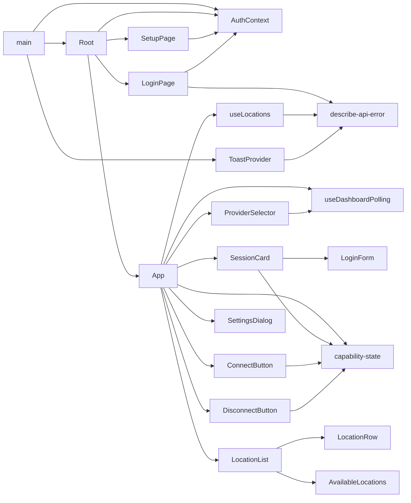
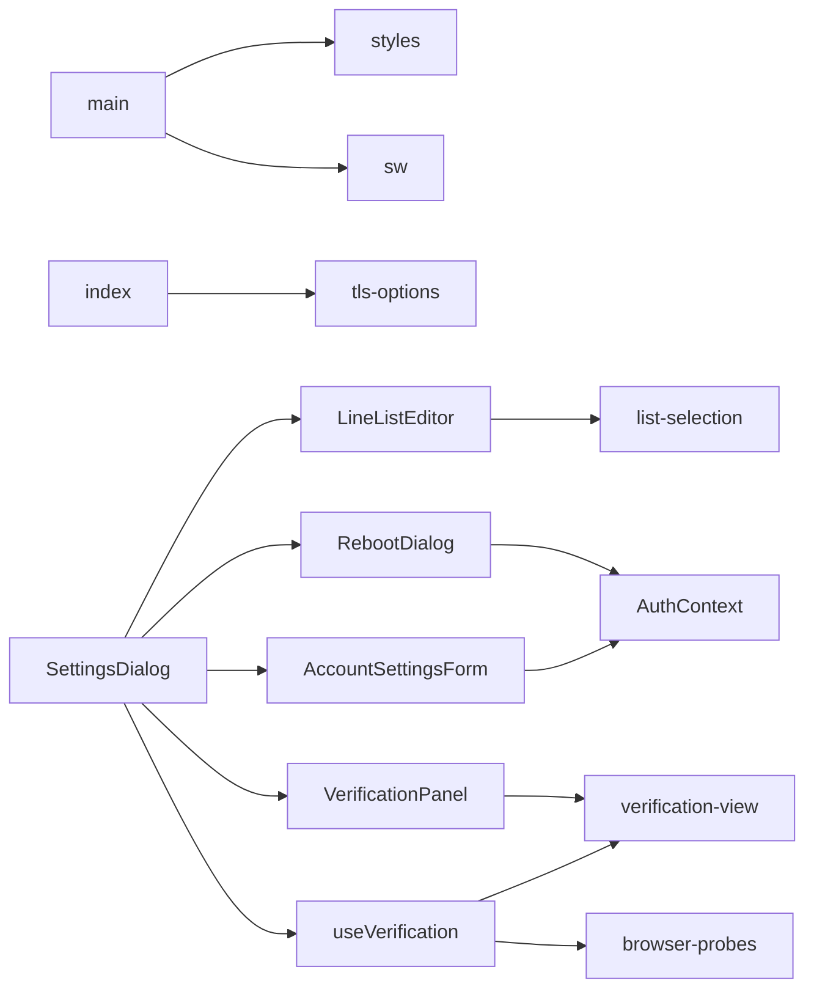
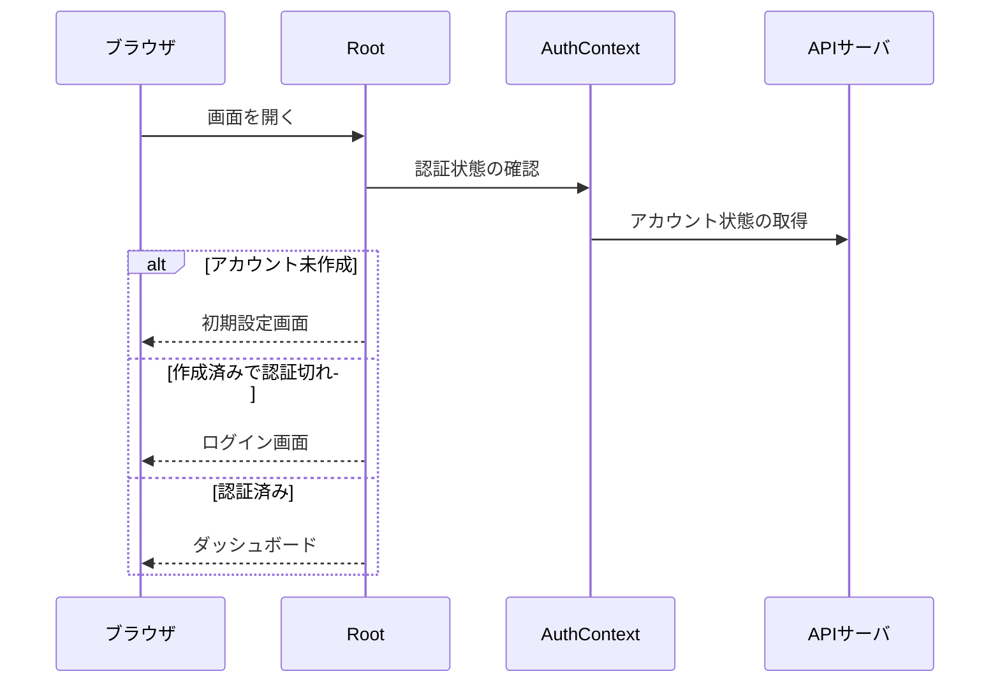
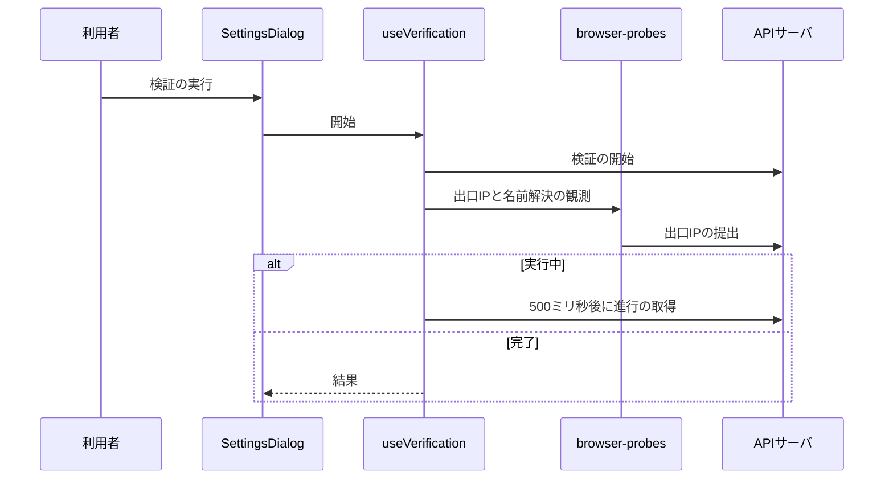

# Webサーバ 設計書

## 1. 構成

| パス                                                              | 責務                                                      |
| ----------------------------------------------------------------- | --------------------------------------------------------- |
| `web/server/index.ts`                                             | 画面の配信と、APIサーバへの転送                           |
| `web/server/tls-options.ts`                                       | 待受のサーバ証明書と、APIサーバを検証する認証局の読み込み |
| `web/src/main.tsx`                                                | 起点。各プロバイダの組み立てとService Workerの登録        |
| `web/src/Root.tsx`                                                | 認証状態による画面の出し分け                              |
| `web/src/App.tsx`                                                 | ダッシュボードの組み立て                                  |
| `web/src/contexts/AuthContext.tsx`                                | 認証状態の保持                                            |
| `web/src/components/auth/SetupPage.tsx`                           | 初期設定画面                                              |
| `web/src/components/auth/LoginPage.tsx`                           | ログイン画面                                              |
| `web/src/components/dashboard/ProviderSelector.tsx`               | ベンダーの選択と切替                                      |
| `web/src/components/dashboard/SessionCard.tsx`                    | ベンダーへのログイン・ログアウトとアカウント状態          |
| `web/src/components/dashboard/LoginForm.tsx`                      | 資格情報入力型のログインフォーム                          |
| `web/src/components/dashboard/ConnectButton.tsx`                  | 接続ボタン                                                |
| `web/src/components/dashboard/DisconnectButton.tsx`               | 切断ボタン                                                |
| `web/src/components/dashboard/LocationList.tsx`                   | 接続先リスト                                              |
| `web/src/components/dashboard/LocationRow.tsx`                    | 接続先の1行                                               |
| `web/src/components/dashboard/AvailableLocations.tsx`             | 参考の国・都市の一覧                                      |
| `web/src/components/dashboard/SettingsDialog.tsx`                 | 設定ダイアログ                                            |
| `web/src/components/dashboard/LineListEditor.tsx`                 | 行リストエディタ                                          |
| `web/src/components/dashboard/RebootDialog.tsx`                   | ゲートウェイ機の再起動ダイアログ                          |
| `web/src/components/dashboard/AccountSettingsForm.tsx`            | アカウント情報の変更フォーム                              |
| `web/src/components/dashboard/verification/VerificationPanel.tsx` | 動作検証の表示                                            |
| `web/src/components/dashboard/verification/verification-view.ts`  | 動作検証の表示規則                                        |
| `web/src/components/dashboard/verification/browser-probes.ts`     | ブラウザ側の観測                                          |
| `web/src/hooks/useDashboardPolling.ts`                            | 状態の定期取得                                            |
| `web/src/hooks/useLocations.ts`                                   | 接続先リストの取得とお気に入りの操作                      |
| `web/src/hooks/useVerification.ts`                                | 動作検証の開始と進行の取得                                |
| `web/src/capabilities/capability-state.ts`                        | 実行可否の参照                                            |
| `web/src/lib/list-selection.ts`                                   | 行リストの選択・追加・削除・並べ替えの純粋関数            |
| `web/src/notifications/ToastProvider.tsx`                         | 通知の表示                                                |
| `web/src/notifications/describe-api-error.ts`                     | APIのエラーの要約                                         |
| `web/src/styles.css`                                              | 配色・レイアウト・入力欄・レスポンシブ                    |
| `web/public/sw.js`                                                | Service Worker                                            |

## 2. 関係図・ワークフロー

画面の組み立てと依存方向を示す。

設定ダイアログ・動作検証・配信まわりの依存方向を示す。

起動時の認証状態による画面の出し分けを示す。

動作検証の開始から結果の表示までの流れと、完了による分岐を示す。

## 3. 設計項目

### D-1: 配信とリバースプロキシ (FR-1)

| 項目         | 内容                                                                                                                        |
| ------------ | --------------------------------------------------------------------------------------------------------------------------- |
| 待受         | HTTPS。サーバ証明書は `WEB_TLS_CERT_FILE` と `WEB_TLS_KEY_FILE`（既定は `$GATEWAY_PKI_DIR/web-server.*`）。コンテナ内は8080 |
| 転送         | `/api/*` を `API_ORIGIN`（既定 `https://api:3000`）へ、接頭辞 `/api` を除いて転送する。`@fastify/http-proxy` を使う         |
| 証明書の検証 | 上流の接続に `undici.connect.ca` として `API_TLS_CA_FILE`（既定 `api-ca.crt`）を渡す。検証を無効にするオプションは使わない  |
| Cookie       | 転送がそのまま渡す。Webサーバは中身を解釈しない。同一オリジンのためCORSの設定は要らない                                     |
| 静的配信     | `dist` を配信し、`/api` 以外で一致しないGETは `index.html` に戻す（クライアント側のルーティング）                           |
| 分離配置     | `API_ORIGIN` を任意ホストのHTTPS URLにするだけで、ブラウザからは常に単一オリジンに見える                                    |

- 画面はSPA（Vite + React）とする。状態を持つ操作画面が中心で、静的生成に向かないためである。
- APIの呼び出しは、OpenAPIから `orval` で生成したクライアントだけを使う。

### D-2: 認証の画面 (FR-2)

| 画面・操作   | 内容                                                                                                                                |
| ------------ | ----------------------------------------------------------------------------------------------------------------------------------- |
| 起動時       | `GET /v1/operator` の `configured` で分岐する。作成済みなら `GET /v1/operator/session` を呼び、401ならログイン画面を表示する        |
| 初期設定画面 | ユーザー名、パスワード、確認用のパスワード。成功でそのままダッシュボードへ進む。409（他の利用者が先に作成）はログイン画面へ         |
| ログイン画面 | ユーザー名とパスワード。401は「ユーザー名またはパスワードが正しくありません」、429は専用の文言を表示する                            |
| 認証切れ     | どのAPI呼び出しが401を返しても、その場でログイン画面へ切り替え、実行中の操作はエラーとして通知する                                  |
| ログアウト   | ヘッダのボタンから `DELETE /v1/operator/session` を呼び、ログイン画面へ戻る                                                         |
| 状態の保持   | 認証状態（未設定・未ログイン・ログイン済みとユーザー名）をReactのコンテキストで持つ。トークンは保持しない（Cookieはブラウザが管理） |

- 認証のフォームはパスワードマネージャが扱える作りにする。`autocomplete` は `username`・`current-password`・`new-password` を使う。
- パスワードの入力欄を持つダイアログは非モーダル（`show()`）で開く。モーダルは拡張機能の候補をトップレイヤーの背後に隠す。閉じている間はフォームを描画せず、開いたときにDOMへ追加する。

### D-3: 状態の取得と表示 (FR-3, NFR-1)

| 取得                                                     | 契機                                                                                                               |
| -------------------------------------------------------- | ------------------------------------------------------------------------------------------------------------------ |
| 接続状態・稼働状況・ベンダー一覧・実行可否・ログイン状態 | 画面の表示中に5秒間隔で並行して取得する。各部分が独立に成否を持つ                                                  |
| 接続先リスト                                             | 画面の表示時と、「再計測」「再取得」の操作時だけ。CLIを起動して並び順が変わるため、定期取得に含めない              |
| 実行可否の取得失敗                                       | 全ての操作を可とみなす（判定できないことを理由に操作を塞がない）。初回の取得が済むまで接続先リストの取得を始めない |

- 取得に失敗した部分は、古い値を残さず取得失敗を表示する。ただし接続・切断のボタンは、最後に取得できた接続状態で操作できる。
- 接続国は、クライアントで保持せず、常に接続状態の応答（国と都市）を表示する。再読み込みや別端末でも同じ表示になる。
- 接続状態・稼働状況・接続と切断のボタンは、1枚のカードにまとめる。枠色は接続中・切断・エラーで変える。

### D-4: 実行可否に従う部品 (FR-4)

| 操作                | 部品                       | 制限時                                                       |
| ------------------- | -------------------------- | ------------------------------------------------------------ |
| `login`             | ログイン導線               | 導線ごと出さず理由を表示                                     |
| `logout`            | ログアウトボタン           | 無効化し理由を表示                                           |
| `locationList`      | 接続先リスト               | リスト全体を出さず、理由文の枠を表示する（一覧を取得しない） |
| `locationFavorites` | お気に入りボタン           | 無効化し理由を表示                                           |
| `pingMeasurement`   | 「再計測」                 | 無効化し理由を表示                                           |
| `connectToLocation` | 選択した接続先への［接続］ | 無効化し理由を表示                                           |
| `connectAuto`       | ［接続］（指定なし）       | `connectToLocation` が使えないときだけ［接続］として表示する |
| `changeLocation`    | ［接続先を変更］           | 無効化し理由を表示                                           |
| `disconnect`        | ［切断］                   | 無効化し理由を表示（通常は常に可）                           |

- 部品は画面から消さず無効にする。理由文はAPIの `message` をそのまま表示し、無効な部品から `aria-describedby` で辿れるようにする。
- ［接続］が無効になる理由は接続先リストの制限表示に出るため、ボタン側には重ねて表示せず、`aria-describedby` だけでリスト側の理由を参照させる。
- 403の `operation_restricted` は専用の文言でトースト通知し、直後に実行可否を再取得して反映する。
- Webは判定ロジックを持たない。ベンダーの名前や出力書式も持たず、名前はAPIの `displayName` を表示するだけである。

### D-5: ベンダーの選択 (FR-5)

| 項目     | 内容                                                                                                                                                    |
| -------- | ------------------------------------------------------------------------------------------------------------------------------------------------------- |
| 部品     | 複数のとき `select`（枠線・余白・フォーカスは他の入力欄と揃える）。1つだけのときは名前のみ                                                              |
| 利用不可 | 選択肢を無効にし、理由を文言に含める                                                                                                                    |
| 切替     | 切断中は即座に `PUT /v1/providers/active`。接続中は `window.confirm`（切断されること、Kill Switch有効の間は通信が遮断されること）を経て、承諾時だけ呼ぶ |
| 切替中   | ベンダーの選択、接続、ログインの操作を無効にする                                                                                                        |
| 失敗     | 選択は元のまま。409は「切替中」、422は「現在のVPNを切断できませんでした」としてトースト通知する                                                         |
| 入れ替え | 選択中のベンダーIDを `key` として接続操作の部品へ与え、IDが変わると再マウントする。接続先リストとお気に入りと選択中の接続先を捨てて取得し直す           |

- 選択はサーバが保持するため、別の端末で開いても同じベンダーが選ばれ、定期取得で他所からの切替にも追従する。
- ログイン・ログアウトの導線は、ベンダー選択のカードにまとめる。

### D-6: ベンダーへのログイン (FR-6, NFR-4)

| ログイン方式  | 導線                                                                                                                                                 |
| ------------- | ---------------------------------------------------------------------------------------------------------------------------------------------------- |
| `deviceUrl`   | 未ログイン時はプルダウンの隣に［ログイン］。押下で認証URLを表示する                                                                                  |
| `credentials` | 未ログイン時はプルダウンの隣に［ログイン］。押下でプルダウンの下にフォームを展開する。2段階認証の欄は「2段階認証を設定している場合」ボタンで追加する |

- 秘密情報の欄は `type="password"` とし、送信の成否にかかわらず送信直後に値を空にする。ブラウザの記憶領域へ保存せず、トーストにも画面にも出さない。
- 送信中はフォーム全体を無効にして二重送信を防ぐ。422の標準エラーは詳細（折りたたみ）にだけ入る。
- フォームには、ユーザー名・パスワード・送信ボタンだけを同じ `form` に置く。2段階認証の欄が同じ `form` にあると、パスワードマネージャがログインフォームとして反応しない。
- ログイン済みの表示は緑のバッジでプラン名を示し、プランの補足情報があれば括弧書きで併記する。未ログインのときは何も表示しない。

### D-7: 接続先リストと接続操作 (FR-7, NFR-3)

| 項目         | 内容                                                                                                                                     |
| ------------ | ---------------------------------------------------------------------------------------------------------------------------------------- |
| 表示         | 1行が1つの接続先。国コード・国名・都市・応答時間（無ければ「-」で末尾）。並びはAPIが返した順で、Webで並べ替えない                        |
| タブ         | 「すべて」と「お気に入り」。星印でお気に入りを登録・解除する。操作は楽観的に反映し、失敗したら戻してトースト通知する                     |
| 絞り込み     | 国名・都市名・国コードの入力で表示中のタブを絞る。大文字小文字を区別せず、並びは変えない                                                 |
| 選択         | 実効選択 = 明示的に選んだもの、なければ接続中の接続先、なければ前回の接続先。「接続中」「前回」のバッジを付ける                          |
| 現在の接続先 | 接続状態の `locationId`。無いときは `location` と都市名を大文字小文字を区別せず突き合わせる                                              |
| ボタン       | 切断中は［接続］。接続中は［切断］を常に表示し、実効選択が現在と異なるときだけ［接続先を変更］を併せて表示する。確認ダイアログは設けない |
| 送信中       | 接続・変更・切断のボタンは送信中に無効になる。成功後は明示的な選択を消す                                                                 |
| 取得の失敗   | リスト領域にエラー要約と［再取得］を表示する（トーストにしない）。切断はできる                                                           |

- ［接続］と［切断］は、接続状態に応じてどちらか一方を、スクロールせず押せる位置に置く。［切断］は強調色（赤系）にする。ログイン状態の判定で切断の操作を塞がない。
- ツールバー（タブと操作ボタン）は折り返さず、画面幅を超えたら横スクロールにする。［接続先を変更］は［再計測］の左に置く。

### D-8: 参考の国・都市の一覧 (FR-8)

| 項目     | 内容                                                                                                                                                  |
| -------- | ----------------------------------------------------------------------------------------------------------------------------------------------------- |
| 条件     | `locationList` がプラン制限で使えないときだけ、理由文の枠に続けて `GET /v1/connection/available-locations` の結果を表示する。空・失敗は何も表示しない |
| 行       | 接続先リストと同じ行の見た目で、選択とお気に入りは常に無効にする。「自動接続で、次のいずれかの国のサーバに接続されます」と、選べないことを説明する    |
| 現在地   | 接続状態の `location` に参考一覧の都市名のいずれかが含まれるとき（大文字小文字を区別しない部分一致）、その国に「接続中」を付ける                      |
| 応答時間 | `pingMeasurement` の不可の理由が非対応のときだけ列を出す。値が無ければ「-」                                                                           |

- 取得はベンダーの切替とプランの変化のときだけ行い、定期取得はしない。

### D-9: 設定ダイアログ (FR-9)

| タブ            | 項目                                                                                                             |
| --------------- | ---------------------------------------------------------------------------------------------------------------- |
| 通信制御        | `killSwitch`、`excludedDomains`                                                                                  |
| ゲートウェイ    | `transparentGatewayEnabled`、`explicitProxyEnabled`、`explicitProxyAllowedCidrs`                                 |
| 上位DNSリゾルバ | `dnsRelayEnabled`、`dnsUpstreamUrl`、`dnsUpstreamCaPem`                                                          |
| DNS詳細         | `dnsFailureMode`、`dnsFallbackServers`、`dnsClientNameServers`、`dnsRedirectEnabled`、`dnsRedirectExcludedCidrs` |
| 動作検証        | 検証の実行と、`verifyEchoUrl`                                                                                    |
| メンテナンス    | ［アカウント情報を変更］、［ゲートウェイ再起動］。設定値は持たない                                               |

- ダイアログは1つの状態と1つの保存処理を持ち、タブは入力部品の表示を切り替えるだけとする。保存は全タブの内容を一括で `PUT /v1/connection/config` し、タブを切り替えても未保存の入力を失わない。
- 「DNS詳細」のタブは `dnsRelayEnabled` が有効なときだけ表示し、無効にした時点で表示中なら「上位DNSリゾルバ」へ戻す。DNS中継の項目は無効の間は編集できない。
- 保存できない入力（明示的プロキシが有効で許可元が空、DNS中継が有効で上流も切り替え先も空、切り替えるのに切り替え先が空、検証用URLが空）は、保存ボタンを無効にし、該当タブのラベル末尾に `!` を付けて理由を表示する。
- 迂回ドメインがあるのにDNS中継が無効なときは「DNS中継が無効なため、迂回ドメインは反映されません」と表示する。
- 設定の読み込みとタブの初期化は、ダイアログを開いたときだけ行う。定期取得で値が変わるたびに読み直すと、未保存の入力と検証の表示が消える。
- エラーはダイアログ内に表示する（モーダルの間はトーストを操作できないため）。ラジオボタンは独自の見た目にし、複数行入力は幅を揃えて折り返す。

### D-10: 行リストエディタ (FR-10)

| 項目       | 内容                                                                                                                                |
| ---------- | ----------------------------------------------------------------------------------------------------------------------------------- |
| 構成       | 見出し、枠で囲んだリスト、枠上端のツールバー（件数・［追加］・［削除］）。各行の先頭に並べ替え用の掴み部を置く                      |
| 選択       | 1回目のクリックで単独選択。`Ctrl`（Macは`⌘`）で追加と解除、`Shift` で範囲選択。すでに単独選択の行をもう一度クリックすると編集に入る |
| 編集       | `Enter` で確定、`Esc` で取り消す。フォーカスが外れた空欄の行は削除する                                                              |
| 追加       | 選択行のうち最も下の行の直後。選択がなければ先頭。追加した行は選択し、すぐ編集できる                                                |
| 削除       | 選択行をまとめて削除し、削除した最上行の位置（なければ直前）の行を選択する。選択がなければ押せない                                  |
| 並べ替え   | 掴み部のドラッグ。複数選択中は選択行を相対順序を保って移動する。タッチ端末でのドラッグは対象外                                      |
| キーボード | `↑` `↓` で移動、`Shift` を併用して範囲選択、`Ctrl+A` で全選択、`Enter` と `F2` で編集、`Delete` で削除                              |
| 上限・無効 | 上限のある項目は上限で［追加］を押せなくする。無効のときは全ての操作を受け付けず、背景を薄くする                                    |

- 各行は内部の安定したIDを持つ（値の重複や空文字があるため）。選択・追加位置・削除後の選択先・並べ替え後の配列は、DOMに依存しない純粋関数にまとめて単体で検証する。
- 選択は `mousedown` で確定し、編集の開始は `click` で行う。リストは `role="listbox"` と `aria-multiselectable`、行は `role="option"` と `aria-selected` を持つ。
- 保存時の変換（前後の空白の除去と空行の除外）は、設定ダイアログの保存処理が行う。

### D-11: 動作検証の画面 (FR-11, NFR-7)

| 状態   | 文字色   | アイコン                  | 文字    |
| ------ | -------- | ------------------------- | ------- |
| 待機中 | 灰色     | 中空の円                  | 待機中  |
| 実行中 | 青・太字 | 8つの点が順に光る回転表示 | 確認中… |
| 合格   | 本文色   | 緑の円にチェック          | OK      |
| 不合格 | 赤・太字 | 赤の円に×                 | NG      |
| 未確認 | 黄土色   | 中空の円に横線            | 未確認  |

- 回転表示は `prefers-reduced-motion` のときは動かさず、点の濃淡だけにする。合格の観測値は薄い文字で1行、不合格は期待値・観測値・対処を赤い背景、未確認は状況と対処を黄土色の背景で、項目の下に展開する。文言はAPIの応答の内容を表示し、判定の文言はWebに持たない。
- 項目は `config`・`gateway`・`client` の3グループの枠にまとめる。枠のヘッダ全体が開閉ボタン（`aria-expanded`）で、既定は全て閉じ、実行中のグループも自動では開かない。
- グループの状態: 実行中の項目があれば実行中、全項目が確定していれば不合格あり→NG、未確認あり→未確認、すべて合格→OK、どれも始まっていなければ待機中。
- 件数バッジは「完了数 / 項目数」を常に出し、不合格か未確認があればその件数（「NG n」「未確認 n」）を追加する。
- 閉じているときの代表行: 未実行は「未実行」、対象なしは「対象の項目はありません」、待機中は「待機中（n項目）」、実行中は実行中の項目、不合格ありは最初の不合格、未確認ありは最初の未確認、全て合格は「すべてOK（n/n）」。
- 対象外の項目は「対象外の項目（n件）」の折りたたみにまとめ、理由を添える。
- ブラウザ側の観測は、開始の応答の直後に、利用者の操作なしで行う。出口IPは `client-egress` が対象のときだけ、`verifyEchoUrl` へ8秒でfetchして `PUT .../client-observations/egress-ip` で提出し、失敗は `{ip: null}` にする。検証用の名前は `fetch("https://<名前>/", {mode: "no-cors", cache: "no-store"})` で解決だけを起こす（失敗が正常）。
- 開始後は500ミリ秒間隔で進行を取得し、完了まで表示する。ダイアログを閉じると状態を破棄する。409はタブ内のエラー表示（`role="alert"`）で示す。

### D-12: メンテナンス (FR-12)

| 操作                 | 内容                                                                                                                                                     |
| -------------------- | -------------------------------------------------------------------------------------------------------------------------------------------------------- |
| アカウント情報の変更 | 先頭にユーザー名、現在のパスワード、新しいパスワードの欄を置く。別のダイアログで開き、現在のパスワードを必須にする。401はダイアログ内に表示する          |
| ゲートウェイ再起動   | 警告文、パスワード入力、［再起動］［キャンセル］。`POST /v1/gateway/reboot` を呼ぶ。誤りと失敗はダイアログ内に示し、成功したら受付と通信が止まる旨を示す |

- 両ダイアログは、設定ダイアログの入れ子にならない兄弟要素とする。設定ダイアログは、これらが開いている間だけ表示を閉じる（状態は保持する）。
- パスワード欄のラベルに「確認」「再入力」を含めない（確認欄と判定されるため）。ユーザー名の欄を可視で置き、非表示の欄は使わない。
- パスワードは閉じるまで保持しない。

### D-13: エラーの通知 (NFR-6)

| 事象                               | 通知                                                                                           |
| ---------------------------------- | ---------------------------------------------------------------------------------------------- |
| 操作（接続・切断・ログイン）の失敗 | トースト。400・422・502・504を要約へ変換し、標準エラーの生の出力は詳細の折りたたみにだけ入れる |
| トーストの寿命                     | エラーは利用者が閉じるまで残す                                                                 |
| ダイアログ内の失敗                 | ダイアログ内にインライン表示する（モーダルの間はトーストを閉じられない）                       |
| 接続先リストの取得失敗             | リスト領域に表示する                                                                           |
| プラン制限（403）                  | 専用の文言でトーストし、実行可否を再取得する                                                   |

- PCの幅ではトーストを画面右上に、幅420ピクセル以下では下部に、セーフエリアを避けて幅を画面に収めて表示する。

### D-14: レイアウトとホーム画面への追加 (NFR-2, NFR-5, NFR-8)

| 項目                     | 内容                                                                                                                                            |
| ------------------------ | ----------------------------------------------------------------------------------------------------------------------------------------------- |
| 入力欄                   | `input` `select` `textarea` は文字サイズ `1rem` 以上、枠線は専用の変数（ボタンの枠線と同じ薄さ）、余白 `8px 10px`。フォーカス時にズームさせない |
| ヘッダ                   | 画面幅600ピクセル以下では、タイトルを非表示にして操作ボタンだけを右寄せで表示する                                                               |
| 縦幅                     | ページ全体はスクロールさせず（`100dvh` 固定）、接続先リストの内部だけがスクロールする。表示する行があるときだけリストが残りの高さへ広がる       |
| 余白                     | 左右の余白は `clamp(10px, (100vw − 569px) / 2, 16px)` で連続的に決める。ダイアログも同じ                                                        |
| 横スクロールする列       | ヘッダのボタン列・タブ列・接続先のツールバーは折り返さず、画面幅を超えたら列だけが横スクロールする。標準のバーは使わず自前のバーを描く          |
| ボタン                   | 文字を折り返さず大きさを保ち、並びきらないときはボタンごと次の行へ折り返す（上記の横スクロールする列を除く）                                    |
| ダイアログの縦スクロール | バーを表示せず、ホイールとスワイプで行う                                                                                                        |
| フッタ                   | GitHubのページへのリンクを、ロゴとともに控えめに表示する                                                                                        |

| 資材           | 内容                                                                                                       |
| -------------- | ---------------------------------------------------------------------------------------------------------- |
| マニフェスト   | `display: standalone`、名前、テーマ色、アイコン（192・512・マスカブル512・Apple用）                        |
| Service Worker | `/api/*` はキャッシュしない。画面の静的な殻は、キャッシュ優先で裏で更新する。`window` の `load` で登録する |
| 制約           | 登録はセキュアコンテキスト（HTTPS）でだけ有効になる。配信はHTTPSで行う                                     |

## 4. エラー処理

| 事象                     | 処理                                                       |
| ------------------------ | ---------------------------------------------------------- |
| 証明書ファイルが読めない | 起動時に例外で終了する（検証の省略へフォールバックしない） |
| APIサーバへ到達できない  | 502を返す                                                  |
| 認証切れ（401）          | ログイン画面へ切り替える                                   |
| 一部の取得の失敗         | その部分だけ取得失敗を表示し、他は表示を続ける             |
| 実行可否の取得の失敗     | 制限をかけない                                             |
| 検証の取得・提出の失敗   | 提出の失敗は出口IPなしで提出し、該当の項目を未確認にする   |
